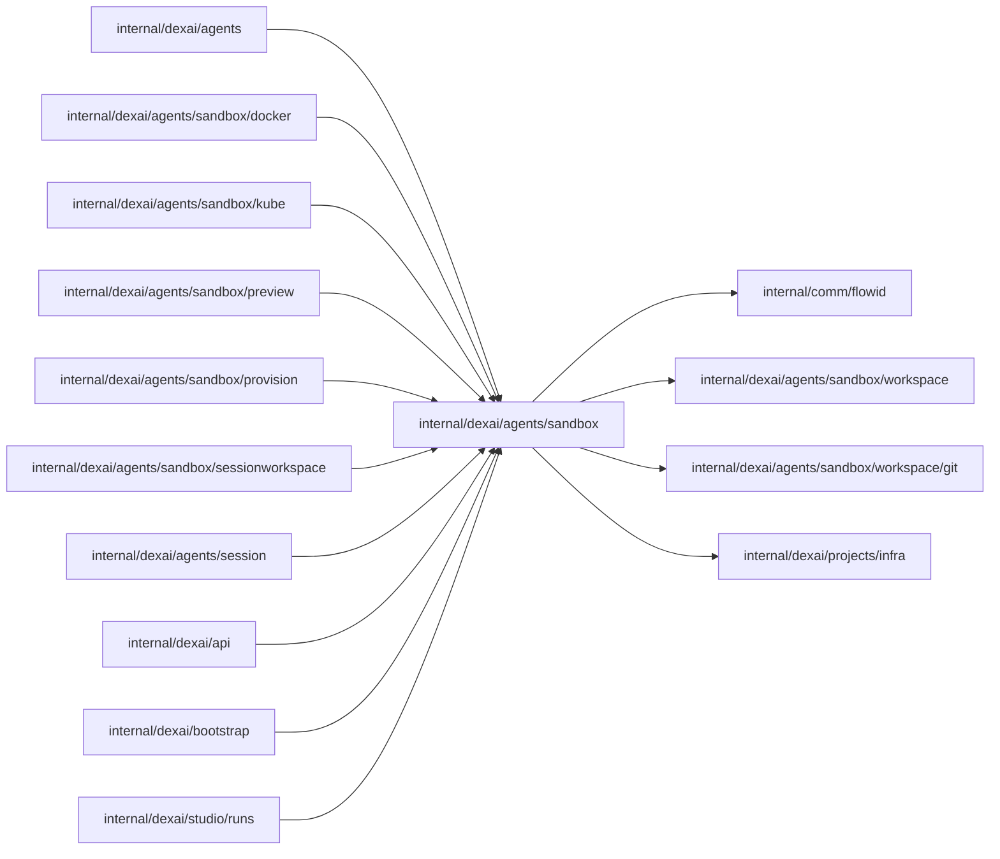

# Sandbox instances

<!-- BEGIN GENERATED PACKAGE SUMMARY (scripts/check-package-readmes.py; edit only Purpose) -->
Purpose: Defines a Session's Sandbox instance, its resources and the InstanceProvider runtime that creates, exposes and removes them; the sub-packages provision instances and serve Previews.

Callers: `internal/dexai/agents`, `internal/dexai/agents/sandbox/docker`, `internal/dexai/agents/sandbox/kube`, `internal/dexai/agents/sandbox/preview`, `internal/dexai/agents/sandbox/provision`, `internal/dexai/agents/sandbox/sessionworkspace`, `internal/dexai/agents/session`, `internal/dexai/api`, `internal/dexai/bootstrap` and `internal/dexai/studio/runs` import this package.

Dependencies: it imports `internal/comm/flowid`, `internal/dexai/agents/sandbox/workspace`, `internal/dexai/agents/sandbox/workspace/git` and `internal/dexai/projects/infra`.

<!-- END GENERATED PACKAGE SUMMARY -->

A Sandbox **instance** is one Pod of a Project's one Session on the Session's
workspace volume, in the Sandbox namespace `<prefix>-session-<projectID>`; on
Docker it is one container on the network of that name with its workspace volumes
([the current contract](../../../../docs/runbooks/local-native.md)).
The Session owns every instance it
requests ([the current contract](../../../../docs/architecture/agent-harness-design/sandbox.md)):
it provisions one through a `SandboxProvisionFlow`, holds its lease and its
Sandbox deadline, lends it to its Preview, reclaims its Pod and keeps the
volume for the next instance. The deleting Project releases everything that
is left by label.

| File or package | Responsibility |
| --- | --- |
| `instance.go` | `Instance`, `Identity`, `Repository`, `Resources`, `ResourceRef`, `Retained`, the constant `InstanceGeneration` and the workspace states (`ABSENT`, `CLEAN`, `DIRTY`, `UNKNOWN`) |
| `instance_provider.go` | `InstanceProvider`, the runtime of an instance, the typed refusals of provisioning (`ErrProfileMismatch`, `ErrVolumeInUse`) and the check of the rendered coding profile both runtimes read (`VerifyCodingProfile`), whose contract revision the coding image implements (`ImageContractRevision`) |
| [`provision/`](provision/README.md) | `SandboxProvisionFlow`: provisions one instance and reports its outcome to the Session |
| [`preview/`](preview/README.md) | `PreviewFlow`: the Project's Preview on the instance it acquires from the Session |
| [`kube/`](kube/README.md) | `InstanceProvisioner`, the Kubernetes `InstanceProvider`; only `internal/dexai/bootstrap` builds it |
| [`docker/`](docker/README.md) | `InstanceProvider`, the Docker `InstanceProvider` that Local Native runs; only `internal/dexai/bootstrap` builds it |
| [`workspace/`](workspace/README.md) | The pooled sandboxd transport, the lease and the workspace operations: checkout, inspection and the Preview engine |

`InstanceProvider` queries exact resource identities before every effect and
owns no lifecycle state. It takes the instance as a `sandbox.Instance`: the
Session's identity, the WorkspaceRequestID, the constant generation and the
resources the instance recorded. Its methods:

| Method | Caller | Effect |
| --- | --- | --- |
| `Provision` | `SandboxProvisionFlow` | Creates the instance's resources, adopting recorded ones by UID; reports Ready once the Sandbox serves its Service. Refuses a volume of another profile or in use by another Pod |
| `DiscoverResources` | the Session's reclamation, the Project's release | Completes the references from the deterministic names, checking the owner labels and every recorded UID |
| `EnsurePreviewEnvironment`, `ExposePreview` | `PreviewFlow` | Verifies the Preview engine's Dex through the instance's Service; reconciles the Project's Preview route to the instance and to the platform's current spec, under the Project's host, and probes it |
| `StopPreview` | `PreviewFlow` | Removes the Project's Preview route, then stops the application |
| `ReleasePreviewRoute` | `StopPreview`, the Project's release | Removes the Project's Preview route objects, whichever instance published them |
| `DeletePod` | the Session's reclamation, the Project's release | Deletes the recorded Sandbox and waits until its Pods are gone |
| `DeleteVolume`, `DeleteNamespace` | the Project's release | Delete the workspace volume and the Sandbox namespace of the Project's Session, `<prefix>-session-<projectID>`, or its network on Docker |

Every delete runs only if the object still is the recorded one, and absence is
success. The workspace operations that do not depend on the runtime (the
checkout, the inspection, and the start and stop of the Preview engine and
application) go through `workspace.Capabilities`, which reaches the instance
through its `Binding`.

`Resources` keeps the persisted keys of the earlier SandboxFlow snapshot
(`Namespace`, `ServiceAccount`, `Sandbox`; `ResourceRef.Boundary` stays
`Namespace`). `Resources.Retained()` is what outlives a Pod: the namespace and
the volume with its coding profile, which the next instance adopts;
`Resources.WithoutPod()` is what a reclamation leaves.

## Dex Flow Changes

| Fact | Single owner |
| --- | --- |
| The instance: requests, lease, Sandbox deadline, reclamation, what outlives the Pod | `SessionAgentFlow` (`Workspace` Attribute) |
| One provisioning and its outcome | one `SandboxProvisionFlow` execution ([`provision/`](provision/README.md)) |
| The Project's Preview | one `PreviewFlow` execution per Project ([`preview/`](preview/README.md)) |
| What exists in the runtime | Kubernetes or Docker, through deterministic names and ownership labels; recorded UIDs are "changed underneath us" guards |
| Project admission, the start of its one Session and deletion | `ProjectFlow`; its Session-scoped child is the Session |

This package itself declares no Flow and no primitive. The Flows, their
identities, primitives, Steps and RPCs are in the sub-package READMEs and in
[the Session README](../session/README.md).

## Database Schema Changes

None.

## UI/UX

None in this package; see [`preview/`](preview/README.md) and the Session.

## Tests

The provider is covered against a real Kind cluster in [`kube/`](kube/README.md)
and the local Docker Engine in [`docker/`](docker/README.md), and the transport
in [`workspace/`](workspace/README.md); the Flows in their packages and in
`internal/dexai/agents`.

## Documentation

[the current contract](../../../../docs/architecture/agent-harness-design/sandbox.md),
[the current contract](../../../../docs/architecture/agent-harness-design/sandbox.md),
[the specification](../../../../docs/architecture/superverse-v2.md) and
[StartFlow admission](../../../../docs/architecture/start-flow-admission.md).

Coding Sandbox admission retains `contract` names that the fixed profile
ConfigMap, the Kubernetes `InstanceProvisioner`, the coding image and the
admission policies share: `contract.json`, `sandboxImageContractRevision`, the
image label `io.superdurable.sandbox-image-contract-revision` and the workload
label `superdurable.io/sandbox-image-contract-revision`. They are compatibility
boundaries, not generic names for new code.
