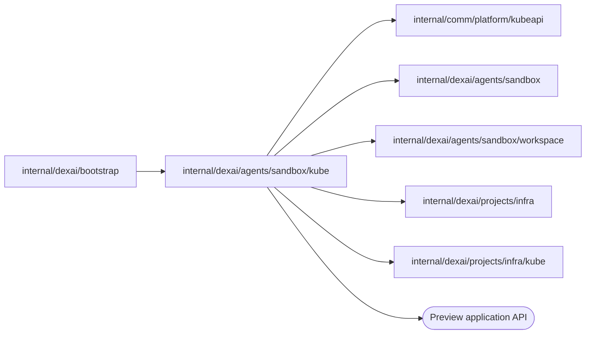

# Kubernetes Sandbox instances

<!-- BEGIN GENERATED PACKAGE SUMMARY (scripts/check-package-readmes.py; edit only Purpose) -->
Purpose: Applies the Kubernetes resources of Sandbox instances from the coding profile, checks and exposes their Preview, and deletes them by UID, behind `sandbox.InstanceProvider`.

Callers: `internal/dexai/bootstrap` imports this package.

Dependencies: it imports `internal/comm/platform/kubeapi`, `internal/dexai/agents/sandbox`, `internal/dexai/agents/sandbox/workspace`, `internal/dexai/projects/infra` and `internal/dexai/projects/infra/kube` and calls the Preview application API.

<!-- END GENERATED PACKAGE SUMMARY -->

`InstanceProvisioner` is the Kubernetes implementation of `sandbox.InstanceProvider`.
It applies the resources of a Sandbox instance from the immutable coding profile
ConfigMap, queries exact resource identities before every effect and owns no
lifecycle state. An object it finds must carry the Project's owner labels, and a
recorded UID that no longer matches is an ownership conflict, never adopted.

- **Provision.** Applies the profile's namespace baseline, the workspace volume and
  the Sandbox, in that order, and creates the Sandbox only once the volume is of this
  profile and no other Pod mounts it: a volume of another profile is
  `sandbox.ErrProfileMismatch`, a Pod that mounts it and that nobody deletes is
  `sandbox.ErrVolumeInUse`, and a terminating Pod of an earlier instance is waited
  for. A 403 within the authorizer lag of the delegated RoleBinding stays pending.
- **Preview.** `EnsurePreviewEnvironment` starts the engine through the workspace
  transport and verifies, through `infra.Connections`, that its Dex answers behind the
  instance's own Service. `ExposePreview` reconciles the application's Service,
  network policy and HTTPRoute under the Project's host to the platform's current spec
  (`kubeapi.Matches`): it creates an absent object, keeps a matching one and deletes
  one whose spec changed with its UID as a precondition, so the next round creates
  it again, because the Sandbox namespace admits only creates and deletes of them.
  The HTTPRoute attaches to the platform's one project Gateway
  (`infra/kube` `RouteGateway`), which serves every Project host on every lane. It
  probes the route through the real gateway; the Backend of
  [`infra/kube`](../../../projects/infra/kube/README.md) decides where the route is
  probed. `StopPreview` removes those objects, the HTTPRoute first, before it stops
  the application, and `ReleasePreviewRoute`
  removes them for the deleting Project's release.
- **Cleanup.** `DiscoverResources` completes the references a cleanup instance lacks
  from the deterministic names of the instance. `DeletePod` reports done only once
  every Pod the Sandbox controlled is gone, because only that frees the volume for
  the next instance. A 403 inside the namespace is rechecked against the namespace,
  since a deleting namespace loses its RoleBinding first.

| File | Responsibility |
| --- | --- |
| `instance_provisioner.go` | `InstanceProvisioner`, the profile, `Provision` and `DiscoverResources` |
| `instance_provisioner_preview.go` | The Preview engine check, the reconciliation and removal of the route objects and `StopPreview` |
| `instance_provisioner_cleanup.go` | UID-checked deletion of the Pod, the volume and the namespace |

## Tests

`instance_provisioner_integration_test.go` and
`instance_provisioner_cleanup_integration_test.go` run against the real Local Kind
cluster: provisioning and its repetition, the volume handover between instances,
the Preview route's reconciliation to a changed spec, its removal by a stop and its
return under the same host (`TestKindPreviewRouteLifecycle`), resource discovery
and the repetition of every deletion after a lost answer.
