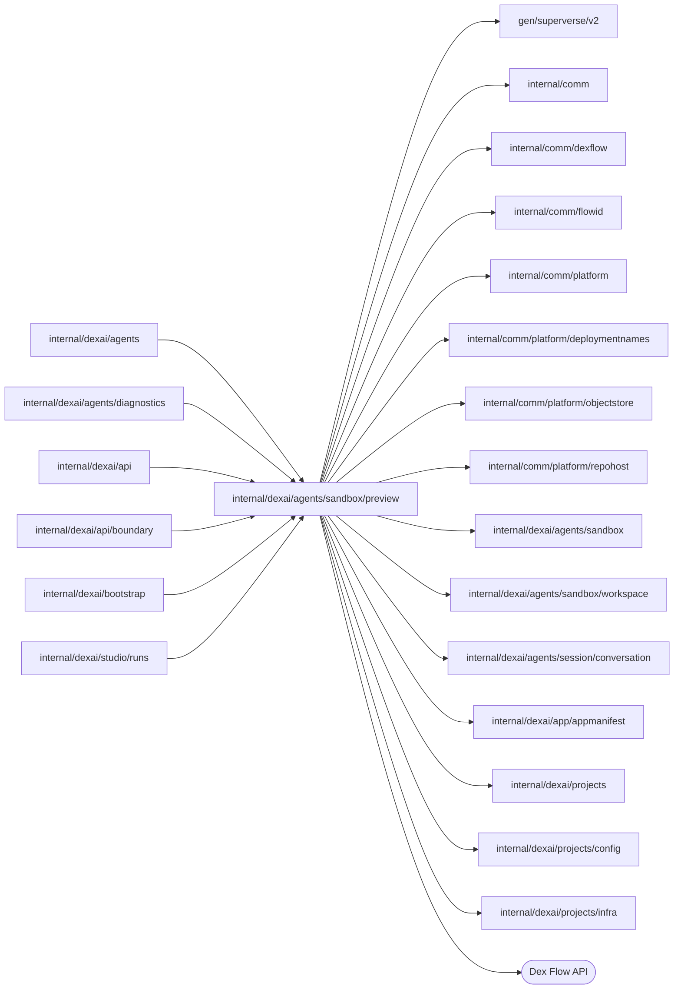
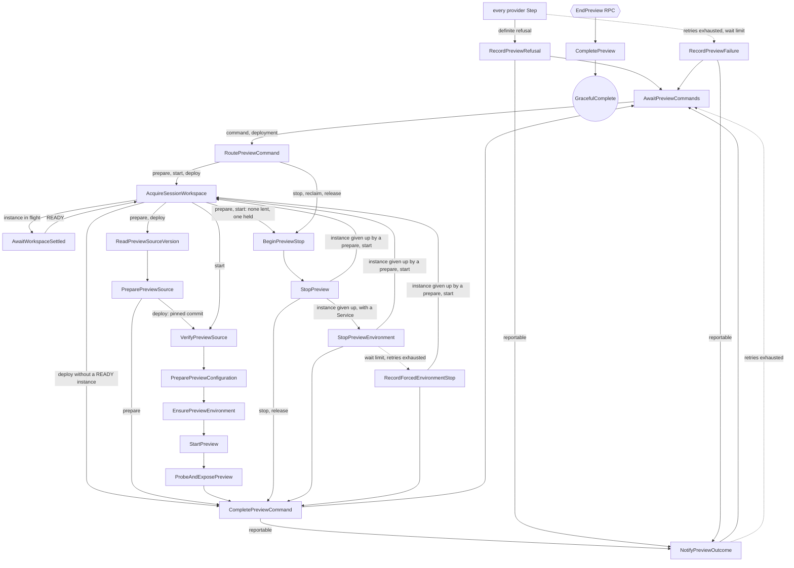

# Session Preview

<!-- BEGIN GENERATED PACKAGE SUMMARY (scripts/check-package-readmes.py; edit only Purpose) -->
Purpose: Serves a Project's Preview: one PreviewFlow execution per Project runs its Preview commands on the current Sandbox instance of the Project's Session, which it acquires from the Session.

Callers: `internal/dexai/agents`, `internal/dexai/agents/diagnostics`, `internal/dexai/api`, `internal/dexai/api/boundary`, `internal/dexai/bootstrap` and `internal/dexai/studio/runs` import this package.

Dependencies: it imports `gen/superverse/v2`, `internal/comm`, `internal/comm/dexflow`, `internal/comm/flowid`, `internal/comm/platform`, `internal/comm/platform/deploymentnames`, `internal/comm/platform/objectstore`, `internal/comm/platform/repohost`, `internal/dexai/agents/sandbox`, `internal/dexai/agents/sandbox/workspace`, `internal/dexai/agents/session/conversation`, `internal/dexai/app/appmanifest`, `internal/dexai/projects`, `internal/dexai/projects/config` and `internal/dexai/projects/infra` and calls the Dex Flow API.

<!-- END GENERATED PACKAGE SUMMARY -->

`PreviewFlow` is the Preview of one Project, served on the instances of the
Project's one Session
([the current contract](../../../../../docs/architecture/agent-harness-design/session.md)).
It starts with the Session's first Preview command or its first automatic
deployment and lives until the Project is deleted. It owns no instance: it acquires the Session's current
instance for a command, and the Session asks it to release the instance before
it reclaims it
([the current contract](../../../../../docs/architecture/agent-harness-design/sandbox.md)).
With each successful pushed tool result, the Session asks it to build and deploy that
commit (`RequestPreviewDeployment`), and the outcome of every deployment, start
and source preparation returns to the Session as one `delivery` notification
([the current contract](../../../../../docs/architecture/agent-harness-design/sandbox.md)).
Build owns Preview source preparation, configuration and deployment; Publishing
owns Live only ([the current contract](../../../../../docs/architecture/superverse-v2.md)).
The Preview runs on the Sandbox-local engine
([the current contract](../../../../../docs/architecture/agent-harness-design/sandbox.md)).

| File | Responsibility |
| --- | --- |
| `preview_flow.go` | Primitives, Step and RPC registration, Step options, thin RPCs and Steps |
| `preview_flow_client.go` | `FlowID`, `PreviewFlowClient`: the start on the first command or deployment, the retained read that reports a stopped engine execution, commands, deployment requests, the read of a prepared source without a Flow call, the Session's settlement announcement and the end of a deleting Project's Preview |
| `preview_flow_dependency.go` | `PreviewFlowDependency`: acquiring the Session's workspace, resuming a reclaimed instance for a pinned build, and reporting an outcome to it |
| `preview_snapshot.go` | `Snapshot` and its value types, initial Attributes and the one Attribute binding that `save` writes |
| `preview_command.go` | Statuses, `CommandKind` and command admission |
| `preview_deployment.go` | The automatic deployment: `DeploymentRequest` and its admission (`DeploymentAnswer`), `PreviewDeployment` and its `DeploymentStatus`, the pinned source preparation, the end of every command (`finishCommand`: its outcome; `admitNext`: the queued deployment or the release of what an unserved deployment started) and the `delivery` notification it keeps |
| `preview_failure.go` | `failureCode`: every failure code, declared once with its message and whether it is terminal; the codes of each provider Step; the typed classification of provider errors and the owner of each refusal |
| `provider_wait.go` | Wait limits and intervals, and `providerWait`: the observed state and a definite refusal with its owner of one polling Step |
| `preview_configuration.go` | `PreviewConfiguration`: AppManifest registration and configuration pins in the Project's Live storage, the configuration gap report, the grant generations and the deletion of the Project's Preview data |
| `preview_definitions.go` | Generation, from the clean HEAD or a deployment's pinned tree, storage and verified reads of the Preview definition bundle with the commit's AppManifest (`ReadPreparedSource`) |

The server bootstrap assembles the Flow with the instance provider and the
workspace transport that the Session Agent Flow bootstrap owns; the Preview
holds no process-local resource of its own, so it has no bootstrap type.

## Dex Flow Changes

| Fact | Single owner |
| --- | --- |
| The Project's Preview: commands, prepared source, configuration pins, grants, the engine as last ensured, which instance it last acquired, the automatic deployment and the last reportable outcome | one `PreviewFlow` execution per Project |
| The instance: provisioning, lease, Sandbox deadline, reclamation; the pushed commit a turn hands off | `SessionAgentFlow` |
| The configuration gaps of a commit | computed by the configuration host from stored configuration, never stored as a fact; a refused start keeps the list it got |
| What exists in Kubernetes and the Live storage | the providers, through deterministic names, ownership labels and recorded UIDs |

### Identity and execution lifecycle

- Flow type: `PreviewFlow` (the Go type name; no `GetFlowType` override).
- FlowID: `preview-<projectID>`, for example `preview-a7k2`, derived by
  `flowid.PreviewFlowID` (`preview.FlowID`) from the Project.
- Creation trigger: the Session's first Preview command in the first-demand
  form (no observed instance, generation or revision), which
  `SessionFlowService.sendAcquiringCommand` turns into `Start` before it sends
  the command, or the Session's first automatic deployment, whose Service call
  `RequestPreviewDeployment` starts it first. A read never starts a Preview: a
  Project without one reads as `NOT_STARTED` from the Session Service.
- Start admission: the ProjectID must fit the deployment's Sandbox namespace
  name by `flowid.ValidateSessionScope`; the identity names no repository.
- Start RequestID: the fingerprint of `{ProjectID}`.
- Reuse policy: `IDReuseDisallow` with `AlreadyStarted.IgnoreError`: a repeated
  start joins the one execution, running or completed, so a Project has at most
  one Preview execution ever.
- Business state versus engine execution: a stopped Preview (`STOPPED`) is a
  business state of a running execution, which keeps waiting for commands.
  The execution completes only through `EndPreview`, when the Project is
  deleted: `CompletePreview` ends it with `dex.GracefulComplete(Receipt{ProjectID})`.
  Its snapshot stays readable for the engine retention period.
- `Generation` is the constant `1`; `Revision` advances with every committed
  write and is the command fence of `PreviewSnapshot.revision`.
- Relationships: an independent top-level execution, not a SubFlow and not a
  Project child. The deleting Project ends it through the Session Service
  (`CleanupProjectSession`) and releases its resources by label.

### Attributes and AttributeMaps

There is **no AttributeMap**. Every Attribute is an ordinary singleton value.

| Attribute | Type and meaning |
| --- | --- |
| `ProjectID` | `string` identity, indexed as `keyword2 / IndexKeyword` |
| `Identity` | `sandbox.Identity`: the Project, fixed by the start; it names no repository |
| `Generation`, `Revision` | `uint64`: constant `1`, and a counter advanced by every committed write |
| `WorkspaceRequestID` | `string`: the Session's instance the Preview last acquired |
| `Resources` | `sandbox.Resources` of that instance while the Preview holds it, without its Pod once the Preview released it |
| `WorkspaceState`, `HeadCommit` | `string`: what the last source preparation from the workspace observed |
| `PreviewState` | `PreviewState` struct: status (`NOT_STARTED`, `STARTING`, `READY`, `STOPPING`, `STOPPED`; a `start-preview` is `STARTING` from its admission, a `deploy-preview` only once `PreparePreviewConfiguration` pins its configuration), URL, a revision, the served source and definitions, `Timings`, the phases of the current or last start (`configuration`, `environment`, `grant`, `application`, `route`), `ConfigurationGaps`, at most 32 `appmanifest.RequirementGap` values (names only) of the last start refused `PREVIEW_CONFIGURATION_INCOMPATIBLE`, kept by a stop and cleared when a start or a deployment is admitted, `Version`, the served commit's `repohost.CommitVersion`, and `StatusBeforeStart`, the status the last admitted `start-preview` found, which it restores when it ends before it pins its configuration |
| `PreviewEnvironment` | `PreviewEnvironmentState` struct: the Sandbox-local engine as the Preview last ensured or stopped it, the Sandbox and Service UIDs through which a READY engine's Dex answered, the retention read back, versions, and `LastStop` (`GRACEFUL` or `FORCED`) with the bounded cause of a forced stop |
| `AppManifest` | nullable `*pb.AppManifestSnapshot` of the commit that the last READY source preparation prepared, saved together with that preparation |
| `PreparedPreviewSource` | `PreparedPreviewSource` struct: status, command, instance and generation, source commit, exact definitions reference, DefinitionRevision, safe failure and `Version`, the commit's `repohost.CommitVersion` (`{Number, Subject}`) computed once by `DescribeCommit` when the commit was prepared; absent for a preparation before versions were recorded |
| `PreviewConfigurationRef` | `PreviewConfigurationRef` struct of one start: the prepared commit, immutable configuration object version and digests, the Live storage, the Sandbox principal, the grant with the one it superseded, and `CommandID`, the start or deployment that pinned it |
| `ActiveCommand`, `LastCommand` | `Command` structs for admission and duplicate identity; a `deploy-preview` also carries its pinned `Commit`. `ActorAccountID` is the caller of `StartPreview`, `StopPreview` or `PreparePreviewSource`, empty for a `deploy-preview`, a `reclaim` and a `release`; `ApplyConfiguration` and `ConfigurationRevision` are set only on a `start-preview` that applies. Every field takes part in the repeat comparison of `admit`, so a retried ID with another actor or flag is `COMMAND_CONFLICT`. An open execution's persisted command decodes them as zero: no actor, not applying |
| `AppliedConfiguration` | `AppliedConfiguration` struct, fixed size: the configuration head version the last applying start froze (`ObjectKey`, `ObjectVersion`, `Digest`, `ConfigurationRevision` of the frozen document, which is the revision the start named plus one when the freeze wrote refreshed TeamSpace settings as a new head revision; Studio compares versions only through `unapplied_change_count`), the commit it was applied for, the start's `CommandID`, its `ActorAccountID` (empty when the Agent's first deployment applied) and `AppliedAt`. Written by `PreparePreviewConfiguration` of an applying start in the save that pins `PreviewConfigurationRef`; kept across stops and reclaims; zero before the first Apply. Metadata only |
| `RecentStarts` | `[]StartRecord`, at most 50, oldest first and dropped first: one per admitted `start-preview` or `deploy-preview`, `{CommandID, Kind, ActorAccountID, Commit, ConfigurationRevision, Applied, AdmittedAt, EndedAt, Outcome, FailureCode, Timings, Version}`. `Outcome` is `RUNNING` until the start ends, then `READY`, `FAILED` (`RecordPreviewFailure`), `REFUSED` (`RecordPreviewRefusal`) or `CANCELLED` (a skipped deployment, or the Project's deletion). Every update finds its record by `CommandID`; a record already dropped is never recreated. The failure message stays in `Failure` |
| `Failure` | nullable `*dexflow.Failure`: code, phase, a message made of the code's message and its cause, truncated, and the remedy the code declares |
| `FailureOwner` | `conversation.DeliveryOwner`: who must act on `Failure`, set by the Step that ends the command with it and cleared with it; zero without a failure |
| `PreviewDeployment` | `PreviewDeployment` struct, fixed size: `Queued`, the newest request waiting for the active command (`{WorkspaceRequestID, Commit, Sequence, RequestedAt}`); `HandledSequence`, the newest request that ran or was cancelled, so a commit deploys once; `Last`, the newest handled deployment `{CommandID, Commit, Sequence, Status, Failure, Owner, UpdatedAt}` with `Status` `RUNNING`, `READY`, `INCOMPATIBLE`, `FAILED`, `SKIPPED` or `CANCELLED` (`DeploymentStatus`); and `NotifiedGapsDigest`, the fingerprint of the configuration gaps the Session was last told about |
| `OutcomeReport` | nullable `*conversation.SessionNotification`: the `delivery` notification of the last reportable outcome, which only the Steps that end a command write and `NotifyPreviewOutcome` delivers |
| `CreatedAt`, `UpdatedAt` | `time.Time` |
| `CommandLock` | `bool` coordination Attribute; its value is not a lock flag |

- Owner: this execution is the only writer. `save` advances `Revision` and
  writes every mutable Attribute but `PreviewDeployment` from one binding
  table, so every Step commits a consistent snapshot; the reads of
  `GetPreview` are the graph's read edges. Every write is unconditional and
  carries the value the handler read when it began.
- Locking: `CommandLock` serializes command and deployment admission. The
  command RPCs, `RequestPreviewDeployment` and the short state Steps lock it. A
  Step that calls a provider, the Project or the Session holds no lock: it runs
  only while its command is active, when the command RPCs write nothing that
  it saves, so it is the single writer of what it saves.
  `PreviewDeployment` is the one Attribute an RPC changes while such a Step
  runs, so only `CommandLock` holders write it (`saveDeployment`): a queued
  request writes it alone, without a new `Revision`, and the Steps that end a
  command or the Preview write it after their `save`. An accepted request
  saves everything, because no command, and so no provider Step, runs.
- CAS: commands carry `Generation` and, except in the first-demand form, the
  observed `ExpectedRevision` with the WorkspaceRequestID the Preview
  acquired, which is empty while it never acquired one, as after a refused
  first command. A deployment request is fenced by its handoff `Sequence`
  against `HandledSequence` and `Queued`.
- The grant generations never repeat for the Project, because a revoked
  hosted grant role stays a deny fence for hours: `PreviewState.Revision` is
  seeded from the start time, and one execution serves every instance of the
  Project's Session.
- Secrets: none. Credential plaintext never enters an Attribute; a gap holds
  names only, and the report's message is the Failure's bounded message.
- Growth and retention: fixed size except `RecentStarts`, bounded at 50 records of at most five timings each, well under 64 KiB. `AppliedConfiguration` and `RecentStarts` are absent in an execution started before they existed: `GetPreview` reads them as zero (`dexflow.ValueOrZero`), so its next start applies and its earlier starts are unrecorded. Both go with the execution when the Project is deleted.

### Channels and ChannelMaps

There is **no ChannelMap**.

`PreviewCommands` carries `Command` values.

- Producers: `RequestPreviewCommand`, in the commit that sets `ActiveCommand`;
  `RequestPreviewDeployment` when it accepts a deployment; and the Steps that
  end a command (`CompletePreviewCommand`, `RecordPreviewFailure`,
  `RecordPreviewRefusal`) when they admit the queued deployment or a
  `release`.
- Consumer: `AwaitPreviewCommands` with `ForOne`; routing reads
  `ActiveCommand`. At most one message is ever pending, and it belongs to the
  current `ActiveCommand`: a deployment request that finds a command active is
  state (`PreviewDeployment.Queued`), not a message.
- Kinds: `prepare-preview-source`, `start-preview`, `stop-preview`;
  `reclaim`, which only the Session Service sends (`ReclaimCommand`, ID
  `reclaim-<workspaceRequestID>`) before the SessionWorkspaceFlow reclaims that instance;
  `deploy-preview`, whose ID `deploy-preview-<Sequence>` derives from the
  handoff's sequence, so it is stable across retries, and which only
  `RequestPreviewDeployment` admits; and `release`, whose ID
  `release-<deploy command ID>` names the deployment it follows, which only
  the Steps that end a deployment admit (below).

| `RequestPreviewCommand` admission check, in order | Rejection |
| --- | --- |
| Unknown kind, `deploy-preview`, `release`, or empty ID | `INVALID_COMMAND` |
| ID equals the active or last command with different content | `COMMAND_CONFLICT` |
| ID equals the active or last command with identical content | accepted again, nothing published |
| `reclaim` of an instance the Preview does not hold | `NOT_HELD` (the client's `ErrNotHeld`) |
| Generation differs, or an observed revision differs or names another WorkspaceRequestID than the acquired one (empty while none was acquired) | `STALE_GENERATION` |
| Another command is active, a deployment included | `BUSY` |

| `RequestPreviewDeployment{WorkspaceRequestID, Commit, Sequence}` answer, in order | When |
| --- | --- |
| `QUEUED` | The request is the queued one: a retry |
| `DUPLICATE` | `Sequence` is not above `HandledSequence` (a retry of a lost answer), or is below the queued request's |
| `QUEUED` | A command is active: the request becomes `Queued` and an earlier queued request is superseded, so the newest wins |
| `ACCEPTED` | No command is active: `deploy-preview-<Sequence>` becomes the active command, `HandledSequence` and `Last` (`RUNNING`) record it, and it is published |

The Session records nothing from the answer; the outcome returns as a
notification. A deployment resumes a reclaimed workspace when its pinned source needs building.

`WorkspaceSettled` carries `WorkspaceSettlement{CommandID, WorkspaceRequestID, Failure}`:
the ID of the command that waits, the settled request and its failure code, empty for READY.

- Producer: `NotifyWorkspaceSettled`, which the Session Service calls for the
  command that the Session recorded as waiting for its request
  (`SessionWorkspace.PreviewWaits`, the ID that `AcquireSessionWorkspace`
  named; the newest command's ID replaces an earlier one). The Session's Step
  announces before it commits that the announcement was made, so a retried
  Step announces again.
- Admission, under `CommandLock`: the RPC publishes only when the settlement
  names the active command and no settlement is pending. A repeat while one is
  pending, a settlement for an ended or another command (the repeat of a
  retried Step after the command ended), and one while no command is active
  answer true without a message. A repeat for the same command after its
  settlement was consumed can only be READY, because a failed settlement ends
  the command; it makes a later wait of that command ask the Session once
  more, which is harmless.
- Consumer: `AwaitWorkspaceSettled` with `ForOne`, bounded by 90 minutes,
  which outlasts the Session's own bounded wait for a provisioning. A failed
  settlement refuses the command `PREVIEW_WORKSPACE_FAILED`; a READY one asks
  the Session again, which lends the instance; the timer refuses it
  `PREVIEW_WORKSPACE_UNAVAILABLE`. A deployment never waits here.

Pending messages at the end: every Step that ends a command
(`CompletePreviewCommand`, `RecordPreviewFailure`, `RecordPreviewRefusal`)
deletes a pending settlement, which names the ended command, under
`CommandLock`, so no later command consumes it. `CompletePreview` deletes both
Channels' pending messages, cancels the queued deployment and records
`PREVIEW_SESSION_CLOSED` for an active command.

### Streams

None. `GetPreview` is the durable state every reader recovers from; the
Session Watch carries the Preview in its snapshot.

### Steps, RPCs and recovery

- `AcquireSessionWorkspace` (`dexflow.ProviderStepOptions()`) asks
  `PreviewFlowDependency.AcquireSessionWorkspace` with the active command's ID. A READY instance is lent
  with its resources, and the Session records the Preview as its holder; the
  Preview binds to it, and a new instance starts with its engine
  `NOT_STARTED`. Otherwise the Session requests an instance, unless one is in
  flight, records the command as waiting and announces the settlement to it. The
  Preview names the instance it acquired last meanwhile, but it holds none
  while it waits: the Session lends no instance while it replaces the one the
  Preview holds, whose release it asks for before it reclaims it, so the
  command first releases that instance through the stop Steps and then asks
  again. The reclamation therefore never waits for a command that waits for
  the Session. A start keeps `STARTING` through the release, and a source
  preparation leaves a Preview that served on the instance `STOPPED`. A
  deployment also acquires or resumes the Session workspace, so a reclamation racing
  an asynchronous push does not discard its process build. A Session that is not ACTIVE
  is refused `PREVIEW_SESSION_CLOSED`.
- `ReadPreviewSourceVersion` commits the pinned commit or clean HEAD and its Git-owned version
  before compilation. It reads Project/Git metadata, inspects a manual build's workspace, and uses
  one-minute heartbeating attempts with two attempts within three minutes. It publishes no manifest
  and changes no configuration. A manual HEAD change before compilation is a definite refusal
  requiring a new explicit build; a previously scheduled unnamed preparation first reads metadata.
- `PreparePreviewSource` (one six-minute heartbeating attempt, two attempts
  30 seconds apart):
  - for `prepare-preview-source` it requires a clean workspace, registers the
    manifest of its exact pushed HEAD and generates strict FDG 2.0 Flow
    Definitions from an isolated archive inside the Sandbox;
  - for `deploy-preview` it reads no working tree: `superverse-previewctl
    source ensure --commit <sha>` exports the pinned commit into its isolated
    tree (`workspace.EnsurePreviewSource`), a commit missing from the
    repository is `PREVIEW_SOURCE_NOT_PREPARED`; the AppManifest is published
    from that commit; the definitions program's pinned mode renders the
    commit's definitions and answers the digest of the tree's `dex-app.yaml`,
    which must equal the published `ManifestDigest`, else
    `PREVIEW_MANIFEST_FAILED`; the READY preparation names the commit and the
    command as its RequestID, and the deployment goes on to start it.

  Both paths prepare only a commit that `main` reaches, as a Release does:
  `registerPreviewAppManifest` asks the host's `ValidateReleaseCommit` first, then
  reads the commit's stable version again (`DescribeCommit`), which the READY
  preparation keeps as `Version`, `serve` copies into `PreviewState.Version` and
  the start's record and delivery notification carry.
  A commit the repository host cannot read, or one `main` does not reach, is
  `PREVIEW_HEAD_NOT_READABLE` ("Push the current Sandbox commit to main"), a
  manifest whose content is rejected (`appmanifest.ErrInvalidAppManifest`) and
  any other registration failure `PREVIEW_MANIFEST_FAILED`, a rejected source
  `PREVIEW_FDG_INVALID`, and any other error is retried once and then recorded
  `PREVIEW_SOURCE_FAILED`. The Step saves the commit's AppManifest only
  together with its READY preparation, so `AppManifest` always belongs to the
  READY commit `PreparedPreviewSource` prepared. Automatic admission records PREPARING
  for its pinned commit; its build records FAILED on refusal/exhaustion, or READY together
  with its AppManifest. ReadPreviewSourceVersion persists its version in a separate Step before generation;
  Attribute.Set inside a long Step is staged until that Step succeeds. A later configuration/deployment
  refusal preserves that READY build; the processes a READY Preview already serves remain
  in PreviewState even when a newer build fails. Immutable bundles of earlier successful
  builds still supply configuration for their exact commits.
- `VerifyPreviewSource`, a state Step that calls no provider, requires a
  READY preparation rebound to the acquired instance, else
  `PREVIEW_SOURCE_NOT_PREPARED`, and begins the configuration phase. The
  Project's one Preview takes no lease.
- `PreparePreviewConfiguration` reads the Project's Live storage, validates
  the configuration of the prepared commit against its AppManifest and pins it
  with that storage, the Sandbox principal and the grant generation: a start
  keeps the live grant while the configuration revision and the principal are
  unchanged, else allocates `max(PreviewState.Revision, Grant.Generation) + 1`
  and keeps the replaced grant as `SupersededGrant` until the new application
  runs. A validation that answers `ErrNotReady` or `ErrConflict` asks the
  configuration host's gap report (`PreviewConfiguration.checkRequirements`):
  gaps refuse the start `PREVIEW_CONFIGURATION_INCOMPATIBLE`, naming every gap
  ("Configure gmail (authorization required), then start Preview"), and leave
  the running Preview untouched; no gap keeps `PREVIEW_CONFIGURATION_FAILED`. A
  report that fails, such as for a connector release that cannot be resolved,
  is retried and ends `PREVIEW_CONFIGURATION_FAILED`. Its save is the first of
  a deployment that changes what the Preview runs: it marks the Preview
  `STARTING`, so a deployment refused before leaves a READY Preview serving
  its commit.

  Only an applying start freezes the configuration head: a `start-preview` with
  `ApplyConfiguration`, or any start while `AppliedConfiguration` is zero, such
  as the Agent's first `deploy-preview`. It validates and freezes exactly the
  command's `ConfigurationRevision` (the head's when the command names none);
  a head past it is refused `PREVIEW_CONFIGURATION_CHANGED`, owned by the
  configuration, unless that head is the settings refresh an earlier attempt of
  the same freeze recorded and wrote (the host's refresh intent, below). The
  save that pins the configuration then records `AppliedConfiguration`. Every
  other start, a `deploy-preview`, a menu Start or a wake, revalidates the
  applied version against its commit through
  `projectconfig.Configuration.ValidateAppliedPreview`, an exact-snapshot
  validation that freezes nothing, refreshes no shared settings and replaces no
  usages, so the Preview keeps running exactly what the last Apply froze. Its
  refusal asks the gaps of that exact version (`RequirementsRequest.Snapshot`).
  A Preview freeze that refreshes shared settings writes a new head revision;
  before that write the host records a refresh intent under
  `preview-refreshes/<applied revision>` with the revision and the digest of
  the document it writes, so a retry after a lost answer recognizes that head
  as its own by content and freezes it. The intent is metadata only, one small
  object per applied revision that refreshed, deleted with the scope.
- `EnsurePreviewEnvironment` (wait limit ten minutes) runs `environment
  ensure` through sandboxd until the supervisor answers `ready`, then verifies
  the instance's Dex through its own Sandbox Service
  (`connect.ProbeSandboxDex`). `full`, `inconsistent` and `failed` answers are
  refused `PREVIEW_STATE_FULL`, `PREVIEW_STATE_INCONSISTENT` and
  `PREVIEW_ENVIRONMENT_FAILED`; a replaced object `PREVIEW_OWNERSHIP_CONFLICT`.
- `StartPreview` issues or reuses the storage grant and asks the supervisor to
  start the pinned commit (`begin --commit`: build in the commit's tree first,
  then swap, so the old application keeps serving until the new one is ready)
  until it runs; `failed` is `PREVIEW_FAILED` with the redacted log tail
  (`workspace.ErrPreviewSupervisor`). A grant that names too many secrets
  (`infra.ErrGrantTooLarge`) is `PREVIEW_CONFIGURATION_FAILED`, owned by the
  configuration. Once the application runs it revokes `SupersededGrant`.
- `ProbeAndExposePreview` reconciles the Project's route (the HTTPRoute and
  Service `preview-app` and the NetworkPolicy `allow-preview-app` in the
  Sandbox namespace; on Docker the gateway's route file) to the instance it
  serves on, under the Project's host: it creates an absent object, keeps one
  that matches the platform's current spec and replaces one whose spec changed
  by deletion and creation, because the Sandbox namespace admits no update. It
  probes the real gateway until it answers, then records `READY`.
- `CompletePreviewCommand`, `RecordPreviewRefusal` and `RecordPreviewFailure`
  (state Steps under `CommandLock`) end the active command (`finishCommand`):
  a failure with its owner, the configuration gaps of an incompatible start, a
  reclaim that released its instance's Pod; a deployment's `Last` becomes
  `READY`, `INCOMPATIBLE`, `FAILED` or `SKIPPED` with the owner. They admit the
  newest queued deployment on every path, including after a stop or reclamation
  (`admitNext`); only Project completion cancels the queued request (`CANCELLED`). Otherwise a start or a deployment that ends after it started
  the Preview without serving it (`startedUnserved`: the Preview is still
  `STARTING`), because it failed or was refused
  before `READY` or because it was skipped after one that did, admits
  `release-<command ID>` (`CommandRelease`) at once: nobody would stop a
  deployment, and a start whose application exited at startup must not read
  `STARTING` until someone stops it. A deployment refused before
  `PreparePreviewConfiguration` pinned its configuration, such as for
  `PREVIEW_CONFIGURATION_INCOMPATIBLE`, leaves the Preview as it found it and
  needs no release. So does a `start-preview` that ends before its own
  configuration pin (`PreviewConfigurationRef.CommandID` names another
  command or none), such as one refused `PREVIEW_SOURCE_NOT_PREPARED`: it
  started nothing and restores `StatusBeforeStart` when that is `READY` or
  `STOPPING`, so a serving Preview keeps its URL and pin, and otherwise ends
  `STOPPED` with its failure at once. The release
  runs the stop chain (`BeginPreviewStop`, `StopPreview`) as an explicit stop
  does and keeps the instance, its engine, the configuration gaps and the
  start's failure; the Preview ends `STOPPED`, which a person starts again,
  and the next admitted command clears the failure. A deployment queued
  meanwhile runs after it. The release
  reports nothing; a release that fails records its own failure in the phase
  `release`, which Studio retries as a Preview cleanup. A reportable outcome
  keeps its notification in `OutcomeReport` and goes on to
  `NotifyPreviewOutcome`.
- `NotifyPreviewOutcome` (`dexflow.ProviderStepOptions()`, saves nothing)
  delivers `OutcomeReport` with one `PreviewFlowDependency.ReportPreviewOutcome`
  call; its success and its failure route both return to
  `AwaitPreviewCommands`. Only the ending Steps write the report and none runs
  before it ends, so every retry delivers the same notification, which the
  Session's receipts admit once.
- `StopPreview` removes the Project's route, then stops the application and
  revokes the grant and the one it superseded, so a stopped Preview admits
  nothing to the application's port and holds no route on the project
  Gateway; the next start creates the route again under the same
  host. A round does not repeat what an earlier round of the attempt
  finished. A `reclaim`, and a start or source preparation that releases the
  instance it held, give up the instance: an unreachable Pod does not block,
  because the Session deletes the Pod next, and an instance that published its
  Service continues to `StopPreviewEnvironment`. An explicit `stop-preview` and
  the `release` of a deployment keep the instance and its engine running. An
  ownership conflict and an HTTP permission
  denial are recorded at once as `PREVIEW_CLEANUP_OWNERSHIP_CONFLICT` and
  `PREVIEW_CLEANUP_PERMISSION_DENIED`, exhausted retries as
  `PREVIEW_CLEANUP_OUTCOME_UNKNOWN`.
- `StopPreviewEnvironment` (wait limit three minutes) runs `environment stop`
  until the supervisor answers `stopped` and records `LastStop` `GRACEFUL`; an
  unreachable sandboxd records `FORCED` at once. Its failure route
  `RecordForcedEnvironmentStop` records `FORCED` with the cause: the Session's
  Pod deletion stops the engine, whose preStop hook still asks the supervisor.
- Giving up the instance (`releaseInstance`) drops the Pod from `Resources`,
  so the Preview no longer holds the instance, a `reclaim` of it answers
  `NOT_HELD` and the Session's reclamation goes on: the Step that ends a
  `reclaim`, and the stop Step that ends a start or source preparation giving
  up its instance, which then asks the Session again in
  `AcquireSessionWorkspace`. The `release` of a deployment keeps the instance.
- `AwaitPreviewCommands` waits for one command. Nothing expires a READY
  Preview: a stop, a reclamation or the Project's deletion ends it.

A provider Step ends its command with a failure in one of two ways, and the
Failure message carries the cause either way: a definite answer that asking
again cannot change is a decision into `RecordPreviewRefusal`; any other error
is returned as `dex.ErrorWithStack`, and once the retries ran out or the
engine ended a polling Step at its wait limit, the failure route
`RecordPreviewFailure` records the code of the failed Step (`providerFailures`)
with the final error. A failed command leaves the Preview with its failure
until it is started or stopped again; a failed deployment that started the
Preview without serving it is released at once, keeping its failure (above).

#### Outcome reports and owners

The deciding Step sets the owner of a refusal from its typed cause, never from
the code: `refusal` is the platform's, `applicationRefusal` the application's
and `incompatibleRefusal` the user's configuration. `RecordPreviewFailure`
always records the platform, because every exhausted retry and wait limit is a
platform symptom.

| Outcome | Owner | Notification |
| --- | --- | --- |
| A start or deployment `READY` | none | `ready`: it never enters the conversation; the Session holds the instance it serves on for `sandbox.previewHold` |
| `PREVIEW_FAILED` (`workspace.ErrPreviewSupervisor`: the build failed, or the application exited or missed its health probe) | application | `failure` |
| `PREVIEW_FDG_INVALID` (`workspace.ErrPreviewDefinitionsRejected`, `ErrDefinitionMismatch`, `projectconfig.ErrInvalidDefinitions`) and `PREVIEW_MANIFEST_FAILED` with `appmanifest.ErrInvalidAppManifest` | application | `failure` |
| `PREVIEW_CONFIGURATION_INCOMPATIBLE` | configuration | `notice` with the first 8 gap names and their count; the same gaps as the last told (`NotifiedGapsDigest`, reset by `READY`) are not reported again |
| Every other refusal and every `RecordPreviewFailure` | platform | `notice` |
| `SKIPPED`, `CANCELLED`, a superseded request, a completed source preparation, a stop, a release or a reclamation | none | none |

The commands that report are `deploy-preview` (every outcome),
`start-preview` (`READY` and failures) and `prepare-preview-source`
(failures). The notification is `conversation.SessionNotification{Kind:
delivery, Source: preview}` with `Outcome`, `Owner`, `Code`, `Phase` (the
command kind), `Commit` (the deployment's pinned commit, the prepared commit of
a start or the preparation's HEAD), `ResourceID` (the instance it ran on), the
gaps, a summary that names no commit or code, and the Failure's message and
remedy, the message cut to fit 4 KiB. Its ID is
`preview/<WorkspaceRequestID>/<command ID>/<outcome>`, for example
`preview/ws-42/deploy-preview-137/failure`; a command ID that is not printable
ASCII without spaces or slashes enters it as its kind and a fingerprint.

Execution policy:

| Steps | Options | Lock | Failure route |
| --- | --- | --- | --- |
| `StartPreview`, `ProbeAndExposePreview`, `StopPreview` | `dexflow.PollingStepOptions(30m)`, rounds every 2 s, each within a 40 s round timeout | none | `RecordPreviewFailure` |
| `EnsurePreviewEnvironment` | `dexflow.PollingStepOptions(10m)` | none | `RecordPreviewFailure` |
| `StopPreviewEnvironment` | `dexflow.PollingStepOptions(3m)` | none | `RecordForcedEnvironmentStop` |
| `AcquireSessionWorkspace`, `PreparePreviewConfiguration` | `dexflow.ProviderStepOptions()` | none | `RecordPreviewFailure` |
| `NotifyPreviewOutcome` | `dexflow.ProviderStepOptions()` | none | `AwaitPreviewCommands` |
| `ReadPreviewSourceVersion` | a one-minute heartbeating attempt, two attempts within three minutes | none | `RecordPreviewFailure` |
| `PreparePreviewSource` | a six-minute heartbeating attempt, two attempts 30 seconds apart | none | `RecordPreviewFailure` |
| `AwaitWorkspaceSettled` | `dexflow.StateStepOptions()`, a 90-minute business timer | none | none |
| State Steps | `dexflow.StateStepOptions()`; the Steps that end a command and `CompletePreview` load `WorkspaceSettled` | `CommandLock` | none |

RPCs:

| RPC | Options | Purpose |
| --- | --- | --- |
| `GetPreview` | unlocked, output only | Snapshot; also the retained snapshot of an ended Preview |
| `GetDexSummary`, `GetDexDisplay` | unlocked | Operator metadata: the Project and the acquired instance (`WorkspaceRequestID`) |
| `RequestPreviewCommand` | locks `CommandLock` | Admission of one command |
| `RequestPreviewDeployment` | locks `CommandLock` | The only admission of a deployment: `DeploymentRequest` to `DeploymentAnswer` |
| `NotifyWorkspaceSettled` | locks `CommandLock`, loads `WorkspaceSettled` | The Session's announcement of a settled request |
| `EndPreview` | locks `CommandLock` | The deleting Project's end: cancels every branch and moves to `CompletePreview` |

`PreviewFlowClient.Get` reports a Project that never ran a Preview command as
`*dex.FlowNotFoundError`; while a command is active it joins a bounded engine
status read, and a stopped engine execution reads with
`PREVIEW_EXECUTION_STOPPED`. `RequestDeployment` invokes the deployment RPC
with a ten-second lock wait and answers `ErrClosed` for a Preview that ended or
never started. `ReadPreparedSource` reads the AppManifest of a prepared
commit from its definition bundle without a Flow call. `End` answers true once
the execution no longer runs: it never started, it completed or its engine
stopped.

Recovery and cleanup ownership:

- A Worker that dies after a provider effect and before the commit repeats
  the Step; every provider call reconciles the exact object first, and a
  polling Step's next attempt asks again within the same wait limit. The
  pinned export is idempotent per commit and keeps at most the tree in use and
  the candidate; the build swaps only after the new application is healthy.
- A deployment request whose answer was lost is retried by the Session's
  `DeployPreviewHandoff` and answered `DUPLICATE` or `QUEUED` again, so a
  commit deploys once. A lost notification only drops the event: the Preview
  keeps the outcome in `PreviewDeployment.Last`, its failure and its gaps.
- A stopped engine execution: a new start joins the closed execution
  (`IDReuseDisallow`), so the Preview is never replaced; a replacement would
  begin at `NOT_STARTED` without the grants, the prepared source and the
  deployment sequence it recorded. An operator recovers it by a time travel to
  its last `AwaitPreviewCommands-<n>` wait
  (runbook).
- A reclamation: the SessionWorkspaceFlow sends `reclaim` only while the Preview
  holds the instance and waits for the Preview to release it; `BUSY`, also during
  a deployment, is asked again in the reclamation's next round, and `NOT_HELD` means
  nothing to release. A command that waits for the Session holds no instance:
  it released the one it held first, which ends the reclamation's `BUSY`
  answers.
- The deleting Project ends the Preview first and then releases a route that
  no stop removed (`ReleasePreviewRoute`), its grants and its Live storage data
  (`DeletePreviewData`) by label, so nothing of the Preview outlives the
  Project.
- Compatibility: the `FailureOwner` Attribute and `Failure.Remedy` are additive.
  A new execution initializes `FailureOwner`; `GetPreview` reads it as none
  where an open execution started without it, and an earlier failure has the
  zero remedy until the next one, which Studio shows as a platform problem with
  its details.
- Compatibility: pre-launch replacement. `WorkspaceSettlement.CommandID` and the
  Session's `previewWaitsFor` (which replaced the boolean `previewWaits`) are
  new: a Session that recorded a waiting Preview before them announces nothing
  and its command ends `PREVIEW_WORKSPACE_UNAVAILABLE` after the 90-minute wait,
  so local lanes delete such Projects before the rollout. `PreviewDeployment`, `OutcomeReport`,
  `RequestPreviewDeployment`, `NotifyPreviewOutcome` (which replaced
  `ReportPreviewOutcome`) and the command kinds `deploy-preview` and `release`
  are new, and one Preview per Project re-keys the execution to
  `preview-<projectID>`, removes the `SessionID` Attribute,
  `AcquireProjectPreview`, `RenewPreviewLease` and the lease expiry, and adds
  `VerifyPreviewSource`; Local lanes and AWS delete their Projects before the
  rollout (rollout reconciliation),
  so no open execution of the earlier graph exists.

Preview configuration: the Project's Preview configuration and storage grants
live in the Project's Live storage below the Project's Preview prefix
(`infra.PreviewKeysOf`). Grants bind the Sandbox principal: the instance's
namespace and service account by UID. Starting requires a READY preparation of
the acquired instance and freezes the exact configuration version; only
immutable pins and the grant identities are saved. A preparation registers the
prepared source with the configuration host and only then stores the commit's
definition bundle, written once at
`projects/<projectID>/preview-source/<commit>/definitions.json` with schema
`superverse.dev/preview-definition-bundle/v2`: the definitions with the
commit's AppManifest. `ReadPreparedSource` reads that bundle by its key with no
Flow call and no Preview execution, and the Session Service's
`ReadPreviewTarget` serves the AppManifest of the Session's HEAD from it, so
reading, editing and validating the Preview configuration never needs a
workspace; a commit without a bundle is `ErrSourceNotPrepared`. Studio Runs
reads the running Preview's exact definitions through
`ReadPreviewDefinitionBundle` and reaches its engine through
`connect.DialSandboxDex`. A bundle that does not match its pin or its key is
`ErrDefinitionMismatch`.

## Database Schema Changes

None. Dex Attributes own the Preview state. Mutable Preview configuration
belongs to the Project's Preview-scoped versioned store in its Live storage
through the Go configuration host, which also computes the gap report from it.
The Preview engine's store on the workspace volume belongs to its local
Temporal and is deleted with the volume.

## UI/UX

Studio reads the Preview from the Session snapshot and the Session Watch. A
Project without a Preview shows `NOT_STARTED`; its first command in the
first-demand form starts the Preview, which acquires the Session's instance
and brings one up when there is none. The Preview has no lease to show or
renew, and its URL is the Project's and never changes, though nothing serves it
while the Preview is stopped. `PreviewSnapshot.revision` stays the
command fence. Hosted routes are `preview-<projectID>.<environment>.dexai.dev`;
local routes use the configured loopback gateway. The phase timings of the last start reach the browser as `PreviewSnapshot.phase_timings`; the engine status
and the automatic deployment are Flow state, visible through
`GetPreview` and `dexcli flow state`; a delivery failure or notice appears in
the conversation as a notification with its summary. A deployment that
started the Preview and ends before `READY` leaves it `STOPPED` with its
failure once its release ran, where the Preview panel offers Start Preview as soon as the source and
the configuration are ready; a release that failed offers Retry Preview
cleanup. The Preview panel's automatic deployment status, the gap list and the
setting are Studio work that follows.

## Tests

- `TestPreviewApplyDexIntegration` (`internal/dexai/agents`, the mock Session inputs): before the first
  Apply every item is `ADDED`; an Apply records the applied version, its sender and V0, and a
  retried ID with another flag is `COMMAND_CONFLICT`; a TeamSpace settings change is one unapplied
  change; an Apply of an older revision is refused `PREVIEW_CONFIGURATION_CHANGED`; the push's
  `deploy-preview` runs V1 on the applied version; the next Apply freezes the refreshed head, which
  the same freeze retried after a lost answer recognizes; the applied version survives a stop and a
  menu Start runs it; 50 more starts drop the oldest record.
- `TestPreviewApplyWorkerRestartDexIntegration` (run alone): the server restarts during an Apply,
  which completes once with one record.
- `TestMissingPreviewReadDexIntegration` (`SUPERVERSE_TEST_LANE`, `SUPERVERSE_TEST_DEX_ADDRESS`): a read
  of a Preview that never started reports absence and creates no execution.
- `TestStoppedPreviewTimeTravelDexIntegration` (`SUPERVERSE_TEST_LANE`,
  `SUPERVERSE_TEST_DEX_ADDRESS`, `SUPERVERSE_TEST_EXISTING_WORKER_TARGET`): a Preview whose engine execution
  an operator terminated refuses every command `ErrClosed`, a new start joins
  the closed execution, and the runbook's time travel to `AwaitPreviewCommands-1`
  brings it back to admit and run a stop to `STOPPED`.
- `TestSandboxReclaimStopsPreviewDexIntegration` (`../../`): a start passes
  `VerifyPreviewSource` without a lease; a reclamation of the instance a READY
  Preview serves on stops the Preview first, whose engine the supervisor stops
  `GRACEFUL` before the Pod deletion, and it stays `STOPPED`; a later pushed build can resume the workspace; the reclamation removed the route,
  so the local gateway answers 404 for the Project's host, and the
  configuration of the prepared HEAD reads without a workspace.
- `TestPreviewAfterRefusedFirstCommandDexIntegration` (`../../`): a first
  command that waits for a request whose provisioning fails is refused before
  the Preview acquired an instance, and the next command, which observed the
  Preview without one, is admitted and prepares the source although the first
  command's failed settlement is repeated while it waits.
- `TestSessionMockPreviewAutoDeployDexIntegration` (`../../`): a pushed commit
  deploys by itself from its pinned tree to `READY`, holds the instance for the
  Preview hold and enters no conversation.
- `TestSessionMockPreviewFailureFixDexIntegration` (`../../`): a deployment whose
  application exits ends `PREVIEW_FAILED` owned by the application after it
  started the Preview, which releases it at once with one stop that keeps the
  engine; its notification opens an automatic turn whose fix the Preview then
  serves.
- `TestPreviewDeploymentAnswersDexIntegration` (`../../`): `ACCEPTED`, then
  `DUPLICATE` for a retried sequence, `QUEUED` twice with the newest
  superseding, `DUPLICATE` for an older one; the superseded request never
  prepares a source.
- `TestPreviewRefusedDeploymentKeepsServingProcessesDexIntegration` (`../../`): a
  deployment refused `PREVIEW_FDG_INVALID` before it starts the Preview leaves
  the READY Preview serving; the new process build records FAILED. Rebuilding restored HEAD
  becomes READY and a start serves the prepared commit.
- `TestPreviewIncompatibleDeploymentDexIntegration` (`../../`): the deployment
  of a fresh Project whose Preview nobody configured is refused
  `PREVIEW_CONFIGURATION_INCOMPATIBLE` before it starts the Preview, so
  nothing is released: the Preview stays `NOT_STARTED` with the refusal, its
  gaps and the READY preparation, the Session records the configuration
  notice, and the Preview starts once configured.
- `TestPreviewBuildResumesReclaimedInstanceDexIntegration` (`../../`): a
  build on a reclaimed instance resumes a new instance and renders the pinned processes,
  independently of missing Preview configuration.
- `TestPlatformToolsProjectScopeIntegration` (`../../diagnostics`) reads the
  Preview of a Project whose Session's instance was reclaimed.
- `TestDockerSandboxInstances` (`../docker`): the route is the Project's, a
  later instance takes it over, a stop withdraws it, the next expose publishes
  it again and rewrites one that differs, and the Project's release removes it
  but never a route of another holder. `TestKindPreviewRouteLifecycle`
  (`../kube`): an expose creates the three route objects under the Project's
  host, replaces a policy and an HTTPRoute whose spec changed while it keeps the
  matching Service, a stop removes all three and the next expose creates them
  again. `TestCodingNamespaceCleanupKubernetesIntegration` (`../kube`): the
  release of the route objects reports a namespace denial and completes once
  the namespace is gone.
- The configuration gap report is checked against real MinIO by
  `TestConfigurationStorageMinIOIntegration`
  (`../../../studio/confighost`).

Not yet covered by a real-dependency scenario: a `reclaim` racing an active
start (`BUSY`); the engine wait limits (`PREVIEW_ENVIRONMENT_DEADLINE`, a
forced stop after three minutes); the same `INCOMPATIBLE` gaps not reported
twice; the state a `release` leaves, which
`TestSessionMockPreviewFailureFixDexIntegration` observes only as its one stop
that keeps the engine; a `release` that fails; a manifest digest that differs
from the published AppManifest; a Worker replacement during `deploy-preview`
or `NotifyPreviewOutcome`.

## Documentation

[the current contract](../../../../../docs/architecture/agent-harness-design/session.md),
[the current contract](../../../../../docs/architecture/agent-harness-design/sandbox.md),
[the current contract](../../../../../docs/architecture/agent-harness-design/sandbox.md),
[the current contract](../../../../../docs/architecture/superverse-v2.md)
and [the specification](../../../../../docs/architecture/superverse-v2.md). The
generated graph is `docs/flows/sv2-preview-flow.json`.

The immediate asynchronous handoff and build status deltas are documented in
[automatic process builds](../../../../../docs/architecture/studio-setup/auto-refresh.md).
New pushed requests queued behind a stop or reclamation still build after it; only Project
completion cancels the queued request. The old SKIPPED enum/status remains decodable for
retained pre-upgrade results but no new build skips solely because its workspace was reclaimed.

READY definitions are durable commit artifacts: Studio build readiness does not depend on
which Sandbox instance is current. Acquisition rebinds the existing READY preparation before
a manual start on a replacement; Preview serving-runtime instance/UID checks remain unchanged.
`TestPreviewProcessesSurviveWorkspaceReplacementDexIntegration` removes its owned real instance,
reads the retained process/configuration bundle, and starts it on the replacement without rendering again.
