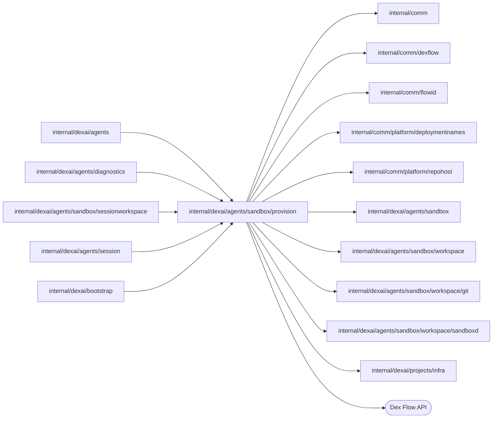
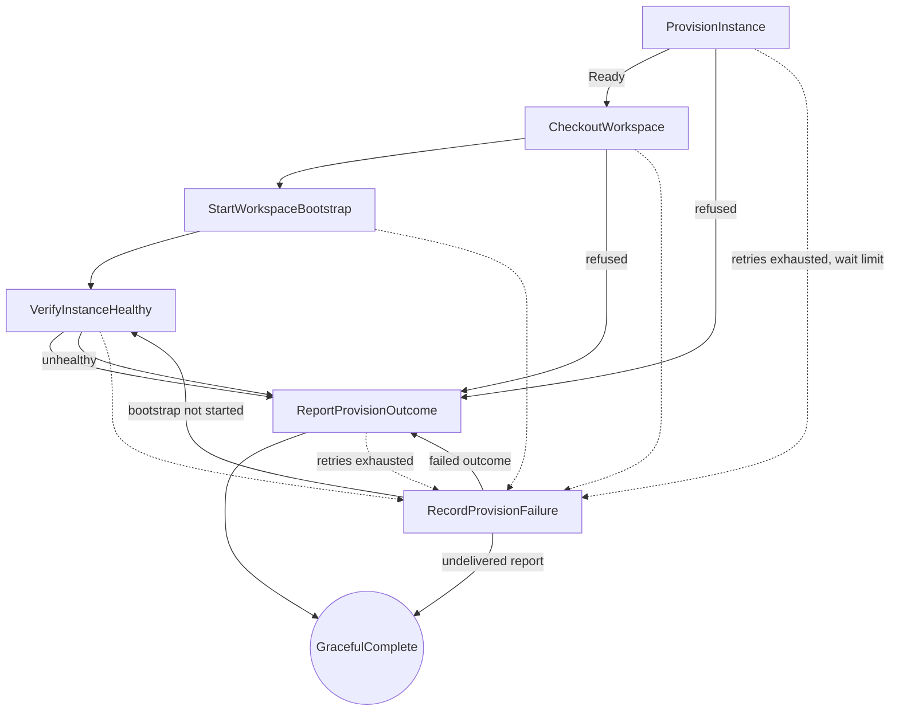

# Sandbox provisioning

<!-- BEGIN GENERATED PACKAGE SUMMARY (scripts/check-package-readmes.py; edit only Purpose) -->
Purpose: Provisions one Sandbox instance of a Session: one SandboxProvisionFlow execution creates its Pod on the Session's volume, checks the repository out, starts its bootstrap, verifies it and reports the outcome.

Callers: `internal/dexai/agents`, `internal/dexai/agents/diagnostics`, `internal/dexai/agents/sandbox/sessionworkspace`, `internal/dexai/agents/session` and `internal/dexai/bootstrap` import this package.

Dependencies: it imports `internal/comm`, `internal/comm/dexflow`, `internal/comm/flowid`, `internal/comm/platform/deploymentnames`, `internal/comm/platform/repohost`, `internal/dexai/agents/sandbox`, `internal/dexai/agents/sandbox/workspace`, `internal/dexai/agents/sandbox/workspace/git`, `internal/dexai/agents/sandbox/workspace/sandboxd` and `internal/dexai/projects/infra` and calls the Dex Flow API.

<!-- END GENERATED PACKAGE SUMMARY -->

`SandboxProvisionFlow` provisions exactly one Sandbox **instance** of a Session
and then **completes**. The [SessionWorkspaceFlow](../sessionworkspace/README.md)
that started it owns the instance from the outcome on and reclaims it, and the
Session holds its lease and its Sandbox deadline
([the Session](../../session/README.md),
[the current contract](../../../../../docs/architecture/agent-harness-design/sandbox.md)).
This Flow has no commands, no TTL, no Preview and no reclamation, and it
never deletes anything.

| File | Responsibility |
| --- | --- |
| `sandbox_provision_flow.go` | Primitives, Step and RPC registration, Step options, thin Steps and the read RPCs |
| `sandbox_provision_flow_client.go` | `provisionFlowID`, `SandboxProvisionFlowClient`: the idempotent start and the retained read that reports a stopped engine execution as failed `WORKSPACE_EXECUTION_STOPPED` |
| `sandbox_provision_flow_dependency.go` | `SandboxProvisionFlowDependency`, the report of the outcome to the SessionWorkspaceFlow |
| `sandbox_provision_flow_bootstrap.go` | `SandboxProvisionFlowBootstrap`: the Flow with the instance provider and the workspace transport, and its client |
| `provision_outcome.go` | `Request`, `Checkout`, `Bootstrap`, `Outcome` and its struct-typed `OutcomeStatus` and `reportAnswer`, `Snapshot` with the READY lease, the wait limits, the failure codes and the initial Attributes |

## Dex Flow Changes

| Fact | Single owner |
| --- | --- |
| How one provisioning went: the resources it found, its checkout, the start of its bootstrap, its outcome and how the workspace Flow answered its report | one `SandboxProvisionFlow` execution |
| Whether the bootstrap command has run, and its output | the Pod's command ledger (`superverse-exec`), run `platform-bootstrap-<workspaceRequestID>`; the template's `.local/bootstrap.lock` serializes it with the agent's own runs |
| The instance from the outcome on: its state, resources, lease, reclamation and what outlives the Pod | `SessionWorkspaceFlow` (`Instance` Attribute) |
| The accepted lease and the Sandbox deadline | `SessionAgentFlow` (`Workspace` Attribute) |
| What exists in Kubernetes | Kubernetes, through deterministic names and ownership labels; recorded UIDs are "changed underneath us" guards |

### Identity and execution lifecycle

- Flow type: `SandboxProvisionFlow` (the Go type name; no `GetFlowType` override).
- FlowID: `sandbox-provision-<projectID>-<workspaceRequestID>`, for
  example `sandbox-provision-a7k2-ws-41`, derived by
  `flowid.SandboxProvisionFlowID` (`provision.provisionFlowID`). The ProjectID names the
  Project's one Session; the WorkspaceRequestID `ws-<n>` is the
  instance identity the Session derives from the Step execution that opened
  the request, so it never repeats within the Session.
- Creation trigger: the SessionWorkspaceFlow's `ProvisionInstance` Step, for
  the Session's `provision` command, through
  `SessionFlowService.StartProvisioning`, which requires a READY Project and
  adds the repository and HEAD the workspace checks out. Nothing else starts a
  provisioning, and a read never starts one.
- Start admission: the ProjectID must fit the deployment's Sandbox namespace
  name by `flowid.ValidateSessionScope`, and the request must name its
  WorkspaceRequestID.
- Start RequestID: the fingerprint of `{SessionFlowID, WorkspaceRequestID,
  retained volume reference, profile}`.
- Reuse policy: `IDReuseDisallow` with `AlreadyStarted.IgnoreError`. A retry of
  the same request joins its execution, running or completed, and never
  provisions again; every instance has its own FlowID, so no closed execution
  is ever replaced and the first Step needs no admission check. A different
  request for the same FlowID is a programming error and fails the start.
- Completion: the outcome, `ready` or `failed`, is the business result.
  `ReportProvisionOutcome`, or `RecordProvisionFailure` once the report's
  retries ran out, ends the execution with `dex.GracefulComplete(Receipt{ProjectID,
  WorkspaceRequestID, Status})`; business and engine completion
  coincide. There is no explicit rerun: a new instance is a new request.
- Retention: the completed execution stays readable through `GetProvision`
  for the engine retention period. The workspace Flow copies what it keeps
  (the resources, the lease, the volume state and the phases) into its
  `Instance` Attribute when it records the outcome, so nothing depends on the
  retained execution after that; a read after retention reports absence.
- Relationships: an independent top-level execution, not a SubFlow and not a
  Project child. Its only cross-Flow call is the report to the workspace Flow,
  which reads the outcome itself.

### Attributes and AttributeMaps

There is **no AttributeMap**. Every Attribute is an ordinary singleton value.

| Attribute | Type and meaning |
| --- | --- |
| `Request` | `Request` struct, fixed by the start: the Session `Identity` with the repository and HEAD, the `WorkspaceRequestID` and `Retained`, the namespace and volume references with the volume's profile that earlier instances left |
| `Resources` | `sandbox.Resources`: the namespace, service account, Sandbox and volume references with UIDs, the Sandbox Service's name and UID, the image digest and the profile. It starts as the retained namespace and volume; the Pod is always new |
| `Checkout` | `Checkout` struct: the HEAD the checkout recorded, which the lease expects, and the volume state (`ABSENT`, `CLEAN`, `DIRTY` or `UNKNOWN`) |
| `WorkspaceTimings` | ordinary `[]dexflow.PhaseTiming`: `provision` then `checkout`, ended by the outcome; at most two entries |
| `Outcome` | nullable `*Outcome`: the status, the resources, the checkout, the `*dexflow.Failure` of a failed one, and `Reported` (`admitted`, `declined` or `undelivered`) with the cause of an undelivered report. Nil until the provisioning ended |
| `Bootstrap` | `Bootstrap` struct `{Declared bool, CommandID string, StartedAt time.Time, Refusal string}`: whether HEAD's `.superverse/template.json` declares `commands.bootstrap`, the command ledger run that `StartWorkspaceBootstrap` started (`platform-bootstrap-ws-41`) and its start, or why no run was started, or that a start whose retries ran out was not confirmed. Written once by that Step or by `RecordProvisionFailure`; missing (the zero value) until then and in executions that passed the Step before it existed |

- Owner: this execution is the only writer, and its Steps form one chain, so
  no Step holds a lock and none needs CAS.
- Index and query needs: none. A provisioning is always addressed by its
  FlowID; diagnostics list a Session's provisionings by the FlowID prefix
  (`flowid.ParseSandboxProvision`).
- Secrets: none. The lease binds provider identities only; Git credentials are
  minted inside the workspace transport and never enter an Attribute.
- Loading: ordinary Attributes are delivered to every handler.
- Growth and retention: fixed size; nothing needs cleanup. The bootstrap run
  ends at its 15-minute lifetime or with the Pod, and the ledger removes it two
  hours after it ended.

### Channels and ChannelMaps

None.

### Streams

None. The phases of `WorkspaceTimings` are the durable cold-path measurement.

### Steps, RPCs and recovery

- `ProvisionInstance` (`dexflow.PollingStepOptions(30m)`, rounds every 2 s,
  each within a 40 s round timeout) asks `InstanceProvider.Provision` until the
  Sandbox is Ready, which adopts every recorded object only with its recorded
  UID. Before it applies the Sandbox, every round checks the volume
  (`volumeFree`): a volume of another coding profile is refused
  `WORKSPACE_PROFILE_MISMATCH`, and a Pod of another instance that mounts it is
  waited for while it terminates and refused `WORKSPACE_VOLUME_IN_USE` when
  nothing deletes it. An object of another owner is refused
  `PROVISION_FAILED`. A refusal records the failed outcome with the resources
  found so far.
- `CheckoutWorkspace` (`dexflow.PollingStepOptions(15m)`) waits, each
  connection attempt within 20 s, until sandboxd accepts connections, then
  runs the checkout within ten minutes while heartbeating. The checkout
  reconciles the repository before it repeats a Git effect. A refusal the
  workspace reports as a typed failure, or a repository bound under another
  repository host than this server's, records `CHECKOUT_FAILED` at once.
- `StartWorkspaceBootstrap` (`dexflow.ProviderStepOptions()`, each attempt
  within 40 s) reads `commands.bootstrap` of HEAD's `.superverse/template.json`
  (`git.DeclaredBootstrap`; only a `make <target>` command is started) and, through
  `workspace.Capabilities.StartBootstrap`, asks the command ledger for the run
  `platform-bootstrap-<workspaceRequestID>` before it begins it: a foreground run in
  the workspace root with the tool environment and a 15-minute lifetime, which takes
  none of the four background slots. It never waits for the command, so READY is
  not delayed. A repeated attempt finds the run an earlier one began, and the
  ledger's begin answers the same run for the same ID and command, so nothing
  starts twice. A ledger refusal or an undeclarable command is recorded as
  `Refusal`; an error is retried and, once the retries run out,
  `RecordProvisionFailure` records it and continues with the health check: the
  bootstrap never fails a provisioning, and the agent's own `make bootstrap`
  restores what a missing run did not.
- `VerifyInstanceHealthy` (`dexflow.PollingStepOptions(5m)`) provisions again,
  which adopts only the recorded UIDs, until the Sandbox is Ready, then reaches
  sandboxd: a Sandbox or Service replaced since is refused
  `INSTANCE_UNHEALTHY`. It records the `ready` outcome with the instance's
  resources and checkout.
- `ReportProvisionOutcome` (`dexflow.ProviderStepOptions()`) asks
  `SandboxProvisionFlowDependency.ReportProvisionOutcome`. The workspace Flow
  admits the report only while this instance is the one it provisions
  (`admitted`, also for a repeat), and refuses it for another instance or once
  it ended (`declined`). The answer is recorded and the
  execution completes.
- `RecordProvisionFailure` (`dexflow.StateStepOptions()`) is the failure route
  of every provider Step and of the report. For `StartWorkspaceBootstrap` it
  records the final error as the bootstrap's `Refusal` and goes on to
  `VerifyInstanceHealthy`. For another provider Step it records the
  failed outcome with the code of that Step, the timeout code when the engine
  ended it at its wait limit (`PROVISION_DEADLINE`), and the final error
  (`ctx.RecoveryError().Detail`), then reports it. For the report it records
  `undelivered` with the cause and completes: the workspace Flow reads the
  outcome when its own bounded wait ends.

Every polling Step computes no deadline of its own: the engine ends it at its
wait limit (ExecuteMethodTimeout and ExecuteRetry.TotalDuration), and an
attempt that fails saves nothing. A Worker that dies during a polling Step
stops heartbeating, so the next attempt asks the provider again. Provider calls
query the exact object before mutating, so a repeated attempt adopts what an
earlier one created, and what an attempt created without recording it is found
again by name: by the workspace Flow's reclamation (`DiscoverResources`) or by the
Project's release.

`Budget` bounds a whole provisioning (the four wait limits and the report's
retries, 55 minutes); the workspace Flow waits for the outcome at most
`Budget` plus ten minutes and then fails the request `WORKSPACE_TIMEOUT`.

RPCs:

| RPC | Options | Purpose |
| --- | --- | --- |
| `GetProvision` | unlocked, output only, short | The `Snapshot`. It also serves the retained snapshot of a completed provisioning. |
| `GetDexSummary`, `GetDexDisplay` | unlocked, short | Operator metadata: the `Request` and the `Outcome`. |

`SandboxProvisionFlowClient.Get` reports a provisioning that never started as
`*dex.FlowNotFoundError`, and one without an outcome whose engine execution
failed, was canceled or was terminated as failed `WORKSPACE_EXECUTION_STOPPED`
with the resources it recorded; an unavailable engine read fails.

Cleanup ownership: a failed outcome keeps the resources it found. The
workspace Flow reclaims them before its next instance, or the deleting Project releases them
by label. A late outcome after the deletion is only recorded `declined`.

Compatibility: a new Flow type that replaced the instance lifecycle of
SandboxFlow before launch ([the current contract](../../../../../docs/architecture/agent-harness-design/sandbox.md)).
`StartWorkspaceBootstrap` and the `Bootstrap` Attribute were added on
2026-10-15: an open execution in `CheckoutWorkspace` takes the new Step on its
next decision, and one past it has no `Bootstrap`, which reads as the zero
value. Provisionings are short-lived, so no other open execution is affected.

## Database Schema Changes

None. The Attributes above own the provisioning state, and the
SessionWorkspaceFlow's `Instance` Attribute owns the instance after the
outcome.

## UI/UX

None directly. Studio shows the instance state of the SessionWorkspaceFlow in
the Session snapshot (`PROVISIONING`, `READY`, `CLOSING`, `CLOSED`, `FAILED`)
and the phase timings the workspace Flow copies from the outcome into
`SessionWorkspaceSnapshot.phase_timings`;
they are also visible through `GetProvision` and `dexcli flow state`.

## Tests

- `TestPlatformBootstrapRacesAgentDexIntegration` (`../../`): the provisioning
  records the started run `platform-bootstrap-<instance>`, and the build-basic
  scenario's own `make bootstrap` waits for it and restores nothing again; its
  first commit gate passes.
- `TestRetainedProvisionReadsDexIntegration` (`SUPERVERSE_TEST_LANE`,
  `SUPERVERSE_TEST_DEX_ADDRESS`, `SUPERVERSE_TEST_RETAINED_PROJECT_ID`,
  `SUPERVERSE_TEST_RETAINED_WORKSPACE_REQUEST_ID`): `GetProvision` and the
  client read the same snapshot of a completed provisioning.
- `TestSandboxProvisionStartJoinsDexIntegration` (`../../`): a cold start runs
  exactly one provisioning, and a repeated start joins it.
- `TestSessionWorkspaceWorkerRestartDexIntegration` (`../../`): a Worker
  replaced during a polling Step; one execution provisions the request.
- `TestStoppedSandboxProvisionDexIntegration` (`../../`): a terminated
  provisioning reads as `WORKSPACE_EXECUTION_STOPPED`, and the Project's
  deletion releases what it created.
- The Kubernetes provider tests in [`../kube`](../kube/README.md) cover
  adoption and the volume handover.

## Documentation

[the current contract](../../../../../docs/architecture/agent-harness-design/sandbox.md),
[the specification](../../../../../docs/architecture/superverse-v2.md) and
[StartFlow admission](../../../../../docs/architecture/start-flow-admission.md).
The generated graph is `docs/flows/sv2-sandbox-provision-flow.json`.
