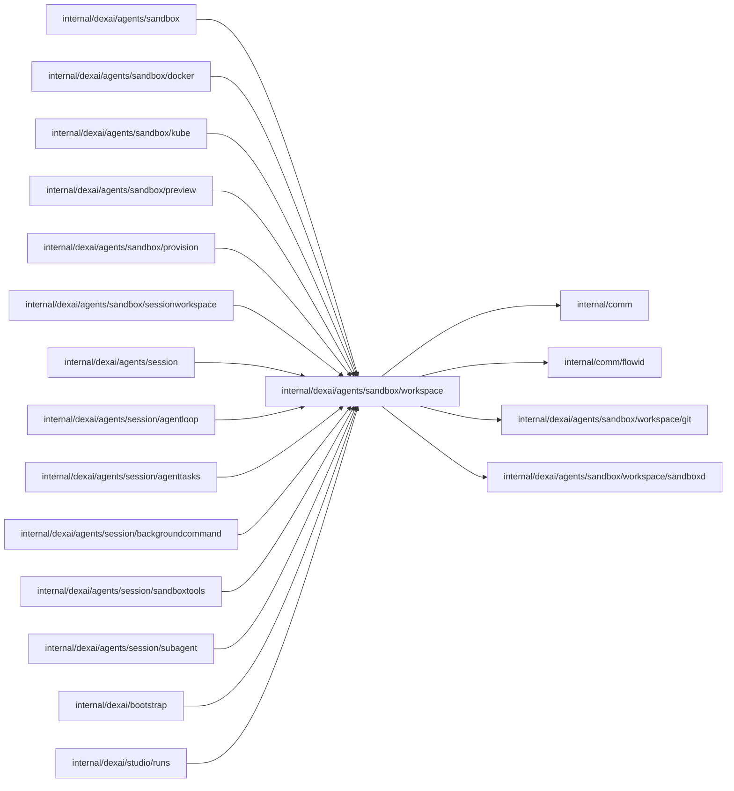

# Session workspace

<!-- BEGIN GENERATED PACKAGE SUMMARY (scripts/check-package-readmes.py; edit only Purpose) -->
Purpose: Gives Session tools and the Sandbox provider one admitted Sandbox's workspace: the pooled sandboxd transport resolved from an accepted lease and the Preview supervisor.

Callers: `internal/dexai/agents/sandbox`, `internal/dexai/agents/sandbox/docker`, `internal/dexai/agents/sandbox/kube`, `internal/dexai/agents/sandbox/preview`, `internal/dexai/agents/sandbox/provision`, `internal/dexai/agents/sandbox/sessionworkspace`, `internal/dexai/agents/session`, `internal/dexai/agents/session/agentloop`, `internal/dexai/agents/session/agenttasks`, `internal/dexai/agents/session/backgroundcommand`, `internal/dexai/agents/session/sandboxtools`, `internal/dexai/agents/session/subagent`, `internal/dexai/bootstrap` and `internal/dexai/studio/runs` import this package.

Dependencies: it imports `internal/comm`, `internal/comm/flowid`, `internal/dexai/agents/sandbox/workspace/git` and `internal/dexai/agents/sandbox/workspace/sandboxd`.

<!-- END GENERATED PACKAGE SUMMARY -->

This package is the Session workspace inside one admitted Agent Sandbox. The
Session Agent's tools, its reclamation, the provisioning and the Preview use the
same code through `Capabilities`. It reads no Flow and owns no durable fact: a
Session replays the `Lease` it accepted, which carries no expiry because the
Session keeps it until it reclaims the instance, and the provisioning and the
Preview pass the `Binding` of the instance they work on. Its sub-packages speak to one Sandbox:
[`sandboxd`](sandboxd/README.md) owns the sandboxd file and process protocols and
[`git`](git/README.md) is the platform's own Git protocol.

## Transport

`Binding` names one instance by provider identities only (isolation boundary,
Service, Sandbox UID, workspace volume UID, generation); the addresses of its
sandboxd are resolved from those identities by the `SandboxAddresses` that
`NewCapabilities` was built with, which the runtime that provisioned the Sandbox
supplies, so no caller can route a tool to another endpoint. Kubernetes resolves the
cluster DNS name of the Sandbox's Service; Docker resolves the ports that the
container carrying the binding's instance UID publishes on 127.0.0.1 now, which a
restart changes, so every new dial resolves them again.
`SandboxResolver` pools one transport per Project, whose one Session works in it. `Bind`
validates the binding, shares one dial between concurrent callers and proves the
process connection READY (five-second probe) before it returns, so an error
wrapping `ErrUnreachable` guarantees that no request was sent. A different
binding of the same Project retires the pooled transport once its borrowers
left; a janitor closes entries idle for ten minutes; a full pool (256 entries)
evicts the least recently used idle entry or returns `errCapacity`; `Close`
closes everything, after which `Bind` returns `errClosed`. Addresses the runtime
cannot resolve, and a probe that fails, are `ErrUnreachable` and retire the entry,
so the next `Bind` resolves and dials again. A READY probe shows that the Service
is reachable now; it does not identify the Pod behind it. `Capabilities.Reach` is
that probe alone: the provisioning waits on it until a freshly Ready instance
accepts connections, before its checkout, and checks it again before it
reports the instance healthy.

## Preview

The Preview runs on the instance's own engine, which the in-image supervisor
`superverse-previewctl` owns (its README in `sandbox/coding/cmd/superverse-previewctl`
is the contract). Every supervisor command runs to its exit through sandboxd
within ten seconds, because the daemon answers over its socket and builds
detached, so a polling round of the Sandbox Step that asks again fits it. Exit
0 is a definite answer (`PreviewAnswer`); any other exit is a supervisor,
transport or usage error that may be asked again, with the supervisor's reason
or the 1.5 KiB tail of its output.

- `EnsurePreviewEnvironment` runs `environment ensure`: `starting`, `ready` with
  the engine's Temporal cluster ID, retention read back and versions, or a
  refusal (`full`, `inconsistent`, `failed`) with its reason.
  `StopPreviewEnvironment` runs `environment stop`: `stopping`, then `stopped`.
- `BeginPreview` delivers the storage credentials as a mode-0600 file under
  `.git`, which Git never commits, and runs `begin --commit SHA` in the tool
  environment, because the supervisor builds and runs repository code, with the
  start's configuration digest and grant generation
  (`DEX_PROJECT_CONFIG_DIGEST`, `SUPERVERSE_PREVIEW_GRANT_GENERATION`) and the
  environment the platform built: the Project configuration grant and the route
  address. No application configuration value enters it. The supervisor
  answers `building`, `starting`, `running` or `source_missing`; an answered
  `failed` (the build failed, or the application exited or missed its health
  probe within five minutes) is `ErrPreviewSupervisor` with the redacted log
  tail.
- `EnsurePreviewSource` runs `source ensure --commit SHA` for an automatic
  deployment, within two minutes because the export runs in the command
  itself: `ready` with the `Path` of the commit's isolated tree under the
  Preview state directory, which keeps at most that tree and the one in use,
  or `source_missing` for a commit the workspace repository does not hold.
- `StopPreview` runs `stop`, which stops the application and keeps the engine:
  `stopping`, then `stopped`.
- `CheckPreviewWorker` runs `status` and requires the application of the
  exact `PreviewIdentity` (prepared commit, configuration digest, grant
  generation) `running` with its Worker listening on `PreviewWorkerAddress`
  (127.0.0.1:18811), so a Flow that Studio Runs starts on the Preview engine
  runs that application's code.

Every configured environment value of eight bytes or more is replaced by
`[REDACTED]` in a supervisor answer or output first, because the supervisor runs
repository code with those values. sandboxd keeps no durable request identity,
so a command's execution identity (the Session FlowID and the instance's
command) only fences a second run while one is in flight.

The Flow definition generator (`preview_definitions.py`, embedded) renders
strict FDG 2.0 of every declared Flow from an isolated archive with the
platform's dexcli, as a tool process, and rejects any diagnostic, a symlink or
a source path outside the archive. It has one mode per owner:

- **HEAD** (`PreparePreviewDefinitions`, PreviewFlow's prepare-preview-source):
  the clean HEAD, which must not change while it runs; it returns the graphs.
- **pinned** (`PreparePinnedPreviewDefinitions`, PreviewFlow's deploy-preview,
  `--pinned <tree> <sha>`): a pushed commit that need not be HEAD, with no HEAD,
  status or working-tree check. The tree must be the commit's export that
  `EnsurePreviewSource` answered: under `$SUPERVERSE_PREVIEW_STATE_DIR/source/`,
  named by the commit and marked with it. It renders the commit's archive and
  returns the graphs with the digest of the tree's `dex-app.yaml`, which the
  caller compares with the AppManifest published from the same commit.
- **worktree** (`checkWorktreeDefinitions`, the commit gate's
  `git.WorktreeDefinitionCheck`, injected by `NewCapabilities`): the tree that
  committing every change would create, written through a copy of the index,
  so neither the index nor the working tree changes. It returns that tree's ID
  with its rendered Flows (`git.RenderedSource`: each Flow's type, its Steps'
  types and its connector Steps), which the commit must hold, or
  the rejection, which wraps `git.ErrFlowDefinitionsRejected`, and runs for at
  most two minutes under a fresh platform execution ID. It renders an isolated
  archive, so the gate runs it beside its static stage.

A generator that rejects the source is `ErrPreviewDefinitionsRejected` with the
1.5 KiB tail of its stderr, which names the failing command, its exit code and
output, or every invalid definition with its diagnostics, including the
blocking ones of a partial graph. A failure of the platform's own preparation,
such as a tree that is not the commit's export, exits with 2 and is an error
that may be asked again, never a rejection. A transport error keeps its cause
and leaves the outcome unknown.

## Bootstrap

`StartBootstrap` is the provisioning's start of the bootstrap command that
HEAD's `.superverse/template.json` declares (`commands.bootstrap`, a
`make <target>` command): it reads the manifest at HEAD, asks the command
ledger for the run ID the caller names and begins it only when the ledger has
no such run, as a foreground run in the workspace root with a 15-minute
lifetime, and returns at once with the run's start (`BootstrapStart`). An
undeclarable command or a ledger refusal is the answer's `Refusal`; any other
error leaves the start unknown and may be asked again, which finds the run
instead of starting another.

## Files

| File | Responsibility |
| --- | --- |
| `capabilities.go` | Facade shared by Session tools and the Sandbox provider, with the bootstrap start |
| `lease.go` | `Lease` and `Binding`, the persisted accepted capability |
| `sandbox_resolver.go` | Transport pool |
| `preview.go`, `preview_definitions.go`, `preview_definitions.py` | The Preview supervisor's commands and Flow Definition generation |
