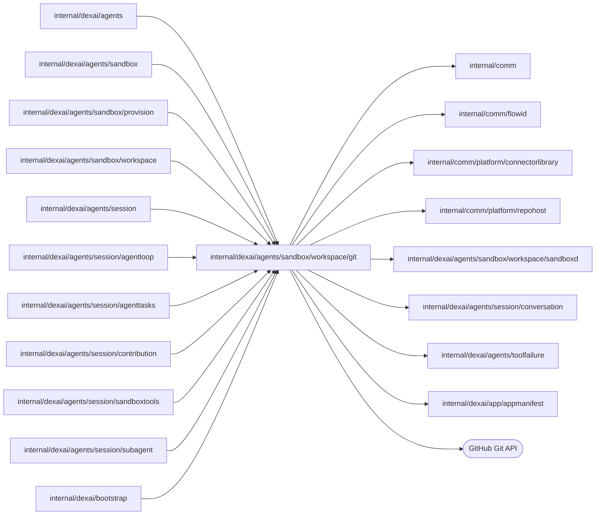

# Git protocol

<!-- BEGIN GENERATED PACKAGE SUMMARY (scripts/check-package-readmes.py; edit only Purpose) -->
Purpose: Runs the platform's own Git commands in a Session's Sandbox for checkout, Agent commits and subagent worktrees, with a trusted environment and per-operation repository credentials.

Callers: `internal/dexai/agents`, `internal/dexai/agents/sandbox`, `internal/dexai/agents/sandbox/provision`, `internal/dexai/agents/sandbox/workspace`, `internal/dexai/agents/session`, `internal/dexai/agents/session/agentloop`, `internal/dexai/agents/session/agenttasks`, `internal/dexai/agents/session/contribution`, `internal/dexai/agents/session/sandboxtools`, `internal/dexai/agents/session/subagent` and `internal/dexai/bootstrap` import this package.

Dependencies: it imports `internal/comm`, `internal/comm/flowid`, `internal/comm/platform/connectorlibrary`, `internal/comm/platform/repohost`, `internal/dexai/agents/sandbox/workspace/sandboxd`, `internal/dexai/agents/session/conversation`, `internal/dexai/agents/toolfailure` and `internal/dexai/app/appmanifest` and calls the GitHub Git API.

<!-- END GENERATED PACKAGE SUMMARY -->

Every Git command the platform runs uses one trusted environment: no system or
global configuration (the image HOME, `/workspace`, is model-writable), no
repository hooks, no credential helper, no prompts. The repository token,
minted per operation by `HostCredentials` from the repository
host alone, exists only in the environment of the commands that talk to the host
and is redacted from every diagnostic before truncation.

`Checkout` clones a fresh volume at the remote default branch. A retained
volume of the same Session is adopted as it is, clean or dirty; it is only
fast-forwarded when it is clean and strictly behind. Only Git's exit code 128
for the repository probe sends a volume down the clone path. A volume with
files but no repository is the platform fault `workspace_not_empty`, and a
retained checkout whose origin is another repository is
`workspace_origin_mismatch`. `Inspect`
reports clean or dirty without changing anything.

`CommitAndPush` first validates the repository, then runs the commit gate
(`commit_source_checks.go`) unless the turn is a blocked handoff. Its stages
stop at the first failure and report their start and end to the call's
progress. The static and definitions stages run side by side (the definitions
program renders an isolated archive and shares no file with the builds) and
report their end once both ended; when both fail, the static failure is the
result. The tests stage's run starts with them and holds its engine until the
gate releases it:

1. **manifest**: a bounded 1 MiB read within 30 seconds validates `dex-app.yaml`
   with the same `appmanifest` parser as Preview and Release, and the working tree's
   `.superverse/template.json` must keep every gate command HEAD declares,
   `checkStatic` and, once declared, `testApplication` (`source_gate_weakened`
   otherwise).
2. **static** (ten minutes): the committed template's `checkStatic` make target
   in the tool environment. A nonzero exit is `source_check_failed` with the
   last 6 KiB of stdout and stderr (`commandTail`, at least a third for stdout,
   where make echoes its commands); Git failures keep the head of their output
   (`commandError`).
3. **definitions** (two minutes): the injected `WorktreeDefinitionCheck`,
   `workspace.checkWorktreeDefinitions`, renders every declared Flow of the tree
   the next commit would hold with the platform's dexcli, as Preview and Release
   render a pushed commit, and returns that tree with them (`RenderedSource`:
   the tree ID and each `renderedFlow`, the Flow type, the type of each of its
   Steps and each connector Step's connection, module and wired branches). A rejection is
   `flow_definition_invalid` with the last 7 KiB of its diagnostics. After a
   passed static stage, because it reads the generated packages, the mock
   guard: `go list -deps ./...` with default tags must not reach
   `.../sdkgo/connectormock`, else `connector_mock_in_production` names the
   importing packages.
4. **tests** (6.5 minutes from the release, `commit_application_tests.go`), when
   HEAD declares `testApplication`: `superverse-previewctl apptest run --run-id gate-<sha256(callID)[:16]>-<nonce>
   --timeout 6m --hold-until /tmp/superverse-apptest-release-<run-id> --hold-timeout 12m -- make test-app`
   in the tool environment (`heldTestRun`), started with the static stage, so it
   queues for the engine lock and starts the engine meanwhile. Once the static
   and definitions stages passed, the gate writes the release file; otherwise it
   cancels the run, which kills its process group with the engine. Its summary line
   ([previewctl](../../../../../../sandbox/coding/cmd/superverse-previewctl/README.md#application-test-engine))
   the stage checks. `application_tests_failed`: the command failed or timed out, or an
   execution's active Step failed at least 3 attempts or with an SDK usage error.
   `application_tests_incomplete`: no test ran through `apptest.Start`, a rendered
   Flow never started, or a wired branch of a mocked connector (one whose module
   has `<name>mock`) never returned. A connector without mocks is waived and listed
   in the report's `Uncovered`. `requirements_untested`: with confirmed
   requirements, an ID that is missing from the trace, names no test and no
   `untested_reason`, or names a test that did not pass in this run.
   `test_environment_unavailable`: the run queued or was held past its deadline,
   the engine did not start twice, or the summary or the executions could not be read. The
   failure lists up to 6 failing tests, the engine excerpts, the coverage and
   requirement lines, the run directory and the `make test-app RUN=...` that reruns
   the named tests, within 7 KiB.

A clean tree at the HEAD the Session already confirmed runs only the manifest
stage; the other stages are `skipped`. A failure is an application failure whose message, at most 8 KiB, names
the stage, its duration and the cause; an unobserved exit or transport error stays
uncertain. A passed gate returns every stage with its duration, the tree it
verified (the rendered tree, or HEAD's tree for a clean accepted HEAD), when the
definitions stage ran, the Steps of the Flows it rendered (`DefinedSteps`, at most
256 `DefinedStep{FlowType, StepType}` pairs, which the commit_and_push result hands
the Session for a matched start's first build), and, when the tests stage ran, its
`ApplicationTestReport` (passed, failed, Flows that ran and the uncovered
connectors). The gate keeps no result cache.

`CommitAndPush` then stages every change, refuses a staged file under
`conversation.AttachmentWorkspaceDirectory` (`.local/superverse-attachments/`,
where `place_attachment` writes the user's attachments) with
`attachment_in_source`, also for a blocked handoff, unstaging everything
(`rejectAttachmentFiles`), and requires the staged tree to be the
verified one (`requireVerifiedTree`): a file that changed after the gate rendered
the tree, such as a tracked file the tests wrote, fails `source_check_failed`
with the changed paths, and the index is reset so nothing stays staged. It
commits with a process-scoped committer identity and the turn marker
`SuperVerse-Turn: <sha256(callID)>` (a 72-byte subject that never splits a UTF-8
character), and publishes without force. Git ancestry, not the newest call ID,
decides the next step: local behind is a checked fast-forward, local ahead a
push (also of several local commits), and divergence rebases and returns
`main_reverification_required` before any push; unrelated histories are
rejected. Remote reads before and after the push reconcile concurrent writes
and lost responses. A failed push that left the branch unchanged keeps its real
diagnostic; only Git's porcelain reject flag makes it `git_push_rejected`. A remote
command (fetch, push, ls-remote) that fails, by exit code or transport, is marked
transient with `sandboxd.MarkTransient`, so Dex repeats the tool within its retry
budget; every decision typed from a result, such as the rejected push or a rebase
conflict, stays a typed failure. A local command that fails is not transient.
`refs/superverse/turns/*` record each turn's base and are removed, best effort,
by a later call. The caller records the returned `CommitResult`.

`RepositoryContext` builds the bounded trusted prompt context from HEAD: its
top-level entries, the template manifest's paths and commands and the
template's `AGENTS.md`.

## Subagent worktrees

A subagent works in its own git worktree of the workspace repository
([subagents](../../../../../../docs/architecture/agent-harness-design/subagents.md#worktrees)).
`agent_worktree.go` runs `agent_worktree.py`, fixed program text that no model
input selects, as one `python3` helper process per operation with the trusted
Git environment; the helper answers one JSON object, and its typed refusals
become tool failures. No helper Git command takes an optional lock
(`GIT_OPTIONAL_LOCKS=0`), so the status read of a snapshot never rewrites the
workspace's index or holds its lock against the main agent's Git commands.
Every operation queries before it writes:

- **`CreateAgentWorktree`** snapshots the workspace through a temporary index
  (`read-tree HEAD`, `add -A`, `write-tree`, `commit-tree -p HEAD`), so the
  snapshot holds the uncommitted and untracked files but no ignored ones and
  the workspace's index, HEAD and files stay as they are, records it as
  `refs/superverse/agents/<agent ID>/base` and checks it out with
  `worktree add --detach` at `/workspace/.git/superverse/worktrees/<agent ID>`.
  Git accepts a worktree inside its own directory, where `git add --all`,
  `git clean` and the main agent's file tools never reach it
  (`TestAgentWorktreeActualSandbox`). An existing base ref is reused. A first
  creation first saves and removes the worktrees of subagents that the caller
  does not name as running, and is refused with `workspace_disk_low` below
  256 MiB free on the volume and with `snapshot_too_large` above 100 MiB of
  uncommitted and untracked files.
- **`FinishAgentWorktree`** saves the worktree on top of its base
  (`add -A`, `commit-tree -p base`) as `refs/superverse/agents/<agent ID>/result`,
  counts its changes (`diff --numstat`) and removes the checkout; the refs keep
  the result. A saved result is reused.
- **`CleanupAgentWorktree`** deletes the base/result refs, checkout directory and
  helper plans and receipts of a closed attempt only after its Session state
  names the old ID. By default it refuses a registered checkout, preserving
  the remote task worktree contract. Platform subagent record expiry alone sends
  `removeCheckout: true` to remove a checkout whose finish could not save; its
  evicted record can no longer be merged. Repeating cleanup after a lost answer
  succeeds without touching a new attempt.
- **`MergeAgentChanges`** merges the result into the workspace file by file,
  three ways: the base is the snapshot, ours the workspace now (snapshotted the
  same way) and theirs the result. A file only one side changed takes that
  side; a text file both changed is merged with `git merge-file --diff3`, and a
  conflict leaves its markers in the file; a binary file, a deletion against a
  change and a file both added keep the workspace's version and are reported.
  Requested paths select the changed files they name, files or directories;
  a path that names no changed file is listed under `unknown`, never as
  unchanged. Each request has its own plan and receipt in
  `.git/superverse/agents/<agent ID>/`, keyed `apply` for every file, `discard`,
  or `apply-<digest>` for the sorted selected paths: the merge writes its plan
  (`plan-<key>.json`), writes only the files that still hold their planned
  pre-image (one that changed since is the conflict `changed_during_merge`) and
  then its receipt (`receipt-<key>.json`), which a repeated request answers. A
  merge of selected paths is therefore not final: a later request merges other
  files, and the files it already merged read as unchanged. A discard or a
  merge of every file closes the changes, and every later call answers that
  receipt. A worktree that the subagent's end could not save is saved first,
  as the finish would, and a subagent whose worktree was lost before it was
  saved has nothing to merge.

## Files

| File | Responsibility |
| --- | --- |
| `credentials.go` | `repositoryToken` and `HostCredentials` |
| `process.go` | `GitOperations`, the `Repository` it serves and the trusted Git command runner |
| `checkout.go`, `commit.go`, `commit_source_checks.go`, `commit_application_tests.go` | Checkout and inspection, commit and push, the commit gate, its test stage with the mock guard |
| `repository_context.go` | The committed template manifest and the trusted repository prompt context |
| `agent_worktree.go`, `agent_worktree.py` | Subagent and Codex task worktrees: creation from a snapshot, finishing into the result ref, the per-file three-way merge with its plan and receipt, idempotent cleanup of a closed task attempt, and typed refusals |
| `connector_contribution.go`, `connector_contribution.py` | Connector contributions: the `ConnectorLibrary` port, the library worktree of a develop subagent and its finish (verify, commit as the committer, push without force, receipt, release candidate) |

## Connector contributions

A `connector_develop` subagent works in a worktree of the connectors library, which
`connector_contribution.py` (fixed program text, one helper process per operation) creates and
finishes. The Sandbox keeps one full clone of the library inside the workspace's Git directory,
`/workspace/.git/superverse/connectors/library`, where the application's Git commands and the main
agent's file tools never reach it, and one worktree per subagent in
`.../connectors/worktrees/<agent ID>`. A full clone, not a partial one: the lazy fetches of a partial
clone would run in the model's own commands, which hold no credential. The remotes come from
`ConnectorLibrary` (`connectorlibrary.Library`): the upstream library, the public library or the local
Git host's copy, each with a token minted for the one operation that only the helper's Git
environment carries (`sandboxd.RunRemoteHelperJSON`, which replaces an error that would show it).

- **`CreateContributionWorktree`** fetches the library's main, refreshing the local Git host's copy from
  GitHub first in the local lanes, and the connector's branch when the remote has it, and checks the
  branch `superverse/<lane>/<projectID>/<slug>` out: from the remote branch when an earlier
  contribution pushed it, otherwise from main. Its base is `refs/superverse/contributions/<agent ID>/base`
  in the clone; a recorded base is reused. A worktree of a subagent that never finished and still
  holds the branch is removed first. It is refused with `workspace_disk_low` below 256 MiB free.
- **`FinishContribution`** saves the worktree as a commit on its base, by the committer the library names
  (the GitHub App's bot with an upstream), with the subject `connector(<slug>): 
` and no
  trailer, into `.../result`. For a completed subagent it verifies that the change touches exactly one
  module below `connectors/` whose `connector.yaml` declares `metadata.name` the slug and whose path ends
  with it, a `new` one adding its `catalog.yaml` entry and nothing else, an `operation` or `fix` one
  changing an existing module and leaving `catalog.yaml` alone. It selects that module with the
  library's `connectorctl test-matrix`, fetches official release tags, then runs its catalog, Studio
  bundle, React and current/latest Dex compatibility Makefile targets before moving the branch. It
  mirrors `test-connectors` with the dependency validator, unit tests, vet, manifest validation and
  generation check, except that unit tests omit `-race` because the coding image has no C compiler and
  CGO is disabled. Race detection runs only in the library CI; CONNCI notifies the agent of a CI
  failure. Failed checks return
  a redacted 4 KiB output tail and leave the worktree editable, with no finish receipt or push. Go
  and npm caches stay on the workspace volume and end with it. Disposable target worktrees use the
  Sandbox's `/tmp`, outside the repository so Go does not infer the application's Git identity; the
  coding profile bounds that volume at 2 GiB. A passed check moves the branch and pushes it
  without force where the library takes pushes, reading the remote branch before (a branch that already
  holds the commit is published; one that moved elsewhere is refused) and after. The receipt
  `.../connectors/contributions/<agent ID>.json` makes each step happen once: a retry after a lost answer
  or a Worker restart reuses the commit and reconciles the push by reading the remote.
- **The release candidate** of a pushed head (the helper's `candidate` operation) is the tag that
  already names the head, or the next `<directory>/vX.Y.Z-rc.N` of the manifest's `metadata.version`,
  read from the remote's tags. Pushed to the upstream library, the head's candidate is only named:
  the library's workflow publishes it ([connectorlibrary](../../../../../comm/platform/connectorlibrary/README.md#release-candidates)).
  Pushed to the local Git host's copy, the helper also builds it as that workflow does, with the
  library's own `connectorctl` at `main`, which the subagent cannot change, in separate worktrees of
  `main` and of the head: `release-candidate` validates the change and the version against the
  connector's latest release, read from the public library, then `ui-artifact` when the connector has
  a Studio UI and `release-artifact` write the assets, and the helper pushes the tag. The finish reads
  the assets (16 MiB each at most) and stores them on the copy (`PublishLocalReleaseCandidate`). A
  candidate the library's rules refuse is `release_candidate_refused`: the contribution still
  completes, and the task notification asks the main agent for a fix. A public read goes without the
  Sandbox's Git redirect, which would send it to the copy.

The first contribution of a workspace creates the helper's directories below `.git/superverse/`. Only
a failure in reaching the remote (a fetch, `ls-remote` or push) or a timeout is transient, exit code 1;
every other helper failure, such as a missing path or a local Git command, repeats when asked again, so
it exits with 2 and becomes a platform `tool_error` at once.

## Tests

These tests call an owned, disposable real sandboxd (`SUPERVERSE_TEST_SANDBOX_GRPC`,
`SUPERVERSE_TEST_SANDBOX_HTTP`) and fail without it; they run with `-tags=live`.

- `TestConnectorContributionHelperActualSandbox` runs the contribution helper in a container of
  `SUPERVERSE_TEST_CODING_IMAGE` against a bare copy of the library there: a workspace's first
  contribution creates its worktree, a finish and its replay commit and push the new connector once, a
  remote that cannot be reached is transient and a workspace without a repository a `tool_error`.
- `TestConnectorContributionGitHubIntegration` is a manual test, like `TestPlatformIssueGitHubIntegration`:
  it runs only when the connector contribution code changes, never in a pull request's default lane
  runs. In a container of `SUPERVERSE_TEST_CODING_IMAGE` it contributes a fresh connector to
  `superdurable/dex-connectors-library-test` through the App's installation there and checks the
  branch, the bot as Author and Committer, the subject without a trailer, a replayed finish, one draft
  pull request against `main` after a repeated opening, and no token in the clone; it closes the pull
  request and deletes the branch. Its inputs are in the
  [integration paths](../../../README.md);
  a missing one fails it.

- `TestAgentWorktreeActualSandbox` instead owns a container of
  `SUPERVERSE_TEST_CODING_IMAGE` (`sandboxdtest.StartCodingContainerForTest`) and needs
  Docker. With the image's own Git and Python it creates a worktree from a dirty
  workspace inside the Git directory without touching the workspace's HEAD,
  index or files, finishes it into the result ref and removes the checkout,
  merges it with every outcome (a change of one side, a clean three-way merge
  and the conflicts `content` with diff3 markers, `binary`, `delete_modify` and
  `add_add`), answers repeated creations, finishes and merges from their
  records, resumes a merge between its plan and its receipt writing each file
  once, discards, refuses a merge without a result and a snapshot above
  100 MiB, saves and removes an orphan worktree and keeps a running one's. The
  disk-budget boundary is covered separately below.

- `TestAgentWorktreeDiskBudgetActualSandbox` and
  `TestConnectorWorktreeDiskBudgetActualSandbox` use real coding containers with
  size-limited tmpfs workspace mounts. A 1 GiB filesystem admits a small dirty
  source snapshot and a checkout of the official connector library; a 128 MiB
  filesystem refuses both with `workspace_disk_low` before creating a worktree.
  These tests do not establish full Preview build capacity or EBS enforcement.

- `TestCommitRecoveryActualGitHubAndSandbox` also needs isolated GitHub effects
  and App credentials (`SUPERVERSE_TEST_GITHUB_EFFECTS=true`, `SUPERVERSE_TEST_GITHUB_OWNER`, `SUPERVERSE_TEST_GITHUB_APP_ID`, `SUPERVERSE_TEST_GITHUB_INSTALLATION_ID` and the App private key in `GITHUB_APP_PRIVATE_KEY_BASE64`). It creates and archives its own repository and covers
  fresh-call recovery, duplicate requests, several local commits, concurrent
  remote commits, rebase and revalidation, a lost success response,
  remote-only fast-forward, a real GitHub push rejection with unchanged heads,
  and a model-written global Git configuration and failing pre-push hook that
  the token-bearing push must ignore.
- `TestApplicationSourceGateActualSandbox` needs a clean, bootstrapped template
  checkout at `SUPERVERSE_TEST_SOURCE_CHECK_COMMIT` and the pinned dexcli in the
  Sandbox. It compiles the real application, renders its Flows with the real
  generator and runs its API tests on the image's real test engine: every stage
  passes with durations (logged as `duration_ms`), the definitions stage
  starting beside the static stage and reporting, as `DefinedSteps`, the Steps
  the embedded catalog lists for the default example, three tests, one Flow that
  ran and the llm connector listed as untested, and the unchanged tree stages as
  the verified one; a failure of both the static and the definitions stage reports static;
  a test that writes a tracked file passes the stages and fails the tree check
  without staging a file; a deployment-schema error, a previously accepted invalid
  HEAD, a changed or removed `checkStatic`, a removed `testApplication`, a
  TypeScript error after more than 6 KiB of output on each stream, a Step without
  a group behind a disabled template FDG check, a failing assertion
  (`application_tests_failed` with the test and its rerun command), deleted tests
  (`application_tests_incomplete`), a production import of the connector mock
  contract (`connector_mock_in_production`, from a local module of the disposable
  checkout) and a confirmed requirement without a passing test
  (`requirements_untested`) each fail their stage without moving HEAD or staging
  a file; a complete trace passes; a taken engine port is the platform's
  `test_environment_unavailable`; a clean accepted HEAD repeats no build and no
  test and reports no Step. `TestExampleSourceGatesActualSandbox` requires the
  same of every other example's composed tree: every stage passes and
  `DefinedSteps`, compared as a set, is the catalog's Steps of that example.
  It is an external test package because it injects the workspace package's
  check; `export_test.go` exposes the gate to it.

## Candidate asset confinement

The local connector candidate helper rejects symlinked output directories and
non-regular entries (including symlinks, directories and FIFOs) with
`release_candidate_refused` before returning any asset paths. It opens each
regular asset with `O_NOFOLLOW`, bounds it to 16 MiB, and returns its relative
path, size and SHA-256. The platform accepts only paths under that agent's
`.git/superverse/connectors/candidates/<agent ID>/` directory, then compares
sandboxd's read with the recorded size and digest before publishing any assets.
A size or digest mismatch produces `platform_command_unavailable` and no
asset set to publish. Filesystem read failures retain their typed error. The filesystem API may still follow a swapped symlink
while reading; integrity validation prevents publishing different bytes.
`TestConnectorCandidateAssetsActualSandbox` exercises regular assets, symlinks,
directories, FIFOs, output-directory symlinks and replacement after validation
against a real coding Sandbox and its filesystem API.
