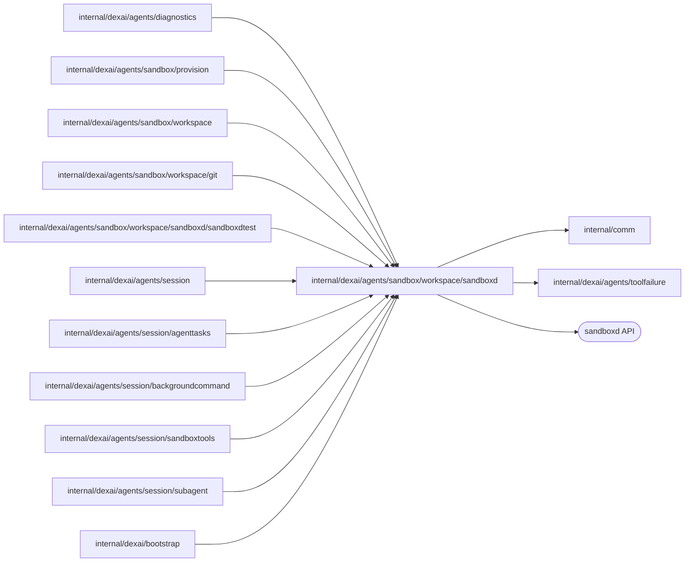

# sandboxd protocols

<!-- BEGIN GENERATED PACKAGE SUMMARY (scripts/check-package-readmes.py; edit only Purpose) -->
Purpose: Speaks the sandboxd file and process protocols of exactly one Sandbox, and runs the coding image's JSON helpers, for the workspace, Git and Agent tool packages.

Callers: `internal/dexai/agents/diagnostics`, `internal/dexai/agents/sandbox/provision`, `internal/dexai/agents/sandbox/workspace`, `internal/dexai/agents/sandbox/workspace/git`, `internal/dexai/agents/sandbox/workspace/sandboxd/sandboxdtest`, `internal/dexai/agents/session`, `internal/dexai/agents/session/agenttasks`, `internal/dexai/agents/session/backgroundcommand`, `internal/dexai/agents/session/sandboxtools`, `internal/dexai/agents/session/subagent` and `internal/dexai/bootstrap` import this package.

Dependencies: it imports `internal/comm` and `internal/dexai/agents/toolfailure` and calls the sandboxd API.

<!-- END GENERATED PACKAGE SUMMARY -->

`SandboxClient` speaks the sandboxd file and process protocols of exactly one
Sandbox. A process stream owns its caller's cancellation and timeout from before
dispatch: it sends the sandboxd process-group SIGKILL with an independent
five-second deadline before it cancels the transport and releases the execution
ID. A process-local reservation fences a late Init, cancellation and release
against a later stream with the same `ExecutionID`; it is disposable ownership,
not a persisted ledger. A missing Init or Exit, or a failed kill, stays an
uncertain result, and signal acknowledgement is no proof of rollback. A Start
that sandboxd refuses before Init with `InvalidArgument`, `NotFound` or
`PermissionDenied` is `ErrProcessNotStarted`: no process ran and the execution ID
is released. The pinned sandboxd reports a missing working directory as
`fork/exec <command>: no such file or directory`, the same text as a missing
command. sandboxd
has no durable Start request identity or reattachment, so the Agent's commands
run through the command ledger (below), which keeps that identity in the Pod.
A tool call derives its `ExecutionID` from its Flow and Call identity
(`DeriveExecutionID`); a platform command that is not a tool call, such as Git
or a commit gate stage, gets a fresh one per run (`PlatformExecutionID`).
Every process gets stdin EOF right after Init. Combined output beyond its budget
(16 MiB at most) kills the process with the call failure
`command_output_limit_exceeded`, whose effect is partial
(`process_output_limit_exceeded`, a platform fault, for the platform's own
helpers). A stream whose `StartRequest.Timeout` passes kills the process group
with the cause `errProcessTimeout`; `TimedOut` reports that the kill was
confirmed, and a kill that could not be confirmed wraps `errProcessStopFailed`.

## Typed failures

`ToolFailure` is a failure whose outcome is known and safe to return to the
model: a `toolfailure.Code`, which names its owner (the call, the application or
the platform), and a `toolfailure.Effect` (none, completed, partial or unknown),
all declared once in [`toolfailure`](../../../toolfailure/README.md).
`NewToolFailure` creates one with the effect none; `WithEffect` and `WithDetail`
refine it and `Rewrap` replaces its cause while keeping the rest. Every other error stays ordinary, and `IsTransient` tells the
caller by type, never by message, whether repeating the call can help: gRPC
`Unavailable`, `ResourceExhausted`, `Aborted` and `DeadlineExceeded`, sandboxd
HTTP 429, 502, 503 and 504, network errors, connection resets and refusals,
an unexpected EOF, a stream without an exit and a deadline, and any error that a
caller passed through `MarkTransient`.

`ToolProcessEnvironment(root)` is the overlay of every process that runs
repository code in an agent root (`HOME=/tmp`, `PAGER=cat`, `GIT_PAGER=cat`
and the root as Git's safe directory); `GitProcessEnvironment` is the trusted
environment of every Git command and helper the platform itself runs (see
[the Git protocol](../git/README.md)).

## Command ledger and JSON helpers

`RunHelperJSON` runs one of the coding image's JSON helpers (`superverse-exec`,
`superverse-files`) as a bounded helper process: exit code 0 is the helper's
answer, exit code 1 a helper error that is transient, exit code 2 with a JSON error
one that a repetition repeats, a platform `tool_error` with the helper's message, and
an oversized answer, another exit or a helper the image lacks is a platform fault.
`CommandLedger` speaks the
[ledger contract](../../../../../../sandbox/coding/cmd/superverse-exec/README.md):
`Begin` starts a command once per `ExecutionID` in the tool environment of its
working directory, the agent root, and `Status`, `Background` and `Stop` read
and steer the run by that ID. An answer outside the contract is
`platform_command_unavailable`. Each call is one helper process, so the ledger,
not this client, keeps the command and its supervisor across calls, Worker
restarts and transport loss.

## Files

| File | Responsibility |
| --- | --- |
| `sandbox_client.go` | `SandboxClient`, its configuration and the protocol bounds |
| `sandbox_client_process.go` | Process streams, run-to-exit and JSON helpers |
| `command_ledger.go` | The command ledger client |
| `sandbox_client_files.go` | File reads and writes of the sandboxd file API |
| `sandbox_requests.go` | Request and result types and execution IDs |
| `tool_failure.go`, `workspace_path.go` | Typed failures and transient faults, workspace paths |
| `process_environment.go` | Tool overlay with the lane's module redirects (`ModuleRedirect`: in the local lanes the connectors library's Git fetches go to the local Git host's copy, and the module skips the checksum database) and the trusted Git environment |

`sandboxdtest` connects tests to the owned, disposable real sandboxd.

## Tests

These tests call an owned, disposable real sandboxd (`SUPERVERSE_TEST_SANDBOX_GRPC`,
`SUPERVERSE_TEST_SANDBOX_HTTP`) and fail without it; they run with `-tags=live`.
`TestSandboxStdinActualAPI`, `TestSandboxCancellationActualAPI`,
`TestSandboxStartBudgetActualAPI` (with the runner-owned container
`SUPERVERSE_TEST_SANDBOX_CONTAINER`), `TestSandboxExecutionReuseActualAPI` and
`TestSandboxStartRefusalActualAPI` cover stdin EOF, deadline, cancellation and
close of process groups, the pre-dispatch budget, execution ID reuse and a start
refused for a missing working directory or command.

`TestCommandLedgerActualSandbox` and `TestFileHelperActualSandbox` own their
containers of `SUPERVERSE_TEST_CODING_IMAGE`, a coding image built from the
current source (`sandboxdtest.StartCodingContainerForTest`), and need Docker: the ledger starts one command for 20
concurrent begins of one ID, reads output windows by offset, ends a process
group at its lifetime and at 16 MiB of output, stops idempotently, refuses a
missing working directory and a fifth background command, collects garbage,
reports `lost` after a container restart and `instance_replaced` on a new
container; the file helper's operations, typed failures and path rules hold.
