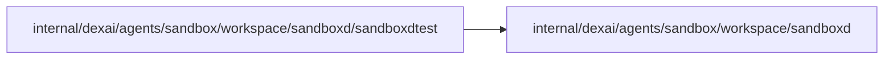

# sandboxd test client

<!-- BEGIN GENERATED PACKAGE SUMMARY (scripts/check-package-readmes.py; edit only Purpose) -->
Purpose: Connects integration tests of the Sandbox workspace packages to an owned, disposable real sandboxd: one the environment names, or a coding image container the test runs.

Callers: no production package imports this package.

Dependencies: it imports `internal/dexai/agents/sandbox/workspace/sandboxd`.

<!-- END GENERATED PACKAGE SUMMARY -->

`ClientForTest` connects an integration test to the owned, disposable real sandboxd
named by `SUPERVERSE_TEST_SANDBOX_GRPC` and `SUPERVERSE_TEST_SANDBOX_HTTP`.
Missing endpoints fail the test; the connection closes with it.

`StartCodingContainerForTest` instead runs a container of `SUPERVERSE_TEST_CODING_IMAGE`,
a coding image built from the current source, that the test owns: the image's
entrypoint with sandboxd's ports published on loopback, removed with the test.
`Restart` restarts it like a container restart in a Pod (a new PID 1, the same
`/tmp`) and `Replace` replaces it like a new Pod. It needs Docker; a missing image
fails the test.

| File | Responsibility |
| --- | --- |
| `owned_sandboxd.go` | `ClientForTest` of the owned sandboxd the environment names |
| `coding_container.go` | `codingContainer`: a coding image container a test owns, its restart and replacement |
