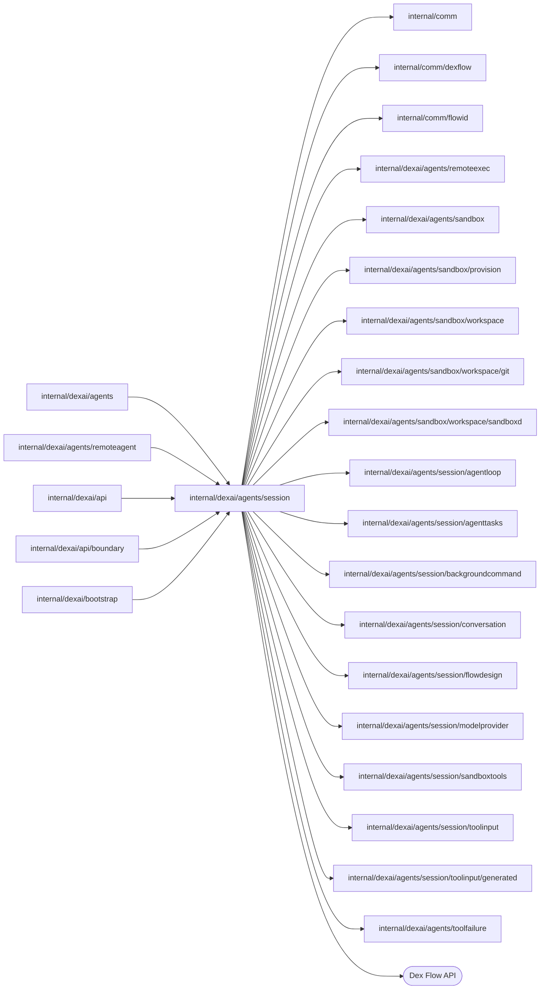

# Session Agent

<!-- BEGIN GENERATED PACKAGE SUMMARY (scripts/check-package-readmes.py; edit only Purpose) -->
Purpose: Owns SessionAgentFlow, the durable coding Agent of a Project's one Session, for the Session Service and API: its Flow, client, bootstrap and every helper that touches its primitives.

Callers: `internal/dexai/agents`, `internal/dexai/agents/remoteagent`, `internal/dexai/api`, `internal/dexai/api/boundary` and `internal/dexai/bootstrap` import this package.

Dependencies: it imports `internal/comm`, `internal/comm/dexflow`, `internal/comm/flowid`, `internal/dexai/agents/remoteexec`, `internal/dexai/agents/sandbox`, `internal/dexai/agents/sandbox/provision`, `internal/dexai/agents/sandbox/workspace`, `internal/dexai/agents/sandbox/workspace/git`, `internal/dexai/agents/sandbox/workspace/sandboxd`, `internal/dexai/agents/session/agentloop`, `internal/dexai/agents/session/agenttasks`, `internal/dexai/agents/session/backgroundcommand`, `internal/dexai/agents/session/conversation`, `internal/dexai/agents/session/flowdesign`, `internal/dexai/agents/session/modelprovider`, `internal/dexai/agents/session/sandboxtools`, `internal/dexai/agents/session/toolinput`, `internal/dexai/agents/session/toolinput/generated` and `internal/dexai/agents/toolfailure` and calls the Dex Flow API.

<!-- END GENERATED PACKAGE SUMMARY -->

`internal/dexai/agents/session` owns SessionAgentFlow, the durable coding Agent of a
Project's one Session, `session-<projectID>`, which ProjectFlow starts when the
Project becomes READY and only the Project's deletion closes
([the current contract](../../../../docs/architecture/agent-harness-design/session.md)).
The [Session design](../../../../docs/architecture/agent-harness-design/session.md) owns
its runtime, workspace, model, prompt and tool contracts, and
[the current contract](../../../../docs/architecture/agent-harness-design/sandbox.md)
the Sandbox instance lifecycle: the Session holds the request side, the
accepted lease and the Sandbox deadline, lends the instance to its
`PreviewFlow` and decides when it is idle, and its
[`SessionWorkspaceFlow`](../sandbox/sessionworkspace/README.md), the instances'
owner, provisions each instance through a `SandboxProvisionFlow` and reclaims
its Pod at the Session's command, keeping the volume until the Project is
deleted. With each successful pushed tool result
it hands that commit to its `PreviewFlow` (`PreviewHandoff`,
`DeployPreviewHandoff`) while `PreviewAutoDeploy` is on, which the RPC
`UpdatePreviewAutoDeploy` switches and the Snapshot reads, and the Preview's
`delivery` notifications return the outcome: a ready Preview holds the
instance for `sandbox.previewHold`, and a failure the application owns opens a
bounded automatic turn. The Live release and deployment Flows report their
failures as `delivery` notifications of the same path, through the Session
Service ([the current contract](../../../../docs/architecture/agent-harness-design/sandbox.md)).
The user's "Keep running for 7 days" (`RenewSessionWorkspace`) holds the READY
instance for seven days (`agentloop.KeepRunningHold`).
[Composition](../../../../docs/architecture/agent-harness-design/composition.md)
describes how the server injects its dependencies, and
[Development](../README.md) separates static checks
from real acceptance.

This package holds the Flow, its client and bootstrap and every helper that reads
or writes a Flow primitive; the primitives are unexported variables of the Flow
file. The values the Flow exchanges with its model provider live in
[`conversation/`](conversation/README.md) and the pure decisions of the loop in
[`agentloop/`](agentloop/README.md).

## Step graph

CallModel and CompactContext replay the current context segment after a short
executor-locked admission stamps their original epoch, generation and Turn.
They stream best-effort activity and return a bounded outcome, without writing
AgentState or context after provider transport. RecordPlatformModelResult freshly
checks that admission under the message/executor/interrupt locks before recording
reply, summary or rejection. A tool-bearing compaction response returns only a
correction request; the fresh result boundary re-admits CompactContext with
ToolChoiceNone before its second provider request. Exhausted transport retries
route to the original admission's fenced RecordModelFailure or
RecordCompactionFailure.

RouteTool routes the tool call at the cursor of `AgentState.PendingToolCalls`:
`write_todos`, `set_effort` and `confirm_requirements` finish there (a card is recorded as
the next version of `ConfirmedRequirements`, with its design in `FlowDesigns[confirmed]` and its
Steps in `WrittenDesignSteps`, and the turn goes on), `start_timer` waits in AwaitAgentTimer, and `request_user_input` in
AwaitUser. SendMessage records and answers a requirements card a Session still waits at from
before cards stopped waiting, and the start Step queues the first message the Session started with. Consecutive
parallel-eligible calls fan out to ExecuteParallelTool branches joined by
AwaitParallelToolResults; any other call runs in ExecuteTool, after AwaitToolApproval
when it needs approval. CheckSteered commits ExecutingTool status together with the
serial RunningTool record before scheduling ExecuteTool, so snapshots describe the
active call while ExecuteTool runs. RouteTool also takes AgentInterrupt's lock and applies a
pending Stop before any built-in or parallel-wave admission. The Stop and its
interrupted results commit under the conversation lock before any work can start. A call whose retries are exhausted is recorded as
a platform failure the model reads, by RecordToolFailure for a serial call and by the branch's
RecoverParallelToolExecution for a branch of a wave; a `bash` command that timed out or
exhausted its retries is settled from the Sandbox's command ledger by
SettleForegroundCommand. Each platform failure of a tool or model call starts
ReportPlatformIssue beside the turn, which never waits for it: without a lock it starts
the PlatformIssueFlow of the failure's signature through the Session Service, which
files the issue and records the outcome ([the reports](../platformissue/README.md)), and
retries only a failed start; AbandonPlatformIssue, its failure route, ends a report whose
start exhausted its retries.

The Session holds the request side of its Sandbox instances. The workspace cold
path (RequestSessionWorkspace, SendWorkspaceCommand, AwaitSessionWorkspace,
ApplySessionWorkspace) is the only conversation path that calls
`SessionAgentFlowDependency`: beside the first platform model call, at remote
activation for the first brief, when no usable lease is admitted and when the
transport proves the instance unreachable. The first model call does not wait for
the workspace ([the decision](../../../../docs/architecture/agent-harness-design/sandbox.md#gates-and-the-cold-path)):
`planModelCall` opens the first segment at once, without the repository context and
with the catalog matches of the request (`connectorCatalogMatcher`, the server
replica's warm copy of the published catalog, read without a network call), and the
boundary Step moves to CallModel and, with `GoToMany`, to RequestSessionWorkspace with
`ContinuePrepareContext`. That request, like the one remote activation starts with
`ContinueAwaitRemote`, runs beside the conversation and never resumes it
(`Continuation.IsBesideConversation`): a workspace tool called meanwhile joins it and
waits, and its owner hands that continuation back when the request settles, READY or
failed. A segment opened without the repository context awaits it
(`ContextSegment.AwaitsRepositoryContext`); the first model-call boundary after the
workspace read it appends it once as a user notice (`agentloop.RepositoryContextNotice`)
and clears the mark in the same commit. A failed request appends nothing. It sends the
SessionWorkspaceFlow a `provision` command, which reclaims an earlier instance
first, and waits for the outcome that Flow reports to `ReportWorkspaceOutcome`.
A tool holding an admitted lease reaches the Sandbox directly. At the Sandbox
deadline AwaitSandboxDeadline decides under the Workspace lock that the
instance is idle and revokes the lease, and SendWorkspaceCommand then sends the
`reclaim` command; the workspace Flow deletes the Pod, keeps the volume and asks
the Preview to release the instance only while the Preview holds it.

A background command's end reaches SessionNotifications through AwaitBackgroundCommand,
which waits for the [`BackgroundCommandFlow`](backgroundcommand/README.md) SubFlow that
follows the command in the ledger and then records the end. While the command runs the
Session holds only that wait, so its turns and its move to a new run never wait for it;
CheckSteered and AwaitUser deliver notifications, and AwaitUser opens a bounded number
of automatic turns. InterruptAgent is the Stop button. Its existing AgentInterrupt Attribute owns
the first actor and MarkerWritten: AwaitUser writes before new input/notifications,
FinishInterrupt can write an idle marker while retaining suppression, and the turn
end skips that marker but still cleans up. FinishInterrupt and its STARTING-subagent
cleanup match the admitted Turn and RequestedAt, never Turn alone. Old ending
inputs without RequestedAt recover only a same-current-Turn, unwritten ending
Stop, using its Attribute actor; old non-ending inputs perform only idempotent
STARTING cleanup for a same-current-Turn non-ending Stop, without marker writes
or interrupt consumption. Absent MarkerWritten means false.
Each successful commit_and_push result schedules DeployPreviewHandoff beside CheckSteered.
The Agent continues without waiting for the build, and Stop preserves its accepted handoff.

The main agent delegates to subagents, each one
[`SubagentFlow`](subagent/README.md) execution, and keeps one `SubagentRecord` per
subagent in the AttributeMap `Subagents`, keyed by the agent ID
([agenttasks](agenttasks/README.md)). RouteTool admits a `start_agent` call (at most
three subagents run and at most six start between two user messages) and writes its
STARTING record; ExecuteTool creates the subagent's worktree and starts its Flow
through the Session Service. A worktree the Sandbox refuses deletes the record,
because a refusal proves that no attempt started the subagent; any other failure is
retried, and exhausted retries fail the record. `stop_task` stops one subagent, and
`merge_agent_changes` merges or discards what it saved and, for a discard or a merge
of every file, closes its record. The RPC `AdmitSubagent` marks the record RUNNING
for the subagent's first Step, and the subagent's task notification records its end
through `ReportSessionNotification`.
RouteTool evicts only the oldest finished record when the retained 50 are full and
stores its ID in the optional `PendingSubagentWorktreeCleanup` string Attribute.
Before creating the next platform subagent's worktree, ExecuteTool uses a
separate committed attempt to clean that expired checkout, its base/result refs
and merge receipts through the Sandbox helper. It clears the ID only after
confirmation; an uncertain result repeats the same ID. Exhausted cleanup retries
answer the start without an unadmitted record, leaving one pending ID for the
next platform start. A switch to remote mode pauses this work; Project deletion
removes the volume. No finished record that remains addressable is cleaned.
If the Sandbox is unreachable during cleanup, the same start takes the workspace
cold path without consuming a retry, then repeats the idempotent cleanup on the
replacement instance, including when that worktree was already removed.

The platform connector subagents follow the same path. For a `connector_develop` call, which names
the connector's slug and the contribution, RouteTool also refuses a slug another
unfinished develop subagent works on and a 17th distinct slug, counted over
the union of `AgentState.ConnectorSlugs` and the remote contribution map, which keeps every
slug an admitted call named; and
ExecuteTool creates the subagent's worktree of the connectors library on the connector's
branch instead of an application worktree. Each submitted contribution is a
[`ConnectorContributionFlow`](contribution/README.md), which the Session Service starts
when the completed subagent's report reaches the Session. Remote mode uses two
non-model tools instead of a platform subagent: `start_connector_contribution`
prepares the worktree and `submit_connector_contribution` commits, pushes and submits
its head. `ConnectorContributions` keeps only the remote attempt and its effect
identities; the contribution Flow owns PR and RC state. The Snapshot names the union
of platform and remote slugs whose contribution Flow snapshots Studio reads.

Every write of a STARTING record whose subagent may have started holds the
AgentInterrupt lock: a Stop marks the starting subagents STOPPED in FinishInterrupt,
while that Stop is still pending, or at the turn's end, so their admission is denied,
and RecordToolFailure fails the record of a `start_agent` call whose retries ran out.
A pending `start_agent` call that a Step answers without its ExecuteTool started no
subagent, so that Step forgets its record: CheckSteered when steering supersedes the
call, and the cold-path Step that settles a workspace the call waited for and that
could not be prepared. InterruptAgent stops the running subagents. A record that has
not reported within an hour after its kind's time limit counts as lost and ends for the
Session: it holds no running place and no Sandbox, no Stop applies to it, `stop_task`
reports it lost and `merge_agent_changes` merges what its worktree holds. An unfinished
subagent holds the Sandbox deadline and refreshes its lease through
`RequestSessionWorkspace{ForAgentID, Lost}`; the deleting Project's cleanup, which
archives the Session first, stops it before the Sandbox is released.

## Executor and remote turn contract

### Dex Flow Changes

`SessionAgentFlow` retains FlowID `session-<projectID>` (for example
`session-project-42`), the Project's admitted start fingerprint, disallowed ID
reuse, parent ownership and existing cleanup receipt. Pairing, activation,
takeover, reconnect and duplicate reports do not start another Flow or Run.
Project deletion still archives the Session before completing its engine
execution; archival is read-only, while an offline remote executor stays remote.
Absent `Executor` in an old open Session means platform epoch 0, without writing
a default. A `RemoteExecutor` persisted before `Consumed` existed reads `Consumed`
0. Pre-launch, remote executions opened before that change are not supported
across it: reset them explicitly (switch the Session to the platform, or delete
the local data) rather than infer their settlement; historical settlement is
never derived from an empty `RemoteInbox` or from admission. Existing Flow/Step names and primitive keys remain unchanged;
`AwaitRemoteAgent` and `RecordPlatformModelResult` are additive.

| Primitive | Value and ownership | Admission, locking and retention |
| --- | --- | --- |
| `Executor` Attribute | Ordinary `remoteexec.Executor`: platform/remote mode, monotone Epoch/Generation, optional Remote `{ConnectionID, Owner, Binding, Reported, Consumed, ActivatedAt}` and optional platform Handoff `{Epoch, From, To, Owners, Reason}`. `Reported` is the admission watermark; `Consumed` is the highest report of this epoch and connection that a consuming commit took from `RemoteInbox`, the base of `SettledThrough`. No credentials or indexed fields. | One authoritative fixed Attribute under `executorLock`; kept for the Session lifetime. Generation is nonzero after activation. `ReportRemote` advances `Reported` with the Channel publication; only the AwaitUser or AwaitRemoteAgent commit that consumes a report advances `Consumed` (`Executor.Consume`), never admission or Channel reservation. Both restart at 0 with a new epoch. Latest four chronological handoff owners, binding at most 8 KiB. No mirrored flag, lifecycle, projection or database row. |
| `RemoteInbox` Channel | `remoteexec.InboxItem`, exactly one server-created Report or Control. Report contains authenticated connection/owner, epoch/generation/sequence/provider turn, and exactly one of public Events, ToolCall or TurnCompleted. Control is `ExecutorChanged`, with diagnostic epoch/generation; consumers read current Executor. | `ReportRemote` and `SetExecutor` publish under `executorLock` in the same commit as admission. At most 8 pending reports, with their actual encoded union payload at most 2 MiB; events at most 32, each 64 KiB, arguments 256 KiB. Control admission inspects the actual pending Channel and publishes only if none is pending. At most one pending control plus one selected by the sole active consumer; this graph/race bound requires real Dex verification. |
| Existing `AgentInterrupt` Attribute | Adds optional `PreserveBackground`; existing Turn/RequestedAt/Actor/MarkerWritten remain authoritative. | `interruptLock` and `executorLock` fence Stop and takeover. A remote Stop increments generation before any report, including an idle executor. A repeated Stop joins its admitted request; an explicit user Stop can replace a pending takeover interruption. Takeover preserves background commands and uncertain-effect ledger. |
| Existing `AgentState` Attribute | Adds `PendingToolsAdmission` (`remoteexec.Fence{Epoch, Generation}`) to the existing pending tool batch. No connection metadata or credentials. | Model results copy their original admission; accepted reports copy their original report fence. Turn start, Stop, cancellation and exhausted cursor clear the stamp. Serial/parallel/recovery inputs carry the original call, Turn and fence, never a value rebuilt after transport. Already dispatched operations retain their existing settlement policy. |
| `ConnectorContributions` AttributeMap | `agentloop.ConnectorContributionAttempt` keyed by canonical connector slug, e.g. `superversemock`; contains kind, worktree ID/path, base commit, `OPEN`/`SUBMITTED`/`FAILED`, start and submit CallIDs, attempt number, summary, submitted result and timestamp. The contribution Flow owns PR and RC. | RouteTool admits under its interrupt lock; ExecuteTool loads the exact slug. File tools and `SettleForegroundCommand` recovery load at most 16 keys to select an OPEN worktree root; the latter declares the whole-map load required for enumeration. The union with platform `AgentState.ConnectorSlugs` enforces 16 distinct connectors and supplies Snapshot lookup. Retained for Session lifetime, removed on Project deletion. No credentials or indexed fields. |
| `TaskWorktrees` AttributeMap | `agentloop.TaskWorktree` keyed by validated task name, e.g. `build-ui`; holds the Codex task checkout ID/path/base, attempt, `OPEN`/`SAVED`/`MERGED`/`DISCARDED`, call IDs, final receipt, predecessor cleanup ID and close time. The Git helper owns snapshot and merge effects. | RouteTool admits under `interruptLock`; ExecuteTool loads one name for merge and at most 16 for open and keep selection. File calls load at most 16 for root selection. Three checkouts may be OPEN; closed records are evicted at 16 and their refs cleaned by the next open. Kept through the Session, with no credentials or indexed fields. |
| Existing `ContextSegment` Attribute | Adds optional Summary (8 KiB) and executor reason; ordinary struct, not another lifecycle. | First actual platform turn consumes a matching Executor.Handoff after old work settles. Its retained suffix is chronological, contiguous, starts user role and keeps complete tool-use/result units within half the compaction budget. One final handoff entry at most 16 KiB supplies summary, owners/time, requirements, HEAD, todos and background IDs. No model call or compaction during the switch. |
| Existing message maps | `CurrentMessages` and exact-key `ArchivedMessages`; keys remain decimal entry sequence and ten-entry chunk first sequence, e.g. `101`. | Remote mode trims to the last 1000 entries independent of an old platform segment. Dropped and incomplete units cannot enter the handoff. ReadRemote loads at most 16 exact current keys or one exact ten-entry archived chunk per data pass, never a whole map. |

No new Channel or ChannelMap exists. Existing tool/task/workspace map keys,
external-effect identities, lease validation, deadlines, cancellation and ledger
reconciliation are retained. InterruptAgent captures original foreground CallID and accepted credential-free workspace Lease in its existing Step payload, without tool arguments. Legacy fallback requires the exact stopped Turn and pending interruption identity; unprovable identity or stale lease reports Stop-specific uncertainty and never command success. Pending RemoteInbox messages remain retained at
Session completion, like existing Channels; the closed Session refuses writes.

| RPC/Step | Purpose and primitives |
| --- | --- |
| `ReadExecutor(SessionScopeInput)` | Unlocked read of exact Project, ACTIVE status and Executor; typed client checks live execution. Pairing admission and UI use it; SQL remains the credential/authentication boundary. |
| `SetExecutor(SetRequest)` | Scoped, ACTIVE write under status/executor/interrupt locks. BasisEpoch CAS has one winner; only same-current-connection retry is idempotent despite an old basis. A replaced connection cannot recapture. Mode change increments epoch and generation atomically, records existing interruption and coalesces a control wake. On remote activation it stores the current `AgentState.LastSequence` as `Executor.Remote.ActivationSequence` in the same commit and returns that fixed head on a repeat. A remote activation with empty stored repository context also starts an independent workspace request with `ContinueAwaitRemote`; its owner alone waits for the outcome, and a joining tool demand ends its branch until the owner resumes it. Uninterruptible commit finishes and records its result before the old turn ends. It never cancels a question's AwaitUser. |
| `ReportRemote(ReportRequest)` | Scoped ACTIVE write; exact connection/epoch/nonzero generation, expected next sequence and actual pending payload bounds. Duplicate admitted sequences publish nothing; gap returns expected sequence. Watermark and new Channel item commit together. External HTTP body maximum is 512 KiB at the owning endpoint. |
| `AwaitUser` | In either executor mode subscribes to RemoteInbox. Records selected accepted answers before takeover settlement; direct Orca input still enters the canonical history. Unanswered pending input gets a takeover notice. Reads latest Executor regardless of wake reason. |
| `AwaitRemoteAgent` | WaitFor on its own reports, steering and notifications, with no timer/history polling. Consumption rechecks fences, drops stale events and records interrupted results for stale tool calls. Public text/imported user entries persist once; activity stays best effort. |
| `CheckSteered` / `RouteTool` | Remote tools use `agentloop.RemoteTools`, not ContextSegment. Consecutive head tool reports form a batch of at most four with stable `remote-<epoch>-<sequence>` IDs; one model-call-limit charge per batch. Existing strict decoders, approvals, requirements, questions, sandboxd transport, parallel read-only waves and timeouts apply. RouteTool checks Stop while holding interruptLock in either mode before built-ins or a wave. |
| `ExecuteTool` connector path | `start_connector_contribution` calls the existing `CreateContributionWorktree` with a stable ID derived from FlowID and CallID and records its base. `submit_connector_contribution` calls `FinishContribution`, then the Session Service's `SubmitConnectorContribution`, which queries the contribution Flow snapshot before mutating. Existing tool timeouts, heartbeats, retry and cancellation apply; worktree and branch receipts reconcile uncertain commit/push. The call answers acceptance, while the existing connector notification reports the RC outcome. |
| `CallModel` / `CompactContext` | Each attempt checks its captured platform fence before transport, retains existing SYNC retry/deadline/heartbeat budgets, and produces a typed outcome capped at 16 MiB encoded total. Field preflight accounts for JSON escaping before whole-payload marshal. An oversized successful response becomes a bounded declared failure without retrying the provider or cutting replay blocks, tool JSON or signatures. |
| `RecordPlatformModelResult` | Execute-only short Step: message-window/executor/interrupt locks, short retries, selective compaction archive/prompts loads. Checks original platform mode, epoch, generation and Turn before any durable mutation. Stale outcomes end their branch. Fresh compaction corrections schedule a new admitted provider Step; fresh results append history and update the existing context/state atomically. Its movement input is durable Dex execution data, including only the private provider replay material the existing platform path retained; it is never remote delivery or public history. |
| `ReadRemote(ReadRequest)` | Scoped current connection/epoch query-only public projection: input/answer/notice/notification not submitted by this connection, and its exact-epoch tool results; excludes assistant, thinking, system and opaque args. Generation, interrupt, question context, requirements, todos, HEAD, tool digest and `SettledThrough` accompany the projection; `ReadRequest.RepositoryContext` adds the Workspace Attribute's repository context, from which the remote endpoint builds the remote agent's context (`agentloop.RemoteAgentContext`: `conversation.RemoteAgentPrompt`, the shared `conversation.RemoteSessionSystemPrompt` and the `<repository_context>` block, at most 64 KiB). `SettledThrough` is `Executor.SettledThrough` over the AgentState pending call suffix: `Executor.Remote.Consumed`, which the AwaitUser or AwaitRemoteAgent commit that consumes a report advances under executorLock (stale and idle `TurnCompleted` reports included), capped below the first remote call of the epoch still without a tool_result. Serial results, the parallel join, Stop, `waitForUser` and stale-batch rejection move the cursor in the commit that appends the results; the transitions are in the `remoteexec` README. No Channel size or load is read. A `request_user_input` tool result keeps its call summary in the projection; its `waiting_for_user` placeholder (`ToolResultStatusWaitingForUser` in its payload) is the wire `status` that keeps the Bridge's call open until the answer entry, while `confirm_requirements`' placeholder carries none and ends the turn. The Bridge owns its cursor; ExaminedThrough advances over filtered entries, never budget-excluded eligible input. One retention-race retry shares a bounded read deadline, then returns an availability failure. |
| `DeployPreviewHandoff` | Each verified, unblocked commit_and_push result in either executor mode immediately publishes an immutable branch from ExecuteTool, capturing Commit, Sequence, Session identity and accepted WorkspaceRequestID. No branch writes shared Session state. Existing PreviewFlow supersession/idempotence remains unchanged. |

Original tool Step inputs carry call/index/wave and, for new inputs, Turn and
PendingToolsAdmission. Retry, recovery and wave-join boundaries compare that
identity with AgentState before any effect or result publication. The same
conversation commit appends results and advances or clears the pending cursor;
a stale settled branch therefore ends without writing or routing replacement
work. Entry retention and history absence are never settlement evidence. Legacy
non-null identities bind only their original call/slot. Legacy serial NULL is
ambiguous: one explicit diagnostic/incident preserves pending effects and
requires owner diagnostics and Stop; it is never reconstructed or replayed.

Legacy NULL model inputs likewise lack an original Turn. Before transport they
are allowed only in platform epoch/generation0 and capture their invocation
Turn for the fresh result boundary. Stop must cancel the old provider Step
before a replacement turn starts: a delayed old NULL attempt cannot prove its
original turn by inspecting a newer pending state. Best-effort cancellation and
a billed already-admitted request retain this compatibility limitation. A raw
old persisted NULL input, Stop/new-turn/provider race requires real dependency
coverage; current source is not a seamless migration guarantee.

`planModelCall` selects remote before workspace/segment/compaction/model work.
Remote mode admits no platform model call or platform subagent. A provider transport already durably admitted before the switch can race best-effort cancellation; its stale outcome cannot mutate the new executor state. Its
catalog excludes start_agent, merge_agent_changes, set_effort and start_timer;
stop_task accepts background command IDs only. watch_preview_run is absent until
its separate implementation.

Streams are `ReasoningSummary`, `AssistantText`, `AgentActivity` and
`RequirementsDraft`, each 10 MiB shared by every SessionAgentFlow instance with
that Stream name (verified against pinned SDK v1.10.1 stream.go). CallModel writes
the drafts of a requirements card while the model writes it, at most once a
second, through `agentloop.RequirementsDrafter`; the recorded card is canonical
([requirements drafts](../../../../docs/architecture/agent-harness-design/streaming-and-studio.md#requirements-drafts)). Remote reports never populate reasoning. Activity
is immediately visible best effort, may precede a failed commit and may truncate;
Snapshot/current/archive reads recover canonical facts after reconnect. Agent
execution history is diagnostics, never business conversation recovery.

RPCs never write a Stream. `SetExecutor` commits its control wake with the new
executor; the consuming `AwaitUser` or `AwaitRemoteAgent` Step emits
`snapshot_required`, including a control-only wake, after reading current
authority. The Flow file holds every decision, wait and RPC movement; helpers
return data and do not hide scheduling edges. `ReadRemote` declares both message
maps as invocation-loaded, while its typed client supplies only the exact keys
described above.

### Database Schema Changes

None in executor ownership. The separate connection SQL table authenticates a
Bridge but never owns current executor mode, epoch, generation or report cursor.

### UI/UX

Generated transport contracts expose Executor and remote/imported provenance.
Shared Agent conversation renders Remote reply and Imported labels without
transport calls. Studio owns connection dialog, executor commands, offline
liveness display and stale-response protection. Endpoint and authorized platform selection are integrated through the existing
service/bootstrap; header and dialog composition await the connection owner
source. Exact-credential LastSeen is a transient SQL join, never executor state.

### Tests

`stop_marker_ordering_integration_test.go` covers Stop between CheckSteered and RouteTool
in platform and remote modes, and an admitted first remote report consumed after idle Stop,
using the real Dex integration harness. Parent agents tests drive the actual
remote HTTP/PostgreSQL/Dex/Sandbox/Git/storage path for admission, concurrent
activation, bounds, batching/catalog, question and foreground takeover,
worker restart, offline reclamation, retention, initial HEAD and strict/interactive
handoff continuation. Source also covers duplicate edit/commit reports and
immediate Preview before turn completion, plus old Preview request admission
after the newer push. It does not hold an actual older deployment Step branch.

`TestSessionRemoteLongHandoffHTTPDexIntegration` adds actual platform
continuation after more than 1000 remote entries, with and without a genuine
prior compaction summary. It aligns retention across a tool unit, proves the
orphan result is omitted from the provider request, and checks whole
chronological units, current arguments, canonical handoff metadata and the
original Git HEAD. Its two existing 994-block cases keep their behavior. An
independent summarized byte case imports more than 1000 real public entries
with numbered 473..632-byte filler bodies and verifies a canonical retained
valid candidate over 400000 immutable block bytes. The actual provider request
must select a contiguous newest suffix through filler 993 with the exact original
tail units, current arguments, notice/summary and HEAD. Canonical stored-block
digests bind that request to retained Dex reads; the provider independently
checks the selected suffix at most 400000 bytes and maximality: adding its
immediate predecessor exceeds 400000 using the same encoding. The test separately
checks actual ContextSegment.FirstSequence advances beyond the old retention
floor, without calling or reproducing the production selector. No content cache
anchor is allowed on this first executor request; stored sender-envelope bytes
remain counted, the exact current input is counted because AwaitUser stores it
before suffix selection, and only the separately validated handoff notice with
its summary is excluded. Reports and individual canonical loads stay small.
This source is uncompiled and unrun, and the SDK's maximum-payload hydration gate
remains open.

`TestSessionRemoteHeldPreviewBranchHTTPDexIntegration` holds one actual
Session deployment Step before forwarding it to the real lane Worker. A newer
verified push must reach Preview admission within the 30-second hold; releasing
the old Step must produce a duplicate without an old deployment command.
The relay preserves real requests, responses and metadata. It restores the
original Flow configuration with readback, and stays available through the sole
ordinary Project cleanup if restoration cannot be confirmed. Its finalizer
checks the exact current Run before closing; an unknown outcome remains a
cleanup failure. Native and Kind timing and cleanup remain unverified, and this
case does not exercise publication during workspace reclamation.

The quiescent handoff test uses bounded, fully paginated engine diagnostics and
an exhaustive provider/child-start source audit to prove no newly admitted model
or subagent work through activation and switch commit. It requires exact typed
SetExecutor commits, current wait and run-start anchors, rejects unsupported or
missing history and subagent RPC/Attribute writes, and observes actual CallModel
positive controls before and after remote mode. This is not an HTTP counter;
preactivation in-flight traffic belongs to separate takeover acceptance.

The approved 18-package compile-only freeze and embedded mock-scenario check
passed; these checks ran no integration/E2E tests. Newer test source requires an
affected compilation. Full race, prior-summary/long-context and connection-load
acceptance remains required on the released local lane. Studio owns the real
pairing/reply/takeover specs. Source and static checks establish no runtime acceptance.

### Documentation

This inventory owns implemented Session primitives. The [Session harness](../../../../docs/architecture/agent-harness-design/session.md)
and [domain package](../remoteexec/README.md) describe the executor branch; generated
Flow graphs must be refreshed with the pinned CLI after coherent source freezes.

### Resource Scalability

One fixed Executor and bounded Inbox belong to each existing Session; no cloud,
Kubernetes, Dex Flow, Preview engine, timer or database resource is created per
report or change. No control-plane API or tenant scan is added on the tool path.
Retention remains bounded at 1000 messages per remote Session; closed Flow
retention follows the existing Project cleanup owner. HTTP per-replica hydration
and long-poll limits are owned by the remote endpoint and its typed config;
source defaults and measured encoded/decode memory require integration/load
verification before claiming deployment capacity.

## Files

| File | Owns |
| --- | --- |
| `session_agent_flow.go` | The Flow DSL: primitives, registration, StepOptions, the RPCs and the Steps. Each Step reads and writes its primitives directly, applies the decisions of `agentloop` and returns its decision; see [the line budget](../../../../docs/architecture/agent-harness-design/session.md#line-budget). |
| `session_agent_flow_client.go` | `SessionAgentFlowClient`: start, commands (the Stop button `InterruptAgent` and the Preview's automatic deployment switch `UpdatePreviewAutoDeploy` among them), `ReportSessionNotification`, `ReportWorkspaceOutcome` and, with the subagent's record locked and loaded, `ReportSubagentNotification`, `AdmitSubagent` and `RequestSubagentWorkspace` for the Session Service, snapshots, the live summary that never reports a stopped engine execution as running (`SessionExecutionStoppedError`), archived history, best-effort Stream subscription types and reads, the workspace demand, the workspace renewal and the Project cleanup reads and command. |
| `session_agent_flow_bootstrap.go` | `SessionAgentFlowBootstrap`: assembles the Flow with the model adapter, the Sandbox tool Runner, the platform tool reader, the workspace capabilities and the instance provider that the workspace Flow reclaims through, and closes them. |
| `session_agent_flow_dependency.go` | `SessionAgentFlowDependency` (admission, the provision and reclaim commands to the SessionWorkspaceFlow, its outcome read, the report of a platform failure, the Preview's announcement, the Preview deployment of a handoff, and the start and stop of a subagent, `agenttasks.AgentTaskLauncher`) and `repositoryContextReader`, the ports the cold-path, deadline and handoff Steps and `ReportPlatformIssue` call, `ProjectDiagnosticsReader`, the port of the [platform tools](../diagnostics/README.md), and `connectorCatalogMatcher`, the port through which the Step that opens the first segment reads the catalog matches of its request from `connectorlibrary.PublishedCatalog`. |
| `session_lifecycle.go` | The Start input, start Attributes, the ACTIVE check of commands, status transitions, clearing the pending input of an archived Session, the Agent status, the conversation view of the Snapshot with the Preview's automatic deployment and the current design's built and written Steps, the writes of a recorded design and of how far a tool result built it (`recordFlowDesign`, `recordDesignProgress`), the bounded read-only RemoteRead projection, and the option presets of the Steps and RPCs. |
| `session_messages.go` | Conversation RPC data operations, turn start and steering, the append-only entry log and archive chunks, recording a model reply by its stop reason, todos and effort, Stop admission and settlement, Preview publication data, Session notifications and automatic turns; remote inbox batch sizing, consumption, public-entry persistence and report-batch formation. Waits and scheduling decisions remain in the Flow file. |
| `session_executor.go` | The executor side of a turn: best-effort Stream activity writes, model and tool attempt activity, the options of the model Steps, model-call planning and selective loads, compaction outcomes, the replayed segment request, the model call with its activity, opening segments, and recording model and compaction failures, with the platform incident of a rejected model call, executor/report admission, fresh platform outcome recording and platform handoff reconstruction. |
| `session_workspace.go` | The cold-path Step input, request execution and wait budget, trusted task calls on a workspace lease, admitting the workspace Flow's outcome (a reclaimed one clears the Preview's hold), applying and failing a request, the demand of a call or wave that lost its workspace, the dispatch gate with its Sandbox deadline extension (also after a task's end, or for a ready Preview with the Preview hold), the decision at the deadline, which a running task or an unfinished subagent postpones and which revokes the lease of an idle instance, resumption and the Session HEAD, the repository context a segment awaits, appended once as a notice, and the catalog matches of the first request. |
| `remote_worktree_tools.go` | Remote-only connector contribution and Codex task worktree admission and execution, exact or bounded map loads, server-owned file-tool roots, stable keep sets, and closed-task cleanup. |
| `tool_execution.go` | The refusal of a call the turn may not make, built-in tools, Sandbox and platform tool execution, the foreground `bash` flow (begin, then polling the command ledger within the call's timeout) and its settling, the parallel tool inputs, branches and results, recording tool results with the HEAD and the Preview handoff a push hands off, the platform incidents of recorded results, which ReportPlatformIssue reports beside the turn, background commands: their records, the input of the SubFlow that follows one in the ledger, and the stop of the running ones; and subagents: the admission of `start_agent`, the start, stop and merge of a subagent, and the writes of its record by its admission, its report, a Stop and a failed start. |
| [`conversation/`](conversation/README.md) | The entry log and its public view, request assembly, models, request and reply, tool calls, events and the embedded `session-v1` prompts. |
| [`agentloop/`](agentloop/README.md) | The pure loop decisions: state, turns, notifications and automatic turns, the Stop button, questions, context segments, tool catalog, batches and results. |
| [`agenttasks/`](agenttasks/README.md) | The task records of background commands and subagents, their bounds, kinds and admission, and the notifications of their ends. |
| [`subagent/`](subagent/README.md) | `SubagentFlow`: one subagent's own conversation and tools in its worktree, its client and bootstrap. |
| [`modelprovider/`](modelprovider/README.md) | The Claude adapter behind `conversation.ModelClient` and the model profiles. |
| [`toolinput/`](toolinput/README.md) | Tool JSON Schemas, generated inputs and strict decoding. Regenerate with `make generate-go check-generated`. |
| [`sandboxtools/`](sandboxtools/README.md) | Sandbox tool handlers behind `Runner`; no Agent import and no Flow API. |

## Tests

`session_cleanup_integration_test.go` reads retained Session executions of the
business E2E journey on a real Dex server, and `retained_reads_integration_test.go`
the retained Session of the deleted Project `SUPERVERSE_TEST_RETAINED_PROJECT_ID`.
The Session's lifecycle scenarios run in [the Session Service](../README.md#tests). The `live` build tag selects
`modelprovider/claude_client_live_test.go`, which calls the Claude API.

See [automatic process builds](../../../../docs/architecture/studio-setup/auto-refresh.md) for the
per-Flow contract delta: each successful pushed result schedules its Preview handoff beside
CheckSteered, with the existing single preference and no wait for compilation or deployment.

## Collaborator commands

The Session Service supplies authenticated actors. Queue deletion compares author or owner under
the same transactional RPC lock as deletion; a stale ID and an authorization refusal are distinct.
Steering retains author and ID and records SteeredBy through consumption. The optional
PreviewAutoDeployChangedBy Attribute locks and commits with PreviewAutoDeploy; a no-op keeps the
previous changer. CurrentMessages and ArchivedMessages retain actor metadata with unchanged keys
and retention. See the owning [Session contract](../../../../docs/architecture/agent-harness-design/session.md#actors).

`pendingRequestText` passes retained turn entries to conversation's bounded quote helper.
The first segment still starts after the original input and quotes its complete attributed line;
later input in that segment stays a top-level block. The quote preserves the first request and
newest whole later entries that fit within 256 KiB, explicitly counts omissions, and shortens only
a necessary first inner body with a UTF-8-safe visible suffix while retaining its complete outer
sender/via object. Stored/public originals and Flow primitive keys, graph, admission and cleanup
are unchanged. The Collaborators prompt covers both forms; see
[context management](../../../../docs/architecture/agent-harness-design/context-management.md).
