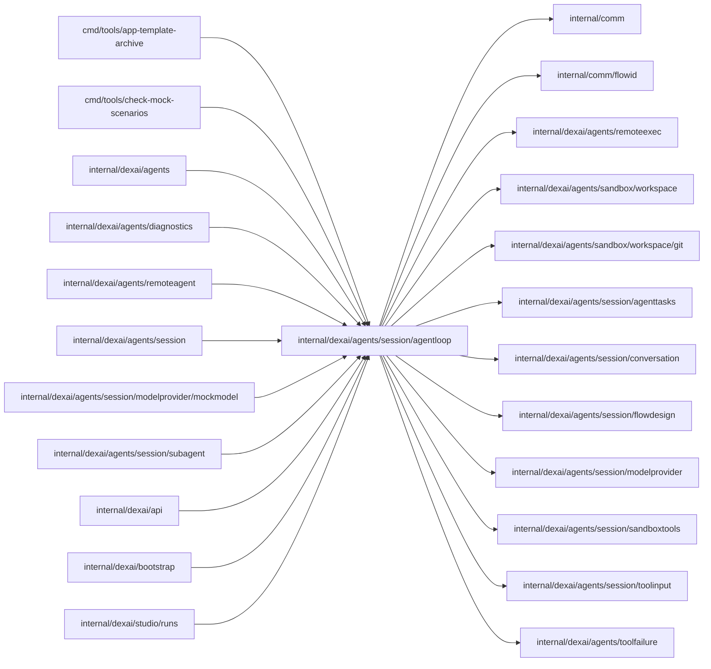

# Agent loop

<!-- BEGIN GENERATED PACKAGE SUMMARY (scripts/check-package-readmes.py; edit only Purpose) -->
Purpose: Computes the Session Agent's pure loop decisions for SessionAgentFlow: state machine, turns, questions, context segments, tool catalog, batches and results, without touching Flow primitives.

Callers: `cmd/tools/app-template-archive`, `cmd/tools/check-mock-scenarios`, `internal/dexai/agents`, `internal/dexai/agents/diagnostics`, `internal/dexai/agents/remoteagent`, `internal/dexai/agents/session`, `internal/dexai/agents/session/modelprovider/mockmodel`, `internal/dexai/agents/session/subagent`, `internal/dexai/api`, `internal/dexai/bootstrap` and `internal/dexai/studio/runs` import this package.

Dependencies: it imports `internal/comm`, `internal/comm/flowid`, `internal/dexai/agents/remoteexec`, `internal/dexai/agents/sandbox/workspace`, `internal/dexai/agents/sandbox/workspace/git`, `internal/dexai/agents/session/agenttasks`, `internal/dexai/agents/session/conversation`, `internal/dexai/agents/session/flowdesign`, `internal/dexai/agents/session/modelprovider`, `internal/dexai/agents/session/sandboxtools`, `internal/dexai/agents/session/toolinput` and `internal/dexai/agents/toolfailure`.

<!-- END GENERATED PACKAGE SUMMARY -->

The pure decisions of the Session Agent's loop: the state machine, turns and
steering, questions, the requirements card, the todo list, context segments with their compaction and
rollover decisions, the tool catalog, tool batches and results, and the
Session lifecycle and workspace values. Every function computes over values; the
Steps of SessionAgentFlow read and write the Flow primitives and apply these
decisions in their own commits.

## Files

| File | Owns |
| --- | --- |
| `agent_state.go` | `AgentState` with the turn's interruptible work in flight, the starting example and its first build, automatic-turn and subagent counters, Agent statuses and interaction modes, continuations, `TaskWorktree` with its typed state and bounded admission/eviction, and the conversation view. |
| `session.go` | Session identity, lifecycle values and close reasons, the source handoff rule (an `edit`, a `write` and a `merge_agent_changes` that applied files change source) the Preview handoff (`PreviewHandoff`): the commit a succeeded, pushed and unblocked `commit_and_push` hands to the Preview at its result's sequence, published once with the tool result, and the request that switches the Preview's automatic deployment (`PreviewAutoDeployRequest`); such a push also completes the build of the confirmed Flow design (`BuildsDesign`); the file and text a succeeded `write` or `edit` wrote (`WrittenSource`), which marks designed Steps written. |
| `session_workspace.go` | The Session's accepted Sandbox capability, its repository context, the plans of a workspace demand (a ready-only demand, a deployment's, wakes nothing; a subagent's takes the usable lease, and its lost lease revokes the instance) and a cold-path request, whose demands beside the conversation (`IsBesideConversation`: a remote activation's and the first model call's `ContinuePrepareContext`) end when a request is in flight, grants, losses, the Sandbox deadline and lifecycle values. |
| `conversation_turn.go` | Turn start and steering, the continuation after a model reply or an output-limit stop, model reply kinds and the entry-window bounds and keys; the admission and delivery of Session notifications and the automatic turns they open under `AutomaticTurnBounds` (task and connector notifications against the task bound, an application-owned delivery failure of HEAD against the platform bound); the Stop button's admission and turn end. |
| `context_segment.go` | `ContextSegment`, `SessionModel` and its changes, the frozen prompt of each model and of each subagent kind on each model, a segment on a given prompt and effort (`NewSegmentFor`, how a subagent opens its own), the compaction and rollover decision, `segment_start` text (with the `starting_example` section while it is described and the first segment's `catalog_matches` before the pending request, which stays last), the mark of a segment that awaits the repository context and the notice that brings it (`RepositoryContextNotice`, `HoldsRepositoryContext`), markers and retention. |
| `todo_list.go` | The Agent's own progress list that `write_todos` replaces. |
| `user_input.go` | Pending user input: questions and answers, and the reply to a card an old Session still waits at; the requirements card with its Flow design's reference, recorded as the next version of the current requirements (`RecordRequirements`), which carries the design forward, and the result that answers the card; the draft of a card the model still writes (`RequirementsDraft`), read leniently from its partial input at most once a second (`RequirementsDrafter`). |
| `progress.go` | Step heartbeats, activity event constructors and the target of a tool call. |
| `tool_catalog.go` | `ToolDefinition` with its workspace access and execution policy, the static catalog of built-in, Sandbox, delegation (`start_agent`, `merge_agent_changes`, both loose) and platform tools with their strict and eager-input-streaming flags and the startup check of the provider's strict counts (`confirm_requirements` and `commit_and_push` stay non-strict because of the provider's grammar-size limit, which only `make test-claude-live` shows; rerun it whenever the strict set or a strict schema changes), the frozen tool set of a model (each tool as the request carries it), the tool set of a subagent kind (`SubagentTools`: commands in its root, whose `bash` has no `run_in_background`, the file tools, the connector catalog, the platform readers and `set_effort` for `change`) and the argument mapping of built-in tools and `start_agent` (`RequestedSubagent`). |
| `tool_execution.go` | Tool batches, approvals, results with the code and effect of a failure, the failure results of calls that cannot run or finish, the reasons that cancel pending calls, and their entries, sized when recorded; the `PlatformIncident` of a platform-owned tool result or of a model call the API rejected with HTTP 400, 401 or 403, its signature (the SHA-256 of owner, tool, code and error type), the outcomes of its report and the event that records one. |

## Collaborator attribution

User turns preserve their message author; answers preserve the answerer, and a version of the
requirements confirmed while cards waited keeps who confirmed it (a recorded card has none). Model changes preserve their accepted changer across revision acknowledgements. The
first pending Stop keeps its actor; the Stop entry names that author. Automatic turns invent none.

## Remote catalog and context selection

`RemoteTools` derives the remote executor's sorted catalog from the Session catalog,
excluding `platformOnlyTools`: `start_agent`, `merge_agent_changes`, `set_effort` and `start_timer`.
The catalog marks `start_connector_contribution`, `submit_connector_contribution`,
`open_task_worktree` and `merge_task_worktree`
`RemoteOnly`; `SessionTools` excludes that marked set, and the scenario checker
requires a remote HTTP Dex test for it.
`RemoteAgentContext` contains `conversation.RemoteAgentPrompt`,
`conversation.RemoteSessionSystemPrompt` (shared rules, source handoff and delivery guidance)
the repository context in the same `<repository_context>` tag as segment_start and, while it is
described, the starting example in its `<starting_example>` tag after it, at most
`maximumRemoteAgentContextBytes` (80 KiB; the prompts are about 30 KiB, the repository context at
most 8 KiB and the starting example at most `MaximumStartingExampleBytes`, 16 KiB). The remote `read`, `grep` and `glob` tools are the platform's, with the same read-only
roots, the Dex skills under `/opt/superverse/dex-skills` included.
Its `stop_task` schema admits background command IDs only. `RemoteToolNames` supplies
one allow-list for serial and parallel admission, and `RemoteToolDigest` hashes the
names, descriptions and schemas so a Bridge can refresh its tool list.
`watch_preview_run` is absent until its separate implementation supplies it.

`ExecutorContextStart` selects a chronological retained suffix of complete
assistant/tool-result units within half the compaction budget, estimated at four
bytes per token. It stops at a missing or duplicate result, a broken unit or the
byte budget and starts at a user entry, never at an orphan tool result.
`ContextSegment.Summary` retains at most 8 KiB of the last platform summary;
older segments read it as empty. An executor segment's explicit request shape
admits a user-first retained range and consecutive assistant text only when no
tool use remains unanswered. Ordinary segments keep their original shape.
