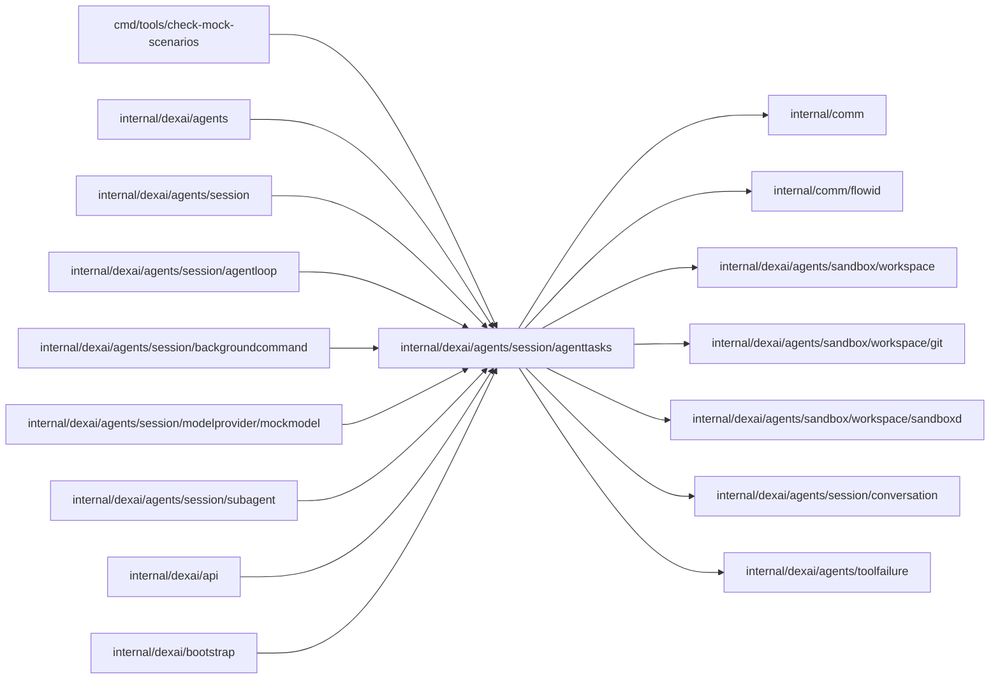

# Agent tasks

<!-- BEGIN GENERATED PACKAGE SUMMARY (scripts/check-package-readmes.py; edit only Purpose) -->
Purpose: Holds the task records of the Session Agent's background commands and subagents, their kinds, bounds and admission, the subagent start and launcher port, and the task notifications they send.

Callers: `cmd/tools/check-mock-scenarios`, `internal/dexai/agents`, `internal/dexai/agents/session`, `internal/dexai/agents/session/agentloop`, `internal/dexai/agents/session/backgroundcommand`, `internal/dexai/agents/session/modelprovider/mockmodel`, `internal/dexai/agents/session/subagent`, `internal/dexai/api` and `internal/dexai/bootstrap` import this package.

Dependencies: it imports `internal/comm`, `internal/comm/flowid`, `internal/dexai/agents/sandbox/workspace`, `internal/dexai/agents/sandbox/workspace/git`, `internal/dexai/agents/sandbox/workspace/sandboxd`, `internal/dexai/agents/session/conversation` and `internal/dexai/agents/toolfailure`.

<!-- END GENERATED PACKAGE SUMMARY -->

A task is work of the Agent that runs on beside its turn: a background command or a
subagent.

A background command is a command started with `bash` `run_in_background`, or moved to
the background when its foreground timeout passed. Its task ID, `cmd-<12 characters>`, is
its command ledger ID in the Sandbox, so `read_task_output` and `stop_task` resolve it
without a Flow read. `SessionAgentFlow` keeps one `BackgroundCommand` per task in its
AttributeMap `BackgroundCommands`, keyed by the task ID: created with the tool result that
started the task, written once more when the task ends, and read by the Snapshot, the
Sandbox deadline (a running task holds the Sandbox) and the Stop button.

A subagent is a background agent that the main agent starts with `start_agent`: one
`SubagentFlow` execution that works on a bounded task in its own git worktree and reports
with a task notification
([subagents](../../../../../docs/architecture/agent-harness-design/subagents.md)). Its task ID
is `agent-<agent ID>`, and the agent ID (`flowid.AgentTaskID`) derives from the Session's
FlowID and the call, so every retry of the call names the same subagent.
`SessionAgentFlow` keeps one `SubagentRecord` per subagent in its AttributeMap `Subagents`,
keyed by the agent ID, at most about 2 KiB and without the prompt: written `starting` by
the admission of the call, `running` by the subagent's admission, finished by its task
notification, which carries the saved changes or marks changes the end could not save,
and closed by a `merge_agent_changes` discard or merge of every file, which saves such
changes from the worktree first; a merge of selected paths leaves it open. A
record merges without the Sandbox only when its subagent left nothing to merge
(`HoldsNoChanges`). The Session starts and stops subagents
through `AgentTaskLauncher`, which the Session Service implements, because the Session's
package never imports the subagent's.

This package computes over the records as values; the Flows read and write them.

## Files

| File | Owns |
| --- | --- |
| `background_commands.go` | `BackgroundCommand` with its status and end reason (the command ledger's end reason, or lost), the bounds of `BackgroundCommands` (64 records, 4 running, 32 ended retained), the ended records a new one replaces, and the `task` notification of an ended command, which a stopped command does not send. |
| `subagents.go` | `SubagentKind` (`investigate`: 20 minutes, effort low; `change`: 45 minutes, effort medium, `set_effort`; `connector_select`: 10 minutes, effort medium, no edits and no platform readers; `connector_develop`: 45 minutes, effort high, `set_effort`, in a worktree of the connectors library) with its system prompt, its workspace and its tools, `SubagentStatus`, `SubagentRecord` with its transitions (the admission, which a Stop or the Session's end turns into a stop before the start, the failed start, the end a report records and the close of a merge, with its receipt), the bounds (3 running, 6 started without the user, 50 finished retained, lost one hour after the kind's duration, after which the record ends for the Session: it holds no running place and no Sandbox, no Stop applies to it, `merge_agent_changes` merges what its worktree holds and the Snapshot marks it lost), the admission of a start (the per-message budget before the running limit), the call fingerprint and the Start RequestID, `SubagentStart`, `SubagentAdmission` with its answer, which marks a record a Stop ended before the start, `AgentTaskLauncher`, and the `task` notification of a subagent's end with its report fitted to 24 KiB. |
| `connectors.go` | The connector a `connector_develop` call names (`ConnectorTarget`: the slug, validated as the library spells a connector ID, and the contribution kind), its admission (a slug another unfinished develop subagent works on is `connector_contribution_running`; a 17th distinct slug of the Session, counted over `AgentState.ConnectorSlugs`, which keeps every slug an admitted develop call named, `connector_contribution_limit_reached`) and the contribution target the Sandbox helper names. |
