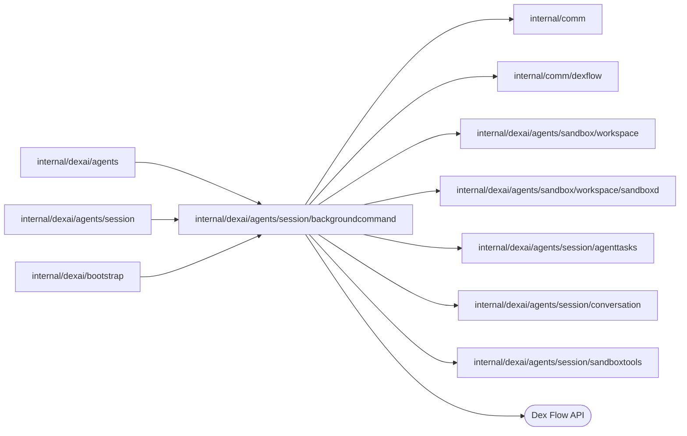

# Background command watch

<!-- BEGIN GENERATED PACKAGE SUMMARY (scripts/check-package-readmes.py; edit only Purpose) -->
Purpose: Follows one background command of a Session in the Sandbox's command ledger, as a Dex SubFlow of the Session, until the command ends.

Callers: `internal/dexai/agents`, `internal/dexai/agents/session` and `internal/dexai/bootstrap` import this package.

Dependencies: it imports `internal/comm`, `internal/comm/dexflow`, `internal/dexai/agents/sandbox/workspace`, `internal/dexai/agents/sandbox/workspace/sandboxd`, `internal/dexai/agents/session/agenttasks`, `internal/dexai/agents/session/conversation` and `internal/dexai/agents/session/sandboxtools` and calls the Dex Flow API.

<!-- END GENERATED PACKAGE SUMMARY -->

A background command runs for up to `BackgroundCommandLifetime` (3300 seconds). Its watch
is one long polling Step, so it runs in its own Flow: the Session's `AwaitBackgroundCommand`
Step starts `BackgroundCommandFlow` as a SubFlow and only waits for it. A wait does not hold
the Session when it moves to a new run; a long running Step would, and the Session would
route no tool until the command ended.

- Identity: Dex generates the FlowID `SubFlow:<Session FlowID>-<Step execution ID>-0`, for
  example `SubFlow:session-6w4b-AwaitBackgroundCommand-3-0`, and its request identity from
  the Session's run and the Step execution. A Step execution starts it once; the Session's
  move to a new run carries the wait and its result and starts nothing again.
- Input `BackgroundCommandWatch`: the task ID, the Session's FlowID (the ledger identity's
  root) and the accepted lease of the instance that runs the command, which names provider
  identities only and holds no secret. The Attribute `TaskID`, installed with the start, is
  what Dex Web shows.
- `WatchBackgroundCommand` polls the ledger with `dexflow.PollUntil` and reads no Flow. It
  completes the Flow with the command's `agenttasks.BackgroundCommandEnd`: the ledger's end,
  or lost when the instance does not know the task, such as a replacement instance. An
  unreachable instance, or a status failure, is an error for a new attempt.
  `dexflow.PollingStepOptions` bounds the watch by the lifetime plus `watchSlack`; past it,
  or after its retries, `RecordBackgroundCommandLost` completes the Flow with a lost end.
- The watch never reads the Session's `Workspace`. A command on a replaced instance stays
  running in the Session's record until the replacement answers that it does not know the
  task, or the attempts on the unreachable instance run out (about 75 seconds of backoff
  plus the dials); meanwhile it counts against the four running commands, and each attempt
  on the old lease makes the pooled resolver, which keeps one entry per Project, dial again.
- The Session's Step reads the result with `WatchedEnd`: the completion output, or lost when
  the SubFlow ended otherwise or the Step's WaitFor failed. It records the end and publishes
  the task notification itself; no RPC reaches either Flow on this path.
- A Stop and `stop_task` stop the command through the ledger, and the watch observes it
  stopped and completes.
- Dex does not stop a SubFlow with its parent, so the Session's close stops each watch
  explicitly. The Session's Step waits with `AnyOf` for the SubFlow or for the task's
  instance of its ChannelMap `BackgroundCommandStops`, to which `CompleteProjectSession`
  publishes one message per running command. When the stop wins, the Step stops the
  SubFlow by `dex.SubFlowID` through `BackgroundCommandFlowClient.Stop` (a Flow that no
  longer runs counts as stopped) and records the command stopped; the Session completes
  after every such Step.
- A failure of Dex to start the SubFlow fails the Session, because a SubFlow Condition has
  no failure route of the waiting Step yet (superdurable/dex).

## Files

| File | Owns |
| --- | --- |
| `background_command_flow.go` | The Flow DSL: the `TaskID` Attribute, the SubFlow condition the Session waits for, the Dex Web views, `WatchBackgroundCommand` and its failure route `RecordBackgroundCommandLost`. |
| `background_command_watch.go` | `BackgroundCommandWatch`, the ledger polling and `WatchedEnd`, which reads the SubFlow's result in the Session's Step. |
| `background_command_flow_client.go` | `BackgroundCommandFlowClient`: the stop of a watch by its SubFlow ID, which the Session Service calls at the Session's close. |
| `background_command_flow_bootstrap.go` | `BackgroundCommandFlowBootstrap`: the Flow with its Sandbox tool runner over the Session's pooled workspace capabilities, and its client. |
