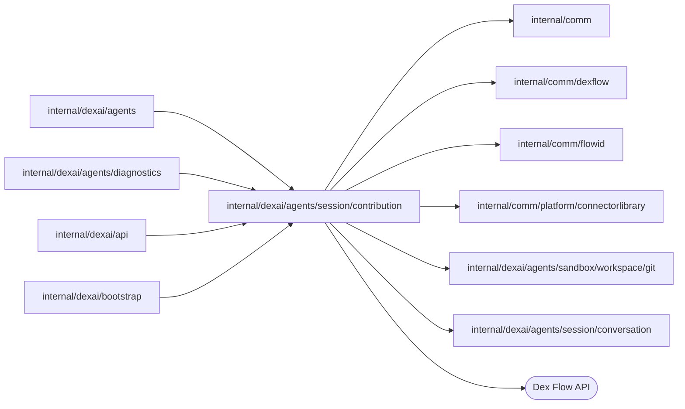

# Connector contributions

<!-- BEGIN GENERATED PACKAGE SUMMARY (scripts/check-package-readmes.py; edit only Purpose) -->
Purpose: Owns ConnectorContributionFlow, one connector a Project's Session contributes to the connectors library: its record, its draft pull request and its client and bootstrap.

Callers: `internal/dexai/agents`, `internal/dexai/agents/diagnostics`, `internal/dexai/api` and `internal/dexai/bootstrap` import this package.

Dependencies: it imports `internal/comm`, `internal/comm/dexflow`, `internal/comm/flowid`, `internal/comm/platform/connectorlibrary`, `internal/dexai/agents/sandbox/workspace/git` and `internal/dexai/agents/session/conversation` and calls the Dex Flow API.

<!-- END GENERATED PACKAGE SUMMARY -->

A completed `connector_develop` subagent ([subagent](../subagent/README.md)) commits its change on
the connector's branch of the connectors library and pushes it
([connectorlibrary](../../../../comm/platform/connectorlibrary/README.md)). When its task notification reaches
the Session, the Session Service (`internal/dexai/agents/session_flow_service_connectors.go`) submits the
contribution here: one `ConnectorContributionFlow` per Project and connector. The Session keeps no
copy; the Snapshot reads the contributions through the Service. The package sits below the Session
Service (level 7, beside `subagent`), and neither the Session nor the subagent imports it.

Every head the Flow records also becomes a release candidate of the connector, `vX.Y.Z-rc.N`, which
an application uses in the Preview and in Live before maintainers release the connector
([connectorlibrary](../../../../comm/platform/connectorlibrary/README.md#release-candidates)). On the local
Git host the subagent's finish already published it, and the task notification names it; on the
upstream library this Flow requests it from the library's workflow and tells the Session its version
with a connector notification.

When the branch reaches the upstream GitHub library, the Flow also observes that exact head's
GitHub Actions check suites. A failure records the failed job names and a bounded, redacted tail of
the first failed step's CI output, then sends a connector notification. A later head starts a new
observation and fences the old one. The Session's `read_connector_checks` platform tool reads its
own Project's contribution and current GitHub status on demand. Neither path starts or reruns CI.

## Per-Flow review contract

### Identity and execution lifecycle

- **Flow type and FlowID.** `ConnectorContributionFlow` (the Go type name). FlowID
  `flowid.ConnectorContributionFlowID(projectID, slug)`: `connector-contribution-<projectID>-<slug>`,
  for example `connector-contribution-a7k2-newsapi`.
- **Business IDs.** The Project from the subagent's identity, the slug from the contribution,
  which `start_agent` named and `FinishSubagent` verified against the committed manifest.
- **Creation trigger.** `ConnectorContributionFlowClient.Submit`, called by the Session Service in
  `ReportSubagentOutcome` once the Session admitted the report of a COMPLETED develop subagent that
  carries a `Contribution`. Never an API call.
- **Start RequestID.** `flowid.Fingerprint{SessionFlowID, slug, branch, head commit}`. Reuse policy
  `dex.IDReuseDisallow` with same-request `IgnoreError`: a repeated report joins the execution.
  The engine also joins a same-request start of an execution that ended, and the start answers it
  as it answers a new one, so the client confirms every submission with `UpdateConnectorContribution`,
  which changes nothing for the submission that started the execution and is refused
  (`ErrContributionClosed`) once it ended. This post-start call exists because the owner requires a
  closed contribution to refuse every later submission, the repeated first one included. A start
  whose admission the Session denies answers `ErrContributionClosed` the same way.
- **A later head of the same connector.** A second develop subagent of the slug pushes a new head on
  the same branch; its start finds the execution started by another request
  (`FlowAlreadyStartedError`), and the client sends the submission as the RPC
  `UpdateConnectorContribution` instead, which is idempotent by head commit. A Project contributes
  each connector once. Because a closed FlowID is never reused, a contribution that ended (a
  deleting Project's) is final for that slug in that Project:
  the client answers `ErrContributionClosed`, which the Service only logs. A later head cancels its
  old `OpenConnectorPullRequest`, `RecordConnectorPullRequest`, `PublishReleaseCandidate`,
  `RecordReleaseCandidate`, `WaitConnectorChecks` timer or check and `RecordConnectorChecks`
  executions before scheduling the new head's pull request update and
  CI observation; the PR's branch is reused, and no new FlowID or Run is created.
- **Admission.** The first Step asks the Session through the Service before any effect
  (`AdmitConnectorContribution`: ACTIVE with a running execution). A deleting Project's Session
  denies it, and the Flow closes without an effect.
- **Completion.** Business completion is status `closed`: only the close of a deleting Project
  ends it; it stays open after its pull request opened and its release candidates were published.
  Engine completion is
  `dex.GracefulComplete(Receipt)` at the end; the closed execution stays readable through
  `GetConnectorContributionSnapshot` for the engine's retention. The `Closing` Attribute fences
  reports and submissions as soon as `CloseConnectorContribution` is admitted; the end Step
  completes the execution. A passed or failed CI result does not archive or complete the Flow.
- **Relationships.** An independent top-level Flow, not a Project child; the deleting Project's
  cleanup finds the open ones by FlowType, `ProjectID` and status and closes them
  (`closeSessionContributions`, beside the subagents' stop).

### Attributes and AttributeMaps

| Attribute | Type and rules |
| --- | --- |
| `Identity` | Immutable `{ProjectID, Slug}`, installed with the start |
| `ProjectID` | Indexed `keyword2`: the cleanup search and the Snapshot read |
| `ContributionStatus` | Indexed `keyword3`, the status lock Attribute: `pull_request_pending`, `unpublished`, `pull_request_failed`, `draft`, `closed` |
| `Submission` | The latest `Submission{Identity, Contribution, Report}` of a develop subagent; installed with the start, replaced by `UpdateConnectorContribution` |
| `Contribution` | The record `Record{Module, Kind, Branch, HeadCommit, HeadRecordedAt, Location, PullRequest{Number, URL, NodeID, State}, Status, ReleasedVersion, ReleaseCandidate, Checks, Failure, Description, Report, UpdatedAt}`, the authority of the contribution, bounded by the 16 KiB report and failure evidence below. `HeadRecordedAt` is set once for each accepted head and anchors the first CI timer and workflow-run recovery boundary across Worker restarts. `ReleaseCandidate{Directory, Version, Tag, Commit, Status published\|failed, FailureKind workflow_failed\|already_released\|timed_out\|refused, Failure, Jobs, Step, LogTail, LogUnavailable, PullRequestConflict, UpdatedAt}` is the candidate of the latest head the Flow published or tried to; an older head's candidate is never recorded over it |
| `Closing` | A Boolean fence set by `CloseConnectorContribution` before `ContributionEnd` is consumed. A second close remains pending until the execution ends; later submissions and notifications are refused. |

`Contribution.Checks` is `HeadChecks{Head, State pending|passed|failed, SuiteCount, Jobs, Step,
LogTail, LogUnavailable, UpdatedAt}`. It belongs to this Flow, not a second database. `Jobs` has at most 12
names of at most 160 bytes each, `Step` at most 160 bytes, and the log tail at most 3 KiB. If
GitHub has expired the log, `LogUnavailable` records that without suppressing the failed-job
notification. The
diagnostics redactor runs before this evidence enters the Attribute; a newer head clears it.
Release-candidate workflow evidence uses the same 12-job, 160-byte name and step, 512 KiB read and
3 KiB retained-tail limits and the same Project redactor. The workflow run itself is GitHub's
authority; the Flow retains only its bounded business result, never a credential.
`ContributionStatus` remains the indexed field for Project cleanup. CI status is not indexed:
the Session reads its contribution by deterministic FlowID, and the tool asks GitHub for current
status. `Contribution` writers use the status lock, and the head comparison is the revision fence.

AttributeMaps: none. Every writer holds the status lock: the admission, the record Steps, the end and
the two RPCs. Status moves only forward: a contribution with a pull request never returns to a
status without one; a later head moves `pull_request_failed` back to `pull_request_pending`, which
retries the pull request. No secret: branch, commit, module and pull request are public. Growth: one
execution per contributed connector, at most 16 per Session (`agenttasks.maximumConnectorContributions`).

### Channels and ChannelMaps

- **Channel `ContributionEnd<contributionEnd>`.** Producer: `CloseConnectorContribution`, at most once
  while the contribution is open (a closed one answers ended). Consumer:
  `AwaitConnectorContributionEnd`, `ForOne`. `Closing` rejects duplicates while the end is pending.
  At completion, the end Step cancels every outstanding PR, release candidate, CI and notification
  Step; no pending message remains. No ChannelMap or other Channel.

### Streams

None. The Session's existing conversation and remote inbox deliver the notification; no Stream
becomes the CI authority. A remote reconnect reads its durable Session conversation.

### Steps, RPCs and recovery

| Step | Purpose | Options and routes |
| --- | --- | --- |
| `AdmitConnectorContribution` | Asks the Session, then records the contribution `pull_request_pending`, or `unpublished` on a server without an upstream library (an explicit state, never a skip), or closes a denied one | Provider options with the status lock; goes to `AwaitConnectorContributionEnd` beside `OpenConnectorPullRequest` and the release candidate: `PublishReleaseCandidate`, or `RecordReleaseCandidate` for a candidate the library refused in the finish |
| `AwaitConnectorContributionEnd` | Waits for the close; records `closed`, cancels the pull request and release candidate Steps and completes | WaitFor the Channel; status lock |
| `OpenConnectorPullRequest` | Every round looks the pull request up by head branch first (`connectorlibrary.Upstream.findPullRequest`), pushes a branch of the local Git host to the upstream library without force, and opens a draft against `main` | `dexflow.PollUntil` within `PollingStepOptions(5 minutes)`, no lock; a refusal (`ErrRejected`, `ErrNotConfigured`) decides at once; a lost answer or a server error retries; the passed limit goes to `RecordConnectorPullRequest` |
| `RecordConnectorPullRequest` | Records `draft` with the pull request, or `pull_request_failed` with the reason, only for the current head; after a successful PR read it starts `WaitConnectorChecks` for that head | State Step with the status lock; a later head's PR remains the one on the same branch |
| `WaitConnectorChecks` | A durable `WaitFor` timer waits until about 15 minutes after the head was recorded; its short Execute reads the exact head's aggregate GitHub Actions check suites once. A pending or unknown result schedules one more timer about 30 minutes later, then records `pending` if still unresolved. A passed result records immediately. A failed result reads bounded failed-job details and one log tail, then records and notifies. | `checksAttempt{Head, CheckAt, Number, Checks}` carries the fixed timer point and count; `connectorCheckFirstDelay`, `connectorCheckNextDelay`, and `connectorCheckMaxReads` (2) are the only schedule constants. Execute is limited to one attempt and one minute, with no status lock. A rate limit consumes that check point as unknown, with no retry loop. The App reads the public library with its cached repository-scoped token. A newer head or Project close cancels the pending timer or check. No workflow dispatch, rerun or mutation. |
| `RecordConnectorChecks` | Records only the current head's result and sends `checks_failed` for a failure. A newer head or `Closing` drops the old result. | Synchronous state Step with the status lock; the notification ID contains the full head SHA. |
| `PublishReleaseCandidate` | Every round reads the head's candidate first (`IsReleaseCandidatePublished`). Before the first dispatch it reads the stable tag and pull request mergeability and refuses an already released version. After dispatch it lists one page of this workflow's repository-dispatch runs created after the dispatch boundary and matches exact run name `RC <directory> <version> <commit>` at most once a minute; a concluded failed run reads bounded failed-job evidence and decides at once. A missing run or failed GitHub read remains within the existing bounded wait. | The existing `dexflow.PollUntil` every 10 seconds within 40-second rounds and `PollingStepOptions(25 minutes)`, no lock and no new poll; a refusal (`ErrRejected`, `ErrNotConfigured`, `ErrReleaseCandidateConflict`) decides at once; the passed limit goes to `RecordReleaseCandidate` with a plain business timeout. |
| `RecordReleaseCandidate` | Records the candidate `published` or its typed failure and bounded redacted evidence, only while it is the current head's and the contribution is not `Closing`, and reports it unless the subagent's task notification already did | State Step with the status lock |
| `ReportConnectorEvent`, `DropConnectorEvent` | Delivers the existing PR and candidate notifications and `connector/<slug>/checks_failed/<full-head>` through the Service's `ReportSessionNotification`, once per ID. The status lock, `Closing` and head check suppress head-specific notifications after a newer submission or Project close. | Provider options; exhausted retries drop the message, while the Flow record keeps the result. |

| RPC | Locks | Behavior |
| --- | --- | --- |
| `UpdateConnectorContribution` | Status | A later submission of the connector; idempotent by head commit; cancels the old PR, release-candidate and CI Steps, updates the existing PR branch, and starts the new head's release candidate and CI observation |
| `CloseConnectorContribution` | Status | Sets `Closing`, cancels release-candidate, CI and notification Steps, publishes the end and answers whether the contribution ended |
| `GetConnectorContributionSnapshot` | None; retained read | Identity and record |
| `GetDexSummary`, `GetDexDisplay` | None | Dex Web |

External effects: the push of a local branch to GitHub (no force; a branch that already holds the
commit is published); the pull request, found by its head branch before it is created, so a lost
answer, a Worker restart or a retry opens no second one; and the release candidate, read before it
is requested, whose tag names one commit only: the workflow refuses a tag of another commit and
repeats a publication at the same commit, so a repeated dispatch publishes no second candidate. The
query-before-mutate recovery first matches the exact workflow run name after `HeadRecordedAt`; after
the dispatch returns it narrows that boundary to the dispatch start time.
Each head has at most one candidate, `N` counting the candidates of its version. A failed candidate
stays failed until a later head brings its own; the agent fixes the connector with another
connector_develop subagent. Moving a candidate to an official release is the maintainers', and
upgrading an application from a candidate is not this Flow's. Compatibility: before launch the Flow
changed in place. Existing open executions keep their FlowID and Run; `ReleaseCandidate`'s new failure
fields read at their zero values for historical records, and the next candidate uses the correlated
workflow reader. The existing `Closing` Attribute keeps its meaning. The
graph is `docs/flows/sv2-connector-contribution-flow.json`.

CI observation makes at most two scheduled aggregate reads per head, at roughly 15 and 45 minutes after the head was recorded (the second timer starts after the first read). There is no recurring per-round cost. A failure can additionally read at most 400 check runs in four bounded pages, 12 names, one job record and 512 KiB from one redirected log; its retained tail is 3 KiB. The agent's on-demand `read_connector_checks` tool reads the current aggregate state and, on failure, these bounded details even before a Flow notification arrives. The repository is public, but the installation's per-repository metadata token avoids the anonymous API rate limit and is cached per server replica. Checks create no Actions usage. At the existing 16 contributions per Session limit, each current head holds at most one timer/check Step, removed after a terminal result, two checks, a newer head or Project close. A burst of 10,000 contributed heads costs at most 20,000 scheduled aggregate reads spread across two timer points, rather than a recurring hourly load. GitHub's installation limit has a 5,000 requests/hour floor and 12,500 requests/hour cap ([GitHub REST rate limits](https://docs.github.com/en/rest/using-the-rest-api/rate-limits-for-the-rest-api), checked 2026-10-16); at the floor, a simultaneous burst exceeding roughly 2,500 heads per timer point requires admission shaping or installation sharding. The feature creates no new cloud, Kubernetes, Temporal, Dex or database resource; the existing Dex Flow retains the result until Project close and engine retention then applies. It performs no IAM, EKS, DNS or load-balancer call per request or event and no tenant-proportional scan.

Release-candidate observation creates no resource. One upstream head adds one stable-tag read and one
pull-request read before dispatch, then at most one one-page workflow-run read per minute inside the
existing 25-minute wait (no read after a terminal run), plus bounded failed-job detail reads once.
At the 5,000 requests/hour installation floor, roughly 83 continuously pending candidates consume the
entire floor from minute reads alone; 10,000 simultaneous candidate waits therefore require a shared
rate limiter that stretches checks within the existing deadline and installation/account sharding
before that scale. No IAM, EKS, Temporal Cloud, load-balancer, DNS or
tenant-proportional scan enters a request, poll or event hot path.

## Tests

`TestConnectorContributionFlowDexIntegration` (`internal/dexai/agents`) runs the actual Worker of the default
lane, whose server names no upstream library: it submits a contribution of a throwaway Project, joins
a repeated submission, applies a later head, reads the record `unpublished`, and closes it with the
Project's deletion, after which both the repeated first submission and a new head are refused as
closed without another execution or a change of the record. `TestSessionMockConnectorReleaseCandidateDexIntegration`
(scenario `connector-release-candidate`) publishes a release candidate on the local Git host, records
it published without a second notification, and follows the application that uses it into the Preview
and Live. The pull request Step with GitHub, a Worker restart during it and the failure path
run only in the manual `TestConnectorContributionGitHubIntegration` of the
[workspace Git package](../../sandbox/workspace/git/README.md), against `superdurable/dex-connectors-library-test`.
`TestReleaseCandidateWorkflowGitHubIntegration` is read-only against the official library: it reads
failed run `38979345261`, successful run `38985509210`, the released Stripe `v0.22.0` tag and the
conflicting contribution pull request, and fails rather than skipping when GitHub no longer serves
the evidence. `TestReleaseCandidateHeadAndCloseFenceDexIntegration` runs the real Worker and
production record Step with observations installed by test RPCs to prove newer-head and `Closing`
fences. `TestSessionMockReleaseCandidateFailureDexIntegration` delivers the failure through the real
Session notification RPC.

| File | Responsibility |
| --- | --- |
| `connector_contribution_flow.go` | The Flow DSL: primitives, registration, the Steps and RPCs |
| `connector_contribution_flow_client.go` | `ConnectorContributionFlowClient`: submit (start or update), close, snapshot and the Project search |
| `connector_contribution_flow_bootstrap.go` | `ConnectorContributionFlowBootstrap` |
| `connector_contribution_flow_dependency.go` | `ConnectorContributionFlowDependency` (the Session Service), and `ConnectorPullRequests` and `ReleaseCandidates` (the connectors library) |
| `connector_contribution.go` | Identity, statuses, the record, the submission and its RequestID, the pull request draft, the release candidate and the connector notifications |
