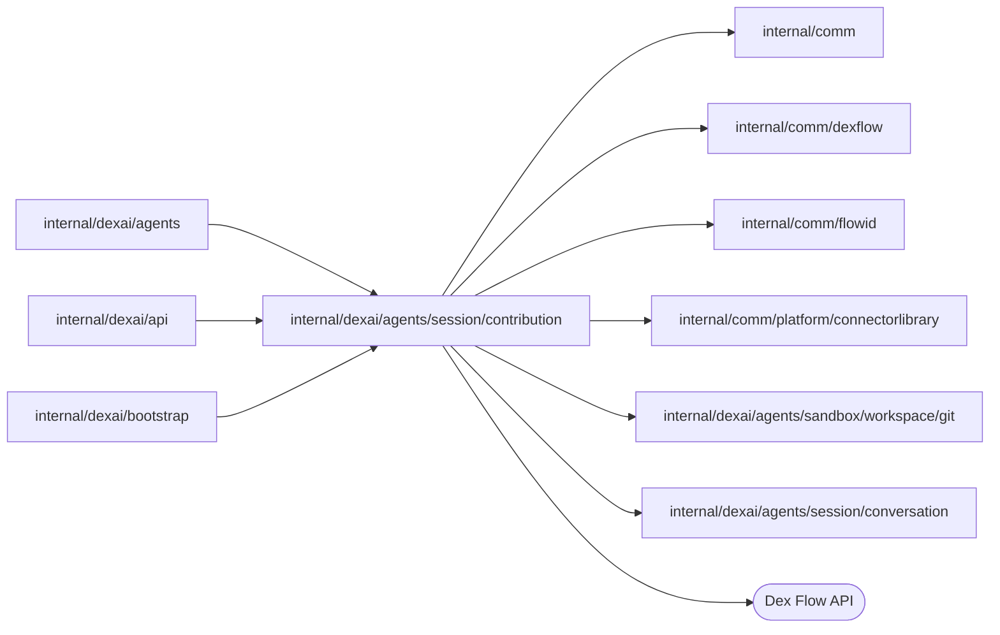

# Connector contributions

<!-- BEGIN GENERATED PACKAGE SUMMARY (scripts/check-package-readmes.py; edit only Purpose) -->
Purpose: Owns ConnectorContributionFlow, one connector a Project's Session contributes to the connectors library: its record, its draft pull request and its client and bootstrap.

Callers: `internal/dexai/agents`, `internal/dexai/api` and `internal/dexai/bootstrap` import this package.

Dependencies: it imports `internal/comm`, `internal/comm/dexflow`, `internal/comm/flowid`, `internal/comm/platform/connectorlibrary`, `internal/dexai/agents/sandbox/workspace/git` and `internal/dexai/agents/session/conversation` and calls the Dex Flow API.

<!-- END GENERATED PACKAGE SUMMARY -->

A completed `connector_develop` subagent ([subagent](../subagent/README.md)) commits its change on
the connector's branch of the connectors library and pushes it
([connectorlibrary](../../../../comm/platform/connectorlibrary/README.md)). When its task notification reaches
the Session, the Session Service (`internal/dexai/agents/session_flow_service_connectors.go`) submits the
contribution here: one `ConnectorContributionFlow` per Project and connector. The Session keeps no
copy; the Snapshot reads the contributions through the Service. The package sits below the Session
Service (level 7, beside `subagent`), and neither the Session nor the subagent imports it.

Every head the Flow records also becomes a release candidate of the connector, `vX.Y.Z-rc.N`, which
an application uses in the Preview and in Live before maintainers release the connector
([connectorlibrary](../../../../comm/platform/connectorlibrary/README.md#release-candidates)). On the local
Git host the subagent's finish already published it, and the task notification names it; on the
upstream library this Flow requests it from the library's workflow and tells the Session its version
with a connector notification.

## Per-Flow review contract

### Identity and execution lifecycle

- **Flow type and FlowID.** `ConnectorContributionFlow` (the Go type name). FlowID
  `flowid.ConnectorContributionFlowID(projectID, slug)`: `connector-contribution-<projectID>-<slug>`,
  for example `connector-contribution-a7k2-newsapi`.
- **Business IDs.** The Project from the subagent's identity, the slug from the contribution,
  which `start_agent` named and `FinishSubagent` verified against the committed manifest.
- **Creation trigger.** `ConnectorContributionFlowClient.Submit`, called by the Session Service in
  `ReportSubagentOutcome` once the Session admitted the report of a COMPLETED develop subagent that
  carries a `Contribution`. Never an API call.
- **Start RequestID.** `flowid.Fingerprint{SessionFlowID, slug, branch, head commit}`. Reuse policy
  `dex.IDReuseDisallow` with same-request `IgnoreError`: a repeated report joins the execution.
  The engine also joins a same-request start of an execution that ended, and the start answers it
  as it answers a new one, so the client confirms every submission with `UpdateConnectorContribution`,
  which changes nothing for the submission that started the execution and is refused
  (`ErrContributionClosed`) once it ended. This post-start call exists because the owner requires a
  closed contribution to refuse every later submission, the repeated first one included. A start
  whose admission the Session denies answers `ErrContributionClosed` the same way.
- **A later head of the same connector.** A second develop subagent of the slug pushes a new head on
  the same branch; its start finds the execution started by another request
  (`FlowAlreadyStartedError`), and the client sends the submission as the RPC
  `UpdateConnectorContribution` instead, which is idempotent by head commit. A Project contributes
  each connector once. Because a closed FlowID is never reused, a contribution that ended (a
  deleting Project's) is final for that slug in that Project:
  the client answers `ErrContributionClosed`, which the Service only logs.
- **Admission.** The first Step asks the Session through the Service before any effect
  (`AdmitConnectorContribution`: ACTIVE with a running execution). A deleting Project's Session
  denies it, and the Flow closes without an effect.
- **Completion.** Business completion is status `closed`: only the close of a deleting Project
  ends it; it stays open after its pull request opened and its release candidates were published.
  Engine completion is
  `dex.GracefulComplete(Receipt)` at the end; the closed execution stays readable through
  `GetConnectorContributionSnapshot` for the engine's retention.
- **Relationships.** An independent top-level Flow, not a Project child; the deleting Project's
  cleanup finds the open ones by FlowType, `ProjectID` and status and closes them
  (`closeSessionContributions`, beside the subagents' stop).

### Attributes and AttributeMaps

| Attribute | Type and rules |
| --- | --- |
| `Identity` | Immutable `{ProjectID, Slug}`, installed with the start |
| `ProjectID` | Indexed `keyword2`: the cleanup search and the Snapshot read |
| `ContributionStatus` | Indexed `keyword3`, the status lock Attribute: `pull_request_pending`, `unpublished`, `pull_request_failed`, `draft`, `closed` |
| `Submission` | The latest `Submission{Identity, Contribution, Report}` of a develop subagent; installed with the start, replaced by `UpdateConnectorContribution` |
| `Contribution` | The record `Record{Module, Kind, Branch, HeadCommit, Location, PullRequest{Number, URL, NodeID, State}, Status, ReleasedVersion, ReleaseCandidate, Failure, Description, Report, UpdatedAt}`, the authority of the contribution, at most about 20 KiB (the report is cut at 16 KiB). `ReleaseCandidate{Directory, Version, Tag, Commit, Status published\|failed, Failure, UpdatedAt}` is the candidate of the latest head the Flow published or tried to; an older head's candidate is never recorded over it |

AttributeMaps: none. Every writer holds the status lock: the admission, the record Steps, the end and
the two RPCs. Status moves only forward: a contribution with a pull request never returns to a
status without one; a later head moves `pull_request_failed` back to `pull_request_pending`, which
retries the pull request. No secret: branch, commit, module and pull request are public. Growth: one
execution per contributed connector, at most 16 per Session (`agenttasks.maximumConnectorContributions`).

### Channels and ChannelMaps

- **Channel `ContributionEnd<contributionEnd>`.** Producer: `CloseConnectorContribution`, at most once
  while the contribution is open (a closed one answers ended). Consumer:
  `AwaitConnectorContributionEnd`, `ForOne`. No other Channel.

### Streams

None.

### Steps, RPCs and recovery

| Step | Purpose | Options and routes |
| --- | --- | --- |
| `AdmitConnectorContribution` | Asks the Session, then records the contribution `pull_request_pending`, or `unpublished` on a server without an upstream library (an explicit state, never a skip), or closes a denied one | Provider options with the status lock; goes to `AwaitConnectorContributionEnd` beside `OpenConnectorPullRequest` and the release candidate: `PublishReleaseCandidate`, or `RecordReleaseCandidate` for a candidate the library refused in the finish |
| `AwaitConnectorContributionEnd` | Waits for the close; records `closed`, cancels the pull request and release candidate Steps and completes | WaitFor the Channel; status lock |
| `OpenConnectorPullRequest` | Every round looks the pull request up by head branch first (`connectorlibrary.Upstream.findPullRequest`), pushes a branch of the local Git host to the upstream library without force, and opens a draft against `main` | `dexflow.PollUntil` within `PollingStepOptions(5 minutes)`, no lock; a refusal (`ErrRejected`, `ErrNotConfigured`) decides at once; a lost answer or a server error retries; the passed limit goes to `RecordConnectorPullRequest` |
| `RecordConnectorPullRequest` | Records `draft` with the pull request, or `pull_request_failed` with the reason, and then reports the failure | State Step with the status lock; never replaces a recorded pull request |
| `PublishReleaseCandidate` | Every round reads the head's candidate first (`IsReleaseCandidatePublished`), and only in a round that found none, once per attempt, requests it (`RequestReleaseCandidate`): the repository dispatch on the upstream library, nothing on the local Git host's copy, which the finish already published | `dexflow.PollUntil` every 10 seconds within 40-second rounds and `PollingStepOptions(25 minutes)`, no lock; a refusal (`ErrRejected`, `ErrNotConfigured`, `ErrReleaseCandidateConflict`) decides at once; the passed limit goes to `RecordReleaseCandidate` |
| `RecordReleaseCandidate` | Records the candidate `published` or `failed` with its reason, only while it is the current head's and the contribution is open, and reports it unless the subagent's task notification already did | State Step with the status lock |
| `ReportConnectorEvent`, `DropConnectorEvent` | Delivers `connector/<slug>/pull_request_failed/<head12>`, `connector/<slug>/release_candidate_published/<version>` or `connector/<slug>/release_candidate_failed/<head12>` through the Service's `ReportSessionNotification`, once per ID; drops it after exhausted retries | Provider options |

| RPC | Locks | Behavior |
| --- | --- | --- |
| `UpdateConnectorContribution` | Status | A later submission of the connector; idempotent by head commit; reopens a failed pull request and starts the new head's release candidate |
| `CloseConnectorContribution` | Status | Publishes the end and answers whether the contribution ended |
| `GetConnectorContributionSnapshot` | None; retained read | Identity and record |
| `GetDexSummary`, `GetDexDisplay` | None | Dex Web |

External effects: the push of a local branch to GitHub (no force; a branch that already holds the
commit is published); the pull request, found by its head branch before it is created, so a lost
answer, a Worker restart or a retry opens no second one; and the release candidate, read before it
is requested, whose tag names one commit only: the workflow refuses a tag of another commit and
repeats a publication at the same commit, so a repeated dispatch publishes no second candidate.
Each head has at most one candidate, `N` counting the candidates of its version. A failed candidate
stays failed until a later head brings its own; the agent fixes the connector with another
connector_develop subagent. Moving a candidate to an official release is the maintainers', and
upgrading an application from a candidate is not this Flow's. Compatibility: before launch the Flow
changed in place, and the local executions of an open contribution ended with their Projects; the
graph is `docs/flows/sv2-connector-contribution-flow.json`.

## Tests

`TestConnectorContributionFlowDexIntegration` (`internal/dexai/agents`) runs the actual Worker of the default
lane, whose server names no upstream library: it submits a contribution of a throwaway Project, joins
a repeated submission, applies a later head, reads the record `unpublished`, and closes it with the
Project's deletion, after which both the repeated first submission and a new head are refused as
closed without another execution or a change of the record. `TestSessionMockConnectorReleaseCandidateDexIntegration`
(scenario `connector-release-candidate`) publishes a release candidate on the local Git host, records
it published without a second notification, and follows the application that uses it into the Preview
and Live. The pull request Step with GitHub, a Worker restart during it and the failure path
run only in the manual `TestConnectorContributionGitHubIntegration` of the
[workspace Git package](../../sandbox/workspace/git/README.md), against `superdurable/dex-connectors-library-test`.

| File | Responsibility |
| --- | --- |
| `connector_contribution_flow.go` | The Flow DSL: primitives, registration, the Steps and RPCs |
| `connector_contribution_flow_client.go` | `ConnectorContributionFlowClient`: submit (start or update), close, snapshot and the Project search |
| `connector_contribution_flow_bootstrap.go` | `ConnectorContributionFlowBootstrap` |
| `connector_contribution_flow_dependency.go` | `ConnectorContributionFlowDependency` (the Session Service), and `ConnectorPullRequests` and `ReleaseCandidates` (the connectors library) |
| `connector_contribution.go` | Identity, statuses, the record, the submission and its RequestID, the pull request draft, the release candidate and the connector notifications |
