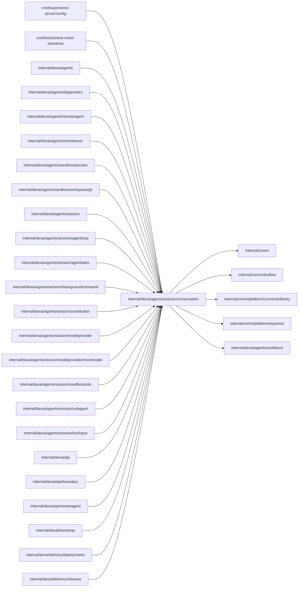

# Conversation values

<!-- BEGIN GENERATED PACKAGE SUMMARY (scripts/check-package-readmes.py; edit only Purpose) -->
Purpose: Defines the values SessionAgentFlow exchanges with its model: the append-only entry log and its public view, request assembly, requests and replies, tool calls, activity events and prompts.

Callers: `cmd/superverse-server/config`, `cmd/tools/check-mock-scenarios`, `internal/dexai/agents`, `internal/dexai/agents/diagnostics`, `internal/dexai/agents/remoteagent`, `internal/dexai/agents/remoteexec`, `internal/dexai/agents/sandbox/preview`, `internal/dexai/agents/sandbox/workspace/git`, `internal/dexai/agents/session`, `internal/dexai/agents/session/agentloop`, `internal/dexai/agents/session/agenttasks`, `internal/dexai/agents/session/backgroundcommand`, `internal/dexai/agents/session/contribution`, `internal/dexai/agents/session/modelprovider`, `internal/dexai/agents/session/modelprovider/mockmodel`, `internal/dexai/agents/session/sandboxtools`, `internal/dexai/agents/session/subagent`, `internal/dexai/agents/session/toolinput`, `internal/dexai/api`, `internal/dexai/api/boundary`, `internal/dexai/api/remoteagent`, `internal/dexai/bootstrap`, `internal/dexai/delivery/deployments` and `internal/dexai/delivery/releases` import this package.

Dependencies: it imports `internal/comm`, `internal/comm/dexflow`, `internal/comm/platform/connectorlibrary`, `internal/comm/platform/repohost` and `internal/dexai/agents/toolfailure`.

<!-- END GENERATED PACKAGE SUMMARY -->

The values SessionAgentFlow exchanges with its model provider: the append-only
entry log and its public view, request assembly, the models and efforts, the
request and reply, tool calls and their outcomes, activity events, the Session
notifications the model reads as user-role entries and the embedded `session-v1`
prompts of the main agent and its subagents. They hold no Flow primitive and call no provider; every enum
validates itself when it is decoded.

## Files

| File | Owns |
| --- | --- |
| `entry.go` | `Entry`, the exact Claude blocks of one conversation item with its `Meta`, the entry constructors and the public `AgentMessage` projection. |
| `request_assembly.go` | `AssembleRequest`: a segment's entries as request messages, gap by gap, with its invariants and the cache anchor. |
| `messages.go` | Message identity, roles, `AgentMessage`, history and queue values, and `PendingRequestText`, the envelope-preserving bounded turn quote. |
| `model.go` | The supported models and efforts, the `ModelClient` port with its request, reply and rejection, metrics and segment prompts. |

`ProviderCreditExhausted` declares the rejection code, fixed model hint and public
text together. `ModelRejectedError` carries those values through the Session without
provider response text in Flow state; `Detail` is bounded API diagnostic text
that the adapter logs and `publicModelRejection` removes before Flow state.
`ProviderSpendLimitReached` declares the corresponding fixed guidance for spending
caps.
`ProviderBillingProblem` declares fixed guidance for `billing_error`.
| `tool_call.go` | Tool names, the `ToolSpec`, `ToolCall`, outcomes and measurements. |
| `tool_failure.go` | `ToolFailure`, the owner, effect, hint and text of a failed tool call as the model reads it. |
| `events.go` | Activity events, input consumption, the provider writers (text, activity and the partial input of a streamed tool call, `ToolInputProgress`) and todo item statuses. |
| `notification.go` | `SessionNotification`, the payload of the Channel `SessionNotifications`, with its kinds, sources, bounds and validation, the text the model reads and its entry; the `TaskChanges` a subagent's `task` notification carries (its result commit and diffstat); the content of a `delivery` notification: `DeliveryOutcome` (`ready`, `failure`, `notice`) and `DeliveryOwner` (`application`, `configuration`, `platform`), struct-typed sets, with the code, phase, commit, resource, at most `MaximumNotificationGaps` gap names, a summary and a message; which notifications open a platform turn and how a stale failure becomes a notice. |
| `json_values.go` | JSON object and enum helpers, and `ClosePartialJSON`, which closes the partial JSON of a tool input the model still writes. |
| `prompts.go`, `prompts/v1/` | The embedded `session-v1` instructions and notices; `session.md` holds shared rules, while `platform_connectors.md`, `platform_delegation.md`, `platform_subagent_task.md` and `platform_effort.md` fill its platform-only insertion points. `platform_event.md` covers delivery notifications. `subagent.md` with its kind-specific prompt is the system prompt of a subagent. `remote_agent.md` opens a remote agent's context and gives its connector guidance. |

## Actor framing

`Actor` freezes the authenticated account ID and email. `UserMessage.Entry` stores one JSON sender
envelope when Actor is present and decodes its outer text field for the raw public projection. Actor, Via and
SteeredBy are application metadata; the public projection keeps the original Actor and separate
SteeredBy through consumption, archival and reconnect. Absent historical actors and steering
remain absent, and their original blocks are retained.

The Collaborators prompt recognizes both a top-level canonical envelope and each canonical
attributed line in a segment's final `pending_request` section. Only the outer sender grants
identity; nested envelopes and delimiter-like text are inert body content. `PendingRequestText`
owns the existing 256 KiB total quote budget: exact all-fit parts remain unchanged; otherwise the
first request and newest whole later parts that fit render chronologically with one explicit
omitted-count line after the first part. A first part that needs shortening keeps its full sender/via
object and cuts only decoded inner text at a UTF-8 boundary, with ` [truncated]`, then re-encodes
canonically without HTML escaping. Prefixes, JSON expansion, separators and both notices count
toward the limit. Body scanning is linear, and the Session's first-plus-eight retained request
bound remains unchanged. Historical authorless parts remain plain text; this never alters stored
blocks, public originals, segment boundaries or subagent tasks. See
[context management](../../../../../docs/architecture/agent-harness-design/context-management.md).
