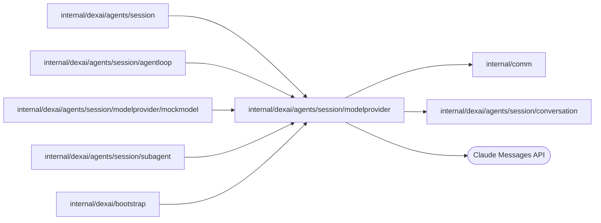

# Model provider

<!-- BEGIN GENERATED PACKAGE SUMMARY (scripts/check-package-readmes.py; edit only Purpose) -->
Purpose: Implements the Session Agent's model client over the Claude Messages API: model profiles, byte-exact replay of stored blocks, streamed summaries and tool activity, fallback cleanup and error classification.

Callers: `internal/dexai/agents/session`, `internal/dexai/agents/session/agentloop`, `internal/dexai/agents/session/modelprovider/mockmodel`, `internal/dexai/agents/session/subagent` and `internal/dexai/bootstrap` import this package.

Dependencies: it imports `internal/comm` and `internal/dexai/agents/session/conversation` and calls the Claude Messages API.

<!-- END GENERATED PACKAGE SUMMARY -->

`claudeClient` implements `conversation.ModelClient` over the Claude Messages API
(`client.Beta.Messages.NewStreaming`). The SDK reads no credential or base URL from
the environment and never retries; Dex retries the Step. A request uses exactly the
configured `ANTHROPIC_API_KEY` over an explicitly owned HTTP client that refuses
redirects. `ClaudeClientConfig.BaseURL` replaces the API origin and is set only for the
[mock model](mockmodel/README.md), which `agent.mockModel: true` starts in the server process;
`RequestBetas` lists the beta headers a request can carry, which that model accepts.

`ModelRouter` is the Flow's `conversation.ModelClient`: it sends the calls of a Session on the
model `mock` to a second `claudeClient` pointed at the in-process mock model with its placeholder
key, and every other call to the Claude API. Without a Claude key the server builds no Claude
client and a Claude model's call is rejected (`no_claude_key`); the API already refuses to select
one there. A segment stays on one model, so one reply never mixes the two.

| File | Owns |
| --- | --- |
| `model_profile.go` | `ModelProfile`: what differs between Opus 5.5, Sonnet 5.5, Haiku 4.5 and the mock model, which takes Sonnet 5.5's request shape (thinking, effort, system messages, fallbacks, compaction ceiling, hard limit). |
| `model_router.go` | `ModelRouter`: the client of each call's model, Claude or the mock model. |
| `claude_client.go` | The request: frozen tools and system prompt, the replayed blocks byte for byte, thinking, effort, betas and the three one-hour cache breakpoints; error classification into retryable errors and `ModelRejectedError`. |
| `strict_schema.go` | `StrictInputSchema`: the input schema of a strict tool as the API takes it (the SDK's transformation: lengths, ranges and defaults move into the description of their parameter), written with sorted keys so the frozen prompt's digest and the request bytes of the tools are the same in every server process. |
| `claude_stream.go` | Stream capture with `BetaMessage.Accumulate`, live reasoning summaries, text and tool-call activity, the fallback cleanup and usage metrics. |

## Tests

`claude_client_live_test.go` (build tag `live`, `make test-claude-live`) calls the real
Claude API with `ANTHROPIC_API_KEY` (the Make target reads it from the main
checkout's `.env` unless it is exported); a missing key fails the test. It sends one
request per model profile, a multi-turn append-only tool loop with
`prefix_mismatch_behavior: error` and its `count_tokens` replay, a compaction, a
continuation after `max_tokens` and the classification of rejected requests.
`claude_strict_tools_live_test.go` sends the Session Agent's frozen tool set, its strict
tools with the schemas the API takes and the eager input streaming of `write` and `edit`,
to every Claude model and requires a tool call whose input the tool's decoder accepts.
The API also rejects a strict set whose compiled grammar is too large (HTTP 400, "The
compiled grammar is too large"), which no count of tools or parameters shows; that test is
where such a rejection appears, and `make test-claude-live` must be rerun whenever the strict
tool set or a strict schema changes.
