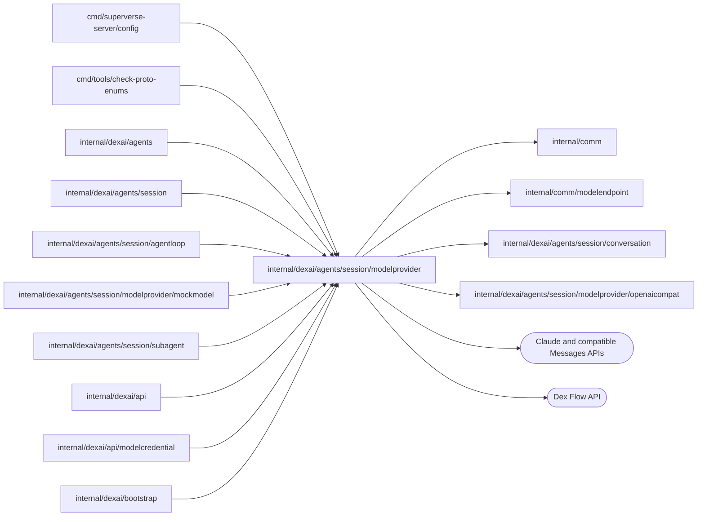

# Model provider

<!-- BEGIN GENERATED PACKAGE SUMMARY (scripts/check-package-readmes.py; edit only Purpose) -->
Purpose: Routes catalog-selected model calls and validates requests, private replay and streamed replies over Claude and compatible APIs.

Callers: `cmd/superverse-server/config`, `cmd/tools/check-proto-enums`, `internal/dexai/agents`, `internal/dexai/agents/session`, `internal/dexai/agents/session/agentloop`, `internal/dexai/agents/session/modelprovider/mockmodel`, `internal/dexai/agents/session/subagent`, `internal/dexai/api`, `internal/dexai/api/modelcredential` and `internal/dexai/bootstrap` import this package.

Dependencies: it imports `internal/comm`, `internal/comm/modelendpoint`, `internal/dexai/agents/session/conversation` and `internal/dexai/agents/session/modelprovider/openaicompat` and calls the Claude and compatible Messages APIs and Dex Flow APIs.

<!-- END GENERATED PACKAGE SUMMARY -->

`claudeClient` implements `conversation.ModelClient` over the Claude Messages API
(`client.Beta.Messages.NewStreaming`). The SDK reads no credential or base URL from
the environment and never retries; Dex retries the Step. A request uses exactly the
Project’s transient `ModelRequest.APIKey` over an explicitly owned HTTP client that refuses
redirects. `ClaudeClientConfig.BaseURL` replaces the API origin and is set only for the
[mock model](mockmodel/README.md), which `agent.mockModel: true` starts in the server process;
`RequestBetas` lists the beta headers a request can carry, which that model accepts.

`ModelRouter` is the Flow's `conversation.ModelClient`: it sends the calls of a Session on the
model `mock` to a second `claudeClient` pointed at the in-process mock model with its placeholder
key. Unavailable catalog models are rejected before client selection. Admitted Claude calls go to the official Claude API with the Project’s active credential.
A request without a key is rejected (`provider_key_missing`); Session admission checks
its metadata and model Steps require equal active metadata/envelope revisions.
The server constructs no per-key transport or pool. A segment stays on one model. Error classification preserves the typed SDK or
transport cause for `errors.Is`/`errors.As`, while formatted diagnostics contain
only HTTP status, an allowlisted error type, validated request ID, cause type
and timeout flag. Provider bodies, request URLs and headers are never formatted.

| File | Owns |
| --- | --- |
| `openaicompat/` | Responses and Chat Completions encoding, bounded stream aggregation and private encrypted replay; currently callable only through the mock transport. |
| `model_catalog.go` | Closed replay/availability policy and dated unavailable candidate profiles; no new adapter. |
| `model_profile.go` | `ModelProfile`: what differs between Opus 5.5, Sonnet 5.5, Haiku 4.5 and the mock model, which takes Sonnet 5.5's request shape (thinking, effort, system messages, fallbacks, compaction ceiling, hard limit). |
| `messages_client.go` | Common Messages request encoding, catalog endpoints, per-request key injection and sanitized compatible-provider error classification. |
| `messages_stream.go` | Strict compatible event ordering and carrier validation, encrypted replay bounds and complete-stream admission. |
| `model_router.go` | `ModelRouter`: the client of each call's model, Claude or the mock model. |
| `claude_client.go` | The request: frozen tools and system prompt, the replayed blocks byte for byte, thinking, effort, betas and the three one-hour cache breakpoints; error classification into retryable errors and `ModelRejectedError`. |
| `strict_schema.go` | `StrictInputSchema`: the input schema of a strict tool as the API takes it (the SDK's transformation: lengths, ranges and defaults move into the description of their parameter), written with sorted keys so the frozen prompt's digest and the request bytes of the tools are the same in every server process. |
| `claude_stream.go` | Stream capture with `BetaMessage.Accumulate`, live reasoning summaries, text and tool-call activity, the partial input of a `confirm_requirements` call for the request's tool input writer, the fallback cleanup and usage metrics. |

The adapter classifies Anthropic's documented low-credit HTTP 400
`invalid_request_error` by its specific message prefix, because the structured error
type is shared with unrelated invalid requests. The message is inspected only for
classification; its text never enters the resulting credit or spend-limit
error. Other rejected requests retain only fixed error categories in diagnostics; raw
provider bodies and request IDs are discarded so they cannot echo a credential.
The [OpenAI-compatible adapter](openaicompat/README.md) implements Responses and Chat Completions through the shared endpoint runtime. Reviewed compatible profiles use Session-owned provider keys when enabled by configuration; local profiles route them to the owned mock engine.
`MockClientConfig.CompatibleTransports` enables the internal `mock/openai-responses`
and `mock/openai-chat` identities only in Local Native and Kind. `ExecutionModels`
includes those fixture transports for validation and prompt freezing; `Models`
excludes them from public catalog/AgentModel mappings. The enum check rejects an
accidental public mapping. The router dispatches their catalog APIStyle without
changing the published `mock` identity or hosted mock behavior.
The monthly enforced spend cap is identified by Anthropic's structured
`error.details.error_code`; user-set spending caps have only documented
message prefixes under `invalid_request_error`. Both use separate, fixed
spending-limit guidance instead of the prepaid-credit guidance.
`billing_error` uses its error type alone and fixed account-owner guidance.

## Tests

`claude_client_live_test.go` (build tag `live`, `make test-claude-live`) calls the real
Claude API with `ANTHROPIC_API_KEY` (the Make target reads it from the main
checkout's `.env` unless it is exported); a missing key fails the test. The live tests also require a ready local lane and its real dependency settings: each creates a Project, sets the developer's key through `ModelCredentialService`, exact-reads its envelope for adapter requests, and deletes it before Project cleanup. Key validation adds one bounded one-token request per test. Run them only when the platform developer requests real-model verification. It sends one
request per model profile, a multi-turn append-only tool loop with
`prefix_mismatch_behavior: error` and its `count_tokens` replay, a compaction, a
continuation after `max_tokens` and the classification of rejected requests.
`claude_strict_tools_live_test.go` sends the Session Agent's frozen tool set, its strict
tools with the schemas the API takes and the eager input streaming of `write`, `edit` and `confirm_requirements`,
to every Claude model and requires a tool call whose input the tool's decoder accepts.
The API also rejects a strict set whose compiled grammar is too large (HTTP 400, "The
compiled grammar is too large"), which no count of tools or parameters shows; that test is
where such a rejection appears, and `make test-claude-live` must be rerun whenever the strict
tool set or a strict schema changes.

## Catalog and availability

`conversation.Model` owns durable typed strings; its `ModelDetails` binds each declared identity to
one closed `Provider`, API model ID and label. `Provider` owns display name, `APIStyle`, base URL and
key hint. Neither provider nor wire style can be constructed from arbitrary strings outside its
package. Mock retains its existing Anthropic request shape and needs no user key.
`ModelProfile` owns request budgets, capability policy, dated sources and `ModelAvailability`.
The closed states are Candidate, Available and Unavailable; the latter two non-callable states
carry reasons. The original Claude/mock profiles retain their availability. `ProviderConfig`
combines implementation capability and strictly parsed `agent.providers.enabled`
provider identities, derived from one reviewed provider-to-flagship mapping, without changing
this global catalog. OpenAI GPT-6 Astra, xAI Grok 4.7, Gemini 4 Argon, DeepSeek Flash,
MiniMax M3 and Meta Muse Wonder can be admitted; other candidates remain unavailable. Startup, key admission, the
server model catalog and `ModelRouter` use the same configuration. The local
profiles enable those six and explicitly route them through the owned mock
endpoint; hosted defaults offer none of the additional providers.

The closed replay policies are ClaudeSigned (existing private signed blocks), EncryptedOpaque
(unreadable protocol items), NonThinking (explicit provider control), and PlaintextRequired
(a policy rejection with its reason). New opaque replay is private to its segment and must be
dropped when that segment closes; no readable thinking, summary or opaque payload enters public
history or compaction. Compatible mock replies encode private replay with `conversation.OpaqueReplay`; the catalog itself does not own reply payloads.

The catalog sources below were read on **2026-10-21**, with the OpenAI, xAI, Gemini and Messages-provider sources rechecked on **2026-10-22**. Those profiles plus DeepSeek Flash, MiniMax M3 and Meta Wonder have Session key admission and mock-endpoint protocol acceptance; hosted availability remains disabled by default. Other entries remain unavailable. Capability flags are conservative
request policies, not live claims. Context budgets stay below documented context limits; reply budgets
are also deliberately conservative. Existing Claude/mock budgets and request behavior are unchanged.

| Provider | Catalog API model IDs | Replay target and documented limits/source |
| --- | --- | --- |
| OpenAI | `gpt-6-astra` | EncryptedOpaque; [1,050,000 context / 128,000 output](https://developers.openai.com/api/docs/models/gpt-6-astra); request output budget 64,000. |
| DeepSeek | `deepseek-flash` | NonThinking; [1M context / 384K output](https://api-docs.deepseek.com/quick_start/pricing/), current Flash version V4.1-Flash-1017; request output budget 64,000. |
| xAI | `grok-4.7` | EncryptedOpaque, Responses only; [500,000 context, no separate text output ceiling](https://docs.x.ai/developers/grok-4-7); request output budget 32,000. |
| Meta | `muse-wonder-1.0` | EncryptedOpaque; [1,048,576 context](https://dev.meta.ai/docs/models). [Messages](https://dev.meta.ai/docs/protocols/messages) documents a 1,024-token Spark example; that is not a ceiling. The harness uses 32,000 output tokens; the official maximum is unspecified and must be confirmed by live smoke before hosted enablement. Reasoning shares this output budget, so 1,024 is unsuitable for a general Session tool loop. |
| Gemini | `gemini-4-argon` | EncryptedOpaque via compatible Chat; [1,048,576 unified context / 65,536 synchronous output](https://ai.google.dev/gemini-api/docs/models/gemini-4-argon); request output budget 32,000. |
| Kimi | `kimi-k3`, `kimi-k2.6` | K3 is PlaintextRequired and unavailable: [always-on preserved thinking](https://platform.kimi.ai/docs/api/chat). K2.6 is the newest [listed API model with non-thinking support and 256K context](https://platform.kimi.ai/docs/models); request output budget 16,000. Coding-subscription routing is not an API-model contract. |
| GLM | `glm-5.3`, `glm-5.2` | 5.3 is PlaintextRequired and unavailable: [1M context / 128K output, thinking cannot be disabled](https://docs.bigmodel.cn/cn/guide/models/text/glm-5.3). 5.2 has [1M context / 128K output](https://docs.bigmodel.cn/cn/guide/models/text/glm-5.2) and an explicit [disabled thinking switch](https://docs.bigmodel.cn/cn/guide/capabilities/thinking); request output budget 64,000. |
| Qwen | `qwen3.8-max` | NonThinking pending verification; [1,000,000 context / 131,072 output](https://help.aliyun.com/en/model-studio/qwen3-8-max); request output budget 64,000. The base URL is an inert reviewed workspace/region template; endpoint admission remains pending. |
| MiniMax | `MiniMax-M3.1-Flash`, `MiniMax-M3` | [Both have 1M context](https://platform.minimax.io/docs/api-reference/text-anthropic-api). M3.1 always thinks and requires readable replay, so is unavailable; M3 explicitly supports disabled thinking. Conservative output budget 4,096 follows the official request example; this is not a ceiling and must be confirmed by live smoke before hosted enablement. M3.1 Flash remains unavailable even when MiniMax is enabled. |

`make check-proto-enums` additionally checks all Model constants against Models, profiles, dated
source data and both directions of the explicit AgentModel mapping, including duplicate rejection.
Studio's Record mappings require every enum and preserve stored selections. Authenticated `ListAgentModels` returns only usable configured models and local mock-endpoint metadata; it creates no persistent
primitive. SessionModel's revision CAS, segment rollover, subagent frozen selection,
Flow identities, Step graph, Maps, Channels and Streams are unchanged. There is no database
migration, per-request control-plane operation or additional tenant scan. The shared endpoint pool bounds active and idle connections across origins to 128 per replica; the OpenAI adapter bounds concurrent requests to 32 and the shared Messages adapter to 64 without wait queues.

## Compatible Messages adapter

`messagesClient` is the credential-free adapter for the reviewed DeepSeek Flash,
MiniMax M3 and Meta Muse Wonder profiles. Its request-local key argument accepts a key only for
one HTTP request and selects the base URL from `conversation.Provider`; it has no
secret store, environment credential fallback or user-controlled endpoint. The router still rejects every unavailable catalog model before making an HTTP call. MiniMax M3.1
Flash remains rejected because its required readable reasoning cannot be persisted.

| Profile | Request control | Replay |
| --- | --- | --- |
| DeepSeek Flash | `thinking.type=disabled` | Text and tools only; unexpected thinking is a protocol rejection. |
| MiniMax M3 | `thinking.type=disabled` | Text and tools only; unexpected thinking is a protocol rejection. |
| Meta Muse Wonder | `thinking.type=adaptive`, `display=omitted`; bearer authentication | Wire `redacted_thinking.data` becomes canonical `OpaqueReplay` with provider, mode and original block position, at most 256 KiB encoded across a complete reply. Missing or unexpected readable reasoning is rejected. Wonder live verification remains outstanding. |

The catalog owns the Messages thinking control; the encoder selects it from the profile. DeepSeek and MiniMax M3 use explicit disabled thinking, while Meta uses adaptive thinking with omitted display. DeepSeek documents `reasoning.effort` only for Responses, so it is not sent on Messages.

Only common system, message, tool and tool-choice fields are encoded. No Claude beta,
cache breakpoint, fallback, strict-tool flag, eager streaming or mid-conversation
system field is inferred from compatibility. Existing Claude signed replay is unchanged.
Each existing Session/Subagent bootstrap owns its router and HTTP pool.
The pool refuses redirects and bounds connections per host; each Messages client
admits at most 64 calls concurrently and refuses overflow immediately with a retryable capacity error; no waiting queue or extra goroutine is created. A key creates no pool or cache entry. Each bootstrap owns disposable pool and admission slots; neither is authoritative business state.

The compatible stream decoder requires a complete `message_stop` before returning a
reply. Its per-response SSE event budget is 16 MiB; only declared tool names and distinct
nonempty call IDs may reach provisional tool activity. The served model must match the
requested catalog ID, stop reasons must be declared, and non-thinking replies may not report
positive thinking usage. Compatible metrics discard undocumented transformation/refusal
strings and retain only reviewed identities and numeric usage. Cancelled or interrupted streams return no tool proposals for execution.
Deterministic 4xx responses use the central `ProviderRequestRejected` reason;
HTTP 402 uses `ProviderCreditExhausted`, and the SDK's allowlisted `billing_error`
uses `ProviderBillingProblem`. Key and protocol rejections also use central typed
reasons with hints. HTTP 408, 429 and 5xx remain retryable under the existing Dex
Step policy. A valid provider Retry-After on 429/503 returns `dex.RetryAfter` with
a 30-second minimum; no HTTP slot sleeps. Rejections produce one bounded Warn log
with call identity, provider, model, code and status. Raw provider bodies, request
URLs and request IDs are never included in errors or logs. Model calls can still incur
billing after cancellation; no billing idempotency is claimed.

Official feature controls were rechecked on 2026-10-21 against
[DeepSeek Messages](https://api-docs.deepseek.com/guides/anthropic_api/),
[DeepSeek thinking](https://api-docs.deepseek.com/guides/thinking_mode/),
[MiniMax Messages](https://platform.minimax.io/docs/api-reference/text-anthropic-api), and
[Meta Messages](https://dev.meta.ai/docs/protocols/messages). These sources describe
protocol support; mock-wire checks do not establish live-provider acceptance.

`TestCompatibleMessagesProtocolDexIntegration`,
`TestCompatibleMessagesProtocolFailuresDexIntegration`,
`TestCompatibleMessagesCompactionDexIntegration` and
`TestCompatibleMessagesStreamCancellationDexIntegration` send the real encoder's requests to the
existing mock model's HTTP Messages endpoint. That endpoint checks profile controls,
authentication and omitted Claude-only fields, and replays synthetic opaque blocks
exactly. The requests and replies cross real Dex Steps and persistence on an owned test Worker. These tests cover adapter serialization and HTTP behavior, not full Session/Sandbox or live-provider acceptance.

`CompatibleProviders` is one shared replica-owned runtime for Session, Subagent
and credential admission. Its endpoint pool performs HTTPS/origin admission and
fresh checked DNS connections, refuses redirects/proxy inheritance, and bounds
active plus idle sockets across providers. The adapter separately admits at most
32 active calls without a capacity queue. Clients retain no key: the exact
Session or child envelope supplies `ModelRequest.APIKey` for that request only.
A save first makes a bounded inference admission request with at most 64 output
tokens; only known machine error fields enter diagnostics.

`ListAgentModels` returns only server-configured, caller-selectable models and
provider display/key hints. Its local mock-endpoint flag lets Studio explain the
non-secret test key and avoid claiming a model charge. Frozen Session and child
prompts include every implemented model, independently of runtime enablement;
configuration never mutates prompt or capability facts.

Custom selections use one version-1 conservative profile per fixed wire family,
with default context 32,768 and output 4,096. A Builder may declare custom context
from 32,768 to 1,000,000 and output from 1 to the smaller of 65,536 and one eighth
of context. The profile derives a compaction ceiling of `floor(context * 11 / 16)`
and hard limit of `floor(context * 3 / 4)`. The actual compaction trigger remains
the smaller of that ceiling and `agent.compactionTokens`. Default thresholds
therefore remain 22,528 and 24,576; absent saved fields preserve those limits. They offer text and serial tools; images, effort,
parallel tools, strict schemas, prompt cache, thinking controls and reasoning
replay are disabled. Compatible Responses and Chat Completions discard readable reasoning before any writer or durable state while continuing visible content and serial tools. Parallel tool proposals are refused.
The frozen system/tool prompt is about 17.7K estimated tokens, leaving about
4.8K tokens of conversation between compactions at the default size. Declared
capacity is configuration, not live verification of an endpoint's token limits.
`ModelKeyInfo/<provider>.Endpoint` owns it; each Session segment and child freezes
its own selection and output budget. All custom request wires and hard-limit
recovery derive from that same frozen selection. Malformed declarations fail
closed, and official model profiles do not accept custom budget overrides.

The API root is supplied explicitly and validated by the shared endpoint pool.
Only the effective model ID enters the inference JSON model field; it is never
a URL segment or metric label. Authentication probes and authenticated model
discovery use the same origin-bound policy. No per-key client or connection pool
is retained. The locally validated `agent.providers.customEndpoints` setting
enables discovery/inference fixtures on the existing mock listener only in local
lanes with the mock model and mock endpoint policy. Custom URLs retain their
explicit destination and never fall back to an official or mock origin.

A workspace/region-matched Model Studio key and public HTTPS compatible API root
can use `qwen/custom` with a bounded model ID. Readable reasoning streamed by compatible endpoints is discarded, never persisted, displayed or replayed. A model that requires reasoning passback fails through the typed provider rejection with guidance to use a non-thinking mode or another model. Custom endpoints receive no provider-specific thinking switch. Region/workspace mistakes remain provider
authentication or model-admission errors; no default workspace or region is
invented. These are protocol boundaries, without a live DashScope acceptance claim.

Hosted administrator mock Sessions use the server-owned built-in listener
client, bound to exactly that origin. The custom/official endpoint pool never
receives this loopback capability. The built-in client owns one bounded pool
per mock-enabled replica; its listener owner closes both together.

Custom Chat Completions credentials are validated through authenticated GET
`/models` using the shared bounded discovery parser. A successful list must contain
the exact effective model ID; an absent ID (including an empty list) is an unknown
model. Only HTTP 404/405 on the listing falls back to the existing completion
probe. Messages and Responses retain their existing probes. The entire validation,
including any fallback, shares one ten-second deadline and a 32-probe process limit.
Custom credential probes classify HTTP 401/403 as invalid keys and completion
HTTP 404 as an unknown model. HTTP 429 and server failures remain retryable; provider response
bodies and endpoint details never enter these errors. Every production router
uses the shared validated endpoint pool, including its Messages adapter.

Custom credential probes preserve closed timeout, transport and retryable HTTP reasons at the credential API. In mock mode only, numeric probe IDs, timestamps and bounded pool occupancy correlate client and mock-handler progress without endpoints or credentials.
