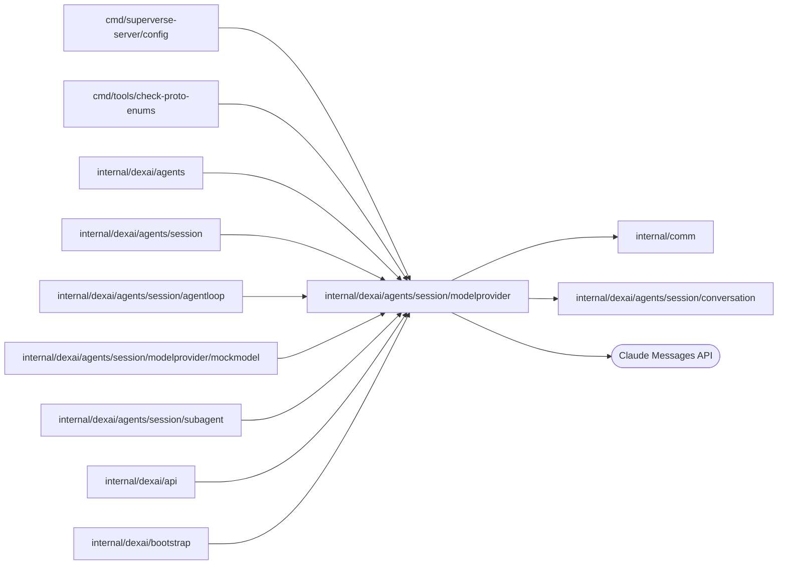

# Model provider

<!-- BEGIN GENERATED PACKAGE SUMMARY (scripts/check-package-readmes.py; edit only Purpose) -->
Purpose: Implements the Session Agent's model client over the Claude Messages API: model profiles, byte-exact replay of stored blocks, streamed summaries and tool activity, fallback cleanup and error classification.

Callers: `cmd/superverse-server/config`, `cmd/tools/check-proto-enums`, `internal/dexai/agents`, `internal/dexai/agents/session`, `internal/dexai/agents/session/agentloop`, `internal/dexai/agents/session/modelprovider/mockmodel`, `internal/dexai/agents/session/subagent`, `internal/dexai/api` and `internal/dexai/bootstrap` import this package.

Dependencies: it imports `internal/comm` and `internal/dexai/agents/session/conversation` and calls the Claude Messages API.

<!-- END GENERATED PACKAGE SUMMARY -->

`claudeClient` implements `conversation.ModelClient` over the Claude Messages API
(`client.Beta.Messages.NewStreaming`). The SDK reads no credential or base URL from
the environment and never retries; Dex retries the Step. A request uses exactly the
Project’s transient `ModelRequest.APIKey` over an explicitly owned HTTP client that refuses
redirects. `ClaudeClientConfig.BaseURL` replaces the API origin and is set only for the
[mock model](mockmodel/README.md), which `agent.mockModel: true` starts in the server process;
`RequestBetas` lists the beta headers a request can carry, which that model accepts.

`ModelRouter` is the Flow's `conversation.ModelClient`: it sends the calls of a Session on the
model `mock` to a second `claudeClient` pointed at the in-process mock model with its placeholder
key. Unavailable catalog models are rejected before client selection. Admitted Claude calls go to the official Claude API with the Project’s active credential.
A request without a key is rejected (`no_claude_key`); Session admission checks
its metadata and model Steps require equal active metadata/envelope revisions.
The server constructs no per-key transport or pool. A segment stays on one model. Error classification preserves the typed SDK or
transport cause for `errors.Is`/`errors.As`, while formatted diagnostics contain
only HTTP status, an allowlisted error type, validated request ID, cause type
and timeout flag. Provider bodies, request URLs and headers are never formatted.

| File | Owns |
| --- | --- |
| `model_catalog.go` | Closed replay/availability policy and dated unavailable candidate profiles; no new adapter. |
| `model_profile.go` | `ModelProfile`: what differs between Opus 5.5, Sonnet 5.5, Haiku 4.5 and the mock model, which takes Sonnet 5.5's request shape (thinking, effort, system messages, fallbacks, compaction ceiling, hard limit). |
| `model_router.go` | `ModelRouter`: the client of each call's model, Claude or the mock model. |
| `claude_client.go` | The request: frozen tools and system prompt, the replayed blocks byte for byte, thinking, effort, betas and the three one-hour cache breakpoints; error classification into retryable errors and `ModelRejectedError`. |
| `strict_schema.go` | `StrictInputSchema`: the input schema of a strict tool as the API takes it (the SDK's transformation: lengths, ranges and defaults move into the description of their parameter), written with sorted keys so the frozen prompt's digest and the request bytes of the tools are the same in every server process. |
| `claude_stream.go` | Stream capture with `BetaMessage.Accumulate`, live reasoning summaries, text and tool-call activity, the partial input of a `confirm_requirements` call for the request's tool input writer, the fallback cleanup and usage metrics. |

The adapter classifies Anthropic's documented low-credit HTTP 400
`invalid_request_error` by its specific message prefix, because the structured error
type is shared with unrelated invalid requests. The message is inspected only for
classification; its text never enters the resulting credit or spend-limit
error. Other rejected requests retain only fixed error categories in diagnostics; raw
provider bodies and request IDs are discarded so they cannot echo a credential.
There is no OpenAI-compatible model adapter in this package.
The monthly enforced spend cap is identified by Anthropic's structured
`error.details.error_code`; user-set spending caps have only documented
message prefixes under `invalid_request_error`. Both use separate, fixed
spending-limit guidance instead of the prepaid-credit guidance.
`billing_error` uses its error type alone and fixed account-owner guidance.

## Tests

`claude_client_live_test.go` (build tag `live`, `make test-claude-live`) calls the real
Claude API with `ANTHROPIC_API_KEY` (the Make target reads it from the main
checkout's `.env` unless it is exported); a missing key fails the test. The live tests also require a ready local lane and its real dependency settings: each creates a Project, sets the developer's key through `ModelCredentialService`, exact-reads its envelope for adapter requests, and deletes it before Project cleanup. Key validation adds one bounded one-token request per test. Run them only when the platform developer requests real-model verification. It sends one
request per model profile, a multi-turn append-only tool loop with
`prefix_mismatch_behavior: error` and its `count_tokens` replay, a compaction, a
continuation after `max_tokens` and the classification of rejected requests.
`claude_strict_tools_live_test.go` sends the Session Agent's frozen tool set, its strict
tools with the schemas the API takes and the eager input streaming of `write`, `edit` and `confirm_requirements`,
to every Claude model and requires a tool call whose input the tool's decoder accepts.
The API also rejects a strict set whose compiled grammar is too large (HTTP 400, "The
compiled grammar is too large"), which no count of tools or parameters shows; that test is
where such a rejection appears, and `make test-claude-live` must be rerun whenever the strict
tool set or a strict schema changes.

## Catalog and availability

`conversation.Model` owns durable typed strings; its `ModelDetails` binds each declared identity to
one closed `Provider`, API model ID and label. `Provider` owns display name, `APIStyle`, base URL and
key hint. Neither provider nor wire style can be constructed from arbitrary strings outside its
package. Mock retains its existing Anthropic request shape and needs no user key.
`ModelProfile` owns request budgets, capability policy, dated sources and `ModelAvailability`.
The closed states are Candidate, Available and Unavailable; the latter two non-callable states
carry reasons. Only the original three Claude models and mock are Available. API admission,
startup configuration and `ModelRouter` enforce availability independently of enum recognition.

The closed replay policies are ClaudeSigned (existing private signed blocks), EncryptedOpaque
(unreadable protocol items), NonThinking (explicit provider control), and PlaintextRequired
(a policy rejection with its reason). New opaque replay is private to its segment and must be
dropped when that segment closes; no readable thinking, summary or opaque payload enters public
history or compaction. This catalog change adds no replay payload or adapter.

The following official sources were read on **2026-10-21**. Every new entry remains unavailable:
adapters, protocol verification and Session API keys are pending. Capability flags are conservative
request policies, not live claims. Context budgets stay below documented context limits; reply budgets
are also deliberately conservative. Existing Claude/mock budgets and request behavior are unchanged.

| Provider | Catalog API model IDs | Replay target and documented limits/source |
| --- | --- | --- |
| OpenAI | `gpt-6-astra` | EncryptedOpaque; [1,050,000 context / 128,000 output](https://developers.openai.com/api/docs/models/gpt-6-astra); request output budget 64,000. |
| DeepSeek | `deepseek-flash` | NonThinking; [1M context / 384K output](https://api-docs.deepseek.com/quick_start/pricing/), current Flash version V4.1-Flash-1017; request output budget 64,000. |
| xAI | `grok-4.7` | EncryptedOpaque, Responses only; [500,000 context, no separate text output ceiling](https://docs.x.ai/developers/grok-4-7); request output budget 32,000. |
| Meta | `muse-wonder-1.0` | EncryptedOpaque pending Wonder verification; [1,048,576 context](https://dev.meta.ai/docs/models). [Messages](https://dev.meta.ai/docs/protocols/messages) documents a 1,024-token Spark example; the candidate uses that provisional request budget and explicitly requires Wonder output verification. |
| Gemini | `gemini-4-argon` | EncryptedOpaque pending compatible-layer verification; [1,048,576 unified context / 65,536 synchronous output](https://ai.google.dev/gemini-api/docs/models/gemini-4-argon); request output budget 32,000. |
| Kimi | `kimi-k3`, `kimi-k2.6` | K3 is PlaintextRequired and unavailable: [always-on preserved thinking](https://platform.kimi.ai/docs/api/chat). K2.6 is the newest [listed API model with non-thinking support and 256K context](https://platform.kimi.ai/docs/models); request output budget 16,000. Coding-subscription routing is not an API-model contract. |
| GLM | `glm-5.3`, `glm-5.2` | 5.3 is PlaintextRequired and unavailable: [1M context / 128K output, thinking cannot be disabled](https://docs.bigmodel.cn/cn/guide/models/text/glm-5.3). 5.2 has [1M context / 128K output](https://docs.bigmodel.cn/cn/guide/models/text/glm-5.2) and an explicit [disabled thinking switch](https://docs.bigmodel.cn/cn/guide/capabilities/thinking); request output budget 64,000. |
| Qwen | `qwen3.8-max` | NonThinking pending verification; [1,000,000 context / 131,072 output](https://help.aliyun.com/en/model-studio/qwen3-8-max); request output budget 64,000. The base URL is an inert reviewed workspace/region template; endpoint admission remains pending. |
| MiniMax | `MiniMax-M3.1-Flash`, `MiniMax-M3` | [Both have 1M context](https://platform.minimax.io/docs/api-reference/text-anthropic-api). M3.1 always thinks and requires readable replay, so is unavailable; M3 explicitly supports disabled thinking. Conservative output budget 4,096 follows the official request example; no larger maximum is claimed. |

`make check-proto-enums` additionally checks all Model constants against Models, profiles, dated
source data and both directions of the explicit AgentModel mapping, including duplicate rejection.
Studio's Record mappings require every enum and preserve picker filtering. No RPC or persistent
primitive is added. SessionModel's revision CAS, segment rollover, subagent frozen selection,
Flow identities, Step graph, Maps, Channels and Streams are unchanged. There is no database
migration, new resource, pool, per-request control-plane operation or additional tenant scan.
