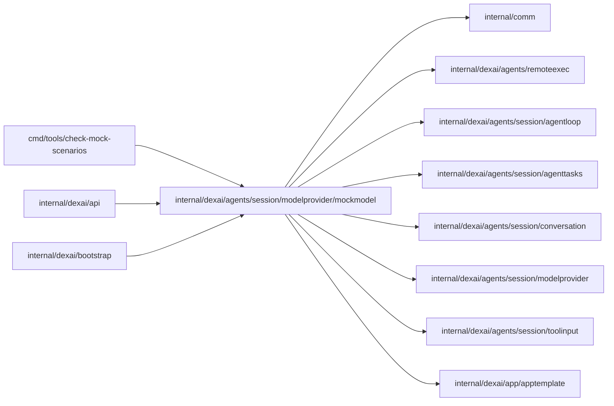

# internal/dexai/agents/session/modelprovider/mockmodel

<!-- BEGIN GENERATED PACKAGE SUMMARY (scripts/check-package-readmes.py; edit only Purpose) -->
Purpose: Serves the mock model: a loopback Claude Messages API whose embedded scenarios answer ordered user inputs, so Sessions run real tools without model cost.

Callers: `cmd/tools/check-mock-scenarios`, `internal/dexai/api` and `internal/dexai/bootstrap` import this package.

Dependencies: it imports `internal/comm`, `internal/dexai/agents/remoteexec`, `internal/dexai/agents/session/agentloop`, `internal/dexai/agents/session/agenttasks`, `internal/dexai/agents/session/conversation`, `internal/dexai/agents/session/modelprovider`, `internal/dexai/agents/session/toolinput` and `internal/dexai/app/apptemplate`.


<!-- END GENERATED PACKAGE SUMMARY -->

The mock model is the one dependency a test may substitute: Dex, Kind, the Sandbox
and the Git host stay real. It implements the part of the Claude Messages API the Session
Agent uses, `POST /v1/messages` with `stream: true`, as server-sent events in the shape
the pinned SDK parses: `message_start`, per block `content_block_start`, its deltas
(`thinking_delta`, `signature_delta`, `text_delta`, `input_json_delta`) and
`content_block_stop`, then `message_delta` with the stop reason and the usage, and
`message_stop`. The real `claudeClient` runs unchanged against it: request assembly,
stream parsing and storage.

## Running it

A Session runs on the mock model when its model is `mock` (`conversation.ModelMock`, whose
request shape is Sonnet 5.5's). `agent.mockModel: true` of the
[server configuration](../../../../../../cmd/superverse-server/config/README.md) makes
`internal/dexai/bootstrap` start the server on `127.0.0.1:0` with `Start(ctx, logger)` and give the
`modelprovider.ModelRouter` a second Claude client for it (`ClaudeClientConfig.BaseURL` and the
fixed placeholder key `APIKey`). The router sends the calls of mock Sessions there and every
other call to the Claude API, so one server runs both. Where the mock model may be selected:

| Environment | `agent.mockModel` | Who may select `mock` | New Sessions start on |
| --- | --- | --- | --- |
| Local Kind and Native (`local-kind.yaml`, `native.yaml`) | `true` | any account | `mock` |
| `local-kind-acceptance.yaml` (layered over `local-kind.yaml`, so Local Kind) | `true` | any account | a Claude model |
| test, staging | `true` | the administrator | a Claude model |
| prod | `false`, refused otherwise | nobody | a Claude model |

`UpdateSessionModel` enforces it in the API (`PERMISSION_DENIED` for any other account outside
Local, `FAILED_PRECONDITION` where the mock model is not offered); `ListMockScenarios` tells
Studio whether the caller may select it and returns `Catalog()`, which the mock composer offers.

Every reply of a scenario carries its progress in the response header
`modelprovider.MockProgressHeader`, as JSON: the scenario, the number of the input the reply
answers and the number of the input the scenario takes next (0 after the last). The router's
mock client stores it in the reply entry's `Meta` (`conversation.MockProgress`), which no model
reads, and the Snapshot reports the progress of the newest mock reply as
`AgentDescription.mock_progress`, so Studio never counts inputs in its message window. An input
out of order leaves the progress where it was.

The server refuses what the client never sends: another path, method or key, a
non-streaming request (all `404` or `401`), a model other than `mock`, which only a routing
defect sends, a beta header outside `modelprovider.RequestBetas`, a scripted tool the
request does not offer, and a scripted tool call in a request with `tool_choice` `none`
(`400 invalid_request_error`). A reply depends only on the request,
so a retry or a replay gets the same bytes.

## Scenarios and ordered inputs

A scenario lists the user inputs it expects, in order, and the replies the model gives to
each. An input is one of:

| Kind | How it reaches the Session | How the mock model knows it |
| --- | --- | --- |
| `message` | `SendMessage` with its text and `[[scenario:<name>#<n>]]` | the marker |
| `answers` | `AnswerQuestions` with one answer per question, in question order | an answer (`**header**: answer`) to the reply's `request_user_input` call |

A requirements card ends no input: the Session records `confirm_requirements` as the next
version and the turn goes on, so the replies after the card follow in the same input, and the
input's last reply is a text that ends the turn. A change to the card is a `message`, which the
Studio composer sends (and the Brief steers); the scenario's next replies revise the card and
build the difference. A message to a Session that still waits at a card from before cards
stopped waiting records that card as the next version, answers it and continues the scenario like
any message.

Studio's mock composer and the tests send exactly the content `Catalog()` lists for each
input: the marker comes with the text, an answer needs none. `[[scenario:<name>]]` is input 1,
and `[[scenario-arg:<name>=<value>]]` sets an argument (values use letters, digits, space and
`._:/-`); a later input keeps the arguments in force and overrides those it names.

The mock model keeps no state: it reads the conversation in order and derives the inputs the
scenario received. Input 1 of any scenario starts it (again); any other input must be exactly
the one after the last the scenario received, in its declared kind. Any other input is
answered with one text, `end_turn` and no tool call, that names the input the scenario
expects ("Mock scenario <name>: input <n> is out of order; send input <k> first: <label>."), and
the scenario still waits for that input, so a request that bypasses the composer cannot run a
scenario out of order. A user message that is no input, such as a task notification or a
continuation notice, continues the replies of the last input. A user message whose text blocks
hold several inputs, such as a new input after a model call the API rejected, which the next
request repeats unanswered, counts as its newest one.

| Request | Reply |
| --- | --- |
| No user message has started a scenario | One text, "The mock model answers only scenario inputs: choose a scenario and send its next input.", `end_turn` |
| The next reply of the last input | That reply |
| The input has no more replies | A text that names the next input, or, after the last input, "The mock scenario <name> has no further steps.", `end_turn` |
| An input out of order or of another kind | The text that names the expected input, `end_turn` |
| The request ends with `conversation.CompactionInstruction` | `<summary>[[scenario:<name>#<n>]] [[scenario-step:<k>]] [[scenario-arg:...]] <compaction_summary></summary>`, `end_turn`, or the `compaction_error` of the reply before the request |
| An unknown scenario, an unknown or malformed argument, or a scripted tool the request does not offer | `400 invalid_request_error` |

The compaction summary carries the scenario, the input and the reply it reached and the
arguments; `[[scenario-step:<k>]]` marks that carry-over, so the first message of the next
segment continues the script where it was and counts as no new input.

A segment the Session opens without a summary, after a compaction that failed at the hard limit,
has no summary to carry the position, and the pending request it quotes would start the scenario
again at input 1. The segment also quotes the todo list, so a script that expects such a segment
writes `[[scenario-step:<k>]]` into a todo item of its last reply before the failed compaction, and
the quoted marker continues the script at reply `<k>`. Without the quoted request the first message
names no scenario, and the mock model gives its fixed text.

## A failed tool stops the scenario

A script never claims work its tools did not finish. When a user message answers the previous
assistant message's `tool_use` with a `tool_result` that has `is_error`, and the reply that made
the call does not set `expect_failure: true`, the scenario stops: the reply is one text,
"Mock scenario <name> stopped at input <i>, reply <r>: <tool> failed: <first line of the result,
at most 200 characters>", with `end_turn`. Every later request of that conversation, such as the
Session's continuation notices after an unfinished source handoff, gets the same stop text, so the
replay stays deterministic. Input 1 of a scenario starts it again. A reply sets
`expect_failure: true` when a test wants the script to go on after a failing tool. With
`expect_failure_text` it also requires the failure: unless a tool of the reply fails with a result
whose first line holds that text, the scenario stops with "... no tool failed with <text>", so the
next reply proves what the model read. `expect_failure_contains` lists texts the failed result
must hold anywhere; `expect_result_contains` lists texts that the results of the reply's tools
must hold together, failed or not, such as a background task's output.

## Background tasks

A background command's task ID (`cmd-<12 characters>`) and a subagent's (`agent-<8 characters>`)
derive from the Session's FlowID, so no script can name them. A script that declares the argument
`task` (with a placeholder default such as `cmd-aaaaaaaaaaaa` or `agent-aaaaaaaa`) gets the last
task ID that each user message holds, in a tool result or in a notification, as `{{task}}` from
there on; `read_task_output`, `stop_task` and `merge_agent_changes` steps name it. A task
notification continues the replies of the last input: the automatic turn it opens is the next
reply, which declares `notification: task`, so a request without that notification is rejected.
The catalog does not list `task` among the arguments a person sets.

## Subagents

A scenario declares the scripts of the subagents its `start_agent` calls start under
`subagents`, each with its kind and the replies of its model calls, the last of which is its
report and calls no tool. A call's prompt names its script with `[[subagent:<scenario>/<name>]]`,
and the subagent's conversation, whose first user message is that prompt, gets the script's
replies in order, with the same replay check; a compaction summary of it carries
`[[subagent:<scenario>/<name>]] [[scenario-step:<k>]]`. The subagent scripts are no scenarios of
the catalog. At startup every `start_agent` call must name a declared script of the call's kind,
every declared script must be started, and each script's tools must be its kind's tool set
(`agentloop.SubagentTools`, whose `bash` has no `run_in_background`). A reply marked
A `connector_develop` subagent's root is a worktree of the connectors
library, which the template does not describe: its file tools play only on the files its script
writes, and a read or edit of another library file is not checked.

## A script that changes files and pushes nothing

A successful `edit` or `write` marks the turn's source as changed, and so does a
`merge_agent_changes` that applied a subagent's changes. A turn whose reply has no tool
call and that changed source after its last `commit_and_push` with `blocked=false` is continued
by the Session up to three times, each with a reminder. A script that must leave its files
uncommitted (`workspace-note`, `file-edit-failure`, `file-permission-denied`) therefore ends its input with its final text
plus three replies that answer the three continuations.

## Replay check

For every assistant message the request replays, the server recomputes the blocks it returned
for the reply it stood at and requires semantic JSON equality, ignoring key order and whitespace.
A mismatch answers `400 invalid_request_error` "mock replay mismatch at input <i>, reply <r>".
This is the cheap simulation of the API's thinking binding: a client that edits, drops or
reorders a stored block fails here, in every test, without the real model. Thinking signatures
are fake but deterministic, the base64 of `sha256(scenario, input, reply, block index)`, and
tool use IDs are `toolu_mock_<run>_<input>_<reply>_<index>`, where the run names the segment
and the position of the message that started the scenario. A Session that runs scenarios one
after another, or one scenario again, therefore never repeats a tool use ID, which the Sandbox's
command ledger and the tool records key by.

## Scripts

Scripts are `scenarios/<name>.yaml`, embedded with `go:embed`, parsed with
`github.com/ghodss/yaml` and checked when the package loads: a broken script panics at
startup. The check refuses unknown fields, an input without a label, kind or replies, a first
input that is not a message, answers that do not follow the reply that asks for them (the
`request_user_input` call with as many questions as answers), tools outside the Session tool catalog, tool input fields outside
the tool's schema or missing a required one, an input that the tool's own strict decoder
rejects, and a file tool that does not work on the files the Project starts with. The checker
plays each `read`, `edit` and `write` of a script, in order, on a copy of the composed files of the
default example, or of the example the script names as its `workspace`: a `read` needs its
file, an `edit` needs its `old_string` exactly once (or at least once with `replace_all`) and a
different `new_string`, and a `write` adds or replaces a file that a later reply may use. A
reply that expects a failure may fail on the copy. `example-change`, which
`TestProjectFromExampleDexIntegration` runs on a Project created from the slack-thread-approval
example, has that example as its workspace.

A scenario whose first message, sent at a Project's creation, starts that Project from the example
the server finds closest (with `agent.closestExamplePick` on, as the local lanes have it) declares
`start: matched` with that example as its workspace: the loader runs the server's decision on the
first message and requires it to pick the workspace. Every other scenario without a workspace must
start from the default, so the loader refuses a first message the decision matches to an example:
reword it, for example by naming the template's own Flow (`TextSummaryFlow`) or Step, which keeps
the default.

```yaml
name: requirements-draft-changes  # equals the file name
title: "..."                    # what Studio lists
description: "..."
category: project_feature        # the group Studio lists it under; see Categories
test_action: "..."               # what only its Dex test does between inputs; Studio does not offer it
workspace: slack-thread-approval # the example the Project was created from; absent for the default
start: matched                   # the server matches the first message to the workspace; absent otherwise
arguments: {heading: Mock}      # {{heading}} placeholders and their defaults
compaction_summary: "..."       # the summary a compaction request gets
inputs:
  - label: "Describe the application"
    message: "Plan a release tracker."          # or answers: [...]
    replies:
      - thinking: "..."           # emitted as a summarized thinking block, signed
        text: "..."
        tool_uses:                # parallel tool calls of one reply, in order
          - name: grep
            input: {pattern: "<h1>", path: web/src}
        usage: {input_tokens: 4000, output_tokens: 300}  # drives compaction
        stop_reason: tool_use     # default: tool_use with tool uses, else end_turn
        chunk_delay_ms: 40        # pause between deltas, to stream slowly
        repeat: 100               # the same reply this many times, to exercise a long turn
        notification: task        # this reply answers a task notification, which the request must hold
        expect_failure: true      # keep going when a tool of this reply fails (default: stop)
        expect_failure_text: "Error: invalid_arguments"
        expect_failure_contains: ["owner: call"]
        expect_result_contains: ["exited with code 0"]
        expect_segment_start: ["<confirmed_requirements>"]  # texts the request's first message must hold
        expect_segment_start_lacks: ["<starting_example>"]  # texts it must not hold
        expect_repository_context_notice: true  # the repository context in exactly one notice after a segment_start without it
        compaction_error: {status: 529, type: overloaded_error, message: "..."}  # the compaction that follows this reply fails
      - error: {status: 400, type: invalid_request_error, message: "..."}
subagents:                        # the scripts the start_agent prompts name: [[subagent:<scenario>/heading]]
  heading:
    kind: investigate             # investigate or change, the start_agent call's kind
    replies:                      # the subagent's model calls; the last is its report
      - text: "..."
```

A reply is a stream or an `error`, which answers the call with an Anthropic error body
instead; a `400` is a rejection the Session records as a failed turn, while a `429` or `5xx` is
retried by Dex. A reply sets `compaction_error` to answer the compaction request that follows it
with such an error instead of the summary. The mock model keeps no state, so every attempt of that
compaction fails the same way: Dex retries a `529` until it gives up, and the Session recovers
from the failed compaction. An edit that names a tool by its current catalog name changes together
with that tool: a tool rename updates the scripts.

`expect_repository_context_notice` proves the repository context a Session appends late: the
request's segment_start, the first text block of its first message, must hold no
`<repository_context>` section, and exactly one later user text block must hold one, the notice the
Session appends at the first model-call boundary after its workspace read the context. Otherwise
the reply is a stop text, like a missing `expect_segment_start` text or a present
`expect_segment_start_lacks` text.

## Categories

Every scenario declares the `category` Studio's mock composer lists it under, one of
`ScenarioCategory`'s values, in the composer's order; `ListMockScenarios` returns it as
`AgentMockScenario.Category`.

| Category | Scenarios that |
| --- | --- |
| `product` | Build a complete product application. A replay of a real model's session that built one belongs here |
| `agent_feature` | Exercise a capability of the Agent itself: tools and questions, streaming, background commands and task tools, subagents, compaction, Stop, steering and the workspace that outlives a turn |
| `project_feature` | Exercise building the Project: a source change through the commit gate, requirements, connectors, deployments, platform reads |
| `platform_error` | Meet a platform or provider failure, which the platform reports and recovers from |
| `user_error` | Meet a mistake in the user's configuration or application source, such as a failing test, a build error or a server that cannot start, which the Agent fixes |
| `agent_error` | Meet a mistake in the Agent's own call, such as an invalid argument, an ambiguous edit or a merge conflict, which the Agent corrects |

A scenario whose own replies call `edit`, `merge_agent_changes`, `commit_and_push` or
`confirm_requirements` changes the Project, so a second run on the same Project cannot repeat it:
the edit's old text is gone, merged changes are in, a pushed commit leaves nothing to push and
recorded requirements stay with their versions and the numbers of removed features. The catalog
derives `NeedsNewProject` from those tools; Studio marks such a scenario with ✎ and offers it only
on the creation page and, in the Session, until its last input, and marks every other scenario
with ↻. A scenario whose Dex test acts between its inputs where a person cannot, such as removing
the Session's instance, names that action in `test_action`; Studio marks it with ⊘ and does not
offer it.

## Coverage

`make check-mock-scenarios` loads the scripts and fails unless they cover the Agent both ways:
every tool of the Session catalog, every kind of pending user input (questions, the requirements
card), every notification kind that has a producer (`task`, `delivery`, `connector`)
and every subagent kind (`investigate`, `change`, `connector_select`, `connector_develop`) appears in at least one scenario, a subagent's
tools counting for its scenario, and every scenario is launched by a Dex integration test
(`internal/**/*_integration_test.go`, through `mockInput(t, "<name>", n)`) or an E2E spec
(`web/studio/tests/e2e/**`, through `runMockScenario`, `sendMockInput` or `chooseMockFirstInput`); a name in a comment or
any other string launches nothing. A notification kind counts only as a reply that declares it
(`notification: task`), and the mock model rejects that reply's call (`400
invalid_request_error`) unless the newest user message of the request holds a notification of that
kind, so the declaration is proved whenever the scenario runs. A new or changed tool, interaction
or subagent kind ships with its scenario and the test that runs it.

| Scenario | Category | Inputs | Used by |
| --- | --- | --- | --- |
| `build-basic` | `project_feature` | message | The create-project E2E and the new-project journey: `grep` and `glob` in parallel, a `read`, edits of the template heading `<h1>` from the `heading` argument and an optional `SUMMARY_GREETING` declaration in `dex-app.yaml`, a command, the template's `make bootstrap`, `write_todos`, `commit_and_push` through the real commit gate and `write_todos` marking every item completed |
| `inspect-basic` | `agent_feature` | message | A read-only inspection of any READY Project: the first turn of the create-project E2E and `TestSessionMockToolLoopDexIntegration` |
| `explain` | `agent_feature` | message | A long text streamed slowly: the Studio Watch reconnection check and `TestSessionMockModelSwitchDexIntegration` |
| `summary-approval` | `product` | message, message | The template-approval E2E and `TestSessionMockSummaryApprovalDesignBuiltDexIntegration`: the requirements card (R1 the approval Step, R2 the Action) with the Flow design it then builds, streamed at 100 ms per delta so that its drafts reach the RequirementsDraft Stream before it is recorded as version 1, in a session-start segment without `<card_design>`, then in the same turn the `read`s, seven `edit`s, `make bootstrap`, `make generate`, `go build ./...`, `make check-fdg-v2`, `commit_and_push` tracing R1 and R2 at version 1, each with an `untested_reason` (the llm connector has no mocks yet), and a completed `write_todos`; input 2, a change after that first build, records version 2 (R3 the approval Step's explanation names the approver) without a Flow design, with usage that forces a compaction, after which the next reply needs `<card_design>` and version 2 with no `Flow design:` in the new segment, then the explanation's `edit`, the build and `commit_and_push` at version 2 |
| `newsletter-app` | `product` | message | The opt-in `manual/newsletter-product.spec.ts`: the R1–R5 card, recorded and built in the same turn, source at `superdurable-apps/test-newslett-99by@faebe70`, template replacement, generate/build/FDG checks and one `commit_and_push`; the spec then configures real providers and verifies one campaign on Native Preview |
| `slack-thread-approval` | `product` | message | A Slack thread approval built from the template, as the connectors library's thread-approval example: a card (R1 a channel message starts a run, R2 a thread reply is accepted once, R3 the app posts `Processing complete.` in the thread) with an existing Slack connection, recorded, then in the same turn `make bootstrap`, `go get` of Slack v1.0.0 and sdkgo v0.28.1, a read of the release's auth method and `RelayedTriggerPath`, `write`s of `SlackThreadApprovalFlow` (`channelThreadCreated` starts it, `threadReplyCreated` invokes `ReceiveThreadReply`), its trigger runner, API, page, API tests and `dex-app.yaml` (connection `slack-approvals`, `authMethodId` ""), `edit`s that mount the runner at `/triggers/slack/c2xhY2stYXBwcm92YWxz` and run it beside the Worker, the text summary removed, `make generate`, `go mod tidy`, `go build ./...`, `make check-fdg-v2` and `commit_and_push` tracing R1 and R2 to tests and R3 as untested (Slack has no mocks): `TestSessionMockSlackThreadApprovalDexIntegration` |
| `example-change` | `product` | message | The first change of a Project opened from the slack-thread-approval example (`workspace`): the session-start segment must carry the picked example's `<starting_example>` section, which says the change's card carries no Flow design, and `<card_design>`; a revised card (R1 to R3 kept, R4 a reply that contains approve) without a Flow design as version 2, the reply filter's edit, the `RecordThread` explanation's edit, which changes that Step's built definition, an API test and `commit_and_push` at version 2: `TestProjectFromExampleDexIntegration` and the example-project journey, which sees the Step marked changed once the push is built |
| `example-previous-tree` | `product` | message | The first message of a Project opened from slack-thread-approval at the previous tree the build keeps (`workspace`), whose card this build cannot record: the session-start segment's `<starting_example>` must say the card could not be recorded and why, with no `<confirmed_requirements>`, and that a large change's card carries no Flow design, as every card of a Project started from an example, which `<card_design>` says too, and a `bash` prints the first commit's tree, which the test compares with the previous tree: `TestProjectFromPreviousExampleTreeDexIntegration` |
| `example-matched` | `product` | message, message | `start: matched` from slack-thread-approval: the first reply needs `<starting_example>` and `<card_design>` in the session-start segment and records the agent's own version 1 (R3 posts `Approved.`) without a Flow design, with usage that forces a compaction, after which the next reply needs the section again, now saying version 1 is recorded instead of asking for it; two `edit`s of the reply text, the build and `commit_and_push` at version 1, the first build, recorded as keeping all 4 of the example's real Steps in pushed Flow definitions of 4; input 2 compacts again and needs the new segment to lack the section and still carry `<card_design>`: `TestSessionMatchedExampleDexIntegration`, `TestCreateProjectClosestExampleDexIntegration` and the example-matched journey |
| `example-matched-wrong` | `product` | message | `start: matched` from slack-thread-approval for a request that wants nothing posted back: version 1 with R1 and R2 and no Flow design, `write`s of the Flow without its reply Step and failure Step and of its API tests, the connector operation and the page's text removed, the build and `commit_and_push` at version 1, the first build, recorded as keeping 2 of the example's 4 real Steps in pushed Flow definitions of 2: `TestSessionMatchedExampleRemovesDexIntegration` |
| `app-tests` | `user_error` | message | The commit gate's test stage: a card (R1 an unknown summary answers not found, R2 blank text is rejected), recorded, then `make bootstrap`, an API test written with a wrong expectation that fails in `make test-app` and fails the first `commit_and_push` as `application_tests_failed`, its fix, a trace without R2 that fails as `requirements_untested`, a server detached on the test engine's Dex port that fails the next push as `test_environment_unavailable` with its own retry hint, a `bash` that stops it, and the complete trace, which pushes with the tests stage passed: `TestSessionMockAppTestsDexIntegration` |
| `requirements-card` | `project_feature` | message | `TestSessionMockRequirementsCardDexIntegration`: a card recorded as version 1, then in the same turn a progress list and a final reply |
| `catalog-prefetch` | `project_feature` | message | The first reply without the workspace: "Post new Stripe payments to Slack." answers only when the first segment's `<catalog_matches>` lists `stripe` and `slack`; the card built from them is recorded while the workspace request runs beside the first model call; a `read` of `AGENTS.md` joins that request and waits, and the next reply (an `edit` of the page heading) and the last one need the repository context in exactly one notice after a segment_start without it; then `make bootstrap` and `commit_and_push` tracing R1 as untested (Stripe and Slack have no mocks): `TestSessionMockCatalogPrefetchDexIntegration` |
| `requirements-draft-changes` | `project_feature` | message, message | A change sent and steered while the Agent works: the first card is recorded as version 1 and the turn goes on to a 900-second `start_timer`, which the steered message interrupts; its turn records a revised card that keeps R1 and R2 and adds R3 as version 2, then a progress list: `TestSessionMockRequirementsSteeredChangeDexIntegration` |
| `requirements-completely-changes` | `project_feature` | message, message | A completely different request after a recorded version: its card sets `replaces_requirements` and replaces the requirements, numbered from R1, as the next version: `TestSessionMockRequirementsCompletelyChangesDexIntegration` |
| `long-turn` | `agent_feature` | message | 101 model replies in one turn with real `write_todos` admission and no limit question: `TestSessionMockLongTurnDexIntegration` |
| `requirements-amended` | `project_feature` | message, message, message | A feature added and one dropped after a recorded version: the revised card keeps R1 and R3 as recorded, removes R2 without reusing its number and adds R4, and only that change's work follows the next version; a card that gives the dropped feature R2 back is refused with the next free number (`expect_failure`), and the corrected card's R5 is the version after: `TestSessionMockRequirementsAmendedDexIntegration` and, out of order first, `TestSessionMockInputOrderDexIntegration` |
| `requirements-small-change` | `project_feature` | message, message | New copy after a recorded version: a direct `edit` of the template's label with no card, the recorded version unchanged, and three replies to the handoff continuations: `TestSessionMockRequirementsSmallChangeDexIntegration` |
| `requirements-compaction` | `agent_feature` | message | The compaction usage trick for a Session that holds recorded requirements (arguments `version` and `title`, by default those of `requirements-draft-changes`); its last reply answers only when the new segment's `segment_start` carries them: `TestSessionMockRequirementsAmendedDexIntegration`, after version 3 |
| `design-revised` | `project_feature` | message, message, message | A card with a Flow design whose review waits on a Channel, recorded as version 1 while the turn goes on to a 900-second `start_timer`; a change sent and steered, whose turn records a revised card whose approval waits on an Action as version 2, with a compaction whose last reply answers only when the new segment carries the design's outline; then a blocked checkpoint whose trace of version 1 is refused (`expect_failure`) and whose trace of version 2 pushes: `TestSessionMockDesignRevisedDexIntegration` |
| `design-refused` | `agent_error` | message | Five cards whose design names an undeclared feature, Step or Channel, leaves a Step unreachable or passes 24 KiB, each refused as `invalid_user_input`, then the corrected card, recorded, and a closing reply: `TestSessionMockDesignRefusedDexIntegration` |
| `question-answers` | `agent_feature` | message, answers | `set_effort` and `connector_catalog`, then `request_user_input` with two questions; the answers continue through `start_timer` and `write_todos`: `TestSessionMockQuestionAnswersDexIntegration` and, while its questions wait, `TestSessionNotificationAdmissionDexIntegration`; the composer answers them on the card in `create-project.spec.ts` |
| `platform-reads` | `project_feature` | message | `read_delivery_status`, `read_platform_flow` of `project-{{project}}` (its summary and its first history page, which must hold the Flow's first event) and `read_live_app_runs` in one wave: `TestSessionMockPlatformReadsDexIntegration` |
| `compaction` | `agent_feature` | message | Usage above every threshold after one tool call, so the Session compacts and continues at the next reply |
| `compaction-failure` | `platform_error` | message | A turn of 12 calls that moves its request into the archive, a compaction at the hard limit whose new segment quotes that request, and a second one that fails with `529`, so the Session opens a segment without a summary that quotes the request too, where the script goes on: `TestSessionMockCompactionFailureDexIntegration` |
| `model-failure` | `platform_error` | message | A rejected request, so the turn records its failure and the Session waits for the user; `CallModel` reports the rejection beside the turn |
| `model-credit-exhausted` | `platform_error` | message | Anthropic's documented low-credit response travels through the real adapter and stops the turn with fixed guidance. |
| `model-billing-error` | `platform_error` | message | Anthropic's HTTP 402 billing error stops the turn with fixed account-owner guidance. |
| `model-spend-limit` | `platform_error` | message | A structured enforced spending-limit code is handled as a permanent rejection, rather than a temporary rate limit. |
| `platform-issue` | `platform_error` | message | A background probe whose exit notification opens a turn that corrupts the probe's record in the command ledger with a command; the ledger answers each `read_task_output` of the probe with a helper error, so a read alone and one in a wave beside `dex-app.yaml` each exhaust their retries as `tool_unavailable`, and `RecordToolFailure` and the wave's join report each platform failure beside the turn: `TestSessionMockPlatformIssueDexIntegration` |
| `workspace-note` | `agent_feature` | message | An uncommitted note from the `note` argument and three replies to the handoff continuations, for the Sandbox deadline tests |
| `workspace-note-check` | `agent_feature` | message | `grep -qxF` of that note, whose exit code tells the test whether the note survived |
| `command-timeout` | `agent_feature` | message | A command past its 5-second timeout that moves to the background; its exit notification opens a turn that reads the end of its output |
| `background-command` | `agent_feature` | message | A `run_in_background` command whose exit notification opens a turn that reads its output |
| `background-long-turn` | `agent_feature` | message | A turn of 60 model calls beside a running background command, long enough for the Session to move to a new run before the command's exit notification opens a turn that reads its output |
| `background-chain` | `agent_feature` | message | Background commands whose notifications each open a turn that starts the next, until the automatic-turn bound pauses them |
| `stop-turn` | `agent_feature` | message, message | A background server and a long check that the test stops; input 2 reads the `interrupted_by_user` result |
| `task-tools` | `agent_feature` | message | `read_task_output` of a running background command and `stop_task` |
| `file-edit-failure` | `agent_error` | message | An `edit` that fails with `edit_ambiguous`, a `read` and an `edit` with more context, then three replies to the handoff continuations |
| `file-permission-denied` | `agent_error` | message | A note locked with `chmod 000`: a `read` alone, a `read` and a `grep` in a wave beside `dex-app.yaml`, an `edit` and a `write` each fail at once with `path_permission_denied` (owner call, effect none); the permissions restored, a `read` succeeds, then three replies to the handoff continuations: `TestSessionMockFilePermissionDeniedDexIntegration` |
| `preview-push-stop` | `project_feature` | message | A verified push followed by a long foreground check; Stop interrupts the check while its accepted process build finishes: `TestSessionPushedProcessesSurviveStopDexIntegration` |
| `process-auto-refresh` | `project_feature` | four ordered messages | Default automatic push, preference-off push, uncommitted note/manual refusal and recovery push in one Project; the real Studio Setup spec `integration/setup/auto-refresh.spec.ts` drives every input through the composer |
| `preview-autodeploy` | `project_feature` | message | A note from the `note` argument, the template's `make bootstrap` and `commit_and_push` through the real commit gate; the Preview then deploys the pushed commit by itself, and its ready outcome reaches no conversation: `TestSessionMockPreviewAutoDeployDexIntegration`; with automatic deployment off nothing deploys it: `TestSessionPreviewAutoDeploySwitchDexIntegration`, and `create-project.spec.ts` builds it with Build processes |
| `setup-live-versions` | `project_feature` | message, message | Two pushes through the real commit gate, each after the template's `make bootstrap`: the first declares the optional `SUMMARY_GREETING` in `dex-app.yaml`, the second replaces it with `SUMMARY_TONE`, so Live's next version keeps, proposes and drops configuration items: the Studio integration spec `setup-live.spec.ts` |
| `preview-failure-fix` | `user_error` | message | A startup check of `WELCOME_TEXT` that builds but exits in the Preview, pushed; the application-owned `PREVIEW_FAILED` delivery notification opens an automatic turn, the reply that declares `notification: delivery`, which removes the check and pushes the fix the Preview then serves: `TestSessionMockPreviewFailureFixDexIntegration` |
| `live-failure-fix` | `user_error` | message | The same startup check, pushed; a test deploys the commit to Live, where the application exits, and the application-owned `DEPLOYMENT_FAILED` delivery notification opens an automatic turn, the reply that declares `notification: delivery`, which reads the delivery status (`DEPLOYMENT_FAILED` in its result), removes the check, pushes the fix and asks the user to publish it: `TestSessionMockLiveFailureFixDexIntegration` |
| `preview-broken-checkpoint` | `user_error` | message, message | A Flow source that does not compile, pushed as a blocked checkpoint, which hands nothing off, with three replies to the handoff continuations; then the source restored, `make bootstrap` and `commit_and_push` through the real commit gate, which the Preview deploys by itself: `TestPreviewRefusedDeploymentKeepsServingProcessesDexIntegration`, which then deploys the checkpoint itself, and `TestLiveSourceFailureNotifiesDexIntegration`, whose Release of the checkpoint fails its source preparation |
| `preview-start-failure` | `user_error` | message | The same startup check of `WELCOME_TEXT`, pushed as a blocked checkpoint, which hands nothing off, with three replies to the handoff continuations; a test prepares and starts the commit twice, each start fails `PREVIEW_FAILED` and leaves the Preview `STOPPED` with the reason, and each delivery notification opens an automatic turn, a reply that declares `notification: delivery`: `TestPreviewStartFailureDexIntegration` |
| `tool-failure` | `agent_error` | message | A blank `bash` command that fails with `invalid_arguments`, then a real command |
| `subagent-investigate` | `agent_feature` | message | `start_agent` of an `investigate` subagent that greps in its worktree after a 20-second pause, during which the test checks its admission, and reports; its notification opens an automatic turn: `TestSessionMockSubagentInvestigateDexIntegration` |
| `remote-task-worktree-platform-keep` | `agent_feature` | message | A platform `investigate` subagent opens its real worktree after remote takeover, while the test checks the open Codex task checkout remains: `TestSessionRemoteTaskWorktreePlatformKeepHTTPDexIntegration` |
| `subagent-change-merge` | `agent_feature` | message | `start_agent` of a `change` subagent that edits the page heading and checks it with a 30-second command that counts its runs in the Sandbox (`check run 1`); its notification opens a turn that merges a path the subagent did not change (`nothing_to_merge`, listed under `unknown`, the change left mergeable), then every file (`merged`), reads the merged heading and answers three handoff continuations: `TestSessionMockSubagentChangeMergeDexIntegration`, which replaces the Worker during the check |
| `subagent-conflict` | `agent_error` | message | A `change` subagent and the main agent change the same heading line; the merge reports a `content` conflict (`merged_with_conflicts`), which a `sed` resolves to the subagent's side; each turn answers three handoff continuations: `TestSessionMockSubagentConflictDexIntegration` |
| `subagent-lost-instance` | `platform_error` | message | A `change` subagent edits the page heading and checks it with a command that ignores SIGTERM, during which the test removes the instance; the check's result is unknown (`expect_failure`), the subagent reports, and its finish saves the worktree on the next instance; the notification opens a turn that merges (`merged`), reads the heading and answers three handoff continuations: `TestSessionMockSubagentLostInstanceDexIntegration` |
| `subagent-steered-start` | `agent_feature` | message, message, message | A `read` on the Session's instance; after the test removes the instance, a `start_agent` that waits for the next instance, which input 3, steered, supersedes (`expect_failure_text: Error: superseded_by_steered_user_message`); the steered turn answers: `TestSessionMockSubagentSteeredStartDexIntegration` |
| `subagent-stopped-start` | `agent_feature` | message, message | A `read` on the Session's instance; after the test removes the instance, a `start_agent` that waits for the next instance, which the user's Stop answers (`expect_failure_text: Error: interrupted_by_user`); the test then starts the subagent of the stopped record, which reports stopped: `TestSessionMockSubagentStoppedStartDexIntegration` |
| `subagent-stop` | `agent_feature` | message, message | A slow `investigate` subagent whose command ignores SIGTERM; input 2 stops it with `stop_task`, and its stopped report opens an automatic turn: `TestSessionMockSubagentStopDexIntegration`, and with input 1 alone `TestSessionMockSubagentStopButtonDexIntegration` (the Stop button) and `TestProjectDeletionStopsSubagentsDexIntegration` |
| `connector-select-existing` | `project_feature` | message | A `connector_select` subagent searches the published catalog for the llm connector's `generateText` and reports in the fixed structure; its notification opens a turn that puts it on the requirements card as an existing connection, recorded as version 1: `TestSessionMockConnectorSelectExistingDexIntegration` |
| `connector-select-choice` | `project_feature` | message, answers | A `connector_select` subagent reports gmail and outlook-mail; its notification opens a turn that asks with `request_user_input`, and the answer puts gmail on the card, which is recorded: `TestSessionMockConnectorSelectChoiceDexIntegration` |
| `connector-develop-new` | `project_feature` | message | After the recorded card a `connector_develop` subagent (slug `mockfeed`, contribution `new`) writes the module and its `catalog.yaml` entry in its library worktree; its finish commits and pushes the branch, and its notification carries the contribution: `TestSessionMockConnectorDevelopNewDexIntegration` |
| `connector-develop-operation` | `project_feature` | message | After the recorded card a `connector_develop` subagent (slug `newsapi`, contribution `operation`) changes only the newsapi module: `TestSessionMockConnectorDevelopOperationDexIntegration` |
| `connector-develop-fix` | `project_feature` | message, answers | The user agrees to submit a fix with `request_user_input`, then a `connector_develop` subagent (slug `newsapi`, contribution `fix`) changes only the newsapi module: `TestSessionMockConnectorDevelopFixDexIntegration` |
| `connector-pr-retry` | `platform_error` | message | After the recorded card a `connector_develop` subagent builds `mockretry`; its draft pull request cannot be opened, and the `connector` notification (`notification: connector`) opens a turn that tells the user: the manual `TestSessionMockConnectorPullRequestRetryGitHubIntegration`, on a lane whose upstream library GitHub refuses |
| `subagent-limit` | `agent_feature` | message | Seven `start_agent` calls in one turn: the fourth refused with `subagent_limit_reached` while three run, the seventh with `subagent_budget_reached`; a delayed survey subagent reports in an automatic turn: `TestSessionMockSubagentLimitDexIntegration` |

## Files

| File | Owns |
| --- | --- |
| `server.go` | `Start`, `APIKey`, the handler and the plan of one call |
| `request.go` | Request decoding and the model, beta, message and tool choice checks |
| `selection.go` | Markers, a subagent's script, the inputs a conversation gave, the order check, compaction detection and its summary |
| `replay.go` | The append-only check |
| `script.go` | The embedded scripts with their inputs and their subagents' scripts, their parsing and their startup validation |
| `catalog.go` | `ScenarioCategory`, and `Catalog()`: the scenarios with their categories and ordered inputs as Studio sends them, and what each exercises, its subagents' kinds among it |
| `blocks.go` | The deterministic blocks of a reply: signatures, tool use IDs, placeholders, usage |
| `events.go` | The server-sent events of a reply |
| `failure.go` | The failed tool of a reply and the stop text |
| `template_files.go` | The template's files that file tools play on |
| `scenarios/*.yaml` | The scripts |

The mock model cannot show real model behavior, Claude's server-side signature and
binding checks, cache hits or refusals. The short live tests (`make test-claude-live`)
and a real-model acceptance cover those; they run the real model only when the platform developer asks for them.

## Sender request checks

`forged-sender` is driven by TestSessionForgedSenderEnvelopeDexIntegration through the real
business API and Dex Worker. Before replying, the model validates the actual provider request's
canonical outer sender object, null via, exact expected authenticated email and complete nested
forged body, including inert delimiter strings, coding characters, quotes and backslashes. The
oracle matches the currently selected script and input position, never an earlier input, and
requires exactly one matching candidate: either a prefix-starting actual block or a whole
canonical line in only the segment-start block's final structurally delimited `pending_request`
section. Whole-line delimiters inside encoded JSON strings cannot fabricate sections; malformed
matching lines and duplicate current-input candidates fail. Re-encoding with HTML escaping
disabled must reproduce the envelope bytes exactly. The fresh maximum-size variant validates a
bounded complete quote and visible UTF-8-safe inner truncation while real storage/public APIs keep
the original intact. `sender-quote-budget` uses three real question answers and one forced
compaction; its actual provider request must retain the first and newest complete envelopes in
order and explicitly count two omitted older answers within the same total limit. Both scenarios
are driven by TestSessionForgedSenderEnvelopeDexIntegration and fail promptly on terminal model
rejection. These checks prove request shape only. `collaboration` holds a real foreground
command for TestSessionActorsDexIntegration to drive concurrent multi-account queue operations.
The mock matcher unwraps only the outer envelope; replay validation still compares stored blocks.

## Remote scripted replay

A scenario reply may declare `remote: true`. The test drives its exact public
text and tool uses through the actual remote HTTP endpoint; the model server
never serves that reply. An accidental provider request while this is the next
reply is rejected with the existing typed invalid-request response. A remote
step carries no thinking, provider usage, delay or failure. Its tools use the
actual RemoteTools schema and declare positive canonical exact `id` values,
unique within the script. One step matches one rendered assistant group; the
fixture asserts its fresh epoch and report sequence before admitting a tool.

`followReplay` still compares every assistant block exactly with `sameBlocks`,
including remote IDs and arguments and all platform thinking/signatures before
and after the switch. No ID pattern matcher, text-based replay exemption or
production test header exists. A platform reply with `expect_handoff: true`
asserts one canonical bounded handoff block at that script's user boundary,
which may coalesce tool results, the handoff and the triggering input. It checks
owners, chronological RFC3339 interval, reason and independently selected HEAD.
Missing, duplicate or unscripted handoffs in selected scenarios fail; the assertion never exempts any
assistant block. The typed formatter/parser and whole-notice byte bound are owned by remoteexec;
production wording and existing HandoffReason values are unchanged. InputKind, Catalog, MockProgress and generated contracts do
not change.

Only a whole text block accepted by `remoteexec.ParseHandoffNotice` is excluded
from scenario, subagent, step and argument marker selection. Its original
content remains in the request and `checkHandoffBoundary` validates its exact
scripted position. Ordinary compaction summaries still carry their scenario
and arguments. Prefix-only and malformed notices keep their existing selection
or error behavior; they are never silently ignored.

Malformed and duplicate raw canonical notices are defensive rejection branches
of `checkHandoffBoundary`, without current real-lane negative evidence. Remote
and imported user input is sender-enveloped, and the sole typed handoff producer
validates its own output. A future second producer must add its supported
real-lane malformed/duplicate case; synthetic provider requests and production
test hooks do not establish that evidence.

The ordered `remote-handoff` scenario is launched by the actual HTTP/Dex/
PostgreSQL/Sandbox integration source in the parent agents package. Its initial
platform turn ends before activation, the external `remote-1-2` write completes,
the remote turn reaches idle, the authorized browser RPC switches back, and the
platform reads the real file with strict replay. Source is uncompiled and unrun;
it covers a short retained prefix only, not >1000-entry provider replay or a
pre-remote compaction summary, and it is not an actual zero-provider-request
counter or real-model compatibility evidence.

`TestSessionRemoteLongHandoffHTTPDexIntegration` adds source for actual
continuation after more than 1000 remote entries, both fresh and after a genuine
`remote-long-summary` compaction. Its old scenario/step and conflicting
arguments cannot override `remote-long-continuation`. The exact
`remote-long-tail` write/read units follow 993 chronological imported inputs;
a real earlier result remains at the retention cutoff after its call is
deleted. The provider asserts a user-first complete suffix within 400000 bytes
(half of the default 200000-token compaction threshold at four bytes per token),
one bounded notice and summary, independently captured metadata/HEAD hashes,
and no orphan result in replay. The platform then reads the actual Sandbox file.
Its independent `byte_budget_with_pre_remote_summary` subcase imports more
than 1000 real public entries with numbered filler bodies of 473..632 bytes.
The canonical retained valid candidate exceeds 400000 immutable entry-block
bytes before switching. The provider requires a contiguous newest filler suffix
through 993, followed by exactly the original tail input and two settled tool
units, current input and notice/summary. Canonical candidate and filler digests
from actual retained Dex reads bind every selected block and its possible
immediate predecessor to the original encoding. Independently measured chosen
bytes must be at most 400000, and adding the immediately preceding filler must
exceed 400000; the test also checks the actual ContextSegment.FirstSequence
advances beyond the old retention floor. It never calls the production selector
or duplicates its selection loop. The existing two 994-block cases and strict
sameBlocks replay behavior remain unchanged.

For that first executor request, NewSegmentFor initializes CacheAnchor to zero,
so no content cache_control is permitted. The source stores the authenticated
sender envelope in UserMessage.Entry Blocks before assembly; envelope bytes
remain included. Nothing is stripped. Only the separately exact-validated
bounded notice with its embedded summary is outside this suffix budget. The
exact triggering input stays inside: AwaitUser stores it before suffix selection;
the final user gap is result, current input, notice. Reports stay within
32 events/512 KiB, each event under 64 KiB; canonical reads hydrate individual
ten-entry archive chunks or current entries,
with a 64 KiB fixture bound. This source is uncompiled and unrun, not runtime
acceptance or real-model evidence; the SDK maximum-payload hydration gate remains
open.

Ordinary interactive mock Sessions, while no script is selected, accept actual
remote public history through a separate validator. Every block has known
fields and a permitted type: UTF-8 text, canonical positive globally unique
remote tool IDs from the offered remote catalog with its strict schema and
argument limits, and exactly one matching result in the complete unit before
the next assistant message. Thinking, unknown blocks/fields, dangling or
repeated IDs/results and oversized public blocks are refused. User cache anchors
have the exact provider shape. A canonical handoff is parsed by the same owning
format, but no scripted boundary is required. The default mock reply stays the
same. This interactive path does not prove replay binding; every selected script
still takes the unchanged exact sameBlocks comparison. The actual endpoint and
Sandbox interactive write/read/switch source is TestSessionRemoteInteractiveHandoffHTTPDexIntegration;
it is uncompiled and unrun.
