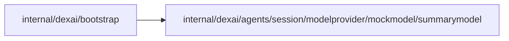

# internal/dexai/agents/session/modelprovider/mockmodel/summarymodel

<!-- BEGIN GENERATED PACKAGE SUMMARY (scripts/check-package-readmes.py; edit only Purpose) -->
Purpose: Serves deterministic application summaries over the Responses API on the local platform credential listener, without provider access.

Callers: `internal/dexai/bootstrap` imports this package.

Dependencies: it imports no other package of this module and calls no remote API.

<!-- END GENERATED PACKAGE SUMMARY -->

`connections.mockLLM` registers `POST /internal/mock-llm/v1/responses` only in
Local Native and Local Kind. It accepts only the fixed synthetic bearer credential
`superverse-local-mock-llm-not-a-secret` and model `superverse-mock-summary`.
The real released LLM connector sends its ordinary streamed Responses request;
the endpoint returns a deterministic excerpt of its first user message, a stable
response identity and positive synthetic token counts. These are model test data,
not provider usage evidence. No outbound client exists here.

One replica admits at most 16 concurrent requests, reads at most 1 MiB per body,
and retains no history or per-Project state. Excess requests receive 503. The
existing credential listener owns request cancellation and shutdown; no cloud,
Kubernetes, Dex or database resources are added. The route is unreachable when the
setting is off, and config validation rejects it outside local lanes or without
the mock Agent model enabled.
