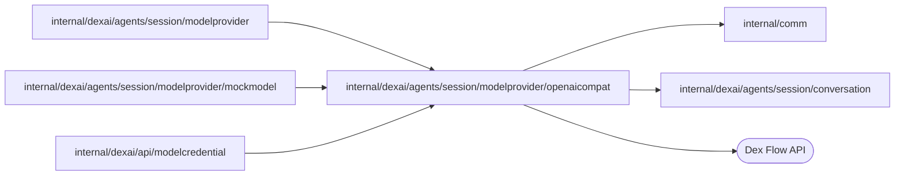

# OpenAI-compatible adapter

<!-- BEGIN GENERATED PACKAGE SUMMARY (scripts/check-package-readmes.py; edit only Purpose) -->
Purpose: Encodes frozen tools and canonical conversation into Responses or Chat Completions, validates streamed replies, and retains bounded private encrypted replay.

Callers: `internal/dexai/agents/session/modelprovider`, `internal/dexai/agents/session/modelprovider/mockmodel` and `internal/dexai/api/modelcredential` import this package.

Dependencies: it imports `internal/comm` and `internal/dexai/agents/session/conversation` and calls the Dex Flow API.

<!-- END GENERATED PACKAGE SUMMARY -->

This package implements both wire modes of one compatible adapter. The router supplies
catalog policy; it does not infer protocol from a failed endpoint or switch providers.
`New` consumes an origin-admitted HTTP client and complete API root from the
shared provider runtime. `Complete` obtains a request-local key, validates the
provider binding and never stores authentication. `NewMock` retains the internal
scenario transport. Operator configuration and reviewed implementation capability
jointly control real catalog availability; custom user URLs are not admitted here.

Responses requests explicitly send `store: false`, request `reasoning.encrypted_content`,
and rebuild `input` from the current segment without `previous_response_id`. Frozen
Anthropic-shaped tool definitions become function tools without modifying persisted
prompts. Complete encrypted reasoning items retain their ordered position through
`conversation.OpaqueReplay`; no raw response object is stored. Chat tools preserve
call IDs and aggregate arguments by choice/tool index. Repeated matching `function`
types are accepted on argument fragments; conflicting types fail. Null optional
Chat delta fields are absent, and unknown metadata such as `matched_stop` is ignored. Gemini signatures bind to the
immediately following call. Kimi/GLM non-thinking profiles explicitly disable thinking;
Qwen disables both thinking and its preservation. These are protocol implementations,
not claims of live provider verification.

Responses item status is optional in the official schema. Missing or null status
is normalized to canonical `completed` only after that item's `output_item.done`
and the aggregate `response.completed` agree. Explicit incomplete, in-progress,
empty or unknown statuses remain rejected; both terminal proofs are mandatory.

History encoding independently rejects duplicate replay item/call identities,
non-assistant replay, wrong bindings and unknown fields, and applies the aggregate
256 KiB reply budget before any HTTP request.

Only ordinary assistant text is forwarded provisionally. A terminal frame and complete,
consistent tool arguments are required before returning a reply to the Flow. Readable
reasoning and reasoning summaries are discarded at the decoding boundary before
writers, aggregation, persistence or replay. Visible content and tool calls continue;
malformed frames still fail validation. A provider that requires readable reasoning
passback returns the existing typed provider rejection, with a non-thinking-mode
recommendation; readable reasoning is never sent back. Per-event input is
bounded to 1 MiB, each stream to 16 MiB, output to 256 items, and private replay to
256 KiB per reply. The owner supplies the shared HTTP transport and cancellation;
there are no goroutines, automatic request retries, key caches or per-provider connection pools here.
A replica admits at most 32 concurrent compatible calls without an in-memory wait queue;
excess admission remains retryable under the existing Step policy.

HTTP 408, 429, 5xx and incomplete transports remain retryable under the existing
model Step policy. Other 4xx responses are deterministic rejections. A valid Retry-After is bounded to one minute and returned through Dex retry-delay metadata,
without an in-process sleep; absent a header, the enclosing Step retry policy applies. Bounded provider error bodies
and failure events retain only allowlisted machine codes/types, never message text.
Credit exhaustion and deterministic request failures are typed rejections with fixed hints.
Warnings contain only fixed machine codes and status; provider response request IDs are discarded to prevent credential echoes, and transport errors
retain their cause without the request URL. Tool results use a lossless textual `{content, is_error}` envelope because the wire
protocols have no native Anthropic error flag. No live provider request is made by this package's
mock verification.

Protocol sources checked 2026-10-21:
[Responses streaming](https://developers.openai.com/api/reference/resources/responses/streaming-events),
[function tools](https://developers.openai.com/api/docs/guides/function-calling),
and [Gemini compatibility](https://ai.google.dev/gemini-api/docs/openai).

## Dex protocol verification

`TestCompatibleReplyPersistenceDexIntegration` calls the approved scenario engine
through the real adapter, persists one reply in a fixture Attribute, replaces its
owned Worker and cold BlobCache, and compares the retained public projection and
private replay digest. Its two test Streams each have a 1 MiB budget shared by the
fixture Flow type's instances; the reasoning writer is observed while retaining its
real Dex destination. The test also reads the reply after execution completion.

`TestCompatibleProtocolFailuresDexIntegration` exercises successful reasoning-bearing
content/tool replies with canonical reply, Stream and log non-retention assertions,
the Qwen-compatible null/whitespace/repeated-type chunk shape producing exactly one
`get_weather` call for Paris, and conflicting-type rejection, plus
missing/oversized replay, authentication rejection, truncated streams, throttling
and overload through real Dex retry/terminal decisions. Its short two-attempt retry
policy belongs only to the fixture. No rejected or incomplete response may commit
a reply. Both tests complete or terminate their fixture executions and close their
Workers and model servers; retained fixture data is removed with the owned lane.

`TestCompatibleReplayBindingsDexIntegration` first persists a real endpoint reply
through Dex, then checks wrong provider/mode/position, unknown fields, duplicate
identity, wrong role and aggregate replay overflow in a following Step. A local
`invalid_replay` rejection is required; a provider-side refusal cannot pass it.

`TestCompatibleStreamCancellationDexIntegration` cancels each real SSE request
after an actual assistant Stream frame and requires a cancellation error, no
persisted partial reply/tool, and an empty reasoning Stream.

`TestCompatibleResponsesItemStatusDexIntegration` drives OpenAI/xAI status variants
through the same endpoint and real Dex: optional/mixed terminal statuses normalize
before persistence, while explicit non-completion and either missing terminal proof
commit no reply or tool. The official
[reasoning item](https://raw.githubusercontent.com/openai/openai-python/main/src/openai/types/responses/response_reasoning_item.py)
and [function call](https://raw.githubusercontent.com/openai/openai-python/main/src/openai/types/responses/response_function_tool_call.py)
types define the optional status contract.

These tests require an owned local lane's `SUPERVERSE_TEST_DEX_ADDRESS` and
`SUPERVERSE_TEST_WORKER_HOST`. They execute no proposed tool and make no claim about
Session admission, Sandbox/Git/storage effects, segment cleanup or full UI acceptance;
those remain separate production-lane checks. Missing lane inputs fail the tests.

Tool admission requires a declared name and a JSON-object argument. Schema mistakes
are returned by the runtime as correctable tool results. Chat length and Responses
max_output_tokens stops use the existing output-limit continuation: completed items
are retained and truncated pending calls carry an empty object and receive
not-executed results. No proposed tool executes for these replies. Missing replay
is allowed only on this path. The optional canonical ModelStopReason identifies
these replies for transient request projection: the proposal and its matching
not-executed result become text with the tool name and a fixed not-executed marker,
without arguments or private replay. Other replies still require exact replay.
Canonical history is never rewritten by request conversion. Refusal delta/done
frames aggregate alongside text and require agreement with the completed item.

A fully completed refusal is definitive even when the aggregate Responses reply
ends with incomplete/max_output_tokens. Refusal takes precedence over the output
limit and ends the turn; completed ordinary text at that limit still continues.

Credential admission uses the same bounded client and shared call limit, sends a
small stateless inference request, discards the bounded response and retains
only allowlisted rejection codes. Local scenario headers/progress are accepted
only when the validated runtime explicitly selects its owned mock endpoint.

Credential admission shares the replica's 32 compatible-call slots with inference,
with no queue or automatic retry. Saturation reaches the Builder as ResourceExhausted
(HTTP 429) with an explicit try-again message, before reserving a credential mutation.
The inference probe has a 60-second total deadline, allowing reasoning-model latency
within its fixed 64-token budget; connection/TLS limits remain 10 seconds. Earlier
caller cancellation still applies: Studio retains its existing 35-second RPC
deadline, so its effective admission budget is shorter than the provider ceiling. A timeout
is retryable admission failure and never marks a key invalid or persists it.
