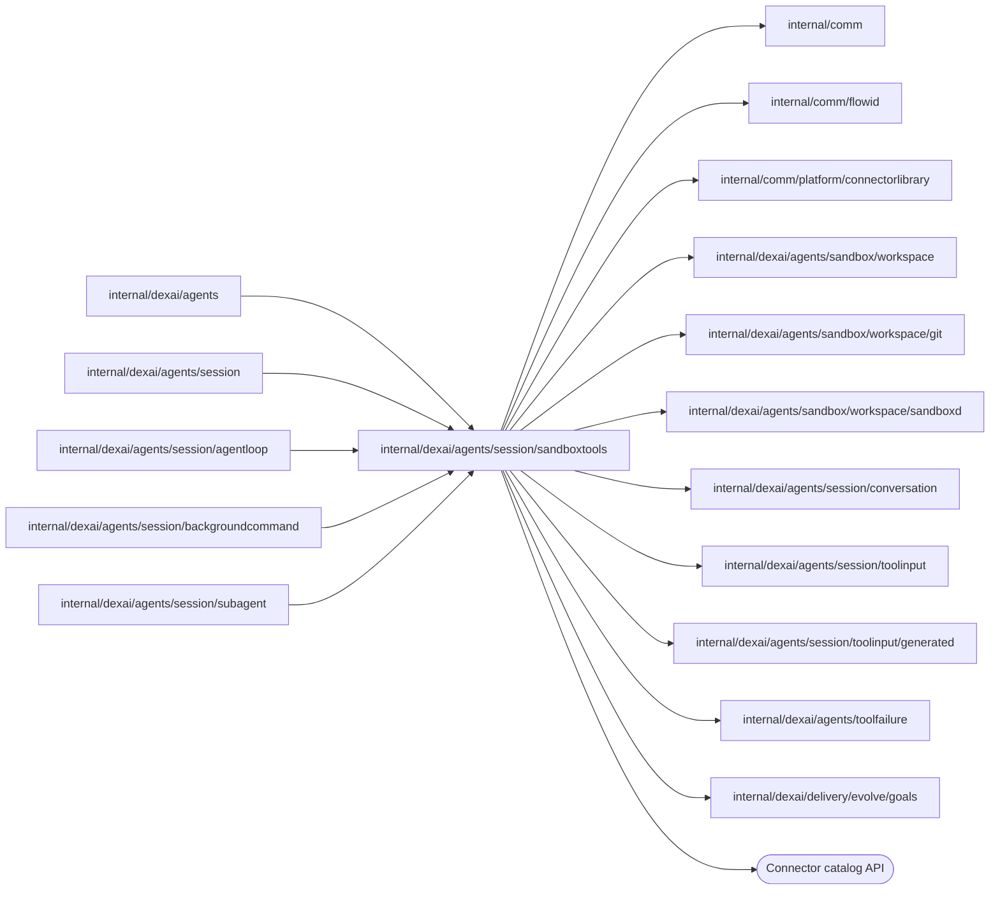

# Sandbox tools

<!-- BEGIN GENERATED PACKAGE SUMMARY (scripts/check-package-readmes.py; edit only Purpose) -->
Purpose: Runs the Sandbox tools of the Session Agent and its subagents over an accepted workspace lease, without any Flow access: files, commands, Git, subagent worktrees and the Connector catalog.

Callers: `internal/dexai/agents`, `internal/dexai/agents/session`, `internal/dexai/agents/session/agentloop`, `internal/dexai/agents/session/backgroundcommand` and `internal/dexai/agents/session/subagent` import this package.

Dependencies: it imports `internal/comm`, `internal/comm/flowid`, `internal/comm/platform/connectorlibrary`, `internal/dexai/agents/sandbox/workspace`, `internal/dexai/agents/sandbox/workspace/git`, `internal/dexai/agents/sandbox/workspace/sandboxd`, `internal/dexai/agents/session/conversation`, `internal/dexai/agents/session/toolinput`, `internal/dexai/agents/session/toolinput/generated`, `internal/dexai/agents/toolfailure` and `internal/dexai/delivery/evolve/goals` and calls the Connector catalog API.

<!-- END GENERATED PACKAGE SUMMARY -->

`place_attachment` writes the file of a JSON attachment the Session's Project
bound, its redacted copy, through `superverse-files write` at
`/workspace/.local/superverse-attachments/<id>/<name>`
(`conversation.AttachmentWorkspacePath`) and answers the path, size, digest
and redaction count. The Session's Step reads the file from storage through
its `attachmentRenditions` port and hands it over in `Call.Attachment`, so the
Runner reads no storage; an attachment the Project did not bind is
`attachment_not_found`, another kind than JSON `invalid_arguments`. Writing it
again writes the same bytes.

`Runner.Run` executes one catalog-selected tool for a Session. `Call` carries the
stable Flow/Call identity, the arguments, the admitted lease, the confirmed HEAD,
the agent root, the first attempt's time for a retried command and the progress
callback; `Result` carries the content, the failure of a call that failed with a
known owner and effect, a flag for a command that exited unsuccessfully, a flag
for a command that still runs, the verified HEAD of `commit_and_push`, and the
exit code and omitted-byte count of a command. This package depends on `toolinput`,
`conversation` and `workspace`, never on `agents/session` or a Flow client.

Run borrows the pooled Sandbox of the lease, which the Session fenced to itself
when it accepted the grant (a missing lease or an unreachable instance is `ErrWorkspaceUnavailable`:
nothing was dispatched) and classifies errors once, in this order: invalid
arguments are the `invalid_arguments` failure of the call; a `sandboxd.ToolFailure`
is the result, with its owner and effect; a transient fault
(`sandboxd.IsTransient`) or a cancellation is returned for Dex to repeat within
the retry budget of the tool; any other error is the platform failure
`tool_error`, recorded at once with the effect none for a read and unknown for a
tool that may change the workspace (`Call.Mutating`), because the Step cannot end
a Dex retry sequence with an error. A program the platform chose for a command
(`curl`) that the Sandbox cannot start is `platform_command_unavailable`.
There is no internal retry, parallel scheduler or mutation mutex; the Session's
Step graph owns those decisions.

Model arguments are decoded by `toolinput`; handlers add only what a schema cannot
express: byte bounds, NUL, blank text and workspace-relative paths.

| File | Responsibility |
| --- | --- |
| `runner.go` | Runner, Call, Execution, the Tool table, lease binding and error classification |
| `result.go` | Result and the failure result |
| `tool_arguments.go` | argument checks beyond the schema |
| `tool_bash.go` | `bash` through the command ledger: begin, in the background on request, status, and the move to the background (or, at the background limit, the stop) after a timeout or exhausted retries |
| `tool_tasks.go` | `read_task_output` and `stop_task` through the ledger, and the status of a task the Session watches |
| `platform_program.go` | Programs the platform chose (`curl`), run to their exit |
| `tool_files.go` | `read`, `edit`, `write`, `grep` and `glob` through the image's `superverse-files` helper; `place_attachment`; `place_evolve_export`, which streams an agent review's stored `runs.jsonl` (`EvolveExport.Runs`, refused above 256 MiB by its stored size before any write) in chunks of 4 MiB through sandboxd and finishes the folder with `evolve_export.py` |
| `evolve_export.py` | The fixed program that finishes a placed review folder: concatenates the chunks into `runs.jsonl` against the export's SHA-256, moves the other files beside it, makes them read-only and keeps the newest two review folders |
| `tool_connector_catalog.go` | `connector_catalog` over the official published catalog |
| `tool_git.go` | `commit_and_push` |
| `tool_agents.go` | The subagent and remote task worktree operations: creation, finish, merge and cleanup with trusted identities, and a `connector_develop` subagent's worktree of the connectors library: its creation (`CreateContributionWorktree`) and finish (`FinishContribution`) |

## Subagents

A subagent's calls run on the copy of the Session's lease it was started with, in its
worktree as the agent root (`Call.Root`, `git.AgentWorktreeRoot`), so the file helper's
path rules and the ledger's working directory confine it there. `Call.Subagent` marks
them: a command runs with `nice -n 10`, `GOFLAGS=-p=2`, `GOMAXPROCS=2` and
`NODE_OPTIONS=--max-old-space-size=1024`, because up to three subagents share the
Sandbox with the main agent, and `run_in_background` is refused. A subagent's command
never moves to the background: `StopTimedOutCommand` stops one whose timeout passed with
`command_timed_out`, and `SettleForegroundCommand` answers one whose attempts ran out from
the ledger, stopping it as `command_interrupted` when it still runs.

The worktree operations run the [Git protocol](../../sandbox/workspace/git/README.md#subagent-worktrees)'s
helper with trusted arguments (`AgentWorktreeArguments`): `CreateAgentWorktree` for the
Session's `start_agent` (`Result.Worktree`, refused with `snapshot_too_large` or
`workspace_disk_low`), `FinishAgentWorktree` for the subagent's end (`Result.Finished`),
and the catalog tool `MergeAgentChanges`, which takes the model's `agent_id`, `action`
and `paths`, refuses `paths` with `discard` and a path outside the workspace, saves a
worktree that the subagent's end could not save before it merges, and answers the receipt
(`Result.Merge`) with the applied, conflicting and unchanged files and the requested paths
that name no changed file (`unknown`). The Session checks that the agent is its own and
has ended before it runs the merge, and closes its record only for a discard or a merge
of every file.

`bash` runs `bash -c` in the agent root through the Sandbox's command ledger
(`superverse-exec`, see its
[contract](../../../../../sandbox/coding/cmd/superverse-exec/README.md)) under a ledger
ID derived from the call identity (`sandboxd.CommandTaskID`, `cmd-<12 characters>`),
so a retried attempt finds the command it started; the ledger ID is also the task ID
of a command that runs in the background. `BeginCommand` starts the command with the
lifetime of its timeout plus 30 seconds and waits up to five seconds; a command that
still runs is a pending result, which the Session polls with `CommandStatus`
(20-second waits). With `run_in_background` it starts a background command (3,300
seconds of lifetime) and answers its task ID at once, with `Result.Background` for
the Session's task record. `MoveTimedOutCommand` moves a command whose timeout passed
to the background and answers its output so far and its task ID; with four
background commands running it stops the command and answers `command_timed_out`
(call, partial) with the start and the end of its output. `SettleCommand` answers a
command whose attempts were exhausted from the ledger: its result once it exited;
one that still runs moves to the background too, or, at the background limit, is
stopped and `command_interrupted` (partial). A lost run, an unknown ID and a replaced instance are
`command_interrupted` with the effect unknown; a missing agent root is
`command_not_started`; 16 MiB of output is `command_output_limit_exceeded`. The
result is the merged output, at most the first 8,000 and the last 22,000 bytes
cut at line boundaries, with a marker that names the omitted bytes and the full
output file, `(no output)` when empty, and an `exit code: N` or
`terminated by signal` line when the command did not succeed. Nothing of the
output reaches the activity Stream.

`read_task_output` and `stop_task` take a task ID and reach its run in the ledger:
an ID that is not a command task ID, or that the instance does not know, is
`task_not_found` (call, none). `read_task_output` answers the task's state (running
since, exited with its code, stopped, stopped at a limit, or lost) and at most
30,000 bytes of output from its byte offset with the offset to read on from;
`stop_task` sends SIGTERM and, after 10 seconds, SIGKILL, idempotently, and answers
the final state. `CommandTaskStatus` waits up to 20 seconds for a task's end and
answers `Result.Task` for the Session's watch; `TaskArguments` builds the arguments
with which the Session watches and stops a task it recorded.

The file tools run the image's `superverse-files` helper through
`SandboxClient.RunHelperJSON`, in the agent root (`Call.Root`), with the call's
arguments as the helper's request ([contract](../../../../../sandbox/coding/cmd/superverse-files/README.md)).
The helper applies the path rules (the agent root, the read-only roots and no
`.git`), sizes every result before it is recorded and keeps `edit`'s intent
record, so this package decodes the arguments with `toolinput` (adding the byte
bounds a schema cannot say), maps the helper's typed failures (one of its
`toolfailure` codes, answered with the code's owner and the effect `none`) to
`sandboxd.ToolFailure`, and treats a helper that answers outside its contract as
the platform fault `platform_command_unavailable`. A helper error (exit code 1) is transient, which
Dex repeats.

| Tool | Result | Budget | Identity |
| --- | --- | --- | --- |
| `read` | `cat -n` lines, a cut marker for a line over 2,000 characters, the next offset when more remains | 2,000 lines and 64 KiB | none needed |
| `edit` | `Edited <path>: N replacement(s), lines a-b` | one line | the helper's intent record, keyed by the call's identity (`DeriveExecutionID`): a retry finds the edit applied and answers with the first result, or applies it once |
| `write` | `Created` or `Overwrote <path> (N lines, B bytes)` | one line | the content: the same content is a no-op |
| `grep` | file paths, matching lines with context, or counts, paged with `head_limit` and `offset` | 32 KiB | none needed |
| `glob` | paths, most recently modified first | 200 paths and 16 KiB | none needed |

Every file call has a 60-second attempt, retried only after a transient fault
(see the Agent catalog). Model-side per-response budgets belong to Agent context
assembly.

Unblocked `commit_and_push` runs the staged source gate before Git effects
(manifest, the template's `checkStatic`, the platform Flow-definition check with
the mock guard and, when the template declares `testApplication`, the API tests;
see the [Git protocol](../../sandbox/workspace/git/README.md)) and reports each
stage to the call's progress; a failed stage is an application failure with that
stage's report. Its result does not echo the arguments: it names the pushed
`commit`, the `branch`, `pushed`, the `gate.stages` with their durations (omitted
for a blocked call, an explicitly unverified checkpoint) and the `tests` of the
test stage when it ran (passed, failed, the Flows that ran and the `uncovered`
connectors without mocks). The Session reads `blocked` from the call's own
arguments. `requirements` traces each requirement of the current version the
Session recorded: a feature ID of that version, the files or symbols that
implement it, the `tests` that prove it and an `untested_reason` when no test
can; the form is checked here, and the gate's test stage requires every ID of
the version with passing tests or a reason.

## Skills and module sources

There is no source selector. The installed skills (`/opt/superverse/dex-skills`),
the Go module cache (`$GOMODCACHE`), `/usr/local/go/src`, the Preview logs and
the command output files are read-only roots of the file tools, which read,
search and list them by path. The Agent finds a module's directory with
`go list -m -f '{{.Dir}}' <module>` through `bash`, after `go get` or
`go mod download` when the module is not restored; the `connector_catalog` result
names each connector's exact module path for it.

`connector_catalog` fetches only the official HTTPS catalog (15-second fetch,
1 MiB bound), decodes and validates it with `connectorlibrary.DecodeCatalog`, and
returns at most eight matching entries within 16 KiB as `connectorlibrary.CatalogMatches`,
with the catalog digest, exact module path and the `install_command` that adds the
release to `go.mod`, the shape the Session's first segment lists its catalog matches in.
Runner keeps one catalog document for five minutes; the cache holds no credential or
goroutine.

See the [tool orchestration design](../../../../../docs/architecture/agent-harness-design/tool-orchestration.md#where-tools-run) for
lease fencing, output budgets and cleanup.

## File tool bounds

The model's file paths are sent to `superverse-files`, not converted to
`sandboxd.WorkspacePath`. The helper confines them to the agent root and allowed
read-only roots and refuses escaping symlinks and `.git` paths. The tool input
schemas limit a path to 4096 characters and write content to 4194304 characters;
`validateText` additionally rejects NUL and caps path bytes at 16 KiB and write
content at 4 MiB. These are distinct character and UTF-8 byte limits.
The helper independently caps write content at 4 MiB and read answers at 64 KiB;
the read schema also limits each call to 2000 lines.
`TestFileToolsActualSandbox`, `TestFileToolBudgetsActualSandbox` and
`TestFileToolReadOnlyRootsActualSandbox` exercise the real helper and tool path.
