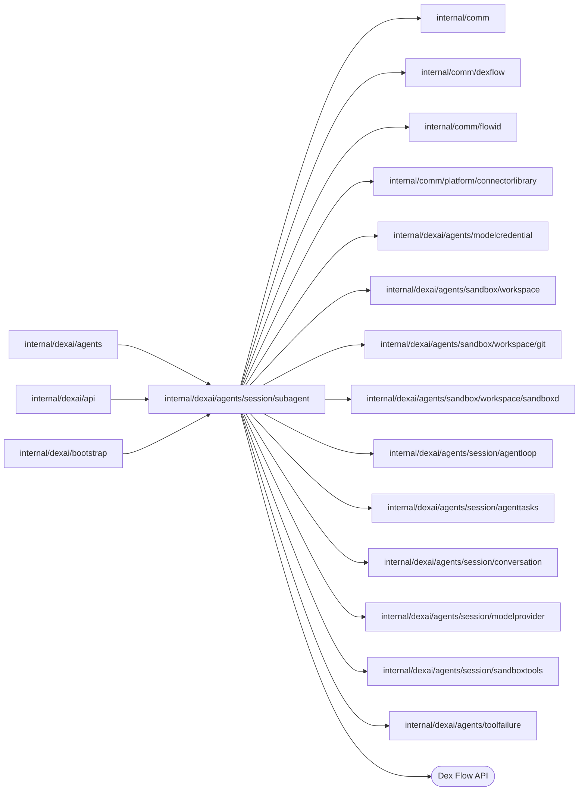

# Subagents

<!-- BEGIN GENERATED PACKAGE SUMMARY (scripts/check-package-readmes.py; edit only Purpose) -->
Purpose: Runs a Session's subagents: each SubagentFlow execution works on one bounded task in its own git worktree, with its own conversation and tools, and reports its end.

Callers: `internal/dexai/agents`, `internal/dexai/api` and `internal/dexai/bootstrap` import this package.

Dependencies: it imports `internal/comm`, `internal/comm/dexflow`, `internal/comm/flowid`, `internal/comm/platform/connectorlibrary`, `internal/dexai/agents/modelcredential`, `internal/dexai/agents/sandbox/workspace`, `internal/dexai/agents/sandbox/workspace/git`, `internal/dexai/agents/sandbox/workspace/sandboxd`, `internal/dexai/agents/session/agentloop`, `internal/dexai/agents/session/agenttasks`, `internal/dexai/agents/session/conversation`, `internal/dexai/agents/session/modelprovider`, `internal/dexai/agents/session/sandboxtools` and `internal/dexai/agents/toolfailure` and calls the Dex Flow API.

<!-- END GENERATED PACKAGE SUMMARY -->

A subagent is a background agent that the Session's main agent starts with `start_agent`.
It sees none of the conversation: its prompt and the repository are everything it knows.
It works in its own git worktree under `/workspace/.git/superverse/worktrees/<agentID>`
with its own message log, model loop, tools and limits, and reports its end to its
Session as a `task` notification. Its changes reach the main workspace only through the
main agent's `merge_agent_changes`
([subagents](../../../../../docs/architecture/agent-harness-design/subagents.md)).

The Session owns the record of each subagent (`Subagents`, declared in
[agenttasks](../agenttasks/README.md)), its admission and its stop; this package owns the
subagent's execution. The Session's package never imports this one: the Session starts
and stops subagents through `agenttasks.AgentTaskLauncher`, and a subagent reaches its
Session through `SubagentFlowDependency`; the Session Service implements both
(`internal/dexai/agents/session_flow_service_tasks.go`).

## Connector subagents

Two kinds work on connectors ([connectors](../../../../../docs/architecture/agent-harness-design/connectors.md#connector-subagents)):

| Kind | Limits and effort | Tools | Root |
| --- | --- | --- | --- |
| `connector_select` | 10 minutes, `medium`, fixed | `bash`, `read`, `grep`, `glob`, `connector_catalog`; no edit, no write, no platform readers | A worktree of the application, which it does not change |
| `connector_develop` | 45 minutes, `agent.subagentConnectorDevelopEffort` (`high`), `set_effort` | `bash`, `read`, `edit`, `write`, `grep`, `glob`, `connector_catalog`, `set_effort` | Its worktree of the connectors library, `/workspace/.git/superverse/connectors/worktrees/<agentID>`, on the connector's branch |

A develop call names the connector's `slug` and the contribution (`new`, `operation`, `fix`), which
the fingerprint and the record carry; the Session created its library worktree with `start_agent`
and passed the branch with the start. Its first segment names the contribution (slug, kind, branch,
base commit) instead of the application's repository context, and its system prompt ends with the
`dex-connector-contributor` skill. `FinishSubagent` saves the work of every develop subagent through
the contribution helper (`git.GitOperations.FinishContribution`); only a COMPLETED one contributes:
the helper verifies that the change touches exactly the connector's module (and for `new` its
`catalog.yaml` entry), commits it once as the library's committer (the GitHub App's bot) with the
subject `connector(<slug>): <description>` and no trailer, moves the branch and pushes it without
force where the server's library takes pushes. The finish of this kind has 4 attempts within 3 hours
(`contributionFinishOptions`, on every movement into it). `Outcome.Contribution` holds what it
contributed and `Outcome.Refused` why it contributed nothing (a change outside the module, no change);
before any branch movement or push, the helper runs the library's selected connector checks. A
failed check leaves the worktree and no finish receipt, and
`ResumeConnectorAfterCheckFailure` adds its bounded output to the model's message log for repair.
`ConnectorCheckFailures` counts these failed finishes; after the third, the Flow ends FAILED and
saves the work without a contribution. The develop finish allows 70 minutes per attempt so the
current-Dex check has its 30-minute deadline; it heartbeats while the Sandbox command runs.
the `task` notification carries the contribution, and the Session Service submits it to its
[`ConnectorContributionFlow`](../contribution/README.md). A develop subagent leaves nothing to
`merge_agent_changes`.

| File | Responsibility |
| --- | --- |
| `subagent_flow.go` | Primitives, Step and RPC registration, Step options, thin Steps and RPCs |
| `subagent_flow_client.go` | `SubagentFlowClient`: the start with the fingerprint RequestID, the stop, the retained read, the search of a Session's subagents for a deleting Project, and the best-effort activity the Session's Watch relays |
| `subagent_flow_bootstrap.go` | `SubagentFlowBootstrap`: the subagent's model transport and Sandbox tool runner over the Session's pooled workspace capabilities |
| `subagent_flow_dependency.go` | `SubagentFlowDependency` (admission, lease refresh, report) and its answers, and the narrow readers the Flow consumes |
| `subagent_outcome.go` | `FlowStatus`, the Attribute value types, the outcome and its delivery, the retained `subagentSnapshot` and the Attributes installed with the start |
| `subagent_messages.go` | The message log and its archive, the context segments with the frozen prompts, the model request, how a reply continues the loop, compaction and the activity events |
| `subagent_tools.go` | The routing of a call, the serial and parallel tool execution on the lease copy, the command ledger polling and settlement, workspace losses, and the finish of the worktree |
| `subagent_contribution.go` | A develop subagent's contribution context, the save of its library worktree with its contribution, its finish options and the report's contribution line |

## Dex Flow Changes

### Identity and execution lifecycle

- **Flow type and FlowID.** `SubagentFlow`, the Go type name. The FlowID is
  `subagent-<projectID>-<agentID>` (`flowid.SubagentFlowID`), for example
  `subagent-a7k2-k3n8q5r1`. The agent ID is `flowid.AgentTaskID(sessionFlowID,
  callID)`: eight lowercase letters and digits derived from the Session's FlowID and the
  `start_agent` call, so every retry of the call names the same subagent; its task ID is
  `agent-<agentID>`.
- **Creation.** Only the Session's `start_agent` ExecuteTool starts it, through the Session
  Service (`AgentTaskLauncher.StartSubagent`), after the Session admitted the call and
  created the worktree; never an API call and never ProjectFlow.
- **Start RequestID and reuse.** `flowid.Fingerprint{call fingerprint, BaseCommit}`, where
  the call fingerprint is `flowid.Fingerprint{SessionFlowID, AgentID, Kind, Description,
  PromptSHA256}`: the complete logical request, without the Session's model, HEAD, lease
  or a time. `dex.IDReuseDisallow` with same-request IgnoreError and no Flow timeout: a
  repeated start joins the execution, also a completed one, so a subagent never runs twice.
  The start installs `Identity`, `Start`, `ProjectID`, `SubagentStatus` (INITIALIZING) and
  `Workspace` (the Session's accepted lease); a retry that carries a fresher lease joins
  and the execution keeps the first.
- **Admission.** `InitializeSubagent` asks the Session (`AdmitSubagent{AgentID,
  Fingerprint, BaseCommit}`) before any effect, and `ApplySubagentAdmission` applies the
  answer under the status lock. The Session admits only while it is ACTIVE
  and its record is STARTING with the same fingerprint (which it marks RUNNING), or already
  RUNNING with it. Any other answer is an authoritative denial without an effect. A
  record that a Stop, or the Session's end, stopped before the subagent started answers
  `stopped`: the subagent ends STOPPED and reports it, because `start_agent` may already
  have answered that it started and the model waits for its report. Any other denial,
  such as one of the Project's deletion or of a start that failed, ends DENIED with
  `admission_denied`. An admission that cannot be asked within
  the Step's retries fails the subagent without an effect, and its report ends the
  Session's record FAILED.
- **Retries and recovery.** Step retries and Worker replacement never create a FlowID or
  reset state. There is no explicit rerun: a task is bounded by its kind's duration limit.
- **Completion.** Business completion is the terminal `Outcome` (COMPLETED, FAILED,
  STOPPED, TIMED_OUT, or DENIED); every end but a denial reports to the Session. Engine completion is `dex.GracefulComplete(Receipt)`
  once the report was delivered, or once its wait limit passed undelivered. A completed
  execution stays readable through `GetSubagentSnapshot` for the engine's retention; the
  Session's record keeps only the bounded summary.
- **Relationships.** An independent top-level Flow that the Session owns: not a SubFlow
  and not a Project child, whose membership would grow without bound. The Session's Stop
  and archival stop it; a deleting Project finds stragglers by FlowType and `ProjectID`
  (`SessionSubagents`) and stops them.

### Attributes and AttributeMaps

| Attribute | Value | Rules |
| --- | --- | --- |
| `Identity` | `agenttasks.SubagentIdentity{ProjectID, AgentID}` | Installed with the start; immutable |
| `Start` | `startRecord{Call{Kind, Description, Prompt, Connector}, Fingerprint, BaseCommit, Model, HeadCommit, Branch}` | Installed with the start; immutable; the only copy of the prompt besides the message log |
| `ProjectID` | string, indexed `keyword2` | The search of a deleting Project |
| `SubagentStatus` | string, indexed `keyword3`: INITIALIZING, RUNNING, FINISHING, COMPLETED, FAILED, STOPPED, TIMED_OUT, DENIED | The status lock: only `ApplySubagentAdmission`, `RecordSubagentAdmissionFailure`, `AwaitSubagentDeadline`, `BeginSubagentFinish`, `RecordSubagentOutcome` and `StopSubagent` write it, under its lock, so each end of the loop is decided once. Each of these Steps is short and calls nothing outside the Flow, so a `StopSubagent` never waits behind a Session RPC or a Sandbox read |
| `Config` | `{Model, Kind, Effort, StartedAt, Deadline, HeadCommit}` | Frozen at the admission; the system prompt and the tool set are frozen in the first segment's prompts; old `model_calls` values are ignored on decode |
| `StopRequest` | bool | Written by `StopSubagent` while INITIALIZING; the admission honors it |
| `Workspace` | `{Lease, Root, BaseCommit, RepositoryContext, LostCallID, Losses}` | The lease copy, the worktree root and the losses of the transport for one call (at most two refreshes per call) |
| `Outcome` | `{Status, Report (at most 24 KiB), Changes{ResultCommit, Files, Insertions, Deletions}, Failure, Unsaved, FinishedAt, Delivery, Contribution, Refused}` | Written once by `RecordSubagentOutcome` (or the denial); the delivery by the report Steps. `Unsaved` says why the end could not save the worktree, whose changes then stay in it on the volume: the report leads with it, the notification carries `changes_unsaved` and its summary says so, and `merge_agent_changes` saves the worktree before it merges |
| `AgentState`, `ContextSegment` | As in the Session | One task is one turn; old `turn_model_calls` values are ignored on decode |
| `MessageWindowLock` | bool | A coordination Attribute that the loop Steps lock |

| AttributeMap | Key | Value | Load and growth |
| --- | --- | --- | --- |
| `CurrentMessages` | Unpadded decimal sequence, `37` | `conversation.Entry` | Whole-map load in the loop Steps; fewer than 20 entries, the oldest ten move to the archive |
| `ArchivedMessages` | First sequence of a chunk, `11` | `conversation.ArchivedEntryChunk` | Exact loads of the chunks the current segment covers |
| `ContextSegmentPrompts` | Segment number, `3` | `conversation.SegmentPrompts` (system prompt and tools) | One exact instance; the previous one is deleted at a compaction |

The execution owns all of its state; it never reads the Session's primitives. No secret:
the lease holds provider identities, never credentials, and the prompt stays here, never
in the Session's record. A subagent runs for at most 45 minutes; its history
grows with the model and tool calls within that deadline and is retained for
the execution's lifetime and then for the engine's retention.

### Channels and ChannelMaps

- **Channels:** None.
- **ChannelMap `ParallelToolResults<parallelToolResult>`**, keyed by the wave's batch ID
  (`agentloop.ParallelToolBatch`, for example `tool-batch-12-0`). Each
  `ExecuteSubagentParallelTool` branch publishes its result in its own commit, and its
  failure route `RecoverSubagentParallelToolExecution` publishes a failure result of the
  same input, never both. `AwaitSubagentParallelToolResults` joins on `ForN` exactly once.
  A branch whose transport proved the lease unreachable dispatched nothing; the join then
  refreshes the lease and routes the read-only wave again. A Stop or the deadline cancels
  the wave, and `RecordSubagentOutcome` deletes its pending results, so none is left at
  the end.

### Streams

`AgentActivity`, `AssistantText` and `ReasoningSummary`, each declared with 10 MiB that
**every** `SubagentFlow` execution shares per Stream name, so one chatty subagent can
truncate another's frames. Delivery is best effort. The Session's Watch relays the
`AgentActivity` of a RUNNING subagent as its one-line live status; the canonical state is
the Session's `Subagents` record and `GetSubagentSnapshot`. No Stream holds the report or
any other business record.

### Steps, RPCs and recovery

| Step | Purpose | Options and routes |
| --- | --- | --- |
| `InitializeSubagent` | The admission, and for an admitted subagent the frozen configuration, the repository context on the lease and the first segment, whose first user entry is the task | Provider options without the status lock; exhausted retries go to `RecordSubagentAdmissionFailure`. Goes to `ApplySubagentAdmission` |
| `RecordSubagentAdmissionFailure` | Fails a subagent whose Session could not be asked to admit it, before any effect, with the bounded cause | Status lock; goes to `ReportSubagentOutcome`, so the Session's record ends FAILED instead of holding a running place until it counts as lost |
| `ApplySubagentAdmission` | Applies the admission under the status lock | State Step. Admitted: `GoToMany(CallSubagentModel, AwaitSubagentDeadline)`, or `FinishSubagent{stopped}` for a recorded `StopRequest`; stopped before the start: STOPPED and `ReportSubagentOutcome`; denied: DENIED and complete |
| `AwaitSubagentDeadline` | The business timer of the kind's duration limit | On expiry a RUNNING subagent goes to `FinishSubagent{timed_out}` and its loop Steps are cancelled |
| `CallSubagentModel` | One model call | SYNC, 10 minutes per attempt, heartbeat 1 minute, 3 attempts within 30 minutes, retries starting 30 seconds apart; failure to `RecordSubagentFailure`. A reply without tool calls is the report: `BeginSubagentFinish{completed}`; a refusal or an unexpected stop: `BeginSubagentFinish{failed}` |
| `CompactSubagentContext` | Compaction as in the Session; the next segment carries the summary, the repository context and the task | Same options and failure route |
| `RecordSubagentFailure` | A model call, a compaction or a lease refresh that could not finish: the bounded cause | `BeginSubagentFinish{failed}` |
| `RouteSubagentTools` | Answers a call the kind does not offer (`unknown_or_disabled_tool`) and `set_effort`, or runs the call serially or in a read-only wave | State Step |
| `ExecuteSubagentTool` | One serial tool on the lease copy with the root in the worktree and the identity `{FlowID, CallID}`; a command runs in the foreground through the command ledger | Catalog timeouts and retries; a command polls within its own timeout. Exhausted retries go to `RecordSubagentToolFailure`, a command's to `SettleSubagentCommand` |
| `SettleSubagentCommand` | Stops a command past its timeout, or reads and stops one whose retries ran out; a subagent's command never moves to the background | Its own exhausted retries go to `RecordSubagentToolFailure` |
| `RecordSubagentToolFailure` | Records a call with exhausted retries as an unknown-effect platform failure that the model reconciles | State Step |
| `ExecuteSubagentParallelTool`, `RecoverSubagentParallelToolExecution`, `AwaitSubagentParallelToolResults` | The read-only wave | As the Session's wave |
| `RefreshSubagentWorkspace` | After the transport proved the lease unreachable, asks the Session every 10 seconds for the lease of its instance (`RequestSessionWorkspace{ForAgentID, Lost}`), which starts a new instance when it has none | `PollingStepOptions(30m)`; the wait limit, or a Session that no longer lends the workspace, fails the subagent |
| `BeginSubagentFinish` | Ends the loop of a RUNNING subagent once; a Stop or the deadline that ended it first keeps its end | Status lock; cancels the deadline timer |
| `FinishSubagent` | Stops a command the loop left running (idempotent ledger stop), saves the worktree into its result ref with its numstat and removes the checkout. A lease copy the transport proved unreachable, such as one of an instance that was replaced or removed while the subagent was outside a tool call, goes to `RefreshFinishingWorkspace`, at most twice | SYNC, 2 minutes per attempt, retried for 10 minutes; exhausted retries record the outcome with its changes unsaved |
| `ResumeConnectorAfterCheckFailure` | Counts a rejected library check and appends its output as a user input to the existing message log; if fewer than three failures and still within the original deadline, resumes the model with the same worktree | Status and message locks; no external effect |
| `RefreshFinishingWorkspace` | Asks the Session every 10 seconds for the lease of its current instance (`RequestSessionWorkspace{ForAgentID, Lost}`, which the record lends until the report, revoking a lost current instance and provisioning the next on the same volume), then saves the worktree again on it | `PollingStepOptions(30m)`; the wait limit, or a Session that no longer lends the workspace, records the outcome with its changes unsaved |
| `RecordSubagentOutcome` | Records the terminal `Outcome` and status, drains a cancelled wave's results and selects exact replay-cleanup chunks | Status and message locks |
| `PurgeSubagentReplay` | Removes opaque replay from current messages and exact archived chunks before outcome reporting | Message lock |
| `ReportSubagentOutcome` | Delivers the `task` notification `task/agent-<id>/<status>` to the Session, asking again every 10 seconds while the Session's queue is full | `PollingStepOptions(2h)`; a Session that ended answers closed; past the wait limit `RecordUndeliveredReport` completes with an undelivered report |

| RPC | Locks | Behavior |
| --- | --- | --- |
| `StopSubagent` | `SubagentStatus` | RUNNING: FINISHING, cancels the loop and the timer, and goes to `FinishSubagent{stopped}`. INITIALIZING or FINISHING: records `StopRequest`; a check failure cannot restart the model after Stop. Any ended status answers that it ended |
| `GetSubagentSnapshot` | None | The retained read: identity, kind, description, base commit, status, last message sequence, configuration and outcome, never the prompt. Serves a completed execution |
| `GetDexSummary`, `GetDexDisplay` | None | The Dex Web row and header |

| Effect | Identity and recovery |
| --- | --- |
| Model call | None; a retry costs only tokens |
| Tool call and command | `{FlowID, CallID}`: the command ledger answers a repeat, and a later attempt passes its first attempt's time, so a replaced instance answers `instance_replaced` instead of running a command again |
| Worktree finish | The refs `refs/superverse/agents/<id>/{base,result}` on the volume: an existing result is reused, so a retry saves once, also on the instance that replaced a lost one |
| Start of this Flow | FlowID and Start RequestID, then `AdmitSubagent` |
| Report | The notification ID `task/agent-<id>/<status>`, which the Session admits once |

A model failure after its retries, or a compaction failure, ends the subagent FAILED with
a bounded cause; the execution never fails because of a model error. A tool failure goes to
the model. A lost transport is recovered through the Session. The owner of a task that
never completes is its duration limit. A worktree that could not be removed is owned by the
volume: the next worktree creation saves and removes orphans, and the Project's deletion
deletes the volume. A result that was not merged stays available to `merge_agent_changes`.

**Compatibility.** A new Flow; no open execution exists. The graph is
[`docs/flows/sv2-subagent-flow.json`](../../../../../docs/flows/sv2-subagent-flow.json). With
one Session per Project the FlowID becomes `subagent-<projectID>-<agentID>`, derived in
`flowid.SubagentFlowID` alone.

## Database Schema Changes

None. The subagent's state is this Flow's; the worktree, the refs, the merge plans and
receipts are files and git objects on the Session's volume.

## Model credential copy

The [owning credential contract](../../../../../docs/architecture/agent-harness-design/subagents.md#project-credential-execution-copy)
adds only a hard-delete `ModelKey`, frozen `ModelCredentialRevision`, and
`ModelCredentialChanged` Stop reason. Start carries the revision, never a key;
the Service copies directly after Start under the Session writer gate. The first
model Step fails closed and uses its existing bounded retry while a copy arrives.
There is no credential Channel, confirmation RPC or waiting Step because these
would duplicate that short readiness boundary. Terminal outcomes delete the copy.

Custom endpoint context/output budgets are frozen in Start.Endpoint,
Config.Endpoint and ContextSegment.Endpoint with the admitted credential revision.
The Session's ModelKeyInfo/provider remains the sole current configuration owner.
Absent fields preserve 32,768 context and 4,096 output; declared values use the
shared execution-profile resolver for model/compaction output, compaction trigger
and hard-limit recovery. A parent edit stops affected children through existing
credential cleanup; no child rereads a mutable parent profile. No new primitive,
instance key, index, query, Stream or retention path is added.
