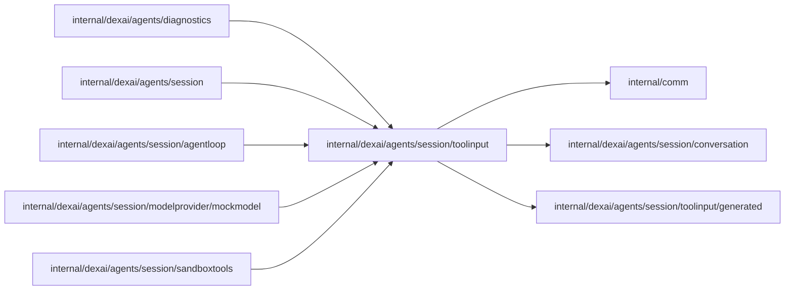

# Tool input schemas

<!-- BEGIN GENERATED PACKAGE SUMMARY (scripts/check-package-readmes.py; edit only Purpose) -->
Purpose: Owns the JSON Schemas the model sees for each Session Agent tool and the strict decoding of tool arguments against them.

Callers: `internal/dexai/agents/diagnostics`, `internal/dexai/agents/session`, `internal/dexai/agents/session/agentloop`, `internal/dexai/agents/session/modelprovider/mockmodel` and `internal/dexai/agents/session/sandboxtools` import this package.

Dependencies: it imports `internal/comm`, `internal/dexai/agents/session/conversation` and `internal/dexai/agents/session/toolinput/generated`.

<!-- END GENERATED PACKAGE SUMMARY -->

This package owns the JSON Schemas shown to the model and strict input decoding. Each
schema is named by the `conversation.ToolName` of its tool, `schema/<name>.json`.
`Schema[T].JSONSchema()` returns the compact schema, which a strict tool's request carries
in the subset the API takes (`modelprovider.StrictInputSchema`) while `Decode` keeps
validating its bounds; `Decode(string)` applies the
object/size/field envelope, generated decoding and defaults, and schema validation,
and returns the zero value on any rejection. `DecodeInput(tool, input)` runs that
decoding by tool name, for the mock scenarios' check; every schema registers its
own decoding when it loads. It imports no Agent code but `conversation`, for the tool
names, and no Sandbox/workspace code.

| Path | Responsibility |
| --- | --- |
| `schema/*.json` | the authoritative tool input schemas, one per tool |
| `tool_inputs.json` | the generator index that references every schema; it is not embedded |
| `tool_schema.go` | the embedded schemas bound to their generated validators |
| `tool_arguments.go` | the strict argument envelope |
| `generated/` | pinned `jschemagen` output; never edit it |

Regenerate with `make generate-go check-generated` from the repository root.
Built-in domain mapping belongs to Agent; byte, NUL and path checks a schema cannot
express belong to sandboxtools. The [tool orchestration design](../../../../../docs/architecture/agent-harness-design/tool-orchestration.md#strict-schemas)
owns execution and compatibility.
