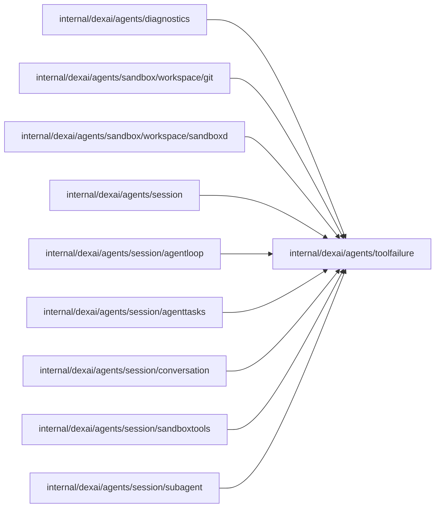

# Tool failures

<!-- BEGIN GENERATED PACKAGE SUMMARY (scripts/check-package-readmes.py; edit only Purpose) -->
Purpose: Declares, once each, the tool failure codes the Session Agent's model reads, with their owner, hint and source-gate flag, and the owners and effects of a failed call.

Callers: `internal/dexai/agents/diagnostics`, `internal/dexai/agents/sandbox/workspace/git`, `internal/dexai/agents/sandbox/workspace/sandboxd`, `internal/dexai/agents/session`, `internal/dexai/agents/session/agentloop`, `internal/dexai/agents/session/agenttasks`, `internal/dexai/agents/session/conversation`, `internal/dexai/agents/session/sandboxtools` and `internal/dexai/agents/session/subagent` import this package.

Dependencies: it imports no other package of this module and calls no remote API.

<!-- END GENERATED PACKAGE SUMMARY -->

A tool call that fails with a known outcome returns to the model as a typed failure: a
`Code`, the code's `Owner` (the call, the application or the platform) and an `Effect`
(none, completed, partial or unknown). This package is the single declaration of all three
sets. It sits below every package that creates or renders a failure, so none of them spells a
code itself.

- `Code` is a struct whose only field is unexported: the codes are the variables of
  `code.go`, each declared with its spelling, its owner, its hint and whether it reports a
  source gate (`flow_definition_invalid`, `source_check_failed`, `connector_mock_in_production`
  and the test stage's `application_tests_failed`, `application_tests_incomplete` and
  `requirements_untested`, whose message holds the end of a check's output). A declaration without a hint, or a spelling declared twice,
  panics when the package initializes; a zero `Code` panics when it is read.
- `Owner` and `Effect` are closed sets of the same kind. The platform owner closes the hint of
  its failures with the advice to work around the platform or tell the user, except for a code
  whose own hint takes precedence (`OwnerHint` is then empty): `test_environment_unavailable`
  asks for one retry and then a blocked handoff. The partial and unknown effects add the advice
  to inspect the current state first.
- `Parse` returns the code of a spelling that crosses a process boundary, such as the typed
  failure the Sandbox's `superverse-files` helper answers.

`sandboxd.NewToolFailure(code, cause)` creates the error form for Sandbox, Git and tool
handler failures, `conversation.ToolFailure` is the model's view of one, and its `Text`
renders the code, message, owner, effect and the hints of all three. The spellings are what the
model reads and what a stored tool result keeps in `failure_code`, so they never change.
