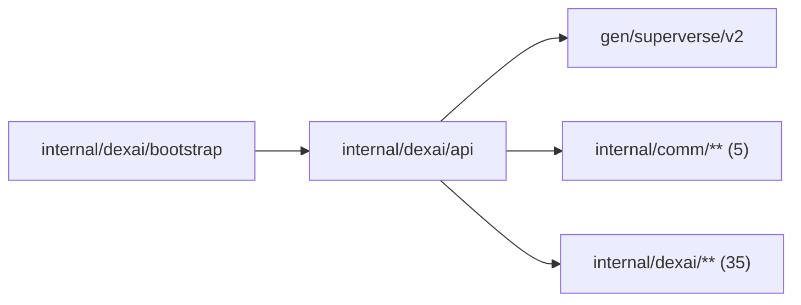

# Business gRPC API

<!-- BEGIN GENERATED PACKAGE SUMMARY (scripts/check-package-readmes.py; edit only Purpose) -->
Purpose: Serves the business gRPC services that the Studio BFF calls, one file per service domain, mapping each RPC onto its owning Flow client or Service.

Callers: `internal/dexai/bootstrap` imports this package.

Dependencies: it imports `gen/superverse/v2`, `internal/comm/**` (5) and `internal/dexai/**` (35).

<!-- END GENERATED PACKAGE SUMMARY -->

The business gRPC services of
[`api/superverse/v2/superverse.proto`](../../../api/superverse/v2/superverse.proto),
specified in the [resource API contract](../../../docs/api/resource-grpc.md).
Studio's BFF reaches AccountService only through `/api/auth`, the four Flow API
services only through `/dex/...` and the others through `/api/rpc/<Method>`.
Each service is an unexported struct that embeds its generated
`Unimplemented<X>ServiceServer`, `*boundary.Boundary` and only the Flow clients
and Services it uses; `NewGRPCServer` registers them behind the same
interceptors. AccountService, TeamSpaceService and TeamSpaceMemberService
live in [`tenancy`](tenancy/README.md).

Every RPC authenticates the explicit `caller`, validates its untrusted input,
checks the `projects.Capability` it needs of a Project it names, calls the owning Flow client or Service and maps the outcome to a public status
once, through [`boundary`](boundary/README.md), which also maps the status
enums to and from their persisted domain values. A start returns only the ID of
the resource it started; a Project snapshot carries the caller's effective
role (`caller_role`); a command returns an empty response or the snapshot
the page renders next. Durable state belongs to the Flows; a
[`watch`](watch/README.md) serves it as authoritative snapshots with
best-effort Dex Stream progress, as `Watch<R>Response` frames whose `event` is a
snapshot or progress.

| File | Responsibility |
| --- | --- |
| `server.go` | `Server`, the dependencies bootstrap composes; `NewGRPCServer`, which registers the services with their interceptors, the account and TeamSpace services through `tenancy.Register` |
| `project.go` | ProjectService: managed creation in a TeamSpace (a caller whom the read model shows outside a TeamSpace it holds is refused before any Flow starts; ProjectFlow's registration confirms the membership), with the Session's optional first message and model, validated and admitted as SendMessage and UpdateSessionModel are before the start and part of the creation fingerprint; GetProject, ListProjects (the Projects of the required TeamSpace, for its members and the administrator, in keyset pages; an entry without the caller's role is reduced to its ID, name, status, setup status, Live and TeamSpace) and the Project Watch from the read model, which waits for a new Project's row; deletion and Live removal, which return ProjectFlow's state; project configuration; and the Project snapshot with its Setup and Live pointer |
| `project_member.go` | ProjectMemberService: a Project's members from the read model for a caller with `CapabilityView`, and the member changes of ProjectFlow for one with `CapabilityManageMembers`, which ProjectFlow checks again; a member added must belong to the Project's TeamSpace, which the read model shows |
| `session.go` | SessionService: reads of the Project's one Session, the workspace renewal (`RenewWorkspace`), the Session Watch with its Agent event Streams and the live status lines of its running subagents, archived messages and the Session snapshot, whose workspace carries its start phase timings |
| `agent.go` | AgentService: the Agent commands through one admission helper, their input checks, the model admission of each environment (`SessionModels`: a Claude key, the mock model, Local or the administrator), `ListMockScenarios` and the protobuf conversion of Agent values |
| `preview.go` | PreviewService: Preview reads with the automatic deployment, the configuration gaps and the start phase timings, commands on the observed instance, source preparation, definitions and the automatic deployment switch |
| `release.go` | ReleaseService: candidates, preparation, builds, recovery, cancellation and the redacted build log (`GetReleaseBuildLog`, builder capability, through `PublishingFlowService`); GetRelease, ListReleases (keyset pages) and the Release Watch from the read model, which waits for a new Release's row; its snapshot carries build and source-preparation timings; GetRelease logs read-phase latency, returns FAILED snapshots without definitions and classifies read deadlines as unavailable |
| `deployment.go` | DeploymentService: Live deployment and its cancellation; GetDeployment, ListDeployments (keyset pages) and the Deployment Watch from the read model, which waits for a new deployment's row; its snapshot carries the deployment's phase timings |
| `flow_api.go` | The Flow API: FlowRunService and FlowDiagnosticsService on Runs, ConnectorService and ApplicationEnvironmentService on the configuration host |

## Tests

`TestTeamSpaceServicesDexIntegration` drives the TeamSpace services and the
TeamSpace guards of ProjectService and ProjectMemberService through the actual
gRPC API, with TeamSpaceFlow and ProjectFlow on the lane's server Worker and
the lane's read model: the creation's replays, reads only for members, changes
only from an admin, the stale rename's `REVISION_CHANGED`, a Project created
only by a member, the refused removal of a Project's only owner and the count
of the roles a re-added member regains. Its Project's Setup creates a
repository, so it requires `SUPERVERSE_TEST_GITHUB_EFFECTS=true`.

`TestProjectAuthorizationMatrixDexIntegration` checks the Project capabilities
through the same API for one Project's owner, builder, operator, a TeamSpace
member and the TeamSpace admin without a role, an outsider and a builder removed
from the TeamSpace: View, Build, ManageMembers and Delete, ListProjects of the
TeamSpace with the reduced entry of a member without a role, the stale
deletion's `REVISION_CHANGED`, and the TeamSpace admin's deletion. The platform
admin, whose password is no test input, and the Live Runs capabilities are not
callers of it.

`TestSessionActorsDexIntegration` uses the real gRPC authentication boundary, PostgreSQL read
model, Dex Worker and Sandbox for two Builders and an owner: immutable queue/steering/history
authors, first answer/Stop, an unattributed recorded requirements card, model/auto-deploy changers and concurrent
author/owner deletion. It also checks the actual ACTIVE platform administrator's SessionCaller
and Flow deletion using its SQL-authorized role; administrator password authentication remains
outside this test. TestSessionForgedSenderEnvelopeDexIntegration launches the forged-sender
scenario and checks a first quoted input and later top-level input from different authenticated
authors, inert delimiters/nested forged envelopes/coding text, and byte-stable segment replay.
A fresh maximum-size quote-heavy UTF-8 input validates bounded canonical inner truncation while
stored/public originals remain complete. Its `sender-quote-budget` continuation uses three real
question answers and one forced compaction to verify first/newest whole parts and an exact
omission count on the actual provider request. Terminal model rejection fails promptly.

The consumed conversation response maps `EntryMeta.SteeredBy` through `AgentMessage.steered_by`
separately from its original author. It is response-only; legacy absence stays absent, and no
request may supply either actor. The actor integration scenario checks the retained entry,
typed public projection and canonical gRPC response after consumption.

`TestLiveExampleComparison` (build tag `live`, `make test-example-comparison-live` only) is the
real-model comparison of the closest-example start: four Projects on Claude Sonnet 5.5 from the
labelled set's Slack thread approval request, created through API servers with
`agent.closestExamplePick` on and off, each observed for at most 30 minutes from its creation until
its first build or the end of its first turn with no background command or subagent left running,
with the matched start's `starting_example.first_build` through this package's mapping and a
comparison table, headed by the lane's coding image (`SUPERVERSE_TEST_CODING_IMAGE`, by digest), that
the test logs when it ends, also after a failure. That image must seed every example's module graph
and build cache, or the matched runs start cold. It fails at once without the switch its target sets,
and `make test-integration` skips it, as every name of the Makefile's `DEVELOPER_ONLY_TESTS`.

`remoteagent` owns the three connection-management RPC mappers and their typed
refusals. CallerContext is set by the BFF; Bridge HTTP requests never pass this
business boundary. Current executor metadata comes from Session's typed read,
independent of PAIRED rows. See [remote agent connections](../../../docs/api/remote-agent.md).
