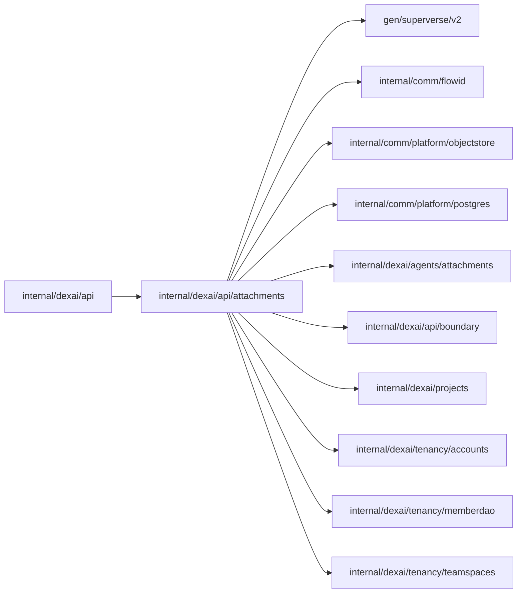

# Attachment business API

<!-- BEGIN GENERATED PACKAGE SUMMARY (scripts/check-package-readmes.py; edit only Purpose) -->
Purpose: Serves AttachmentService: the upload, completion and deletion of files attached to messages, and presigned downloads of a Project's copies.

Callers: `internal/dexai/api` imports this package.

Dependencies: it imports `gen/superverse/v2`, `internal/comm/flowid`, `internal/comm/platform/objectstore`, `internal/comm/platform/postgres`, `internal/dexai/agents/attachments`, `internal/dexai/api/boundary`, `internal/dexai/projects`, `internal/dexai/tenancy/accounts`, `internal/dexai/tenancy/memberdao` and `internal/dexai/tenancy/teamspaces`.

<!-- END GENERATED PACKAGE SUMMARY -->

`AttachmentService` ([api-and-studio](../../../../docs/architecture/attachments/api-and-studio.md#attachmentservice))
is served here because `internal/dexai/api` holds its ten files. `Register` binds it to the business gRPC
server with the trust `Boundary`, the `AttachmentFlowClient`, the `RenditionStore`, the read model's member
queries and the `ProjectFlowClient`.

| RPC | Authorization | Effect |
| --- | --- | --- |
| `CreateAttachmentUpload` | A TeamSpace member from the read model, or the platform admin; `TeamSpaceFlow`'s staging reservation confirms the membership by an exact load. A TeamSpace the read model does not hold yet is left to that reservation | Validates the declared name, type and size, starts the attachment's `AttachmentFlow`, waits at most 10 seconds for its staging slot and returns the attachment with the presigned PUT while it awaits the upload. A wait that ends first is `UNAVAILABLE`; a retry with the same request ID joins it |
| `CompleteAttachmentUpload` | The uploader, which the Flow's RPC checks | Ends the upload wait and waits at most 20 seconds for READY or FAILED |
| `DeleteAttachment` | The uploader or the platform admin, which the Flow's RPC checks | Admits the deletion command of the caller's request ID |
| `GetAttachmentDownloads` | Build access to the Project, the authorization of its conversation | Presigns, for five minutes, a GET of each named attachment the Project's Session copied into the Project, inline or as a download; an attachment without a copy has none |

The presigned URLs are bearer capabilities: they go only into responses, never into logs or Flow state.
A failed attachment shows its code and a fixed sentence, never the recorded cause, which can name storage
keys. No Flow, pool, cache or goroutine is created here.
