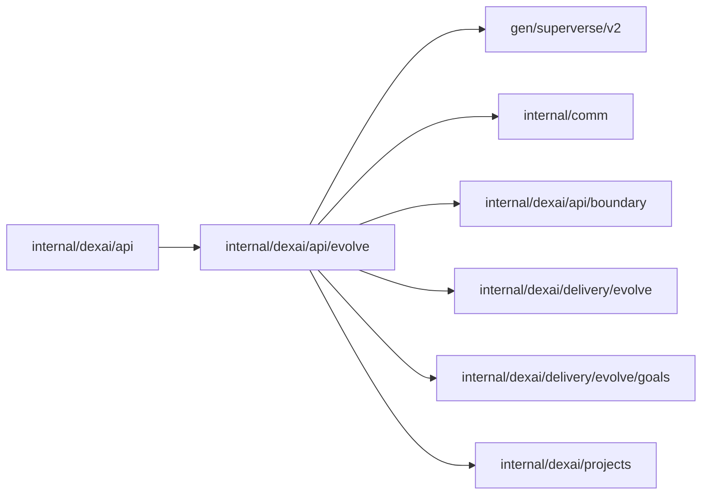

# Goal measurement business API

<!-- BEGIN GENERATED PACKAGE SUMMARY (scripts/check-package-readmes.py; edit only Purpose) -->
Purpose: Serves EvolveService: a Project's goal measurement with its goals, schedule, reviews and proposals, a person's Review now and decision on a proposal, and the proposal document.

Callers: `internal/dexai/api` imports this package.

Dependencies: it imports `gen/superverse/v2`, `internal/comm`, `internal/dexai/api/boundary`, `internal/dexai/delivery/evolve`, `internal/dexai/delivery/evolve/goals` and `internal/dexai/projects`.

<!-- END GENERATED PACKAGE SUMMARY -->

`EvolveService` fronts the Project's `EvolveFlow` ([goal measurement](../../delivery/evolve/README.md)).
The read model authorizes every call before the Flow is reached. Live published runs only (owner
rule 2026-10-22): every goal value and review it answers was measured from runs of the Project's
Live, published deployment against the goals file of the Live build's commit; Preview, workspace
test runs and any other engine never feed them, so there is no Preview measurement to answer.

| RPC | Authorization | Does |
|---|---|---|
| `GetEvolve` | `CapabilityOperateLive` | The Flow's `GetEvolve`: the Live release it was told of, the goals of the Live build (parsed goals or the parser's errors), the schedule, the kept reviews newest first with their goal values, whether agent reviews follow measurement for the Project (`evolve.reviewAccess` and `evolve.reviewTeamSpaces`) and when Review now is admitted again. `NOT_FOUND` before the Project's first Live deployment, which Studio shows as the empty state |
| `StartEvolveReview` | `CapabilityBuild` | The Flow's `StartReview` with Studio's `request_id` and the caller as actor. A refusal (`NO_GOALS`, `GOALS_INVALID`, `REVIEW_RUNNING`, `RATE_LIMITED`) is an answer, not an error; a repeated `request_id` answers the review it started. `NOT_FOUND` before the first Live deployment |
| `DecideEvolveProposal` | `CapabilityBuild` | The Flow's `DecideProposal` with the `review_id` (`r-<n>`), the proposal `revision` the page showed, `APPROVE` or `DECLINE`, an optional `reason` of at most 500 characters and the caller as actor; other input is `INVALID_ARGUMENT`. A proposal no longer offered at that revision, or a review without one, is the refusal `STALE_PROPOSAL`, an answer that carries the proposal as it is; the same decision repeated answers it again. The Flow then tells the Session, and marks the proposal `notify_failed` when it cannot. `NOT_FOUND` before the first Live deployment |
| `GetEvolveProposal` | `CapabilityOperateLive` | The stored proposal document of a review, Markdown of at most 32 KiB, read by the exact object its proposal record names. `NOT_FOUND` for a review without a kept proposal and before the first Live deployment |

`GetEvolve` also returns the kept proposals newest first, each with its kind, title, summary, agent,
backtest summary (the comparison's JSON as written, at most 2 KiB), status and its time, revision,
`notify_failed`, decision, applied commit and Live revision.

Closed sets map to their protobuf enums with `boundary.Enum`, and a request's decision back with
`boundary.DomainValue`; times are absent when unset.
