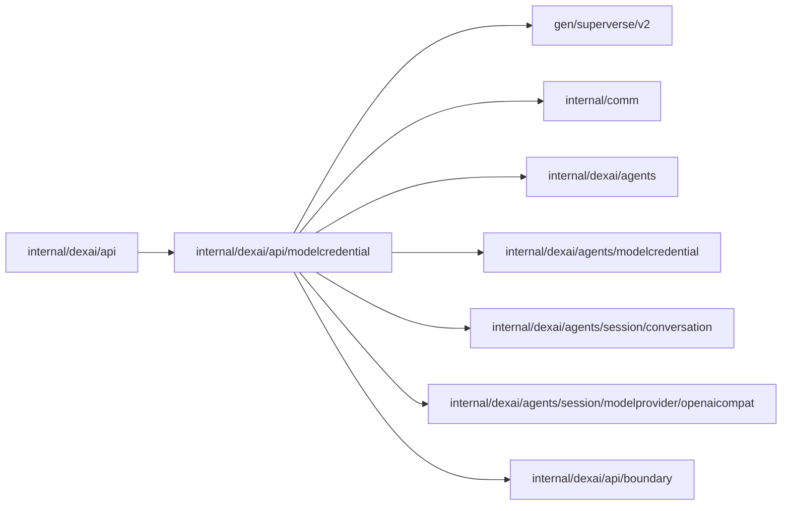

# Model credential API

<!-- BEGIN GENERATED PACKAGE SUMMARY (scripts/check-package-readmes.py; edit only Purpose) -->
Purpose: Authorizes Project credential mutations and returns non-secret metadata.

Callers: `internal/dexai/api` imports this package.

Dependencies: it imports `gen/superverse/v2`, `internal/comm`, `internal/dexai/agents`, `internal/dexai/agents/modelcredential`, `internal/dexai/agents/session/conversation`, `internal/dexai/agents/session/modelprovider/openaicompat` and `internal/dexai/api/boundary`.

<!-- END GENERATED PACKAGE SUMMARY -->
