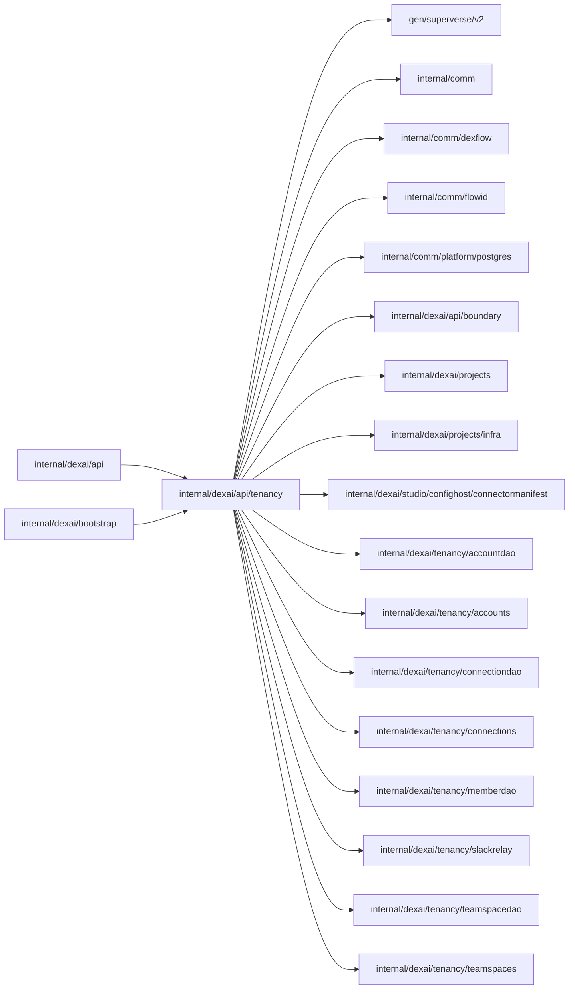

# Tenancy gRPC services

<!-- BEGIN GENERATED PACKAGE SUMMARY (scripts/check-package-readmes.py; edit only Purpose) -->
Purpose: Serves AccountService, TeamSpaceService and TeamSpaceMemberService: accounts, TeamSpaces and their members, written through TeamSpaceFlow and read from the read model.

Callers: `internal/dexai/api` and `internal/dexai/bootstrap` import this package.

Dependencies: it imports `gen/superverse/v2`, `internal/comm`, `internal/comm/dexflow`, `internal/comm/flowid`, `internal/comm/platform/postgres`, `internal/dexai/api/boundary`, `internal/dexai/projects`, `internal/dexai/projects/infra`, `internal/dexai/studio/confighost/connectormanifest`, `internal/dexai/tenancy/accountdao`, `internal/dexai/tenancy/accounts`, `internal/dexai/tenancy/connectiondao`, `internal/dexai/tenancy/connections`, `internal/dexai/tenancy/memberdao`, `internal/dexai/tenancy/slackrelay`, `internal/dexai/tenancy/teamspacedao` and `internal/dexai/tenancy/teamspaces`.

<!-- END GENERATED PACKAGE SUMMARY -->

The account, TeamSpace and TeamSpace connection services of
[`api/superverse/v2/superverse.proto`](../../../../api/superverse/v2/superverse.proto),
specified in the [resource API contract](../../../../docs/api/resource-grpc.md)
and the TeamSpace design (`docs/architecture/teamspace/teamspaces-and-roles.md`).
`api.NewGRPCServer` registers them through `Register`, behind the same
interceptors as the other business services, and each RPC authenticates the
explicit `caller` and maps its outcome through [`boundary`](../boundary/README.md).

TeamSpaceFlow owns a TeamSpace and its members and admits every write: a
member change or a rename only from an admin or the platform admin, the
deletion only from the platform admin, and never a change that leaves no
admin. A stale rename is `ABORTED` with the ErrorInfo `REVISION_CHANGED`. The
reads come from the read model ([`teamspacedao`](../../tenancy/teamspacedao/README.md)
and [`memberdao`](../../tenancy/memberdao/README.md)), for a member of the
TeamSpace or the platform admin; a read of a TeamSpace created a moment ago
waits up to 10 seconds for its row (`teamspaces.AwaitRow`), and a TeamSpace
without a Flow, or DELETED, is `NOT_FOUND` at once. The read model also guards two member
changes:

- A removal is `FAILED_PRECONDITION`, naming up to five Projects, while the
  member is the only owner of a Project of the TeamSpace whose role counts;
  the caller transfers the ownership first.
- An addition answers how many of the TeamSpace's Projects the account still
  holds a role in, which counts again: Project roles stay when a member leaves.

| File | Responsibility |
| --- | --- |
| `server.go` | `Register` and the TeamSpace and member snapshots |
| `account.go` | AccountService: registration, login, logout and the current account |
| `team_space.go` | TeamSpaceService: creation with its replays, the caller's TeamSpaces in signed keyset pages, one TeamSpace and its Home counts, the rename and the deletion |
| `team_space_member.go` | TeamSpaceMemberService: the member list, an addition by email with the regained role count, a role change and the guarded removal |
| `team_space_connection.go` | TeamSpaceConnectionService: the catalog, connections in signed keyset pages with their usages, creation, edits, deletion, OAuth and the editor's forms, under the connection roles |

The database owns TeamSpace connections
([`connections`](../../tenancy/connections/README.md)), and the read model
decides who may do what (`connectiondao.Access`):

- A member of the TeamSpace, or the platform admin, reads its connections;
  any authenticated caller lists the catalog.
- A TeamSpace admin, or the owner or builder of any of its Projects, creates,
  edits and deletes connections and opens the editor's forms, whose provider
  commands use the connection's credential, while the TeamSpace is READY.
- A credential change (replacing a key, editing the setting the OAuth scopes
  come from, or authorizing) also needs an admin or a builder of every
  Project whose Live version uses the connection
  (`connectiondao.BuildsEveryUser`); DELETED Projects do not count.

Requests carry settings, credentials and parameters as JSON strings, which
the server parses as JSON objects of at most 64 KiB. Errors map through
`boundary.ConnectionRPCStatus`: a refusal carries its reason as the ErrorInfo
reason, and the taken name is `ALREADY_EXISTS`. The OAuth redirect URI is the
Studio origin plus `/api/connector-oauth/callback`.

The services' integration tests are `TestTeamSpaceServicesDexIntegration`,
which serves them with the Project services, and
`TestTeamSpaceConnectionServiceIntegration`, both in
[`internal/dexai/api`](../README.md).
