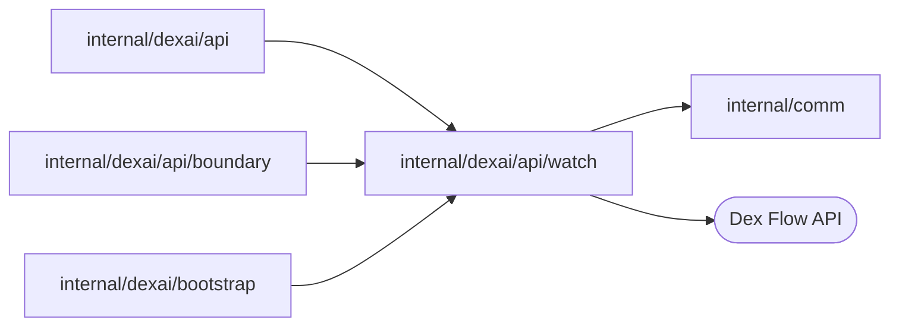

# Resource Watch

<!-- BEGIN GENERATED PACKAGE SUMMARY (scripts/check-package-readmes.py; edit only Purpose) -->
Purpose: Serves a resource to API Watch RPCs as authoritative snapshots followed by best-effort Dex Stream progress, with signed resume cursors and realignment on loss.

Callers: `internal/dexai/api`, `internal/dexai/api/boundary` and `internal/dexai/bootstrap` import this package.

Dependencies: it imports `internal/comm` and calls the Dex Flow API.

<!-- END GENERATED PACKAGE SUMMARY -->

A resource Watch combines lossy Dex Streams with authoritative resource reads.
It owns no operation resource or persisted state: every connection starts with a
snapshot, the caller's access is checked when it starts and every 5 seconds
on its own ticker (`Resource.Authorize`), which ends the Watch on failure
independently of blocked reads and sends, every snapshot read reauthenticates
the caller, and the signed cursor of each frame only lets a reconnect resume the Streams that
frame was read from. A slow client's overflow, a source change or a reconnect
realigns on a fresh snapshot. The package knows no business resource. The
revocation bound is in
[Watch authorization](../../../../docs/architecture/runs-target-cache-and-watch-authorization.md#watch-authorize-per-connection-on-its-own-ticker).

| File | Responsibility |
| --- | --- |
| `watch.go` | `Resource.Run`, the snapshot and progress loop, its sender goroutine and `RecoverAsError` for the Watch's goroutines |
| `progress_source.go` | `DexStreamSource` and `ReadUntilMessage`, which read one Flow's Dex Stream across idle long polls |
| `cursor_codec.go` | `CursorCodec`, which signs Watch resume cursors and listing page tokens for one scope |
