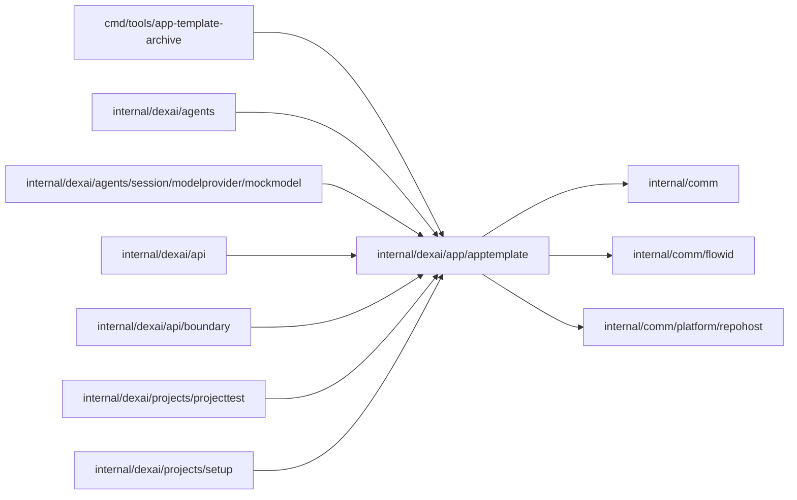

# Application template

<!-- BEGIN GENERATED PACKAGE SUMMARY (scripts/check-package-readmes.py; edit only Purpose) -->
Purpose: Embeds the go-react-v1 application template that Project setup pushes into new managed repositories, with its revision and locally computed Git object IDs.

Callers: `cmd/tools/app-template-archive`, `internal/dexai/agents`, `internal/dexai/agents/session/modelprovider/mockmodel`, `internal/dexai/api`, `internal/dexai/api/boundary`, `internal/dexai/projects/projecttest` and `internal/dexai/projects/setup` import this package.

Dependencies: it imports `internal/comm`, `internal/comm/flowid` and `internal/comm/platform/repohost`.

<!-- END GENERATED PACKAGE SUMMARY -->

Serves the go-react-v1 examples that new managed repositories start from. Their source
lives in `app-template/`: a shared base and one folder per example below
`app-template/examples/` ([the examples](../../../../app-template/examples/README.md)).
`make generate-app-template` (`go generate ./internal/dexai/app/apptemplate`) composes
every example, checks its card and trace, and writes the embedded archives and catalog
and the matching Studio initial design of the default example.

`Current` returns the default example, `text-summary`, with its revision `app-template@`
followed by the Git tree ID, which `repohost.TreeID` computes locally so that Setup can
verify the objects it created through the GitHub API; a Project created from a
description records it. `Examples` lists the catalog, and `ExampleTemplate` returns the
composed tree of a picked example under the revision `app-template/<id>@<tree>`, which
`ForRevision` resolves for Setup; a revision another server build wrote is an error.

| File | Responsibility |
| --- | --- |
| `application_template.go` | The default archive, `Current`, `Decode` and the template revision |
| `example_catalog.go` | The embedded catalog and example archives, the closed set of categories, `ExampleTemplate` and `ForRevision` |
| `git_object_id.go` | Git blob and tree object IDs |
| `app-template.tar`, `examples/` | The generated archives and catalog |
