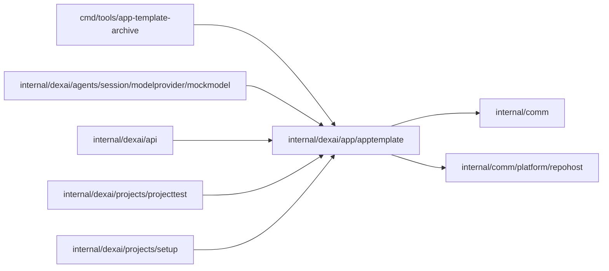

# Application template

<!-- BEGIN GENERATED PACKAGE SUMMARY (scripts/check-package-readmes.py; edit only Purpose) -->
Purpose: Embeds the go-react-v1 application template that Project setup pushes into new managed repositories, with its revision and locally computed Git object IDs.

Callers: `cmd/tools/app-template-archive`, `internal/dexai/agents/session/modelprovider/mockmodel`, `internal/dexai/api`, `internal/dexai/projects/projecttest` and `internal/dexai/projects/setup` import this package.

Dependencies: it imports `internal/comm` and `internal/comm/platform/repohost`.

<!-- END GENERATED PACKAGE SUMMARY -->

Serves the go-react-v1 application template that new managed repositories start
from. The template source lives in `app-template/`; `make generate-app-template`
(`go generate ./internal/dexai/app/apptemplate`) packs its committable files into the
embedded `app-template.tar` and renders the matching Studio initial design.
`Current` returns the embedded template with its revision, `app-template@`
followed by the Git tree ID, which the package computes locally so that Setup can
verify the objects it created through the GitHub API.

| File | Responsibility |
| --- | --- |
| `application_template.go` | The embedded archive, `Current`, `Decode` and the template revision |
| `git_object_id.go` | Git blob and tree object IDs |
