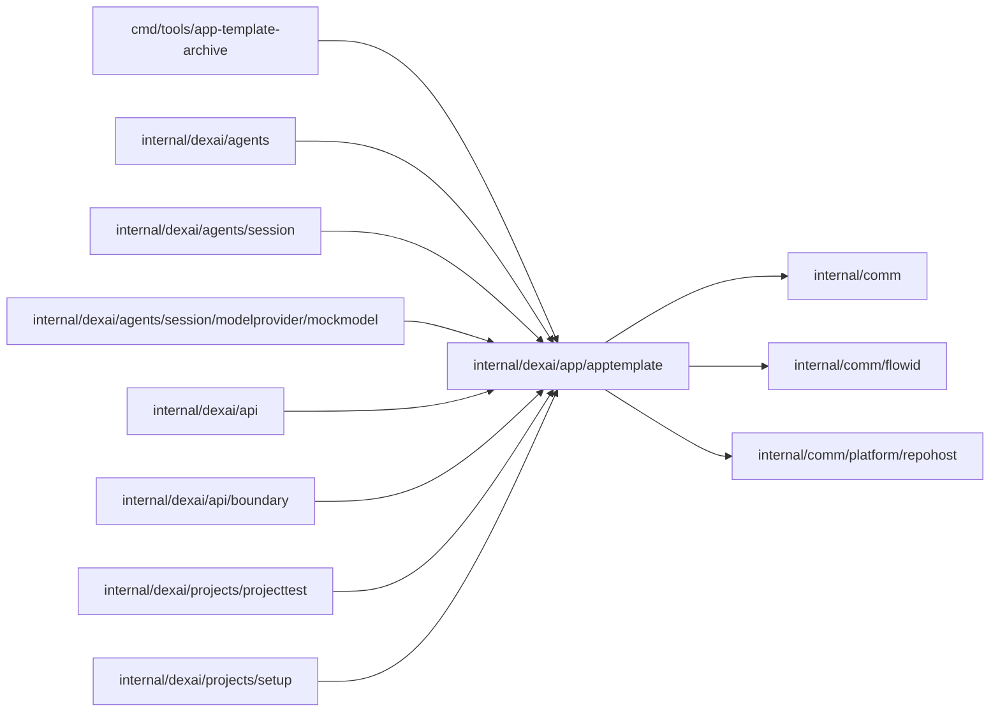

# Application template

<!-- BEGIN GENERATED PACKAGE SUMMARY (scripts/check-package-readmes.py; edit only Purpose) -->
Purpose: Embeds the go-react-v1 application template's examples that Project setup pushes into new managed repositories, with their revisions, Git object IDs and the closest-example search and decision.

Callers: `cmd/tools/app-template-archive`, `internal/dexai/agents`, `internal/dexai/agents/session`, `internal/dexai/agents/session/modelprovider/mockmodel`, `internal/dexai/api`, `internal/dexai/api/boundary`, `internal/dexai/projects/projecttest` and `internal/dexai/projects/setup` import this package.

Dependencies: it imports `internal/comm`, `internal/comm/flowid` and `internal/comm/platform/repohost`.

<!-- END GENERATED PACKAGE SUMMARY -->

Serves the go-react-v1 examples that new managed repositories start from. Their source
lives in `app-template/`: a shared base and one folder per example below
`app-template/examples/` ([the examples](../../../../app-template/examples/README.md)).
`make generate-app-template` (`go generate ./internal/dexai/app/apptemplate`) composes
every example, checks its card and trace, decides every labelled request, renders every
example's Flow definitions with its own FDG script, and writes the embedded archives,
catalog, search index and match rules and Studio's copy of each example's definitions.
The validation workflow's `check-app-template-embedded` passes its changed paths
(`app-template-archive -changed`), which render the definitions of only the default, the
examples those paths reach and those whose own design file they name, and keep every other
example's committed definitions, which name its unchanged tree.

`Current` returns the default example, `text-summary`, with its revision `app-template@`
followed by the Git tree ID, which `repohost.TreeID` computes locally so that Setup can
verify the objects it created through the GitHub API; a Project created from a
description records it. `ExampleTemplate` returns the composed tree of an example under
the revision `app-template/<id>@<tree>`, which `ForRevision` resolves for Setup, at the
example's current tree or at the previous tree the build keeps for it after a change
or its removal; a revision another server build wrote with any other tree is an error. `FindExample` gives
the Session what it reads of an example: its card, the trace of each feature, its
files against the shared base and the Steps of its rendered Flow definitions (`Steps`, each a
`FlowStep` of Flow and Step type), which a matched Session's first build compares with
the Steps of its own pushed definitions.

`ClosestExample` decides which example a Project created from a first message starts
from: the search (`SearchIndex.Closest`, BM25 postings summed per distinct term, which
Studio's `lib/examples` ports to TypeScript) shortlists five examples, and the rules
(`MatchRules.Pick`) pick one or none from the message's facets, its negations, the
core facets another eligible example would add and a winning margin; a message with
letters of a script other than Latin starts from the default. Both read only embedded data, so every replica of one build decides
alike, in microseconds, without a network call.

| File | Responsibility |
| --- | --- |
| `application_template.go` | The default archive, `Current`, `Decode` and the template revision |
| `example_catalog.go` | The embedded catalog, example archives and previous archives, the closed set of categories, `ExampleTemplate` and `ForRevision` |
| `example_search.go` | The words, stems, stop words and synonyms of the search and the inverted index's ranking |
| `example_match.go` | The closest-example decision: facets, negation, eligibility, the margin, and `ClosestExample` |
| `git_object_id.go` | Git blob and tree object IDs |
| `app-template.tar`, `examples/` | The generated archives, catalog, search index and match rules |
