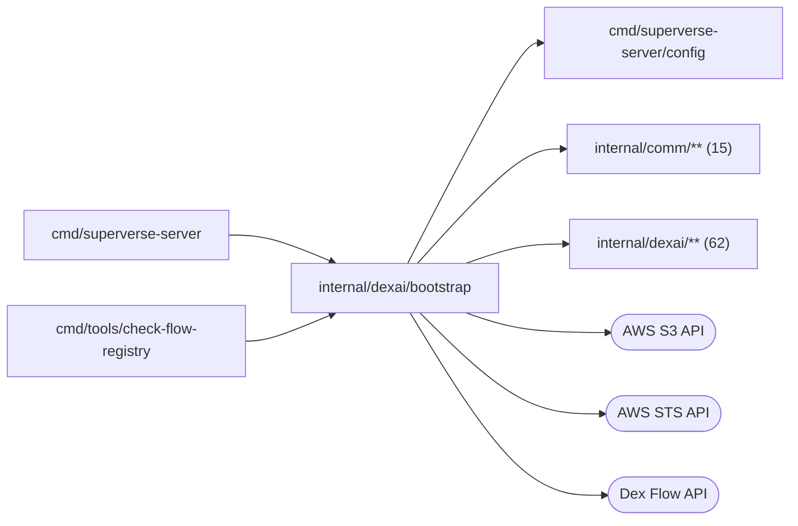

# Server bootstrap

<!-- BEGIN GENERATED PACKAGE SUMMARY (scripts/check-package-readmes.py; edit only Purpose) -->
Purpose: Assembles and runs the single Superverse server process for `cmd/superverse-server`: configuration, providers, Flows, Flow clients, Services, the Dex Worker, the business gRPC server and health endpoints.

Callers: `cmd/superverse-server` and `cmd/tools/check-flow-registry` import this package.

Dependencies: it imports `cmd/superverse-server/config`, `internal/comm/**` (15) and `internal/dexai/**` (62) and calls the AWS S3, AWS STS and Dex Flow APIs.

<!-- END GENERATED PACKAGE SUMMARY -->

`Run` assembles and runs the single Superverse server process from the validated
[server configuration](../../../cmd/superverse-server/config/README.md) and the
secrets of the environment. It reads no other environment variable. Only the
binaries under `cmd/` import this package.

| File | Responsibility |
| --- | --- |
| `run.go` | `Run`, the process entry point, and the resources it releases |
| `config.go`, `secrets.go` | Builds the providers that need nothing but settings from the validated configuration, among them the repository host and the prefix of its repository names, which `repositoryPrefix` decides from `runtime`, `localKind` and `environment`; `secrets.go` is the one place the server reads credentials from its environment |
| `kubernetes.go` | The one file that touches Kubernetes (`runtime: kubernetes`): it builds the Kubernetes API client, the project infrastructure (with the Local Kind or the project cloud backend), the Live serving and the Sandbox instance provider, and hands the composition the interfaces they implement |
| `docker.go` | The Docker runtime of Local Native (`runtime: docker`): the project infrastructure, the Live serving and the Sandbox instance provider on the local Docker Engine, and the routes the server serves the gateway |
| `composition.go` | Builds the Flows, Flow clients and Services on them, and the business gRPC server; with `agent.mockModel` on it first starts the [mock model](../agents/session/modelprovider/mockmodel/README.md), whose client the model routers of the Sessions and their subagents use for mock Sessions, and tells the API which models it offers. The subagents' bootstrap shares the Session's pooled Sandbox resolver. It owns the replica's one copy of the [published connector catalog](../../comm/platform/connectorlibrary/README.md#published-catalog), whose refresh goroutine it starts and, at release, cancels and waits for; Studio's TeamSpace connections and the Session's catalog matches read it |
| `serve.go` | Runs the Dex Worker, the business gRPC server and the health endpoints, which a Local Native server labels with its run ID, and the listeners of the local Git host and of the Native gateway's routes when the configuration has them |
| `flow_registry.go` | The server's Flows in one list for the Dex registry, and `CheckFlowRegistry`, which builds that registry from them without dependencies for `make check-flow-registry` |

Remote agent connections are composed once from the shared PostgreSQL pool,
Session Service and typed executor read. The same capability is injected into
business RPC registration and its independent HTTP Endpoint; bootstrap starts
and drains the configured listener with the existing process. Native publishes
its configured per-instance loopback origin, Kind its direct 28089 forward and
hosted environments the Studio origin, with no path prefix. The Bridge joins
shared protocol paths itself. The
credential DAO also enters existing Session cleanup; no parallel bootstrap or
background cleaner exists. See [connection operation](../../../docs/runbooks/remote-agent.md).

The platform Worker is listener-free pull. Bootstrap waits at most two minutes for all queue
registrations before opening the listeners; readiness checks the Worker's registration state and
Dex health. A permanent rejection returns a typed error and stops the process. Shutdown marks
readiness false, drains the Worker with its own configured budget, then stops the listeners.
The Git host's owner lock remains held until its last HTTP operation returns.

`ComposeWorkerForTest` reuses this assembly for the Native held-Preview race's isolated push
Worker. The test child supplies the same effective run configuration, secrets and server binary;
no second set of Flow bootstraps or dependency substitutes exists. Host composition cannot reach
Kind-only Sandbox addresses, so that transport-gated race runs on Native.

`TestPlatformPushWorkerCompositionIntegration` exercises that same production assembly against
Native's real dependencies without an application connector: it creates, renames and deletes a
TeamSpace through its own push target and waits for the Flow to complete. This covers assembly
and handler execution; the held-Preview test separately owns its transport race assertions.
