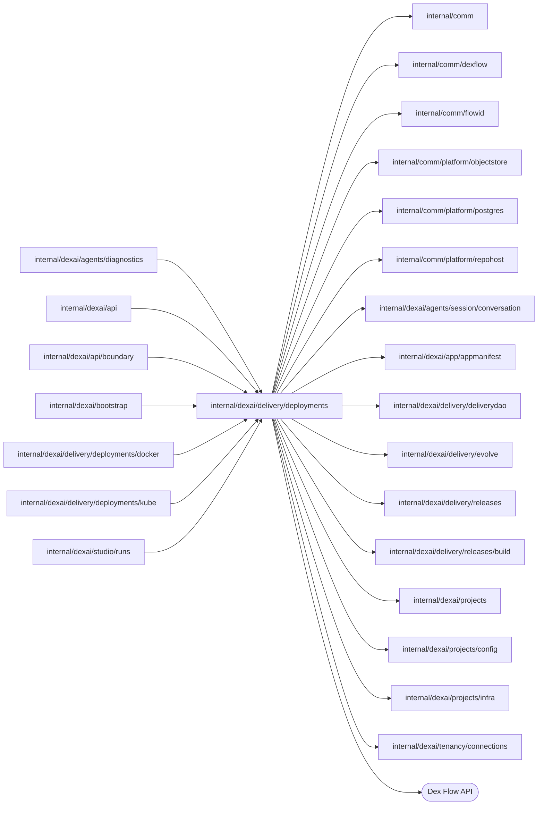

# Live deployment implementation contract

<!-- BEGIN GENERATED PACKAGE SUMMARY (scripts/check-package-readmes.py; edit only Purpose) -->
Purpose: Owns Live deployments for the API and Releases: ProjectDeployFlow deploys one exact Release build, Serving serves its generations and PublishingFlowService links Releases to configuration and automatic deployment.

Callers: `internal/dexai/agents/diagnostics`, `internal/dexai/api`, `internal/dexai/api/boundary`, `internal/dexai/bootstrap`, `internal/dexai/delivery/deployments/docker`, `internal/dexai/delivery/deployments/kube` and `internal/dexai/studio/runs` import this package.

Dependencies: it imports `internal/comm`, `internal/comm/dexflow`, `internal/comm/flowid`, `internal/comm/platform/objectstore`, `internal/comm/platform/postgres`, `internal/comm/platform/repohost`, `internal/dexai/agents/session/conversation`, `internal/dexai/app/appmanifest`, `internal/dexai/delivery/deliverydao`, `internal/dexai/delivery/evolve`, `internal/dexai/delivery/releases`, `internal/dexai/delivery/releases/build`, `internal/dexai/projects`, `internal/dexai/projects/config`, `internal/dexai/projects/infra` and `internal/dexai/tenancy/connections` and calls the Dex Flow API.


<!-- END GENERATED PACKAGE SUMMARY -->

`ProjectDeployFlow` owns one explicit Live deployment of an exact Release build;
`Serving` is the runtime that serves its generations, implemented for Kubernetes
by `LiveServing` in [`kube`](kube/README.md); and `PublishingFlowService`
connects Releases to configuration and automatic deployment.

## Dex Flow Changes

### Identity and execution lifecycle

`ProjectDeployFlow` owns one explicit deployment attempt. It is an independent
top-level Flow started before membership admission. FlowID is
`deploy-<projectID>-<deploymentID>`, for example `deploy-ab12-deploy-checkout-1`.
Deployment IDs are lowercase DNS labels of 1–36 characters with alphanumeric
ends; UUIDs and readable IDs such as `deploy-checkout-1` pass unchanged through
admission, Flow state, grants, labels and resource names, and
`app-<deploymentID>-<uint64 generation>` stays within 61 characters. The
client's admission validates the deployment ID and configuration revision and
authorizes the actor on the READY Project once for both callers,
StartDeployment and automatic deployment.

The caller supplies the deployment ID and a request identity; the server
fingerprints the complete project/deployment/release/build/configuration
revision/expected-Live-revision/actor input and derives the Dex Start RequestID
from the accepted identity. `IDReuseDisallow` and the complete RequestID prevent
conflicting reuse. Successful StartFlow returns only the accepted IDs; only the
typed AlreadyStarted path compares the immutable fingerprint and joins through
RequestLiveDeployment. If Project.ActiveDeployment points to an unresolved
attempt for the same Release build and configuration, it is the target even when
the caller proposes another deployment ID; a different desired deployment is
rejected until its effects are reconciled and cleaned. A new StartDeployment
request for a FAILED deployment resumes its retained phase in the same FlowID;
a failed Live preparation resumes as a new preparation round with a new
LivePreparationResults key, never as a new FlowID. No search result
participates in admission. The execution under its FlowID may span several
Runs: Attributes, ChannelMap instances, unconsumed results and queued wakeups
carry over and are retained for the deployment's lifetime.

The first Step, AdmitDeployment, registers exact Project membership before any
provider effect; a deleting or deleted Project yields a REMOVED terminal receipt
with no external effect, as does Project cleanup admitted before admission.
ProjectFlow remains the sole owner of the active deployment lease and the
current Live pointer: Acquire assigns generation `Project.Revision+1`, the
deployment persists that exact lease, and every provider phase first proves the
lease is still its own. A workload grant is issued only for the leased
generation: PrepareLiveAccess reads the lease again right before its
`IssueWorkload`, and ApplyApplication right before its `GrantEnvironment`, so a
deployment whose Project is deleting or holds another lease never issues one,
and ApplyApplication then fails at once into the failure route instead of
retrying. The provider's revocation fence is only a second line of defense.
Existing Live stays selected until exact image and
definitions readiness and route activation succeed. The accepted FDG activation
object's key/version/digest is committed directly to
`Project.CurrentLive.FDGActivation`.

READY is serving business completion, with an open execution for reads and grant
revocation. FAILED and REMOVED are the other retained states; Live removal
revokes the grant and retains project data, configuration and connections.
Once a newer generation commits as Live, the replaced READY generation retires
([retirement](#retirement-of-replaced-generations)): RETIRING while it drains,
then RETIRED, a business completion after which the execution completes and
stays a retained read.
Project deletion sets CleanupRequested, revokes and cleans the generation,
releases its lease and completes with a typed REMOVED snapshot. Engine retention
starts only at GracefulComplete, after the Project acknowledged child cleanup.

### Attributes and AttributeMaps

All attributes are ordinary Dex Attributes owned by this Flow; structs are
bounded ordinary values.

| Attribute | Value type and purpose |
| --- | --- |
| StartIdentity | `dexflow.StartIdentity`; complete accepted fingerprint and actor |
| ProjectID | string; keyword2 index for scoped lists |
| DeploymentID, ReleaseID, BuildRevisionID | strings; explicit attempt and the exact Release build |
| ConfigurationRevision, ExpectedLiveRevision | uint64; accepted CAS inputs |
| DeploymentStatus | string; keyword3 status index: PENDING, DEPLOYING, READY, FAILED, RECOVERING, CANCELLING (a person's cancellation or Project deletion), REMOVED, RETIRING, RETIRED or CANCELLED |
| ProjectDeploymentLease | `projects.DeploymentLease{DeploymentID,Generation,ExpectedLiveRevision}`; exact Project-issued lease |
| PinnedInputs | `Inputs`; build, image reference/digest, declared application port/health path, source bundle digest, exact configuration/definition/manifest refs |
| WorkloadGrant | `WorkloadGrant`; grant ID, scope/generation/configuration refs and revocation; never the credential |
| DeploymentResources | `DeploymentResources{Storage infra.StorageRefs, Execution infra.ExecutionRefs, Service infra.ResourceRef}`; the deployment's copy of the Project's storage, pinned with the Inputs, and of its Live execution references (pinned when complete, then recorded by preparation and StartLiveDex), plus the generation's own Service |
| ProviderOperationRefs | `ProviderRefs`; phase (a Step type name), application UID, up to 128 request receipts and PreparationRound, the number of the latest preparation round |
| PhaseTimings | `[]dexflow.PhaseTiming`; one entry per phase and per preparation branch, its latest run only (at most 15); the API returns them as `DeploymentSnapshot.phase_timings` |
| ReadinessResult | `Readiness`; exact image/bundle evidence, readiness and observation time |
| DeploymentURL | string; public Live URL |
| CleanupRequested | bool; the Project cleanup fence, never cleared |
| ReplacedLive | `ReplacedGeneration{DeploymentID, Generation}`; the Live generation this deployment replaces, which VerifyReleaseAndConfiguration reads from the Project's Live pointer at ExpectedLiveRevision; zero for the first Live |
| Retirement | `Retirement{RequestID, ReplacedBy, RequestedAt, RetiredAt}`; the admitted request of the generation that replaced this one; RequestedAt starts the drain |
| Cancellation | `*DeploymentCancellation{RequestID, ActorAccountID, RequestedAt, Phase, Preempted}`; a person's admitted cancellation, nil without one ([cancellation](#cancellation-by-a-person)); `Phase` is the phase at the first admission, `RequestID` the latest admitted request, `Preempted` a cancellation that ended a running ApplyApplication |
| Failure | optional `dexflow.Failure`; sanitized provider-phase failure with internal names redacted |
| Revision | uint64; lock/CAS for all mutations and phase commits |
| CreatedAt, UpdatedAt | timestamps |

**Read model.** Every Attribute but ProjectID, DeploymentID,
ExpectedLiveRevision, CleanupRequested, ReplacedLive and Retirement syncs to the PostgreSQL
read model (`docs/architecture/teamspace/read-model.md`). The start selects the
platform Dex Attribute Store `deployments` (`postgres.DeploymentStore`), which
upserts the `deployments` row that the row key
`deploy-{project_id}-{deployment_id}` splits from the FlowID, under snake_case
columns. Sync is asynchronous latest state: the Flow stays the owner of every
fact, and no read uses the table yet.

AttributeMaps and exact instance keys: **None**. Provider work runs outside the
Revision lock and CommitDeploymentPhase records its result under that lock;
PrepareLiveExecution increments PreparationRound under the same lock. Project
owns storage and Live execution references (ProjectStorage, LiveExecution); the
deployment's copy fences its effects and its own generation cleanup, and the
generation Service is the deployment's own. Grant and configuration
credentials exist only in memory or in owned Kubernetes Secrets; no secret
value enters the Flow. Size per deployment is bounded; execution count grows
with explicit attempts until Project deletion. All fields, pending channel
messages, the lease and object references are retained for the deployment's
lifetime; no retry, recovery or restart resets them.

### Channels, ChannelMaps and Streams

`DeploymentRecoveryDecisions: string` is the one Channel; each message is the ID
of the request that admitted it. RequestLiveDeployment for a FAILED deployment
and RequestProjectCleanup produce wakeups; AwaitDeploymentRecovery consumes one
at a time. All status and receipt writers share the Revision lock. Request receipts
`DeploymentRequestReceipt{RequestID,FailedRevision}` are an ordinary slice in
ProviderOperationRefs; a FailedRevision of zero denotes the initial start or a
join. A new identity may resume only the exact current FAILED revision; accepted
identities return the current snapshot without new wakeups.
Receipts are never pruned; capacity exhaustion rejects further identities while
Project cleanup stays available. Channel payloads are wakeups only; the retained
status decides continuation. No expiry is configured.

`LivePreparationResults: LivePreparationResult` is the one ChannelMap. Its
instance key is `prepare-<generation>-<round>` from the lease generation and
ProviderOperationRefs.PreparationRound, for example `prepare-7-2`;
PrepareLiveExecution derives it and carries it in `livePreparationInput.Key`.
`LivePreparationResult{Branch, Round, Execution, Service, Grant, Timing,
Cancelled, Failure}` holds the references a branch observed (also when it
failed), its measured timing, Cancelled when the deployment lost the Project's
lease, or the message of the failure that ends the round. Each branch,
PrepareLiveTemporal and PrepareLiveAccess, has exactly one producer per round:
its Execute decision or its failure-route Step RecordLivePreparationFailure,
never both, because a branch publishes only as part of a committed Execute
decision and a failed or timed-out attempt commits nothing. The consumer is
AwaitLiveExecutionPreparation, waiting on `ForN(key, 2)`; order is irrelevant,
and the join panics on a result of another round, an unknown branch or a
second result of one branch. A new round starts only after the join consumed
both results of the previous one, so a stale result cannot exist. No expiry
and no join timer apply: the branch wait limits (20 and 15 minutes) and the
failure-route Step (at most 3 minutes) bound the join to about 23 minutes, and
nothing is pending at termination.

`DeploymentProgress: dexflow.ProgressEvent` is written by each Step when it
starts and, while it waits, when its pending reason changes, never once per
polling round. Phase is the Step name only; the pending reason goes to Detail,
which can name internal resources and which the API never maps: WatchDeployment
returns the Phase, the Revision and the event time (`ResourceProgress.created_at`).
During preparation both branches write concurrently. It is consumed through
snapshot-first WatchDeployment. The 10 MiB approximate budget is shared by all
instances of this FlowType and Stream name in the backend, not per deployment.
Delivery is best effort with truncation; the Deployment snapshot (Status,
phase, PhaseTimings) and the Project Live pointer recover lost progress.

### Retirement of replaced generations

[the current contract](../../../../docs/architecture/studio-setup/flow-changes.md)
owns the design. VerifyReleaseAndConfiguration records ReplacedLive, the Live
generation the Project's pointer names at the lease's ExpectedLiveRevision,
which the lease keeps until this deployment commits. After CommitCurrentLive and confirmed exit through StopReplacedWorker,
RequestReplacedRetirement sends that deployment one `RequestLiveRetirement`
while this deployment still holds the lease, so no newer generation commits in
between; the RequestID `retire-<deploymentID>-g<generation>` makes a retry
repeat the same request.

`RequestLiveRetirement(retirementRequest{RequestID, ReplacedBy})` is
Revision-locked and makes no external read. A request without a newer
ReplacedBy is INVALID_ARGUMENT. A generation that is RETIRING, RETIRED,
REMOVED, cleaned up, or without an accepted exact Worker reference
(`DeploymentResources.Worker` empty) is answered unchanged, which the sender
accepts. Any other status but READY is FAILED_PRECONDITION. A READY generation
records Retirement with RequestedAt, sets RETIRING and the phase
RetireReplacedGeneration, and publishes the RequestID on
DeploymentRecoveryDecisions, which moves AwaitDeploymentRecovery to
DrainReplacedGeneration.

DrainReplacedGeneration waits for a Dex timer that ends `live.retirementDrain`
(10 minutes; 30 seconds in the local profiles) after RequestedAt, so a Worker
restart never extends it, or for a wakeup; Project cleanup moves to
CleanupCancelledDeployment, another wakeup waits again for the rest.
RetireReplacedGeneration polls without locks: it reads the Project and refuses
to retire its current Live, confirms the exact Worker is absent, then calls `RevokeWorkload` and
`CleanupDeployment`, which preserves the successor's HTTP route and pull Worker and confirms the generation's objects gone. Its commit marks
the grant revoked, records RetiredAt and RETIRED and completes. A failure
passes RecordDeploymentFailure to FAILED with the phase, told to the Session;
a StartDeployment of that deployment resumes the retirement without the lease,
and Project cleanup removes it too. `RemoveForProjectCleanup` answers a RETIRED
deployment as cleaned up. RequestLiveDeployment and the client's resume refuse
RETIRING and RETIRED: a rollback deploys an earlier build under a new
deployment ID and generation. Adoption clears execution data; no earlier push graph is migrated.

### Cancellation by a person

[the current contract](../../../../docs/architecture/studio-setup/flow-changes.md)
lets a person cancel a deployment before the Flow chooses to commit it as Live.
`CleanupRequested` stays the deleting Project's fence; a person's cancellation
is the `Cancellation` Attribute (synced to `deployments.cancellation`, not
indexed, no secret), and CANCELLED, after CANCELLING, is its business
completion: the Flow completes gracefully with the CANCELLED snapshot, as at
RETIRED, and `RemoveForProjectCleanup` answers it as cleaned up without an RPC.

**RPC `RequestDeploymentCancellation(cancellationRequest{RequestID,
ActorAccountID})`** (Revision lock) answers `mutationResult`.
`ProjectDeployFlowClient.Cancel`, behind `DeploymentService.CancelDeployment`,
validates the deployment ID and authorizes the actor with the build capability
on the READY Project; a completed deployment answers from its retained
snapshot. In order: no RequestID is INVALID_ARGUMENT; a recorded cancellation
with the same RequestID, or not FAILED, is accepted unchanged; a FAILED
cancellation cleanup under a new RequestID is admitted again; Project deletion
(`CleanupRequested`) is FAILED_PRECONDITION; any status but PENDING,
DEPLOYING, RECOVERING or FAILED, or a phase from CommitCurrentLive on, is
refused (`ErrDeploymentNotCancellable`, reason `DEPLOYMENT_NOT_CANCELLABLE`),
so a deployment that failed in CommitCurrentLive, which may hold the moved
route and Worker resource (the current contract), is never cancelled. Admission
records the cancellation and CANCELLING. In StartLiveDex, ApplyApplication or
VerifyReadiness, or when FAILED, it sets the phase to cleanup and returns
`NextSteps` with CleanupCancelledDeployment (ReleaseProjectDeployment for a
failed lease release) and `CancelSteps` of StartLiveDex, ApplyApplication,
VerifyReadiness, RecordDeploymentFailure, CommitDeploymentPhase,
NotifyDeploymentFailure, AbandonDeploymentFailureNotification and
AwaitDeploymentRecovery, every Step the chain can be in there: those three
act only on the generation, which cleanup removes, and on the Project's Live
Dex, whose identity the next StartLiveDex adopts. In an earlier phase the
running short Step or preparation round finishes, because the branches hand
minted identities to the Project, and the next boundary routes to cleanup.
CommitDeploymentPhase, which chooses CommitCurrentLive under the same lock,
decides the race: a cancellation first cancels that queued commit; a commit
first sets the phase, which the RPC refuses.

Boundaries: VerifyReleaseAndConfiguration, PublishDefinitions,
PrepareLiveExecution, StartLiveDex, ApplyApplication and VerifyReadiness treat
`Cancellation` as Project cleanup; AcquireProjectDeployment only on its first
attempt, since a later one may follow an acquire whose answer was lost.
CommitDeploymentPhase continues every phase with cleanup, keeps CANCELLING,
drops a forward phase's failure after a cancellation, commits a failure of
cleanup or lease release FAILED and tells nobody; the lease release commits
REMOVED for Project cleanup, CANCELLED for a cancellation and READY otherwise.
RecordDeploymentFailure names the cleanup phases by their failed Step.
AwaitDeploymentRecovery moves a CANCELLING cancellation to cleanup.
CleanupCancelledDeployment's before-provider-effects branch admits the
deleting Project's fence or a cancellation, reconciling only this
deployment's exact lease; after provider effects it revokes the grant and
removes the generation. A preempted ApplyApplication stops only at its next
heartbeat, so its round in progress may still create the generation's
objects or reissue its grant: a cancellation that preempted it
(`Cancellation.Preempted`) repeats the revocation and removal in every round
until `preemptedRoundBound` (the heartbeat timeout plus one interval and one
round, 1m43s) has passed since its admission. Cleanup never removes the
current Live, its generation, route or
Worker resource, the Live execution environment, the connection usages or the
published Flow Definitions. RequestLiveDeployment and the client's resume
refuse a cancelled deployment; `start` releases the exact lease of a CANCELLED
deployment that an acquire left after its cleanup's read. A cancelled
deployment never asks its replaced generation to retire.

Trigger registrations: PrepareLiveAccess keeps the Live scope's Slack
registrations that the new version or the current Live's pinned configuration
selects, so a cancelled or failed deployment never breaks the running Live's
triggers, and CommitCurrentLive's round, once the Live pointer names this
generation, keeps only the new version's.

### Build logs

`PublishingFlowService.ReadBuildLog` reads one redacted page of a build
revision's provider log for `ReleaseService.GetReleaseBuildLog` and the Agent's
`read_delivery_status`: two retained reads of the Release for the build's
provider identity, `Builder.ReadLog` and, for a page with text, the build's
`ConfiguredValues` with `projectconfig.OutputRedaction`, held for that one
redaction; nothing is stored. Per replica, the viewers of one page share one
read (`singleflight`) and its result for 2 seconds (at most 128 pages of 64
KiB), and a token bucket of `builds.logReadsPerSecond` (default 2, burst 4)
bounds the reads a replica starts; a read beyond it, or one the provider
throttled (`build.ErrLogThrottled`, then a per-build backoff from 4 seconds
to a minute), answers an empty page at the same cursor with a longer
`RetryAfter` instead of failing, because the build snapshot is the durable
record. `Complete` requires a READY, FAILED or CANCELLED build.

### Steps, RPCs and recovery

Graph:

```text
AdmitDeployment → AcquireProjectDeployment → VerifyReleaseAndConfiguration
  → PublishDefinitions → PrepareLiveExecution
      ├→ PrepareLiveTemporal ─┐  each publishes LivePreparationResults[prepare-<generation>-<round>];
      ├→ PrepareLiveAccess   ─┤  an Execute failure or a passed wait limit goes to
      │                       │  RecordLivePreparationFailure, which publishes instead
      └→ AwaitLiveExecutionPreparation (ForN(key, 2))
  → StartLiveDex → ApplyApplication → VerifyReadiness → CommitCurrentLive
  → AnnounceLiveChange (failure → RecordLiveAnnouncementFailure)
  → StopReplacedWorker → RequestReplacedRetirement → ReleaseProjectDeployment → AwaitDeploymentRecovery

A replaced READY generation: AwaitDeploymentRecovery (RETIRING)
  → DrainReplacedGeneration (timer or Project cleanup) → RetireReplacedGeneration
  → CommitDeploymentPhase (RETIRED, completes)

CommitDeploymentPhase with a Failure → NotifyDeploymentFailure → AwaitDeploymentRecovery
  (a notification that exhausts its retries: AbandonDeploymentFailureNotification;
   during Project cleanup straight to AwaitDeploymentRecovery)
```

CommitDeploymentPhase sits between phases and commits each phase result under
the Revision lock: the references and grant a phase observed and its
PhaseTimings entry, also when the result carries a Failure. A Failure then
commits status FAILED and keeps the failed phase for recovery, and goes on to
NotifyDeploymentFailure, which tells the Project's Session
([Live failure feedback](#live-failure-feedback)) and moves to
AwaitDeploymentRecovery; during Project cleanup it moves there directly: every
FAILED commit of this Flow passes there. The Failures come from RecordDeploymentFailure, the
failure route of every other phase including StartLiveDex and
CleanupCancelledDeployment, and from the join merging a branch Failure; a
cleanup failure has CleanupRequested set. RecordDeploymentFailure turns the
cause of the last failed attempt, `ctx.RecoveryError().Detail` truncated to
2 KiB with the project's internal resource names redacted (`infra.Redact`),
into the `DEPLOYMENT_FAILED` Failure message, saying that the phase did not
finish within its wait limit when the engine ended it there. Project deletion
takes `CleanupCancelledDeployment → ReleaseProjectDeployment` and completes
REMOVED. No SubFlow is declared.

| Step | StepOptions | Lock | Purpose |
| --- | --- | --- | --- |
| PrepareLiveExecution | `StateStepOptions`, failure → RecordDeploymentFailure | Revision | Honors CleanupRequested, increments PreparationRound and moves to both branches and the join with `livePreparationInput{Branch, Round, Key, StartedAt}` |
| PrepareLiveTemporal | `PollingStepOptions(20m)`, failure → RecordLivePreparationFailure | none | Lease check, `EnsureTemporal` with its data-plane check, `RecordLiveExecution` when the references change; reuse is one query-only round |
| PrepareLiveAccess | `PollingStepOptions(15m)`, failure → RecordLivePreparationFailure | none | Lease check, `EnsureConnectionUsages` for the TeamSpace connections the frozen configuration selects, `EnsureExecutionAccess`, the generation Service `app-<deploymentID>-<generation>` and `IssueWorkload` |
| RecordLivePreparationFailure | `ProviderStepOptions`, no failure route | none | Publishes the failed branch's result with its input: the redacted cause and, for a passed wait limit, the limit; a timed-out Temporal branch also gets the cause from one bounded `CheckTemporalDataPlane` query |
| AwaitLiveExecutionPreparation | `StateStepOptions`, no failure route | none | Joins exactly one result per branch of the current round and merges them for CommitDeploymentPhase |
| StartLiveDex | `PollingStepOptions(10m)`, failure → RecordDeploymentFailure | none | `StartProjectDex` on the Project's accepted Temporal, `RecordLiveExecution` of the Dex Service, until the Dex is ready |
| StopFailedCandidateWorker | `PollingStepOptions(12m)`, failure → RecordCandidateStopFailure | none | Check the exact lease and CurrentLive, stop a failed candidate by owned generation/UID, then commit its original failure; never stop an already committed Live |
| RecordCandidateStopFailure | `StateStepOptions`, no failure route | none | Same typed durable failure input as the stop; commit the stop failure while retaining the original provider phase and lease |
| AnnounceLiveChange | `ProviderStepOptions` with 10 minutes of retries, failure → RecordLiveAnnouncementFailure | none | Entered only from the commit of the CommitCurrentLive result; outside cancellation, one `LiveChanged` through the `liveChangeObserver` port (the EvolveFlow client of [goal measurement](../evolve/README.md)) with the lease generation as the Live revision, the Release ID as the build commit, the end of the CommitCurrentLive timing as the Live time and the ReplacedLive generation as the revision it replaced; then StopReplacedWorker. It is no phase: recovery never resumes it, so a deployment recovered past its commit does not announce and the next one does |
| RecordLiveAnnouncementFailure | `StateStepOptions` | none | Writes the redacted cause into one DeploymentProgress frame and continues to StopReplacedWorker: the announcement never fails the deployment, but its retries can delay StopReplacedWorker, and so READY, by up to ten minutes while the replaced Worker keeps polling |
| StopReplacedWorker | `PollingStepOptions(12m)`, failure → RecordDeploymentFailure | none | After Live commit, reconcile the replaced exact Worker, send SIGTERM and confirm exit; retain HTTP |
| RequestReplacedRetirement | `ProviderStepOptions`, failure → RecordDeploymentFailure | none | While the lease is still held, one `RequestLiveRetirement` to the ReplacedLive deployment with RequestID `retire-<deploymentID>-g<generation>`; nothing for the first Live |
| DrainReplacedGeneration | `StateStepOptions`; WaitFor the drain timer or `DeploymentRecoveryDecisions` | none | The business TTL `live.retirementDrain` from Retirement.RequestedAt; Project cleanup moves to CleanupCancelledDeployment |
| RetireReplacedGeneration | `PollingStepOptions(30m)`, failure → RecordDeploymentFailure | none | Requires a Live pointer of another deployment, then `RevokeWorkload` and `CleanupDeployment` until the generation is gone |

The phases that wait for their provider poll in one long-running Execute
without locks, through `dexflow.PollUntil` every 3 seconds within a 40-second
round, because a round reads the Project and makes several Kubernetes or
cloud calls; they commit their result once through CommitDeploymentPhase
(the branches through the join):

| Step | Wait limit |
| --- | --- |
| PrepareLiveTemporal | 20 minutes |
| PrepareLiveAccess, ApplyApplication | 15 minutes |
| StartLiveDex, VerifyReadiness, CommitCurrentLive | 10 minutes |
| CleanupCancelledDeployment | 30 minutes, the cleanup wait limit of the deleting Project |

`infra.ErrPending`, `projects.ErrCleanupPending` or a round cut off by its
round timeout continues the wait, and a new pending reason writes a
DeploymentProgress frame. The engine enforces the wait limit as the Step's
ExecuteMethodTimeout and ExecuteRetry.TotalDuration, which counts every retried
attempt; a resumed phase is a new Step execution with a full limit, and no
deadline is computed or recorded. Other errors return through
`dex.ErrorWithStack` and the retry policy, whose exhaustion also takes the
failure route. State Steps use ASYNC durability with 30-second methods and two
minutes of retries. The other provider Steps use SYNC
durability with 45-second method deadlines and three minutes of
retries. Every phase error names the failed operation, Project, build or
generation.

A branch decides two outcomes inside its loop as business conditions. A lost
lease (the Project is no longer READY or holds another lease, which only its
deletion causes) ends the branch at once with a Cancelled result: the join
continues with cleanup when CleanupRequested is set and otherwise fails the
round. `infra.ErrOwnershipConflict` (an external owner or identity conflict only an operator repairs) and `connections.ErrConnectionDeleted` (a
selected TeamSpace connection that is no longer ACTIVE, which only selecting
another connection and deploying again repairs) and `infra.ErrGrantTooLarge`
(a workload grant whose configuration names more secrets than its IAM policy
holds, which only fewer secrets repair) end it with a Failure by decision. The Live usages are idempotent and never removed by a deployment, so
a retry or a later round records them again and the version that serves keeps
reading its credentials until a release of the unused ones. An
unauthorized or unreachable Temporal data plane stays pending: the endpoint's
propagation has no bound in code, and the branch's wait limit ends a wait that
never converges. RecordLivePreparationFailure then classifies a timed-out
Temporal branch with one read-only check within 20 seconds of the Project's
accepted namespace: the data plane denied access, stayed
unreachable, or became ready after the limit; with no accepted namespace reference yet
the namespace was not ready, and an error makes the cause
unclassified, so the classification never fails the Step. A failure of the
join, which only merges committed results, is a defect.

The first deployment creates the Temporal namespace and records its identity, the
access of Dex and the applications and the Live Dex on the Project's storage;
later deployments reuse them through the same queries. Each round hands every
new execution identity to the Project through `RecordLiveExecution` under the
deployment's lease before it reports pending or an error, so a failed first
deployment leaves nothing without an owner, and the Project's
`CommitLiveDeployment` requires the complete environment. A round in which one
branch failed still commits what the other prepared (partial handoff);
StartDeployment recovery at the FAILED revision resumes PrepareLiveExecution as
a new round that reuses every accepted resource, query before mutate.

Every external operation is retry safe, so a polling round or a retried
attempt may repeat it. Generation resources have deterministic names
(`app-<deploymentID>-<generation>`) and labels: an existing object is adopted
only when it carries the owner, generation and input digest, and removal
deletes only the observed UID and treats absence as done. The Live route update
is a resourceVersion CAS whose conflict re-reads the route, and the FDG
activation manifest is an S3 ETag CAS guarded by the route generation. The
Project lease and Live pointer are idempotent Project Flow mutations under the
lease. Uncertain apply, activation and lease responses are inspected before
mutation, preserving the same generation. A failed deployment retains its lease
and partial resource identities for its StartDeployment recovery or its deleting
Project's cleanup. The deployment owns the retry of its rounds; the Project owns
project-level resources for deletion.

Compatibility: EnsureLiveInfrastructure and IssueWorkloadGrant are removed,
ProjectResources is replaced by DeploymentResources and PublishDefinitions now
runs before preparation; NotifyDeploymentFailure and
AbandonDeploymentFailureNotification are new, and the Failure branch of
CommitDeploymentPhase moves to them. An open execution of the earlier graph is not
migrated: Local Kind is recreated empty, and hosted environments delete every
Project before the rollout.

RPCs: GetProjectDeployment, GetDexSummary, GetDexDisplay, RequestLiveDeployment,
RevokeDeploymentGrant, RequestProjectCleanup, RequestLiveRetirement and
RequestDeploymentCancellation. ProjectDeployFlowClient
operations: DeployReadyBuild, ReadSnapshot, GetForAccount,
RevokeForLiveRemoval, RemoveForProjectCleanup and RemoveServing. User
operations authorize the account against the Project. DeployReadyBuild, the
caller's explicit deployment, also requires the exact build READY with its
frozen configuration revision; PublishingFlowService's automatic deployment
uses the same admission and start without reading the build, which is still
pending. Live removal is a ProjectFlow command: `ProjectService.RemoveLive`
calls `ProjectFlowClient.RemoveLive`, which admits a REMOVE_LIVE command only
for the Live pointer the caller observed, its deployment ID and Live revision,
and reads no deployment. RevokeForLiveRemoval requires the Project's active
REMOVE_LIVE or DELETING command and its exact current pointer, and revokes the
grant before the Project clears its pointer. Full cleanup is requested only by
the deleting Project, after its deletion committed Live absent.

### Live failure feedback

The Failure branch of CommitDeploymentPhase is the deployment's one hook of
the Live failure feedback that
[the Release package](../releases/README.md#live-failure-feedback) owns: it
builds the failure as the commit recorded it, a `releases.DeliveryFailure`
with the source `deployment`, the Release's commit, the deployment
(`ResourceID`), the committed `DEPLOYMENT_FAILED` Failure and its owner, and
the ID `deployment/<deploymentID>/g<generation>/r<revision>`, for example
`deployment/d41e8f2a-6c3b-4f8e-9a1d-2b7c5e0f9a13/g2/r9`: the generation of
the Project lease the deployment holds, 0 before it acquired one, and the
Revision of the FAILED commit, never a later one, so a retry, a Worker restart
or a recovery admitted meanwhile repeats it. The owner is the failed phase's
(`failureOwner`): ApplyApplication and VerifyReadiness are the
application's, whose image does not run or become ready, so its failure of the
Session's HEAD may open an automatic turn; VerifyReleaseAndConfiguration is
the configuration's; every other phase, PrepareLiveExecution with its branch
named in the message included, is the platform's. A failure committed while
CleanupRequested is set, CleanupCancelledDeployment's included, is told
nobody.

NotifyDeploymentFailure makes one call of the injected
`releases.DeliveryFeedback` under `dexflow.ProviderStepOptions()` without a
lock and saves nothing; its failure route AbandonDeploymentFailureNotification
drops a notification whose retries are exhausted. Both move to
AwaitDeploymentRecovery, where a recovery or a cleanup admitted meanwhile
waits in DeploymentRecoveryDecisions. The Session's receipts admit an ID once.

If lease release succeeds but its response is lost, ActiveDeployment may be
empty while CurrentLive points to the FAILED ReleaseProjectDeployment phase;
StartDeployment resumes that exact attempt for the same inputs and matching
generation instead of allocating a replacement.

Before the first provider Step, Project cleanup reconciles only the lease,
without infrastructure, grant or application effects. That requires the cleanup
fence, a fresh Project in DELETING, exclusion from CurrentLive and the complete
initial-zero Inputs, DeploymentResources, Grant, Readiness, application
reference and URL, in phase AdmitDeployment, AcquireProjectDeployment,
VerifyReleaseAndConfiguration, CleanupCancelledDeployment or
ReleaseProjectDeployment; in the last phase the revoked-only empty grant is also
accepted. CommitDeploymentPhase pins the complete Inputs and the Project's
storage together before scheduling PublishDefinitions, the first provider
Step. If Acquire committed but its response was lost, cleanup recovers only the
same deployment ID, positive generation and accepted ExpectedLiveRevision from
Project.ActiveDeployment and persists it before the exact-tuple release. Once
any provider effect is possible, grant revocation and exact generation cleanup
on the pinned storage are required, including when an uncertain issuance left
no grant receipt.

### Exact build revisions

Every deployment pins one exact Release build through `BuildRevisionID`;
`PinnedInputs.BuildRevisionID` and `Project.CurrentLive.BuildRevisionID` carry
the same identity. StartDeployment requires the build ID and binds it into the
request fingerprint; same-desired recovery compares Release, build and frozen
configuration revision. Verification reads that exact READY map entry and
validates its configuration snapshot and current credentials. FDG publication and
manifest UUIDs include the build identity.

PublishingFlowService freezes a build's draft for the Release: when the
configuration host refuses the draft (`projectconfig.ErrNotReady` or
`ErrConflict`) it reads the gaps of the commit's Live draft
(`Configuration.CheckRequirements`) and answers them, so the Release refuses
the build for its configuration; a refusal without gaps stays the error.

PublishingFlowService runs a build's automatic deployment: it authorizes the
build's actor, requires a READY Project and the build's ExpectedLiveRevision, and
deploys under the build UUID as a stable DeploymentID. The Release Flow reaches it
only for an auto-deploy build with committed artifacts and frozen configuration,
also when recovering an unknown outcome; an already committed exact Live pointer
is success, and a lost acceptance is joined under the original identity.

## Live serving provider

`Serving` adds no Flow primitive. ProjectDeployFlow holds it beside the roles of
the project infrastructure it uses, `infra.Storage`, `Execution`, `Grants` and
`Redactor`, rather than through it: the serving re-exports none of them, so the Flow's
dependencies are exactly the objects bootstrap passes. The Live-specific effects are
the methods of `Serving`: the generation's Service, its application, its readiness,
the activation of its Flow Definitions and Live route, and its cleanup. They are
implemented in [`kube`](kube/README.md); publishing the build's Flow Definitions
(`publishFlowDefinitions`, `ReadPublication`) is plain storage and stays in this
package. The shared scope effects are the roles of [projects/infra](../../projects/infra/README.md),
implemented in [projects/infra/kube](../../projects/infra/kube/README.md).
The Agent's diagnostics read the application's Secret-backed environment and log
through `Serving` too, and `ErrApplicationChanged` reports an application that is no
longer the recorded one. Each call performs a bounded read or effect; `infra.ErrPending` returns control to the owning Step's durable
polling and wraps the reason it is pending: the Deployment without a ready
replica, the failed health probe of the application or the public route, or a
Live route update that lost to a concurrent write (HTTP 409), which the next
call reads again. Cleanup reports `projects.ErrCleanupPending` with the
resource that is still terminating.

The project's Live namespace owns the project Temporal server/namespace, one
versioned object bucket and one Dex Server, independent from the platform's.
Generation resources are named `app-<deploymentID>-<generation>` and labelled
with their deployment ID and generation; a mismatched owner, generation, UID or
input digest is rejected. The application runs its immutable image as an
unprivileged, read-only container without a service-account token (in gVisor
when hosted); Pod `PORT`, Service targetPort, network ingress and readiness probe
use the manifest's declared port and health path, which source preparation
admits only as an unprivileged port other than the Worker port and an absolute
path without a host, query or line break (`appmanifest.ExtractAppManifest`).
The application reads its exact configuration through the SDK; the grant's
environment reaches the Pod only through an immutable generation Secret, and
there is no configuration volume.

Validated Flow Definitions are published to immutable release/build keys in the
`internal/dexai/app/appmanifest` bundle format; the publication record binds ProjectID,
ReleaseID, BuildRevisionID, the deterministic UUIDv5 artifact ID and both
digests. Only Activate updates the project's Live route, and the active-manifest
write is an S3 ETag CAS guarded by the route generation, so a delayed activation
cannot overwrite a newer manifest. Removal confirms absence after a DELETE.
Deployment removal retains project Temporal, objects, PVCs, Dex and
configuration; only Project DELETING admits full namespace and data destruction.

Live URLs are `live-<projectID>.localhost:23080` in Local Kind,
`live-<projectID>.localhost:21080` in Local Native and
`https://live-<projectID>.<environment>.dexai.dev` when hosted. Studio Runs
verifies the Project-owned current deployment, exact build and immutable serving
inputs before calling the public Dex SDK on engine port 8801; Dex runs only
`api,interpreter`.

## Database Schema Changes

None beyond the read model's `deployments` table (migration `0002_read_model`)
and its later columns, the last the nullable `cancellation JSONB` of
`0009_publish_cancellation` (no backfill), which only Dex writes from the
synced Attributes above. Project and Deployment
Flows own control-plane facts. Versioned object
storage holds immutable payloads; workload credentials live only in
provider-owned generation Secrets, and disabled scoped storage identities fence
revocation without a grant table.

## UI/UX

Build owns Preview. Publishing has Config and Deploy tabs: prepare a main commit,
edit its draft, Save & Build, then deploy an exact successful build. Runs and
Inbox use Preview/Live tabs and display exact image and definition identities.
Live removal keeps data and configuration; Project deletion owns full cleanup.
The first deployment also prepares the Live execution environment and shows it
through the existing Deployment status. Progress frames carry only Step names,
and failure messages name the failed preparation branch with placeholders
instead of internal resource names.

## Tests

A person's cancellation runs in `internal/dexai/agents`
`TestDeploymentCancellationDexIntegration` on the actual Worker of a local lane,
with a current Live READY throughout: a deployment cancelled right after its
start ends CANCELLED without its lease and refuses to serve again; one
cancelled once it polls its provider (or, when the commit came first, READY
and refused) ends CANCELLED once across a Worker restart, its generation gone
and its grant revoked, while the current Live keeps its status, grant,
generation and pull Worker; a READY deployment refuses; a published
build names its automatic deployment, whose cancellation the Live history
lists as `PUBLISH_CANCELLED`; and the read model holds the `cancellation`
column. The Project's deletion then acknowledges every CANCELLED deployment.
The retained sync test compares the `cancellation` column too. A deployment
that failed in CommitCurrentLive is refused by the admission rule, which no
test reaches.

`kube/live_serving_kind_test.go` (`TestKindLiveInfrastructureAndFDG`) uses a full
UUID DeploymentID against real Kind, Native forwarding, versioned storage and
the project's real Temporal. It provisions the Live scope one part at a time:
storage alone, on which configuration admission for Live and a Session's
Preview works through the production configuration service with no Dex or
Temporal object; the Temporal namespace, whose data plane answers Ready, whose
second call reuses every reference, and which refuses a replaced namespace or
Service without waiting; a Live grant issued before any Dex exists; then the
Dex access and the Dex. It also covers the isolation of the configuration
references, the engine-only Dex listener, Live generation infrastructure plus
exact FDG publication, a repeated removal of the generation, which succeeds once
nothing is left, and scope destruction, which leaves no namespace. It does not
cover full Live application or grant acceptance, which the merged Studio browser
cases exercise.

`credential_read_kind_test.go` (`TestKindCredentialReadReachability`) uses the
same fixture with the project's storage and execution access, and needs the
current chart deployed: a probe Pod labelled as a project application gets the
credential read endpoint's 401 for a request without a scope token, while a Pod
of an unlabelled namespace cannot connect to it and still reaches the server's
health port, which the Local Kind companion policy keeps open.

`preview_storage_kind_test.go` (`TestKindPreviewStorageGrantAndCleanup`) uses
the same fixture, with only the project's storage provisioned, for a Session's
Preview grant on the Live MinIO: the grant
reads its accepted configuration and writes its Trigger inboxes but no connection,
Live or other Session object, a principal whose namespace or service account UID was
replaced is refused, revocation ends its access, and Session cleanup removes
the grant and the Session's configuration, twice, while the Live and the other
Session's configuration stay readable. It needs the chart's update permission
on `allow-storage`.

`kube/live_preparation_kind_test.go` deploys a READY Release build on the
existing Local Kind Worker with real Dex, Kubernetes, MinIO, Temporal and Live
Dex; each fixture file is the completed image-build request of a READY
Project without an unresolved deployment
([integration verification](../../agents/README.md)).
It injects only the fault a scenario names.

- `TestDeployFirstLivePreparationIntegration` consumes a Project that never
  prepared Live (`SUPERVERSE_TEST_FIRST_DEPLOY_BUILD_REQUEST`) and deletes it.
  An `allow-dex` NetworkPolicy of another owner fails the access branch of the
  first deployment by decision: the deployment is FAILED in
  PrepareLiveExecution with a redacted message naming the branch, the
  measured branches overlap, and the Project holds the Temporal identities
  alone. With the policy gone, recovery's second round reuses them and is
  READY. A second deployment reuses the whole environment in one round with
  the same Temporal and Dex Service UIDs; Live removal keeps the environment
  for the next deployment; and a Project deleted while the Temporal branch
  waits for its stopped Temporal ends the deployment REMOVED and leaves no
  namespace. Every progress frame carries a Step name.
- `TestDeployLivePreparationWorkerRestartIntegration`
  (`SUPERVERSE_TEST_BUILD_FIXTURE_REQUEST`, whose Project keeps the new Live)
  replaces the server Pods while the Temporal branch waits for the stopped
  Temporal: the branch resumes after the heartbeat timeout, and once Temporal
  returns the deployment is READY in its first round with no unconsumed
  preparation result.
- `TestDeployLiveTemporalWaitLimitIntegration` (the same fixture) keeps
  Temporal stopped past the branch's 20-minute wait limit, so it takes about
  25 minutes and runs once per pull request that changes the deployment graph.
  The deployment is FAILED with the cause classified as an unreachable data
  plane, and recovery after Temporal returns is READY in round 2.

Stopping the project's Temporal stands in for a data plane that does not
answer: a NetworkPolicy cannot block the server, because `allow-temporal`,
which every round reconciles, admits it, and policies only add allowances.

The Live failure feedback runs in the Session Service's Dex integration tests
([internal/dexai/agents](../../agents/README.md#tests)): the deployment of a build
whose application exits fails in a phase the application owns, and its
notification of the Session's HEAD opens the automatic turn of the
`live-failure-fix` scenario.

Uncovered real-dependency invariants: the pre-provider cancellation windows
(before Acquire, a lost successful Acquire response, and a committed lease before
Inputs); readiness, commit, revocation and cleanup failures on the actual
merged path; same-desired re-entry, retained failure receipts, old-request
replay and changed-desired rejection; Stream truncation and reconnect, provider
response-loss windows, an unauthorized hosted Temporal Cloud API key, hosted
cleanup, and a phase after preparation that resumes after a lost Worker or
commits its failure at its wait limit.
Static compilation and FDG validation establish none of these.

## Documentation

Keep this contract, `docs/architecture/superverse-v2.md`, the generated graph
`docs/flows/sv2-deployments-flow.json` and the API documentation consistent.
Root composition must set immutable `live.dexImage`, `live.temporalImage` and `live.s3Image` of the
[server configuration](../../../../cmd/superverse-server/config/README.md).

## File map

| File | Responsibility |
| --- | --- |
| `project_deploy_flow.go` | Flow primitives, registration, RPCs and Steps |
| `project_deploy_flow_state.go` | Persisted and RPC types, statuses, phase names, the phase order, wait limits and the preparation round's input and result |
| `project_deploy_flow_phases.go` | Step effects: admission, lease ownership, verification, the Live preparation branches and their join, provider phases and cleanup |
| `project_deploy_flow_client.go` | Deployment admission and start, reads, Live removal and Project cleanup |
| `publishing_flow_service.go` | Release source registration, configuration freezing and automatic deployment |
| `publishing_flow_service_build_log.go` | The replica's shared, rate-limited and redacted build log reads |
| `serving.go` | `Serving`, `Activation`, `LiveApplication`, `ApplicationLog` and `ErrApplicationChanged` |
| `live_serving_definitions.go` | FDG publication and its read, over `infra.Storage` |

### Pull Worker activation

Live uses separate web and pull Worker resources from the pinned image, with runtime YAML in the immutable generation environment Secret (Native: owned temporary volumes). Registration readiness and HTTP health are independent. The guarded FDG precedes HTTP routing and Project.CurrentLive commit under the existing lease. StopReplacedWorker uses PollingStepOptions(12m) and PollUntil to confirm exact Worker exit before RequestReplacedRetirement. Drain is ten minutes; resource grace is eleven minutes. RetireReplacedGeneration confirms Worker absence before grant/HTTP cleanup. No Attribute, Map, Channel, Stream or SQL schema is added; DeploymentResources.Worker now names the exact Worker resource. Adoption resets execution data, so no push reference or old deploy graph is migrated.

### Pull candidate failure and post-commit recovery

`ApplyApplication` records the exact web reference in `ProviderOperationRefs.Application` and the exact Worker reference in `DeploymentResources.Worker` before readiness. A failure in ApplyApplication, VerifyReadiness or CommitCurrentLive passes its original `phaseResult` as durable input to `StopFailedCandidateWorker`. That polling Step has a twelve-minute limit, uses the existing Project lease and owned generation/UID checks, and confirms Worker exit before committing the original failure. Its Execute failure routes to RecordCandidateStopFailure with the same typed input, as required by the pinned SDK. It queries `ProjectFlow.CurrentLive` first: an uncertain activation response must never stop an already committed Live candidate. Cancellation preempts this phase and its cleanup stops the Worker before revoking its grant. The web process remains for existing cleanup. No new Attribute, Map, Channel, Stream, resource or schema is added; only the bounded Step input carries the pending failure.

If stopping the candidate fails, the recorded failure names `StopFailedCandidateWorker`, while the original provider phase and lease remain retained. An exact revision recovery resumes the stop, then reapplies the immutable image to recreate the stopped candidate before readiness. A readiness failure whose stop succeeded similarly retries through ApplyApplication. The original phase is not advanced by a failure.

Post-commit failures keep the existing RequestReplacedRetirement/ReleaseProjectDeployment precedent: the deployment can be `FAILED` while it is still the current Live. `ProjectFlow.CurrentLive` is authoritative for serving, independently of deployment recovery status. Studio's **What is Live** section reads that Project pointer and continues to show its version as Live and serving. A StopReplacedWorker failure names the replaced deployment and generation, keeps N+1's pointer, HTTP route and active FDG unchanged, retains the lease, and waits for an exact revision retry. Retirement is not requested until the exact replaced Worker has exited. Failure notification remains best-effort through the existing Session feedback port. Tests must cover candidate registration followed by readiness failure and confirmed exit before FAILED, ownership conflicts, cancellation/grant order, and a Kind finalizer blocking replaced Worker deletion beyond twelve minutes followed by successful recovery.
