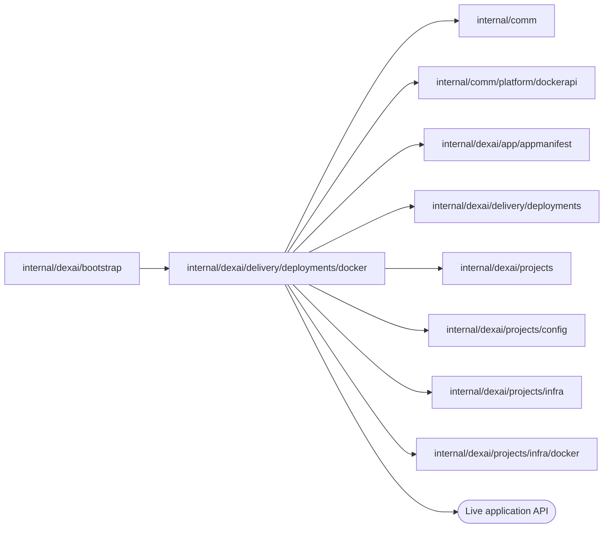

# Docker Live serving

<!-- BEGIN GENERATED PACKAGE SUMMARY (scripts/check-package-readmes.py; edit only Purpose) -->
Purpose: Serves each Live deployment generation as a Docker container of its Release image on its own network, moves the project's Live route to it and reads its log for diagnostics.

Callers: `internal/dexai/bootstrap` imports this package.

Dependencies: it imports `internal/comm`, `internal/comm/platform/dockerapi`, `internal/dexai/app/appmanifest`, `internal/dexai/delivery/deployments`, `internal/dexai/projects`, `internal/dexai/projects/config`, `internal/dexai/projects/infra` and `internal/dexai/projects/infra/docker` and calls the Live application API.

<!-- END GENERATED PACKAGE SUMMARY -->

`LiveServing` is the Docker implementation of `deployments.Serving`, which Local Native
runs. It builds on the [Docker project infrastructure](../../../projects/infra/docker/README.md),
verifies the references the deployment accepted before every effect, and never
rebuilds an application: a generation runs exactly the image its Release built and
pushed to the lane's registry.

| Reference | Kubernetes | Docker |
| --- | --- | --- |
| The generation's Service (`DeploymentResources.Service`) | a Service created before the Pods | the network `<project network>-app-<deployment>-<generation>`, by network ID, created before the application |
| The application (`ProviderRefs.Application`) | the generation's Deployment | the container of the same name, by container ID |

- **Generation.** `EnsureGenerationService` creates the generation's network.
  `ApplyApplication` runs the Release image (pinned by digest, pulled from the local
  registry when the engine does not have it) as UID 65532 with a read-only root,
  every capability dropped, `no-new-privileges`, limits of two CPUs and 1 GiB, an
  anonymous volume for `/tmp` and restart `unless-stopped`. It joins the generation's
  network and the project network under the generation's name, and publishes the
  web HTTP port; the separate Worker publishes only registration readiness on 127.0.0.1. Its environment is the fixed
  `deployments.ApplicationSettings`, as in Kubernetes, and the grant's, given when
  the container is created.
- **Readiness.** Exact web and Worker containers run the accepted image and read
  fixed runtime YAML from their owned temporary volumes. Web HTTP health and Worker
  registration readiness are independent. Only the readiness HTTP port is published
  by the Worker, with no push listener.
- **Activation.** Guarded FDG activation precedes HTTP routing. Only the replaced or
  candidate route, or no route on first publication, is admitted. No alias moves or
  network reconnections occur. DeploymentResources.Worker records the separate exact
  Worker; StopWorker observes its exit with eleven-minute grace, retaining old HTTP.
- **Removal.** `CleanupDeployment` and `RemoveServing` withdraw the route the
  generation holds and remove its container and network, each confirmed gone; the
  live generation must hold the route. A removal still converging is
  `projects.ErrCleanupPending`.
- **Diagnostics.** `ReadApplication` inspects the application container once at the
  ID and labels the deployment recorded (another one is
  `deployments.ErrApplicationChanged`); the `LiveApplication` it returns takes its
  `Environment`, the values of the container's environment beyond the fixed settings
  and every key pair the server generated for the project, for redaction, and its
  `Log`, the end of `docker logs` in whole lines with the container's state, from that
  one container.

## Tests

`live_serving_integration_test.go` (build tag `live`) needs the local Docker Engine.
It pushes a Release image to a local registry as the Native builder does, reads its
digest back with a HEAD of its manifest, removes the local tag so the engine pulls it
again by that digest from the same registry address, and deploys it as a Live
generation: its network, the grant's environment, the application, readiness,
activation of the definitions and the HTTP route through the gateway, the
diagnostics' log and environment and a refusal to read another application. It deploys
three versions of the [generation application](../generationapp/README.md) on the
project's own Temporal and Live Dex: a Flow that generation 1 started runs its next
Step on generation 2 while generation 1 still runs, and a Step that generation 3 no
longer registers takes its failure route within its retry budget. The removal of the
Live generation removes its exact Worker, after which the project's deletion leaves
nothing.

## Files

| File | Responsibility |
| --- | --- |
| `live_serving.go` | `LiveServing`, the generation's network and application, readiness |
| `route.go` | `Activate`, the Live route, `CleanupDeployment`, `RemoveServing` |
| `live_serving_worker.go` | Pull registration readiness and exact Worker stop |
| `diagnostics.go` | The application read for the Agent's diagnostics: its environment and log |

The stop/failure integration cases seed only disposable Project/deployment admission through `deploymentPhaseProject` and `deploymentPhaseFlow` in test files. Their FlowTypes derive from those Go names. They call the production Project/deployment RPC handlers and run every later production Step and option against real Dex and provider APIs. No provider response, handler or timeout is substituted. Each uses a fresh Project and FlowID with reuse disallowed and leaves only the lane's disposable retained execution state after exact owned-resource cleanup. Persistence, Maps, Channels, Streams, RPC admission and recovery are exactly the owning Project/deployment inventory; only the creation trigger and first Step differ. They add no durable primitive or cloud resource and are phase integration evidence, not a complete publish journey.
