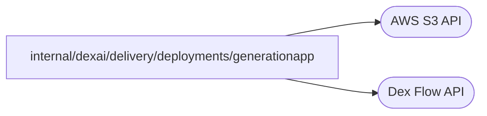

# Live generation test application

<!-- BEGIN GENERATED PACKAGE SUMMARY (scripts/check-package-readmes.py; edit only Purpose) -->
Purpose: A Live application that the deployment integration tests build in several versions to observe which generation's Worker runs each Step of an open Flow.

Callers: no production package imports this package.

Dependencies: it calls the AWS S3 and Dex Flow APIs.

<!-- END GENERATED PACKAGE SUMMARY -->

`generationapp` is a command that the Docker and Kubernetes deployment integration tests build for Linux, in
several versions, and run as consecutive Live generations of one project
(`dockertest.GenerationAppImageForTest` and the Kind deployment tests). It serves the health path `/healthz`, runs a
Dex Worker with the settings every Live application receives (`deployments.ApplicationSettings`), and lets a test
start, release and read one `GenerationProbeFlow` by its ID over HTTP.

The Flow records the build's version in each Step it runs: `RecordStart` in `started-by`, then `AwaitRelease`, which
waits for the `release` Channel, in `released-by`. A test therefore observes which generation's Worker the project
Dex dispatched each Step to. The build sets `main.version` and, with `main.removeAwait=true`, leaves `AwaitRelease`
unregistered, as a version that removed a Step that open Flows still wait in; such a Flow fails that Step's
attempts and takes its failure route, `RecordFailureRoute`, once the Step's 45-second retry budget has passed.

`OverlapProbeFlow`, FlowID `overlap-<eight random characters>` (for example `overlap-ab12cd34`), is independent and starts once through POST /overlap/{id}, RequestID equal to FlowID with reuse disallowed. A duplicate is rejected; tests use a fresh ID for each run. Its immutable Flow/Step names remain the same between fixture images. StartOverlap → SharedOverlap(1) → LongOverlap → SharedOverlap(3), with AddShipping scheduling AddedOverlap → SharedOverlap(2) completes the execution; retained read RPCs remain available for the test lifetime and project deletion removes the fixture's Dex data. There are no child Flows or ownership transfers.

The four ordinary Attributes are Order (`oldOrder{Name string}`), OrderShipping (`shipping{Address string}`), Progress (`overlapState`, version and attempt facts), and LongWorker (`string`). None is indexed or synced to SQL; there are no Maps, Channels, ChannelMaps, Streams, credentials or external business effects. Each Flow holds one bounded record of each, owned by its Steps and RPCs, until the disposable project is deleted. LongOverlap retains the old Order shape locally for three minutes, heartbeats every three seconds, has a five-minute Execute limit and fifteen-second heartbeat timeout, and writes only Order and LongWorker. AddShipping writes the separate OrderShipping plus Progress, so the old Worker's later whole-Order write cannot erase shipping. SharedOverlap and AddedOverlap update Progress only after the preceding invocation finishes; the test invokes AddShipping once before that chain resumes. No concurrent admission or Map/Channel/Stream cases apply.

Version 1 omits AddedOverlap and AddShipping from its registry. Version 2 adds both. The test connects version 2 while version 1 runs LongOverlap, invokes the new RPC through version 2's HTTP client, and schedules the new Step from the new RPC while the old long Step remains active, then stops version 1 while its long handler is still running. The Native test reads the actual Project Temporal interpreter query before and after N+1 registration and requires the unchanged nonempty sticky queue established by N. The nontransactional AddShipping RPC does not replace it; AddedOverlap completes on N+1 at attempt 1 while N remains connected. SDK registration state and ordinary Flow history expose no per-Flow unknown-name rejection counter, so the test credits this outcome and sticky precondition rather than a directly observed reject frame. Both shared-Step executions, handler attempt numbers, the old long Step and the preserved shipping address are read through GetOverlap. This fixture verifies actual Dex routing and additive persistence with Docker/Kind APIs; it does not substitute a provider. Its process lifecycle uses the same pull options, readiness, drain and signal contract as Live. Error/cancellation retries follow the real server defaults; the test's context and owned-project cleanup bound all fixture resources. No business retention or cloud resource is added.

The `blocked-drain` fixture version deliberately ignores SIGTERM after marking not-ready. The Kind stop-failure case uses it to observe the actual eleven-minute Pod grace and forced exit while an owned test finalizer prevents Deployment deletion until the twelve-minute Step limit expires. This behavior belongs only to this test image; application templates always call Worker.Stop.

`DrainProbeFlow` is registered only by the `drain-1`, `drain-2` and `rejected` fixture images. It is independent, starts once at POST /drain/{id} with FlowID and RequestID `drain-<eight random characters>`, for example `drain-ab12cd34`, and disallows reuse. Duplicates are rejected; retries stay in the same Flow/Run and keep the same external-operation key. DrainStart initializes the ordinary `DrainProgress` Attribute (`drainState{By string, Attempt int32, EffectVersion string}`), then DrainLong runs. ReadDrain is a retained read RPC. There are no AttributeMaps, Channels, ChannelMaps, Streams, child Flows, indexes, SQL projection or secrets in state.

DrainLong queries a real Project MinIO object under its own Live trigger-inbox prefix, keyed by FlowID, before conditionally creating it with `If-None-Match: *`. Retries reuse the existing immutable object version and do not repeat the effect. The scoped workload credentials stay in the process environment. Version drain-1 heartbeats every second, waits three minutes, and reports context cancellation through its private Docker log; drain-2 records its version, attempt and the existing object version, then completes. Execute is bounded to five minutes, heartbeat silence to fifteen seconds and retries to three attempts within five minutes. The test changes only that generation's real runtime.yaml drain setting to five seconds, invokes the production StopReplacedWorker path and requires cancellation, retry on N+1 at attempt 2, identical object version, exact old Worker absence, lease release and retirement. The one bounded Attribute and object survive until disposable Project deletion; no tenant-wide resource or hot-path control-plane call is added. Error, cancellation and uncertain-effect reconciliation use the real APIs and retry policy; no fake provider is involved.

The `rejected` version declares a third Flow type against a disposable Project Dex configured with `matching.maxFlowTypes: 2`; the existing two-type Worker remains admitted. Permanent registration rejection makes the candidate exit, and its actual production readiness/failure path must stop it before failure is observable. These configuration changes belong only to the disposable test Project.
