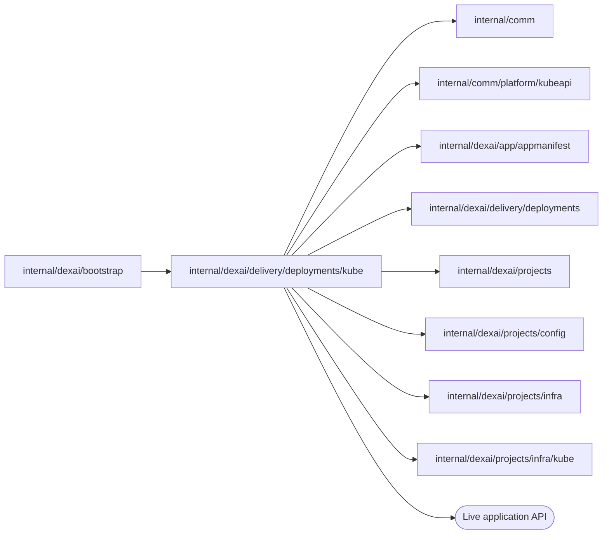

# Kubernetes Live serving

<!-- BEGIN GENERATED PACKAGE SUMMARY (scripts/check-package-readmes.py; edit only Purpose) -->
Purpose: Serves each Live deployment generation as an application Deployment and Service in the project namespace, activates its route and reads its environment and log, for `deployments.Serving`.

Callers: `internal/dexai/bootstrap` imports this package.

Dependencies: it imports `internal/comm`, `internal/comm/platform/kubeapi`, `internal/dexai/app/appmanifest`, `internal/dexai/delivery/deployments`, `internal/dexai/projects`, `internal/dexai/projects/config`, `internal/dexai/projects/infra` and `internal/dexai/projects/infra/kube` and calls the Live application API.

<!-- END GENERATED PACKAGE SUMMARY -->

`LiveServing` is the Kubernetes implementation of `deployments.Serving`. It embeds the
`Infrastructure` of [`infra/kube`](../../../projects/infra/kube/README.md), whose
`Backend` decides what differs between environments: the ingress peer and runtime class
of the application, where the route is probed, and whether a generation has a service
account of its own. The Live route is the same on every lane: the HTTPRoute `live` of the
Live namespace on the platform's one project Gateway (`infra/kube` `RouteGateway`), whose
host the chart's admission fixes to the Project's Live host.

- **Generation.** Each generation is an application Deployment, an immutable environment
  Secret, a network policy and a Service that exists before its Pods, all labelled with
  the deployment ID and the generation, so a resource of another generation is never
  adopted and a Pod of one generation is never selected by another's Service.
- **Application.** Runs the immutable image as an unprivileged, read-only container that
  cannot obtain a service-account token. The grant's storage and project references
  reach it only through the environment Secret.
- **Readiness and activation.** Separate web and Worker Deployments use the same
  pinned image and mounted immutable generation runtime YAML. HTTP selects only web.
  Worker registration readiness and web health are checked independently. Activation
  writes the guarded FDG before the HTTPRoute; only the replaced/candidate route or
  no route on first publication is admitted. Live Flow targets are pull.
- **Cleanup.** StopWorker foreground-deletes the exact Worker Deployment with
  eleven-minute grace and observes absence. Old HTTP remains until retirement.
  Candidate cleanup and Project deletion remove both resources.
- **Diagnostics.** `ReadApplication` reads the application Deployment once and refuses
  one whose UID is not the recorded one; from that Deployment, `Environment` reads the
  Secrets the application container takes its environment from, and `Log` the newest
  Pod's log tail with the state of the container.

| File | Responsibility |
| --- | --- |
| `live_serving.go` | `LiveServing`, generation labels and the generation Service |
| `live_serving_application.go` | Application workload and readiness |
| `live_serving_route.go` | Activation and the Live route |
| `live_serving_worker.go` | Pull registration readiness and exact Worker stop |
| `live_serving_cleanup.go` | Generation and serving cleanup |
| `live_serving_diagnostics.go` | The application's Secret-backed environment and log for the Agent's diagnostics |

## Tests

`live_serving_kind_test.go` provisions a Live scope one part at a time on a real Local
Kind cluster and covers Live generation infrastructure, activation and scope
destruction; `preview_storage_kind_test.go` covers a Preview grant's scope, principal
check, revocation and Session cleanup on the Live MinIO; `live_worker_kind_test.go` runs
three versions of the [generation application](../generationapp/README.md) as
consecutive generations on a project's own Live Dex and proves that a Flow that
generation 1 started runs its next Step on generation 2 while generation 1 still runs,
and that a Step that generation 3 no longer registers takes its failure route within its
retry budget. They live here because they use the Kubernetes API directly.

The stop/failure integration cases seed only disposable Project/deployment admission through `deploymentPhaseProject` and `deploymentPhaseFlow` in test files. Their FlowTypes derive from those Go names. They call the production Project/deployment RPC handlers and run every later production Step and option against real Dex and provider APIs. No provider response, handler or timeout is substituted. Each uses a fresh Project and FlowID with reuse disallowed and leaves only the lane's disposable retained execution state after exact owned-resource cleanup. Persistence, Maps, Channels, Streams, RPC admission and recovery are exactly the owning Project/deployment inventory; only the creation trigger and first Step differ. They add no durable primitive or cloud resource and are phase integration evidence, not a complete publish journey.
