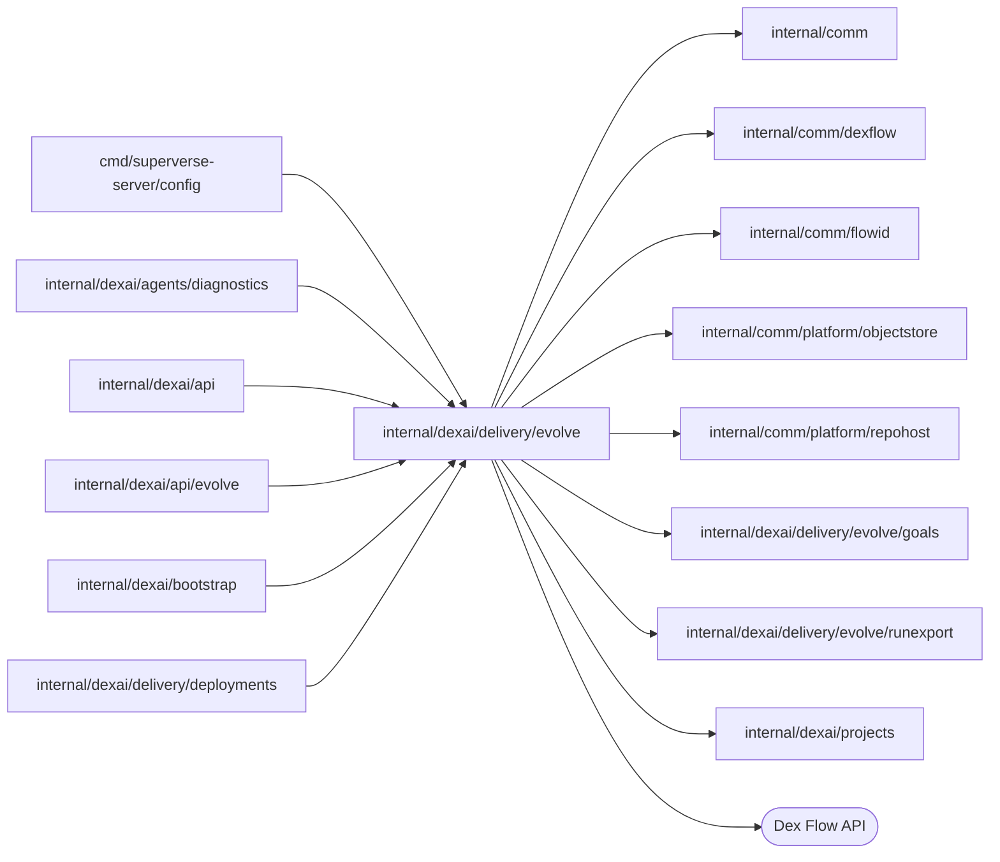

# Goal measurement

<!-- BEGIN GENERATED PACKAGE SUMMARY (scripts/check-package-readmes.py; edit only Purpose) -->
Purpose: Measures a Live application against its goals file: EvolveFlow reads the goals of each Live build, schedules reviews, exports the Live runs and stores their goal metrics.

Callers: `cmd/superverse-server/config`, `internal/dexai/agents/diagnostics`, `internal/dexai/api`, `internal/dexai/api/evolve`, `internal/dexai/bootstrap` and `internal/dexai/delivery/deployments` import this package.

Dependencies: it imports `internal/comm`, `internal/comm/dexflow`, `internal/comm/flowid`, `internal/comm/platform/objectstore`, `internal/comm/platform/repohost`, `internal/dexai/delivery/evolve/goals`, `internal/dexai/delivery/evolve/runexport` and `internal/dexai/projects` and calls the Dex Flow API.

<!-- END GENERATED PACKAGE SUMMARY -->

An application states what it is for in `.superverse/goals.md` ([goals](goals/README.md)).
`EvolveFlow` reads that file from the commit of the build that is Live, and once a period, or
when a person asks with Review now, exports the Project's Live runs into compact records
([run export](runexport/README.md)) and evaluates every goal over them. Studio reads the goal
values and the reviews through `EvolveService`. Agent reviews and proposals are not part of
measurement: every review that measures ends `measured`.

## Invariant: Live published runs only (owner rule 2026-10-22)

Only runs of the Project's Live, published deployment count, and goals come only from the goals
file at the Live build's commit, never from the workspace draft. Preview runs (the Sandbox-local
engine), test runs in the workspace (`make test-app`) and any other engine never feed a goal
value, metric, review, export, backtest, proposal or trial that the platform stores or Studio
shows. Runs that started on an earlier Live release still count: they were published. The code
holds this in three places: `EvolveFlowDependency` is served only by the Project's current Live
engine and takes no scope or engine parameter; `ComputeMetrics` evaluates only the parts this
review's own export Steps wrote from those reads, never a file from outside the Flow; and
`BeginReview` reads the current Live deployment, so a review never measures its runs against the
goals of an earlier Live build. Each export manifest also names its source (`live` here,
`external` from `dexai evolve export`), and `ComputeMetrics` refuses its own manifest when that
label does not name this review's Live export (`runexport.ErrNotLive`). The label is a
consistency check, not a gate: whoever writes a manifest chooses it.

## Identity and lifecycle

- **Flow type** `EvolveFlow`, **FlowID** `flowid.EvolveFlowID(projectID)` = `evolve-<projectID>`,
  for example `evolve-k3m9x2p7q1ab`; one per Project, an independent top-level Flow that owns no
  child Flow.
- **Creation**: the first `LiveChanged` of a Project, from `ProjectDeployFlow`'s
  `AnnounceLiveChange`. `EvolveFlowClient.LiveChanged` first admits the FlowID as the Project's
  `projects.ChildEvolve`, which a deleting Project refuses (the end: nothing starts), then starts
  the Flow with RequestID `flowid.Fingerprint(struct{ ProjectID string }{projectID})`,
  `dex.IDReuseDisallow` and `AlreadyStarted{IgnoreError: true}`, then calls the `LiveChanged`
  RPC. The start carries the announced Live release, so its start Step `ReadGoals` reads that
  build's goals and the RPC that follows is a repeat that changes nothing. A first announcement
  that fails after its retries starts nothing; the next Live deployment's announcement starts
  the Flow.
- **Duplicates and retries**: a repeated start joins the execution; `LiveChanged` is idempotent
  by the Live revision (the deployment's Project lease generation, which grows with every Live
  deployment, rollbacks included). A closed `EvolveFlow` is never started again.
- **Completion**: business and engine completion are the same. Project deletion's child cleanup
  calls `CleanupProjectEvolve` (`projects.EvolveCleanup`), whose `CompleteProjectEvolve` RPC
  cancels every Step and schedules `CompleteEvolve`; a later cleanup pass finds the Flow closed.
  A child admitted without a started Flow has nothing to end. Deletion then removes
  `<projectID>/`, which holds every export.

## Attributes

None is indexed or synced to SQL; Studio reads the Flow by FlowID through `GetEvolve`. Every
write holds the `CommandLock` Attribute's lock: the RPCs `LiveChanged`, `StartReview` and
`CompleteProjectEvolve` and the Steps `CommitGoals`, `AwaitSchedule`, `RecordReviewStart`,
`GateReview` and `RecordReviewFailure`, none of which calls outside the Flow. The Steps that call
the Live engine, storage or the repository host hold no lock and write nothing; they pass their
results on as Step input.

| Name | Type | Use |
|---|---|---|
| `ProjectID` | string | Set at start |
| `Live` | `LiveRelease{Revision, ReleaseID, BuildCommit, CommittedAt}` | The newest Live deployment announced, or adopted by `RecordReviewStart` when the current Live that `BeginReview` read is newer (its announcement failed); a lower or equal revision changes nothing. `ProjectFlow.CurrentLive` owns Live |
| `Goals` | `Goals{Commit, Status none\|valid\|invalid, Spec, Errors, ReadAt}` | The parsed goals block of the Live build as JSON (at most 8 KiB), or at most 10 parser errors, or the read failure |
| `Schedule` | `Schedule{Period, AnchorHour, NextAt, Active}` | `AnchorHour` (0 to 167) is an FNV hash of the Project ID over the hours of the week, so scheduled reviews spread; cycles of the period's length start on a Monday 00:00 UTC. `Active` without valid goals or with `review: off` is false. A goals change that keeps the period keeps `NextAt` |
| `ReviewSeq` | int64 | The last review number |
| `Active` | string | The review in progress, or empty; one review runs at a time |
| `ManualRequests` | `ManualRequests{RequestIDs (newest 16), LastAt}` | Review now duplicates and the once-a-day limit |
| `Reviews` | AttributeMap of `ReviewRecord`, key `r-<n>`, for example `r-12` | Trigger (`schedule`, `manual`) with the request and actor; times; window; the goals commit, and the goals spec copied at `RecordReviewStart` until the review ends; status (`exporting`, `measured`, `skipped`, `failed`) with a reason; the export's parts, runs, bytes, truncation and deletion; a goal summary of at most 2 KiB |
| `CommandLock` | bool | Holds no state; its lock serializes the writes |

Every invocation that reads or writes reviews loads the whole map: allocation keeps the newest 26
and an older review only while its export is stored, so the map stays bounded.

**Reasons.** Skipped: `no_live`, `no_goals`, `goals_invalid`, `previous_review_running`. Failed:
`live_unreachable` (`BeginReview` or `ExportRuns`), `export_failed` (`FinishExport`),
`metrics_failed` (`ComputeMetrics`, goals the evaluator refuses, or a manifest that is not this
review's export of the Live runs), `export_too_large` (one part exceeds an object) and `timed_out`
(a Step passed its wait limit), each with the truncated cause.

Channels, ChannelMaps and Streams: none. Every input is an RPC that writes under the lock and, when
work follows, returns a Step movement.

## Steps and RPCs

| Step | Options | Does |
|---|---|---|
| `ReadGoals(revision, review)` | start Step; provider options, 10 minutes of retries, failure → `CommitGoals` | Reads `.superverse/goals.md` at the build commit from the Project's bound repository after `repohost.CheckInstallation`; `ErrNotFound` is no goals. Parses it with `goals.Parse`. For a superseded revision it ends, or begins again the review that waited for these goals |
| `CommitGoals(revision, review)` | locked state | Only for the newest revision: stores the goals or the read failure, recomputes `Schedule`, cancels `AwaitSchedule` and starts it again while active, and begins again the review that waited (also for a superseded revision) |
| `AwaitSchedule` | WaitFor a business timer at `NextAt`; locked state | Moves `NextAt` to the next cycle, then allocates `r-<n>` and starts `BeginReview`, or records it `skipped` (`previous_review_running`) |
| `BeginReview(id)` | no lock; 2-minute attempts for 10 minutes; heartbeats | Reads the Project's current Live deployment (`CurrentLive`, one bounded Live call), `no_live` without a ready one; with valid goals of that build's commit, deletes the exports of earlier reviews beyond `evolve.keepExports` |
| `RecordReviewStart(id)` | locked state | Marks the deleted exports. Adopts the current Live when its revision is newer than `Live`; when the stored goals are not of the measured Live build's commit, moves to `ReadGoals` of that commit with the review, which begins again once they are stored. Then records the review `skipped` (`no_goals`, `goals_invalid`, `no_live`), or copies the current goals into the review with the window [now − the Live retention of closed runs, now] and starts the export |
| `ExportRuns(id, cursor)` | no lock; 30-minute attempts for 4 hours per part; heartbeats | One Step execution per part (below), then itself again or `FinishExport` |
| `FinishExport(id)` | provider options | Writes `manifest.json` once |
| `ComputeMetrics(id)` | no lock; 5-minute attempts for 15 minutes | Reads the manifest and refuses one that is not this review's export of the Live runs (`metrics_failed`); evaluates the copied goals over the parts at the review's start time, counting each FlowID once with its newest run; writes `metrics.json` once |
| `GateReview(id)` | locked state | Records the review `measured` with its export and goal summary and clears `Active` |
| `RecordReviewFailure(id)` | locked state; the failure route of `BeginReview`, `ExportRuns`, `FinishExport` and `ComputeMetrics` | Records the review `failed` with its code and cause and clears `Active` |
| `CompleteEvolve` | state | Completes the Flow |

| RPC | Caller | Does |
|---|---|---|
| `LiveChanged{Revision, ReleaseID, BuildCommit, CommittedAt}` | `ProjectDeployFlow` through `EvolveFlowClient` | Ignored unless newer; stores `Live`; movement `ReadGoals` |
| `StartReview{RequestID, Actor}` | `EvolveService.StartEvolveReview` | A known RequestID answers its review. Refused `no_goals`, `goals_invalid`, `review_running` or `rate_limited` (one Review now per 24 hours); else allocates `r-<n>`, sets `Active`, movement `BeginReview` |
| `GetEvolve` | `EvolveService.GetEvolve` | Unlocked read of the state and the kept reviews, newest first, also of a completed Flow |
| `CompleteProjectEvolve` | Project deletion | Cancels every Step and completes |

## Run export

Each `ExportRuns` execution exports one part. It holds one of the replica's
`evolve.maxConcurrentExports` export slots, waiting for one while it heartbeats, and reads the
Project's Live engine through `EvolveFlowDependency`, one bounded Live call per search page and
per run, at most 20 reads a second and 2 searches a second.

1. It reads up to five search pages of the goals' Flow types from the cursor, keeps each FlowID's
   newest run that is open or closed within the window, and stops at
   `evolve.maxRunsPerExport` runs in all. No server order is assumed; the part's runs are ordered
   newest start first.
2. It reads and compacts each run with the goals' fields, the Live redaction (configured values
   and the application's environment, as `read_live_app_runs` redacts), `evolve.modelPrices` and
   the Live release timeline up to the review's start; a run the engine no longer holds is left out.
3. It writes the records as `<projectID>/evolve/exports/<reviewID>/part-<nnnn>-<attempt>.jsonl.gz`.
   The attempt number keeps a retried part from writing another part's key, since an object is
   written once; the Step output records each part's key, run count and SHA-256, and only parts
   that a Step output names count.
4. The export ends, truncated, at the run limit, at `evolve.maxReadsPerExport` reads or at 64 MiB
   of compressed parts; a part larger than one object fails the review `export_too_large`.

`FinishExport` writes `manifest.json` with its source (`live`, with the Project, the review and
the goals commit), the window, the Flow types, the parts, the run count, truncation, the Live
releases of the window and the price table date. Its times
come from the review record and its timeline stops at the review's start, so a retry that finds no
manifest writes the same bytes; one that finds it keeps it. A FlowID that two parts hold counts once
in the metrics, with its newest run.

## Dependencies and callers

`EvolveFlowDependency` is the Live reads EvolveFlow's level cannot import: the Project diagnostics
implement it with `runs.Runs.InvokeLive` (each call bounded at 55 seconds), which also serves
`CurrentLive` (the Live target's deployment as its announcement carries it), the redaction of
`read_live_app_runs` and the deployments read model's timeline, and the composition root injects
them. Only the Project's current Live engine may implement it, and it takes no scope or engine
parameter (the invariant above). The Flow takes the Project client, the repository host and object storage directly.
`ProjectDeployFlow` reaches the client through its narrow `liveChangeObserver` port, `ProjectFlow`
through `projects.EvolveCleanup`, and the business API through `EvolveService`.

## Resource scalability

One mostly idle Flow per Project with a Live deployment, with one timer per period while its goals
are valid. Reviews keep the newest 26 records of a few KiB each; exports keep the newest
`evolve.keepExports` under the Project's prefix and Project deletion removes the rest. Each replica
runs at most `evolve.maxConcurrentExports` exports at 20 reads a second each against the Project's
own Live engine; a review's Steps make no control-plane call.
