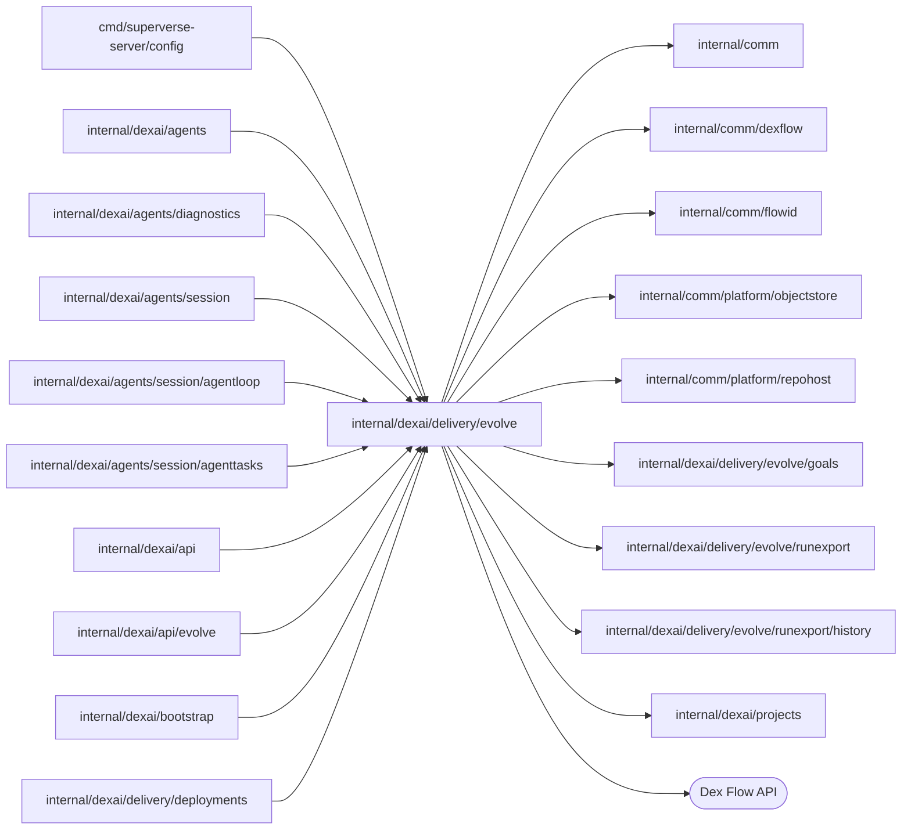
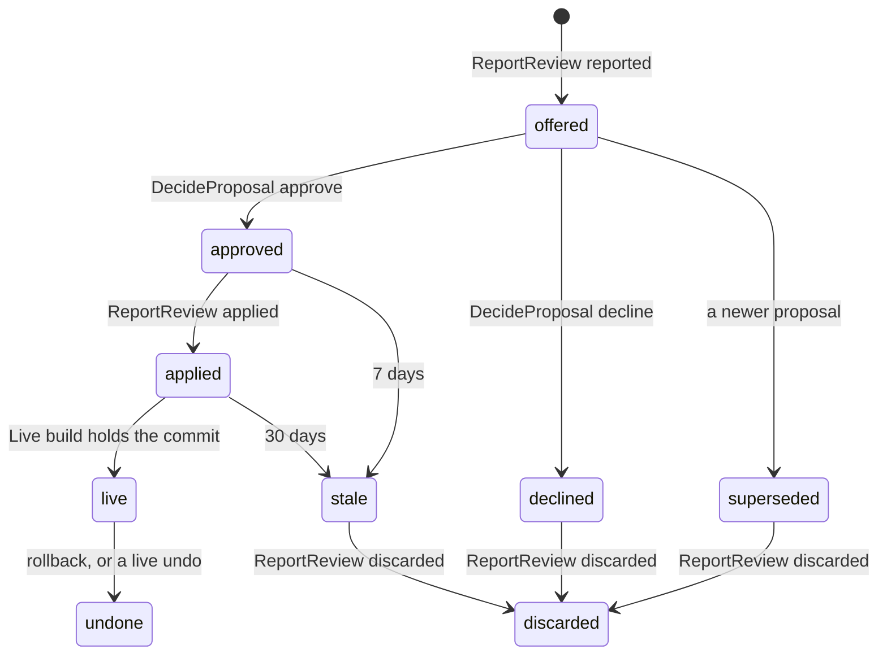

# Goal measurement

<!-- BEGIN GENERATED PACKAGE SUMMARY (scripts/check-package-readmes.py; edit only Purpose) -->
Purpose: Measures a Live application against its goals file and keeps the agent's proposals: EvolveFlow reads each Live build's goals, schedules reviews, exports runs, stores metrics and tracks decisions.

Callers: `cmd/superverse-server/config`, `internal/dexai/agents`, `internal/dexai/agents/diagnostics`, `internal/dexai/agents/session`, `internal/dexai/agents/session/agentloop`, `internal/dexai/agents/session/agenttasks`, `internal/dexai/api`, `internal/dexai/api/evolve`, `internal/dexai/bootstrap` and `internal/dexai/delivery/deployments` import this package.

Dependencies: it imports `internal/comm`, `internal/comm/dexflow`, `internal/comm/flowid`, `internal/comm/platform/objectstore`, `internal/comm/platform/repohost`, `internal/dexai/delivery/evolve/goals`, `internal/dexai/delivery/evolve/runexport`, `internal/dexai/delivery/evolve/runexport/history` and `internal/dexai/projects` and calls the Dex Flow API.

<!-- END GENERATED PACKAGE SUMMARY -->

An application states what it is for in `.superverse/goals.md` ([goals](goals/README.md)).
`EvolveFlow` reads that file from the commit of the build that is Live, and once a period, or
when a person asks with Review now, exports the Project's Live runs into compact records
([run export](runexport/README.md)) and evaluates every goal over them. Studio reads the goal
values, the reviews and their proposals through `EvolveService`. The Flow also keeps the
lifecycle of the agent's proposals ([proposals](#proposals)): the Session's report, a person's
decision, the change applied to Preview and the Live build that holds it. A review outside review
access ends `measured`; inside it, the review waits for the Session's report ([telling the
Session](#proposals)).

## Invariant: Live published runs only (owner rule 2026-10-22)

Only runs of the Project's Live, published deployment count, and goals come only from the goals
file at the Live build's commit, never from the workspace draft. Preview runs (the Sandbox-local
engine), test runs in the workspace (`make test-app`) and any other engine never feed a goal
value, metric, review, export, backtest, proposal or trial that the platform stores or Studio
shows. Runs that started on an earlier Live release still count: they were published. The code
holds this in three places: `EvolveFlowDependency` is served only by the Project's current Live
engine and takes no scope or engine parameter; `ComputeMetrics` evaluates only the parts this
review's own export Steps wrote from those reads, never a file from outside the Flow; and
`BeginReview` reads the current Live deployment, so a review never measures its runs against the
goals of an earlier Live build. Each export manifest also names its source (`live` here,
`external` from `dexai evolve export`), and `ComputeMetrics` refuses its own manifest when that
label does not name this review's Live export (`runexport.ErrNotLive`). The label is a
consistency check, not a gate: whoever writes a manifest chooses it.

## Identity and lifecycle

- **Flow type** `EvolveFlow`, **FlowID** `flowid.EvolveFlowID(projectID)` = `evolve-<projectID>`,
  for example `evolve-k3m9x2p7q1ab`; one per Project, an independent top-level Flow that owns no
  child Flow.
- **Creation**: the first `LiveChanged` of a Project, from `ProjectDeployFlow`'s
  `AnnounceLiveChange`. `EvolveFlowClient.LiveChanged` first admits the FlowID as the Project's
  `projects.ChildEvolve`, which a deleting Project refuses (the end: nothing starts), then starts
  the Flow with RequestID `flowid.Fingerprint(struct{ ProjectID string }{projectID})`,
  `dex.IDReuseDisallow` and `AlreadyStarted{IgnoreError: true}`, then calls the `LiveChanged`
  RPC. The start carries the announced Live release, so its start Step `ReadGoals` reads that
  build's goals and the RPC that follows is a repeat that changes nothing. A first announcement
  that fails after its retries starts nothing; the next Live deployment's announcement starts
  the Flow.
- **Duplicates and retries**: a repeated start joins the execution; `LiveChanged` is idempotent
  by the Live revision (the deployment's Project lease generation, which grows with every Live
  deployment, rollbacks included). A closed `EvolveFlow` is never started again.
- **Completion**: business and engine completion are the same. Project deletion's child cleanup
  calls `CleanupProjectEvolve` (`projects.EvolveCleanup`), whose `CompleteProjectEvolve` RPC
  cancels every Step and schedules `CompleteEvolve`; a later cleanup pass finds the Flow closed.
  A child admitted without a started Flow has nothing to end. Deletion then removes
  `<projectID>/`, which holds every export.

## Attributes

None is indexed or synced to SQL; Studio reads the Flow by FlowID through `GetEvolve`. Every
write holds the `CommandLock` Attribute's lock: the RPCs `LiveChanged`, `StartReview`,
`ReportReview`, `DecideProposal` and `CompleteProjectEvolve` and the Steps `CommitGoals`,
`AwaitSchedule`, `RecordReviewStart`, `GateReview`, `AwaitReviewReport`, `RecordReviewFailure` and
`RecordNotifyFailure`, none of which calls outside the Flow. The Steps that call the Live engine,
storage, the repository host or the Session hold no lock and write nothing; they pass their
results on as Step input.

| Name | Type | Use |
|---|---|---|
| `ProjectID` | string | Set at start |
| `Live` | `LiveRelease{Revision, ReleaseID, BuildCommit, CommittedAt, ReplacedRevision}` | The newest Live deployment announced, or adopted by `RecordReviewStart` when the current Live that `BeginReview` read is newer (its announcement failed), with the revision of the Live deployment it replaced (zero for none, and in announcements from before it); a lower or equal revision changes nothing. `ProjectFlow.CurrentLive` owns Live |
| `Goals` | `Goals{Commit, Status none\|valid\|invalid, Spec, Errors, ReadAt}` | The parsed goals block of the Live build as JSON (at most 8 KiB), or at most 10 parser errors, or the read failure |
| `Schedule` | `Schedule{Period, AnchorHour, NextAt, Active}` | `AnchorHour` (0 to 167) is an FNV hash of the Project ID over the hours of the week, so scheduled reviews spread; cycles of the period's length start on a Monday 00:00 UTC. `Active` without valid goals or with `review: off` is false. A goals change that keeps the period keeps `NextAt` |
| `ReviewSeq` | int64 | The last review number |
| `Active` | string | The review in progress, or empty; one review runs at a time |
| `ManualRequests` | `ManualRequests{RequestIDs (newest 16), LastAt}` | Review now duplicates and the once-a-day limit |
| `Reviews` | AttributeMap of `ReviewRecord`, key `r-<n>`, for example `r-12` | Trigger (`schedule`, `manual`) with the request and actor; times; window; the goals commit, and the goals spec copied at `RecordReviewStart` until the review ends; status (`exporting`, `measured`, `waiting_agent`, `proposal`, `no_change`, `expired`, `skipped`, `failed`) with a reason; the export's parts, runs, bytes, truncation and deletion, with the SHA-256 and count of the runs its metrics evaluated, one per FlowID (`runexport.WriteCanonical`, the bytes of a placed `runs.jsonl`); a goal summary of at most 2 KiB, each value with the digest of the goal's definition (`goals.definitionDigest`: metric, direction or guardrail, target); the agent review's model usage per model (calls, input and output tokens), its billable record |
| `Proposals` | AttributeMap of `ProposalRecord`, key = its review's key, for example `r-12` | Kind (`change`, `trial`, `undo` with `Undoes` naming a review); title (one line of at most 120 characters); summary (2 KiB); the change subagent's agent ID; the summary of the change's backtest (`goals.BacktestSummary`, at most 8 KiB as JSON, separate from the 2 KiB summary text): its export binding, the runs by label, the calibration, the estimation's interval and sample sizes, the gates that fired and each goal's comparison without its known value; the stored document's exact object; status (below) with its time; `Revision`, which every change increments; `NotifyFailed`; the decision `{Decision, Actor, At, Reason, Revision}`; the applied commit and time; the Live revision and time it went live, and `PreviousLiveReleaseID`, the Live release that ran just before that revision when its build lacked the change, which Studio's Undo rolls Live back to (empty when not known, as in records from before it) |
| `CommandLock` | bool | Holds no state; its lock serializes the writes |

Every invocation that reads or writes reviews loads both maps whole, except `DecideProposal` and
`GetProposal`, which load the one proposal they name. Allocation keeps the newest 26 reviews, an
older review only while its export is stored or it has a kept proposal; `BeginReview` and
`RecordReviewStart` prune the proposals beyond the newest 26 whose lifecycle ended (an `offered`,
`approved` or `applied` one is kept), so both maps stay bounded at a few KiB per entry.

**Review statuses.** `exporting` until the review measured, was skipped or failed. Outside
review access (`evolve.reviewAccess` `none`, `listed` with `evolve.reviewTeamSpaces`, or `all`;
`Settings.ReviewsOn`, the local lanes' profiles set `all`) a review that measures ends `measured`. Otherwise it waits
(`waiting_agent`) for the Session's report, which ends it `proposal` or `no_change`; one the agent
did not report within a day ends `expired`, and one whose Session cannot take it ends `skipped`.

**Reasons.** Skipped: `no_live`, `no_goals`, `goals_invalid`, `previous_review_running`, and for a
Session that cannot take the review `session_unavailable` (not ACTIVE, or not told within
`RequestReview`'s six hours), `remote_session` (it runs a local agent, at delivery or when it
switches while the review waits) and `no_model_key` (no active key of the provider of the Session's model, the mock model exempt). Failed:
`live_unreachable` (`BeginReview` or `ExportRuns`), `export_failed` (`FinishExport`),
`metrics_failed` (`ComputeMetrics`, goals the evaluator refuses, or a manifest that is not this
review's export of the Live runs), `export_too_large` (one part exceeds an object) and `timed_out`
(a Step passed its wait limit), each with the truncated cause.

Channels, ChannelMaps and Streams: none. Every input is an RPC that writes under the lock and, when
work follows, returns a Step movement.

## Steps and RPCs

| Step | Options | Does |
|---|---|---|
| `ReadGoals(revision, review)` | start Step; provider options, 10 minutes of retries, failure → `CommitGoals` | Reads `.superverse/goals.md` at the build commit from the Project's bound repository after `repohost.CheckInstallation`; `ErrNotFound` is no goals. Parses it with `goals.Parse`. For every `applied` or `live` proposal, asks `repohost.Host.IsAncestor` whether the build commit holds its applied commit; a commit the repository no longer has is not held. With the release Live ran before, asks the same of its build for each `applied` proposal the new build holds. A review's reading of a revision whose own reading is still pending checks no proposal. For a superseded revision it ends, or begins again the review that waited for these goals |
| `CommitGoals(revision, review)` | locked state | Only for the newest revision: stores the goals or the read failure, recomputes `Schedule`, cancels `AwaitSchedule` and starts it again while active. Moves an `applied` proposal the build holds to `live`, recording the reading's previous release as its `PreviousLiveReleaseID` when that release's build lacked its commit, and a `live` one it lacks (a rollback) to `undone`; a live `undo` makes the proposal it undoes `undone`. A read failure moves nothing. Begins again the review that waited (also for a superseded revision) |
| `AwaitSchedule` | WaitFor a business timer at `NextAt`; locked state | Moves `NextAt` to the next cycle, then allocates `r-<n>` and starts `BeginReview`, or records it `skipped` (`previous_review_running`) |
| `BeginReview(id)` | no lock; 2-minute attempts for 10 minutes; heartbeats | Reads the Project's current Live deployment (`CurrentLive`, one bounded Live call), `no_live` without a ready one; with valid goals of that build's commit, deletes the exports of earlier reviews beyond `evolve.keepExports`; deletes the exact stored documents of the proposals to prune |
| `RecordReviewStart(id)` | locked state | Removes the pruned proposals and makes long-waiting ones `stale` ([proposals](#proposals)), and marks the deleted exports. Adopts the current Live when its revision is newer than `Live` and moves to `ReadGoals` of its build with the review, with the release Live ran before as `LiveChanged` records it, since the adopted revision's own announcement then changes nothing; otherwise, when the stored goals are not of the announced Live build's commit, moves to `ReadGoals` of that commit with the review, checking no proposal, since that revision's own pending reading moves them. The review begins again once the goals are stored. Then records the review `skipped` (`no_goals`, `goals_invalid`, `no_live`), or copies the current goals into the review with the window [now − the Live retention of closed runs, now] and starts the export |
| `ExportRuns(id, cursor)` | no lock; 30-minute attempts for 4 hours per part; heartbeats | One Step execution per part (below), then itself again or `FinishExport` |
| `FinishExport(id)` | provider options | Writes `manifest.json` once |
| `ComputeMetrics(id)` | no lock; 5-minute attempts for 15 minutes | Reads the manifest and refuses one that is not this review's export of the Live runs (`metrics_failed`); evaluates the copied goals over the parts at the review's start time, counting each FlowID once with its newest run (`runexport.Canonical`), with the runs digest and count; stores those runs once as the `runs.jsonl` a review places, in gzip objects `runs-<nnnn>.jsonl.gz` of 24 MiB each before compression (under the 32 MiB object bound; a retry stores the same objects, and one whose stored content decompresses to the same bytes stands), then the index `runs.json` with their digest, count, size and number; writes `metrics.json` once; reads whether review access covers the Project's TeamSpace |
| `GateReview(id)` | locked state | Records the export and goal summary. Outside review access the review ends `measured` and clears `Active`; otherwise it waits (`waiting_agent`, keeping its goals copy) and `RequestReview` follows |
| `RequestReview(id)` | no lock; `dexflow.PollUntil` every 30 seconds with 10-second rounds, `PollingStepOptions(6 hours)`; failure → `RecordReviewFailure` | Tells the Project's Session through `EvolveFlowDependency.ReportEvolveNotification` that the review waits for the agent, with the notice `evolve/<projectID>/<reviewID>`: the window, runs, goals commit, each goal's value and its change since the previous review of the same definition, the newest three proposals and the procedure, at most 3 KiB. A full queue (`ErrSessionBusy`) polls again; a `*SessionSkip` ends the review `skipped` with its reason; a delivered notice moves to `AwaitReviewReport`. Past its limit the review is `skipped` (`session_unavailable`) |
| `AwaitReviewReport(id)` | WaitFor a business timer of 24 hours; locked state | The report (`ReportReview` `reported` or `skipped`) cancels it; at the timer a review still waiting ends `expired` |
| `RecordReviewFailure(id)` | locked state; the failure route of `BeginReview`, `ExportRuns`, `FinishExport`, `ComputeMetrics` and `RequestReview` | Records the review `failed` with its code and cause, or `skipped` for a Session that cannot take it, and clears `Active` |
| `NotifyDecision(notice)` | no lock; `dexflow.PollUntil` every 30 seconds with 10-second rounds, `PollingStepOptions(24 hours)`; failure → `RecordNotifyFailure` | Tells the Project's Session of a decision through `EvolveFlowDependency.ReportEvolveNotification`, with the notice `evolve-decision/<projectID>/<reviewID>/<revision>` and what the agent does next. A Session that cannot take it (`*SessionSkip`) goes to `RecordNotifyFailure`; a full queue polls again; any other error is retried |
| `RecordNotifyFailure(notice)` | locked state | Sets `NotifyFailed` on the proposal while it is still at the notice's revision, so Studio asks the person to tell the agent in the chat |
| `CompleteEvolve` | state | Completes the Flow |

| RPC | Caller | Does |
|---|---|---|
| `LiveChanged{Revision, ReleaseID, BuildCommit, CommittedAt, ReplacedRevision}` | `ProjectDeployFlow` through `EvolveFlowClient` | Ignored unless newer; stores `Live`; movement `ReadGoals` with the release Live ran before, when it is another release and the one this deployment replaced (the stored `Live` is at its `ReplacedRevision`); after a skipped announcement, a Live removal or with an announcement from before `ReplacedRevision` it records none, and `ReadGoals` checks the build of the one it records, since a failed goals read or an applied report that arrived late leaves a proposal applied that an earlier build already held |
| `StartReview{RequestID, Actor}` | `EvolveService.StartEvolveReview` | A known RequestID answers its review. Refused `no_goals`, `goals_invalid`, `review_running` or `rate_limited` (one Review now per 24 hours); else allocates `r-<n>`, sets `Active`, movement `BeginReview` |
| `GetEvolve` | `EvolveService.GetEvolve` | Unlocked read of the state and the kept reviews and proposals, newest first, also of a completed Flow |
| `GetProposal(reviewID)` | `EvolveService.GetEvolveProposal` through `EvolveFlowClient.ReadProposal` | Unlocked exact read of one proposal, the zero record when the review has none; the client then reads the stored document by its exact object |
| `ReportReview{ReviewID, Phase, Verdict, Proposal, Usage, AppliedCommit, Defect}` | the Session's report through `EvolveFlowClient.ReportReview` | Below |
| `DecideProposal{ReviewID, Revision, Decision, Reason, Actor}` | `EvolveService.DecideEvolveProposal` | Below; movement `NotifyDecision` |
| `CompleteProjectEvolve` | Project deletion | Cancels every Step and completes |

## Proposals

An agent review ends with the Session's report, and a proposal follows it through a person's
decision, the agent's apply to Preview and Publish:

- **`ReportReview` `reported`**: the review must be `Active` and `waiting_agent`, else
  `stale_review`; this check comes first. A proposal comes with the change's `proposal.md`,
  `backtest.json` and `open-runs.json`: files the Session could not read, a document over 32 KiB
  or a summary over 8 KiB are `too_large`, and files that do not decode strictly into a bound
  backtest and open-run check `invalid_backtest`. Then `goals.CheckReview` checks both against the
  record while it still holds its goals copy: their export binding names this review, its goals
  commit as the goals and the before commit, and its runs digest and count; the backtest's goals
  are exactly the copy's, each with the copy's definition digest and the review's value before,
  else `export_mismatch`; the calibration is at least 98%, the guardrail gate holds over each
  guardrail goal's known value against the copy's guardrail (never the backtest's own verdict),
  and no gate refuses (a `trial_required` gate needs a trial), else `invalid_backtest` with the
  gate's code in the detail. It then stores the verdict (`proposal` or `no_change`) and the model
  usage, clears `Active`, creates the `offered` proposal at revision 1 with the backtest's summary,
  makes every older `offered` one `superseded` and sweeps; the answer names the reviews whose
  proposals are then `offered` or `approved`, whose change subagents the Session keeps pinned (a
  repeat names them too). The client decodes the files and stores
  the proposal document (Markdown, at most 32 KiB) at
  `<projectID>/evolve/proposals/<reviewID>-<sha256 of the document, 16 hex>.md`, a key of its
  content, so a repeated report stores the same object and a refused report never blocks a
  corrected one; the record keeps its exact object. A refused report may leave its document, which
  no record names and Project deletion removes. The same report repeated answers the record.
- **`ReportReview` `applied`** needs an `approved` proposal and records the commit; **`discarded`**
  needs a `declined`, `superseded` or `stale` one. Otherwise `stale_proposal`; a repeat answers the
  record.
- **`DecideProposal`** is a compare-and-set on the proposal's `Revision` and status `offered`, else
  `stale_proposal`. It records the decision with the actor, time, reason and the revision the person
  saw, increments `Revision` and starts `NotifyDecision`. The same decision on the same revision
  repeated answers the record and starts nothing.
- **Expiry** (`RecordReviewStart` and `reported`): `approved` but not `applied` within 7 days of the
  decision, and `applied` but not `live` within 30 days of the apply, become `stale`; Studio asks the
  person to ask the agent in the chat.
- **Telling the Session.** `RequestReview` and `NotifyDecision` call
  `EvolveFlowDependency.ReportEvolveNotification`, which the Session Service serves: the Session
  takes an evolve notification only while its Agent waits for the user. A Session that cannot take
  a decision leaves the proposal `NotifyFailed`, and Studio asks the person to tell the agent in the
  chat. Nothing claims a delivery that did not happen.
- **`ReportReview` `skipped`**: a waiting review whose Session can no longer take it, reported by the
  Session Service when the executor switches to a local agent (`SkipWaitingReview`), ends `skipped`
  with the reason (`remote_session`) and cancels the wait.

## Run export

Each `ExportRuns` execution exports one part. It holds one of the replica's
`evolve.maxConcurrentExports` export slots, waiting for one while it heartbeats, and reads the
Project's Live engine through `EvolveFlowDependency`, one bounded Live call per search page and
per run, at most 20 reads a second and 2 searches a second.

1. It reads up to five search pages of the goals' Flow types from the cursor, keeps each FlowID's
   newest run that is open or closed within the window, and stops at
   `evolve.maxRunsPerExport` runs in all. No server order is assumed; the part's runs are ordered
   newest start first.
2. It reads and compacts each run with the goals' fields, the Live redaction (configured values
   and the application's environment, as `read_live_app_runs` redacts), `evolve.modelPrices` and
   the Live release timeline up to the review's start; a run the engine no longer holds is left out.
3. It writes the records as `<projectID>/evolve/exports/<reviewID>/part-<nnnn>-<attempt>.jsonl.gz`.
   The attempt number keeps a retried part from writing another part's key, since an object is
   written once; the Step output records each part's key, run count and SHA-256, and only parts
   that a Step output names count.
4. The export ends, truncated, at the run limit, at `evolve.maxReadsPerExport` reads or at 64 MiB
   of compressed parts; a part larger than one object fails the review `export_too_large`.

`FinishExport` writes `manifest.json` with its source (`live`, with the Project, the review and
the goals commit), the window, the Flow types, the parts, the run count, truncation, the Live
releases of the window and the price table date. Its times
come from the review record and its timeline stops at the review's start, so a retry that finds no
manifest writes the same bytes; one that finds it keeps it. A FlowID that two parts hold counts once
in the metrics, with its newest run.

## Dependencies and callers

`EvolveFlowDependency` is what EvolveFlow's level cannot import: the Project diagnostics
implement it with `runs.Runs.InvokeLive` (each call bounded at 55 seconds), which also serves
`CurrentLive` (the Live target's deployment as its announcement carries it, with the revision it
replaced read from the deployment's `ProjectDeployFlow`, since the read model does not sync
`ReplacedLive`), the redaction of
`read_live_app_runs`, the deployments read model's timeline and `ReportEvolveNotification`, which
the Session Service serves; the composition root injects them.
Only the Project's current Live engine may serve its Live reads, and they take no scope or engine
parameter (the invariant above). The Flow takes the Project client, the repository host and object storage directly.
`ProjectDeployFlow` reaches the client through its narrow `liveChangeObserver` port, `ProjectFlow`
through `projects.EvolveCleanup`, and the business API through `EvolveService`.

## Resource scalability

One mostly idle Flow per Project with a Live deployment, with one timer per period while its goals
are valid. Reviews and proposals keep the newest 26 records of a few KiB each, beside the
proposals still in play; each proposal stores one document of at most 32 KiB under the Project's
prefix, deleted when the proposal is pruned. Exports keep the newest `evolve.keepExports` under the
Project's prefix and Project deletion removes the rest. A decision runs one `NotifyDecision` Step. Each replica
runs at most `evolve.maxConcurrentExports` exports at 20 reads a second each against the Project's
own Live engine; a review's Steps make no control-plane call beyond `BeginReview`'s one read of
the Live deployment's Flow.
