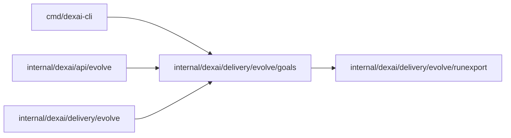

# Application goals and their metrics

<!-- BEGIN GENERATED PACKAGE SUMMARY (scripts/check-package-readmes.py; edit only Purpose) -->
Purpose: Parses an application's goals file, validates it with file line numbers, and evaluates each goal's metric over an export of its runs.

Callers: `cmd/dexai-cli`, `internal/dexai/api/evolve` and `internal/dexai/delivery/evolve` import this package.

Dependencies: it imports `internal/dexai/delivery/evolve/runexport`.

<!-- END GENERATED PACKAGE SUMMARY -->

An application keeps its goals in `.superverse/goals.md` (`FilePath`): prose for people
and exactly one fenced block with the info string `yaml goals` for the platform. `Parse`
finds that block, decodes it strictly (an unknown key is an error) and validates it; every
`Problem` carries its line in the file, so the agent can fix the file from the message.

The block names the Flow types a review reads, the Attributes the export may carry
(`fields`), named outcomes read from each run (an Attribute's value, a Step entered or an
Action accepted), and one to eight goals. Each goal has a kind (`outcome`, `experience`,
`cost`), a statement, a metric and either a direction or a guardrail. `ExportFields` is the
set of Attributes an export reads: the fields plus every outcome's Attribute.

The metric language is closed: `count(o)`, `rate(o, of p)`, `sum`, `mean`, `p50`, `p90` and
`max` of a per-run number, each with an optional `where <condition>`, and the ratio `a / b`.
Keywords take no colon, so a metric stays a plain YAML value. The per-run numbers are
`duration_h`, `steps.<Step>` (times the run entered the Step), `actions.<RPC>`,
`wait_h.<Step>`, `ai.calls`, `ai.input_tokens`, `ai.output_tokens`, `ai.usd` and
`field.<name>`.

`Evaluate` computes every goal over a list of `runexport.Record`s: the value, the number of
runs it rests on (a rate rests on its denominator, a ratio on its denominator's runs),
whether it rests on fewer than 20 runs (`fewRuns`), whether a guardrail holds, and the same value
per release at the run's start and per trial arm when there are at least two. Steps,
Actions and waits a run never had count as zero; a run without a number (no AI price, no
numeric field) is left out of that number's aggregate.

The package imports only the standard library, the YAML library and `runexport`, so the
coding image can build the same code for the agent. Only Live published runs count (owner rule
2026-10-22): on the platform it evaluates only an export of the Project's Live runs that
EvolveFlow made, never the runs of a Preview, test or other engine.
