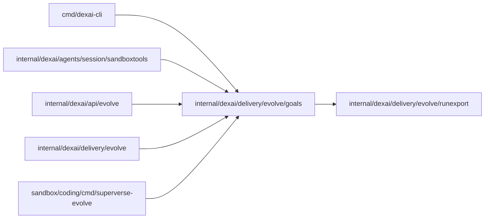

# Application goals and their metrics

<!-- BEGIN GENERATED PACKAGE SUMMARY (scripts/check-package-readmes.py; edit only Purpose) -->
Purpose: Parses and validates an application's goals file, evaluates each goal over an export of its runs, and gates a proposal by its backtest and its open runs.

Callers: `cmd/dexai-cli`, `internal/dexai/agents/session/sandboxtools`, `internal/dexai/api/evolve`, `internal/dexai/delivery/evolve` and `sandbox/coding/cmd/superverse-evolve` import this package.

Dependencies: it imports `internal/dexai/delivery/evolve/runexport`.


<!-- END GENERATED PACKAGE SUMMARY -->

An application keeps its goals in `.superverse/goals.md` (`FilePath`): prose for people
and exactly one fenced block with the info string `yaml goals` for the platform. `Parse`
finds that block, decodes it strictly (an unknown key is an error) and validates it; every
`Problem` carries its line in the file, so the agent can fix the file from the message.

The block names the Flow types a review reads, the Attributes the export may carry
(`fields`), named outcomes read from each run (an Attribute's value, a Step entered or an
Action accepted), and one to eight goals. Each goal has a kind (`outcome`, `experience`,
`cost`), a statement, a metric and either a direction or a guardrail. `ExportFields` is the
set of Attributes an export reads: the fields plus every outcome's Attribute.

The metric language is closed: `count(o)`, `rate(o, of p)`, `sum`, `mean`, `p50`, `p90` and
`max` of a per-run number, each with an optional `where <condition>`, and the ratio `a / b`.
Keywords take no colon, so a metric stays a plain YAML value. The per-run numbers are
`duration_h`, `steps.<Step>` (times the run entered the Step), `actions.<RPC>`,
`wait_h.<Step>`, `ai.calls`, `ai.input_tokens`, `ai.output_tokens`, `ai.usd` and
`field.<name>`.

`Evaluate` computes every goal over a list of `runexport.Record`s: the value, the number of
runs it rests on (a rate rests on its denominator, a ratio on its denominator's runs),
whether it rests on fewer than 20 runs (`fewRuns`), whether a guardrail holds, and the same value
per release at the run's start and per trial arm when there are at least two. Steps,
Actions and waits a run never had count as zero; a run without a number (no AI price, no
numeric field) is left out of that number's aggregate. Each value carries the definition digest, a
short SHA-256 of the goal's metric, direction or guardrail and target, so a value is never read
under another definition of the same goal ID; the backtest comparison gives each goal the same
digest.

## Backtest comparison

A proposal's backtest runs the application's own decision functions over the exported runs,
once on the tree before the change and once on the proposal's tree. The program writes one
decision line per run, as JSON Lines:

```json
{"flow_id": "prospect-089cb90af4fc0b35",
 "decisions": {"lane": "fast", "follow_up_1": true, "follow_up_2": false},
 "points": {"follow_up_1": {"step": "DecideFollowUp", "entry": 1},
            "follow_up_2": {"step": "DecideFollowUp", "entry": 2}},
 "numbers": {"steps.AwaitReply": 2, "ai.calls": 2, "ai.usd": 0.018}, "path": "2-messages"}
```

- `decisions` are the decisions the run takes on its path, by name, each a scalar (string,
  number, bool or null). Two lines of a run decide the same when they hold the same names
  with equal values. A decision taken at several points is one name per point.
- `points` say where the run takes each decision: its `entry`-th entry into `step`, counted
  from 1 over the whole path. Up to the first decision two lines answer differently, the
  paths before and after the change are the recorded one, so that point is on the record's
  `path` and is where the change takes effect. A point names a decision of the line; a
  decision without a point is allowed, but a changed run whose changed decisions lack one
  cannot be estimated.
- `numbers` are the per-run numbers the decisions determine, named as in the metric
  language: `steps.<Step>`, `actions.<RPC>`, `wait_h.<Step>`, `ai.calls`,
  `ai.input_tokens`, `ai.output_tokens`, `ai.usd` and `duration_h`. A line carries no
  `field.<name>`: the backtest reads fields as recorded facts that the decisions do not change.
- `path`, optional, is a short key of the path the decisions take, such as `2-messages`, for
  people reading the lines; the comparison does not read it.

`ReadDecisions` reads a file strictly: an unknown key, a null or non-finite number, a
non-scalar decision, a missing `flow_id`, a point without a step, with an entry below 1 or
naming no decision of the line, or a FlowID on two lines is an error.

`Compare` joins the records with the before and after lines by FlowID. Runs missing from
either side are counted (`missing_before`, `missing_after`, `lines_without_record`) and
left out of everything else.

- **Calibration** checks every before number with a recorded counterpart against the record,
  computed as the evaluator computes it (relative tolerance 1e-6; `duration_h` of an open run
  and `ai.usd` without a price have none). The share of checked runs whose every number
  matches is the calibration; the mismatches are counted by number name.
- **Landmark**: a changed run's landmark is the point of its first changed decision, the
  earliest on its recorded path of the decisions its two lines answer differently, at the time
  the path entered it. A changed decision only the after line takes, at a point the recorded
  path never reached, comes after the paths part; the at-risk pools check it on the runs that
  did reach it. The run has no landmark (`unplaced`) when a changed decision has no point, when
  the recorded path lacks the point of a decision the before line took (a truncated path), when
  two changed decisions share the earliest point, or when the after line does not take the
  first one. Nothing can follow a landmark that is the last entry on the closed record's path
  when the after line takes no decision at a point past it and carries `steps.*` numbers equal
  to the before line's: the after path is then the recorded one, so every Step outcome keeps
  its recorded value (a cost-only change at the closing Step is `changed_exact`).
- **At-risk pools**: a run's pool is the recorded closed runs with a before line in its
  stratum (the values of `CompareOptions.Strata`) that reached its landmark's point and took
  the run's after answer there. For a set of outcome literals the metric reads of the run (the
  selection of a term, and its hit for `count` and `rate`), an outcome that already held for
  the run before its landmark keeps its recorded value, since the change cannot undo it; when
  every literal is so decided the chance is 0 or 1. Otherwise the chance is the mean, over the
  pool runs that stood where the run stood on every outcome the literals read (each held, or
  not yet, by their own time at the landmark), of whether every literal holds. Matching on
  where runs stood at the landmark, rather than on the path they took after it, keeps runs
  whose outcome came before the decision (a prospect who replied before the second follow-up
  decision) from inflating the estimate.
- **Chained landmarks**: past the landmark, a pool run must follow the run's after line. At the
  first later point where the after line takes a decision that the pool run's before line did
  not take there with the same answer, the pool run keeps its record up to that point: when
  the literals are decided there it counts 0 or 1, else it counts the chance from the at-risk
  pool at that point under the after line's answer, in turn (sequential g-computation). The
  chance is unknown when such a pool is smaller than 10 runs, when two such points tie, when
  the after line takes without a point a decision a pool run answered otherwise, or when the
  chain would revisit a point. A decision the run's after line does not take is not checked.
- **Outcome times** come from one function, `heldBefore`: a Step outcome holds from the run's
  first entry into the Step, from its path (entries a truncated path dropped are older than
  every entry it kept). Attribute and Action outcomes have no time in the record yet, so a
  chance that reads one is unknown and the outcome is listed in `untimed_outcomes`.
- **Per goal and run**, an unchanged run is known. A changed run is unknown when the after line
  lacks a number the goal's metric reads; otherwise known when the metric reads no outcome
  (no `count` or `rate`, no outcome in `where`); when it reads one, known when the landmark
  decides every chance the metric needs, estimated when every other chance has its pools of
  at least 10 runs, and unknown when the run is unplaced, a chance reads an untimed outcome or
  a pool is smaller.
- **Labels**: `same` (decisions equal), `changed_exact` (known for every goal),
  `changed_estimated` (no goal unknown), `unknown` (some goal unknown).
- **Values**: `before` is `Evaluate` over every record; `baseline` the before value over the
  runs the after value covers (the compared runs not unknown for the goal); `after` uses the
  recorded facts of unchanged runs, the after numbers of known changed runs, and for an
  estimated run its after numbers with the chance of each outcome condition the metric reads
  decided at its landmark or taken from its at-risk pools, so its count, rate and selection are
  expected values. Each chance has a 90% Wilson interval; a chained pool run adds its own
  chance at the same end. `after_low` and `after_high` evaluate every estimated run at the low,
  then the high end, and keep the extremes: a `count` or `rate` takes its hit at that end and
  its selection at the point, so a rate's end does not shrink its denominator with its
  numerator, and a ratio's denominator takes the other end. `known_value` is the after value
  over the known runs only; `known`, `estimated` and `unknown` count the compared runs whose
  recorded facts select them for the goal's metric.
- **Non-inferiority**: for every goal with a direction whose metric reads an outcome, targeted
  or not, `worst_effect` is the harmful end of its after value (the low end for `up`, the high
  end for `down`) over every compared run, each unknown run at its worst (a hit chance it cannot
  tell at 0 for the low end and 1 for the high end, selected for a `count` or `rate`, selected as
  recorded otherwise), minus the before value of the same runs. A goal is unbounded, with no
  `worst_effect`, when an unknown run lacks an after number it reads. `margin` is how much worse
  it may get: 2 percentage points (0.02) for a `rate`; for a `count` 2% of the runs it counts
  over, since a count is a rate times its runs; for a ratio 10% of its before value but at least
  one run's worth (1 over the runs it rests on); otherwise 10% of its before value.
- **Estimation** reports the method, the pools the `changed_estimated` runs drew on
  (`groups`) and the spread of the smallest pool each drew on (`sample_min`,
  `sample_median`, `sample_max`), and, when there are any, `unplaced` and `untimed_outcomes`.
- **Gates** (`GateCode`, each with its message) are all reported; none stops the comparison:
  `backtest_invalid` when calibration is below 98% or nothing was checked;
  `guardrail_broken` when a guardrail's `known_value` breaks it; `trial_required`, which
  limits the proposal to a trial rather than refusing it, once per reason, naming its goals:
  when more than half of the runs that bear on a targeted goal (`CompareOptions.Target`, or every
  goal with a direction) are unknown or a goal is unbounded; when more than half of the runs
  that bear on a goal are estimated and the estimates move its value (`after_low` differs from
  `after_high`); and when a goal's `worst_effect` is worse than its `margin`. `Refusal` is the
  error of the gates that refuse.

The result, `Backtest`, holds aggregates only, with no FlowID or per-run value, since the
application repository commits it as `backtest.json`.

## Open-run check

A published generation moves open runs to the new code, so a proposal must keep every Step
an open run is in and every existing Attribute's value type. `ReadDefinitions` reads the
Flow definitions of a tree from a file or from every `.json` file of a directory: an FDG 2.0
graph as `dexcli visualize --schema-version 2.0 --json` writes it (the form of
`docs/flows/`), the list that the commit gate's `render-flow-definitions.py --output` writes,
or an object whose `definitions` holds that list. It keeps each valid graph's Step types and
its Attributes' value types, an AttributeMap marked as such, and drops a Go package qualifier
from Flow and Step type names.

`CheckOpenRuns` counts the open records by Flow type and by each Step type in their
`ActiveSteps`, reports whether the after definition keeps each, and lists every Attribute
both definitions declare with different value types. A Step that open runs are in and the
after definition lacks (removed or renamed), or any such Attribute, fires
`open_runs_blocked`. A record whose Flow type the before definitions lack is an error. The
result, `OpenRunCheck`, holds counts only and is committed as `open-runs.json`.

## Export binding

`backtest.json` and `open-runs.json` carry `export`, an `ExportBinding` that names the runs they
read: the review, the Live build's goals commit, the SHA-256 and the run count of `runs.jsonl`,
the commit the before side's code came from and the worktree's base. `BindRuns` binds a runs
file without a review, as `dexai evolve` does for runs exported outside the platform. A review
accepts a backtest only when its binding, its goal set and each goal's definition digest are
the review's own.

`ReadReviewFolder` reads a review's folder as `place_evolve_export` placed it under
`.local/superverse-evolve/<review>/` of a repository root: it refuses a manifest that names no
Live source, no Project or another review, and a `runs.jsonl` whose SHA-256 is not the manifest's
`runs_sha256`, and returns the Live build's goals (`goals.md`), the runs, `metrics.json`'s
evaluation time and the binding of what it read. The coding image's `superverse-evolve` reads
only through it and completes the binding with the before and base commits.

The package imports only the standard library, the YAML library and `runexport`, so the
coding image builds the same code for the agent's `superverse-evolve`
([its contract](../../../../../sandbox/coding/cmd/superverse-evolve/README.md));
`scripts/check-package-layers.py` keeps it so. Only Live published runs count (owner rule
2026-10-22): on the platform it evaluates only an export of the Project's Live runs that
EvolveFlow made, never the runs of a Preview, test or other engine.
