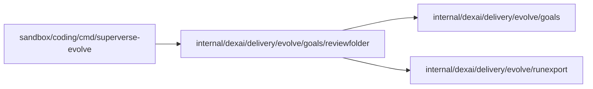

# Placed review folder

<!-- BEGIN GENERATED PACKAGE SUMMARY (scripts/check-package-readmes.py; edit only Purpose) -->
Purpose: Reads a review's folder as place_evolve_export placed it in a workspace, refusing any but the review's own Live runs and the Live build's goals.

Callers: `sandbox/coding/cmd/superverse-evolve` imports this package.

Dependencies: it imports `internal/dexai/delivery/evolve/goals` and `internal/dexai/delivery/evolve/runexport`.

<!-- END GENERATED PACKAGE SUMMARY -->

`Read` reads a review's folder under `.local/superverse-evolve/<review>/` of a repository root:
the workspace of the main agent, or a subagent's worktree, which links the folder at the same
path. It refuses a review ID that is not one EvolveFlow writes (`r-12`), a manifest that names no
source, a source other than `live`, no Project or another review (`runexport.ErrNotLive`), a
manifest without a goals commit or a `runs_sha256`, a `runs.jsonl` whose SHA-256 is not that
digest, a `goals.md` the goals parser refuses and a `metrics.json` that names no evaluation time.
It returns the Live build's goals (`goals.md`), the runs, `metrics.json`'s evaluation time and the
binding of what it read (`goals.ExportBinding`: the review, the goals commit, the runs digest and
count). It never reads the workspace's `.superverse/goals.md`.

The coding image's `superverse-evolve` reads a review only through it
([its contract](../../../../../../sandbox/coding/cmd/superverse-evolve/README.md)) and completes
the binding with the before and base commits. Like `goals` and `runexport`, the package imports
only the standard library, the YAML library and those two packages, so the image builds it from
the source tree; `scripts/check-package-layers.py` keeps it so.
