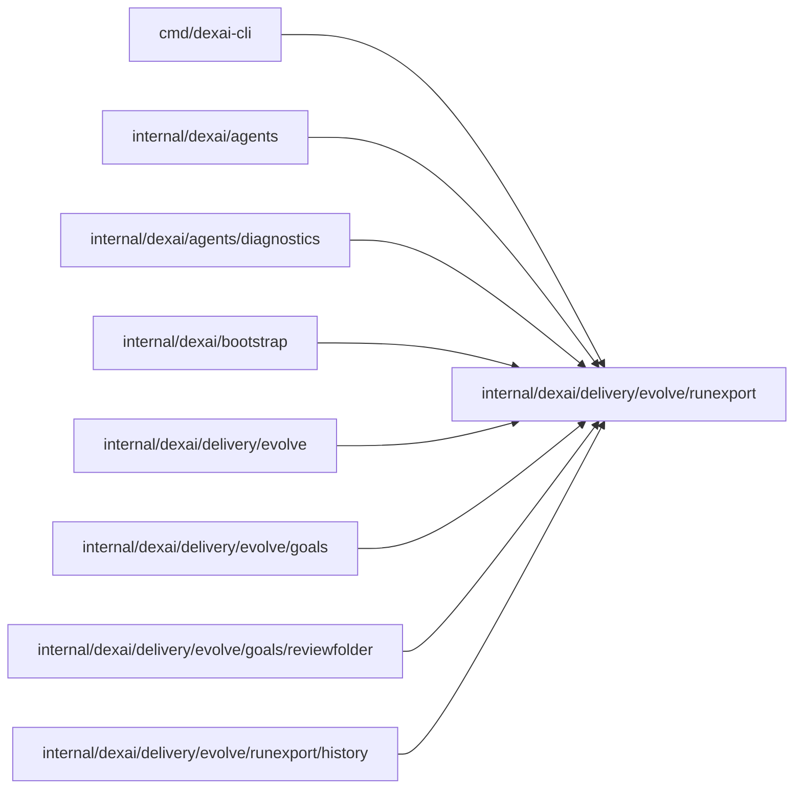

# Exported run records

<!-- BEGIN GENERATED PACKAGE SUMMARY (scripts/check-package-readmes.py; edit only Purpose) -->
Purpose: Declares the run record and manifest of an export of an application's runs, and reads and writes records as JSON Lines.

Callers: `cmd/dexai-cli`, `internal/dexai/agents`, `internal/dexai/agents/diagnostics`, `internal/dexai/bootstrap`, `internal/dexai/delivery/evolve`, `internal/dexai/delivery/evolve/goals`, `internal/dexai/delivery/evolve/goals/reviewfolder` and `internal/dexai/delivery/evolve/runexport/history` import this package.

Dependencies: it imports no other package of this module and calls no remote API.

<!-- END GENERATED PACKAGE SUMMARY -->

A `Record` is one run of one Flow, compacted from its state and history: its identity,
status and times; the release that was Live when it started and the releases that became
Live while it was open; its trial arm (the `evolve-variant` Attribute); the allow-listed scalar
Attributes (`fields`, the last write wins); how often it entered each Step and had each Action
accepted, with the time of the first of each (`steps_first_at`, `actions_first_at`, the latter
for at most 64 Actions); how long it waited in each Step; for an open run, the Step types it is
in at the export time (`ActiveSteps`, which a proposal's open-run check reads); the ordered Step
entries (at most 200, the newest kept); and the token usage and price of its model connector
Steps. No Step or Action input is recorded.

`field_timeline` keeps, per allow-listed field, the distinct values it took in write order, each
with the event time of its write (`[value, time]`; `null` is a deletion), at most 16 per field and
256 KiB of encoded values per record: the oldest are kept and `cut_at` is the time of the first
value left out. `FieldAsOf` reads a field's value at a time from it, the latest write at or before
that time, and answers unknown from `cut_at` on; `FieldMatchedBy` tells whether a field held a
matching value by a time and its earliest such write. Every record that carries timelines and
first times sets `timelines`; a record exported before them answers its current value.

The search that finds a run also supplies `indexed`, the values the engine's search index held
for allow-listed Attributes, keyed by Attribute, and, for an open run, `indexed_active_steps`, the
engine's `ActiveStepTypes` index. Both are fresh at the search and need no history read.

A FlowID's runs form a chain when the engine continues a long Flow in a new run. A record holds
the whole chain when its history was read back to the first run; otherwise it starts at the
oldest run read (`history_from`, also its `started_at`, with no `release_at_start`), with the
Attributes and the Step executions under way that run carried in, and answers unknown before that
time. A run whose own history is longer than the export's event limit is cut there
(`history_truncated`, `history_cut_at`): the record holds no event from the cut on, every field's
timeline is cut there, and its fields and trial arm are the run's current Attributes, read from its
state (`fields_from_state`). A Step or Action that is not in a record may lie in the unread part of
its history, which `HistoryComplete` and `HistoryCovers` let the evaluator tell.

A `Manifest` describes one export: its source, its window, its Flow types, its parts with their
run counts and SHA-256, whether it was truncated, the Live release timeline of the window and
the price table it used. A part the manifest does not list does not exist, which makes the
manifest the export's commit point.

`ActiveSteps` feeds the open-run check of a proposal (`goals.CheckOpenRuns`), which refuses
a change that removes or renames a Step an open run is in. The backtest comparison
(`goals.Compare`) reads the other numbers of a record as the metric evaluator does, matches
estimated runs by their stratum fields and closed state, and places a changed run's landmark
and times its Step outcomes from the `path` entry times and the `steps` counts, which relies
on a truncated path keeping the newest entries.

The source is a closed set (`SourceKind`) and an informational label, not a gate. EvolveFlow
writes `live` on the exports it makes of the Project's Live, published deployment, with the
Project, the review and the goals commit in the manifest, and `ComputeMetrics` checks those fields
of the manifest EvolveFlow has just written (`CheckLive`, `ErrNotLive`); `dexai evolve export`
writes `external`, with the address of the Dex server it read. A manifest stored before the
source was recorded has none; only EvolveFlow stored those. Whoever writes a manifest chooses its
source, Project and review, and `CheckLive` reads only those fields, never the runs or the parts,
so it does not keep the runs of the Preview, of tests or of any other engine out of anything.
Nothing in this package ties a manifest, or a file computed from an export's runs, to the parts a
review stored. Only Live published runs count on the platform (owner rule 2026-10-22); what keeps
other runs out of a review's goal values is EvolveFlow itself, which reads only the Live engine
and evaluates only the parts it exported (see [the evolve package](../README.md)).

`Read` decodes a JSON Lines stream strictly, for the server's own export parts; `ReadPlaced`
decodes a placed or exported `runs.jsonl` accepting record fields it does not know, so a coding
image or `dexai` older than the server that wrote the file still reads it; `Write` appends one
record as `encoding/json` marshals it (`<`, `>` and `&` escaped, as every earlier export wrote
them, so a stored part or a runs object written again on retry has the same bytes) and refuses a
line longer than `Read` accepts (1 MiB). `Canonical` keeps one
run per FlowID, its newest by start, ordered newest first and then by FlowID; `WriteCanonical`
writes those runs as JSON lines and returns their SHA-256 and count, which a review records as
its runs digest and a placed `runs.jsonl` reproduces byte for byte. The package imports only the
standard library, so the coding image's `superverse-evolve` builds it from the source tree;
reading a Dex engine's runs and compacting their history into records is
[`history`](history/README.md).
