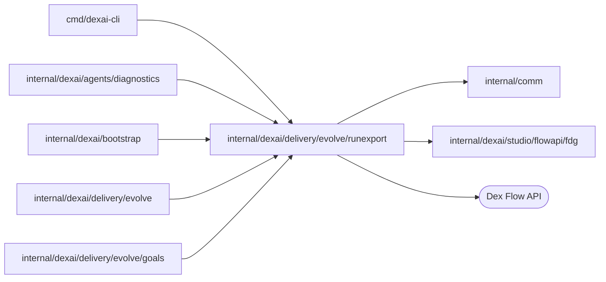

# Exported run records

<!-- BEGIN GENERATED PACKAGE SUMMARY (scripts/check-package-readmes.py; edit only Purpose) -->
Purpose: Declares the run record and manifest of an export of an application's runs, and reads and writes records as JSON Lines.

Callers: `cmd/dexai-cli`, `internal/dexai/agents/diagnostics`, `internal/dexai/bootstrap`, `internal/dexai/delivery/evolve` and `internal/dexai/delivery/evolve/goals` import this package.

Dependencies: it imports `internal/comm` and `internal/dexai/studio/flowapi/fdg` and calls the Dex Flow API.

<!-- END GENERATED PACKAGE SUMMARY -->

A `Record` is one run of one Flow, compacted from its state and history: its identity,
status and times; the release that was Live when it started and the releases that became
Live while it was open; its trial arm (the `evolve-variant` Attribute); the allow-listed scalar
Attributes (`fields`); how often it entered each Step and had each Action accepted; how long
it waited in each Step; for an open run, the Step types it is in at the export time (`ActiveSteps`, which a proposal's open-run check reads); the ordered Step entries (at most 200, the newest kept);
and the token usage and price of its model connector Steps. No Step or Action input is
recorded.

A `Manifest` describes one export: its source, its window, its Flow types, its parts with their
run counts and SHA-256, whether it was truncated, the Live release timeline of the window and
the price table it used. A part the manifest does not list does not exist, which makes the
manifest the export's commit point.

The source is a closed set (`SourceKind`) and an informational label, not a gate. EvolveFlow
writes `live` on the exports it makes of the Project's Live, published deployment, with the
Project, the review and the goals commit in the manifest, and `ComputeMetrics` checks those fields
of the manifest EvolveFlow has just written (`CheckLive`, `ErrNotLive`); `dexai evolve export`
writes `external`, with the address of the Dex server it read. A manifest stored before the
source was recorded has none; only EvolveFlow stored those. Whoever writes a manifest chooses its
source, Project and review, and `CheckLive` reads only those fields, never the runs or the parts,
so it does not keep the runs of the Preview, of tests or of any other engine out of anything.
Nothing in this package ties a manifest, or a file computed from an export's runs, to the parts a
review stored. Only Live published runs count on the platform (owner rule 2026-10-22); what keeps
other runs out of a review's goal values is EvolveFlow itself, which reads only the Live engine
and evaluates only the parts it exported (see [the evolve package](../README.md)).

`Read` decodes a JSON Lines stream strictly and `Write` appends one record. The package
imports only the standard library and `internal/comm`.
