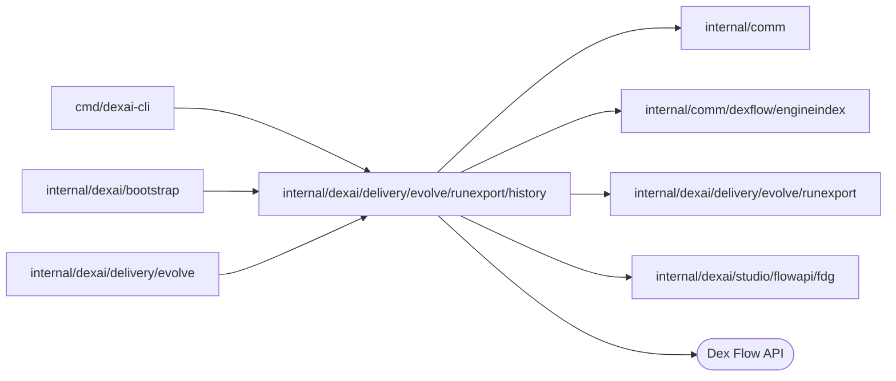

# Run history reader

<!-- BEGIN GENERATED PACKAGE SUMMARY (scripts/check-package-readmes.py; edit only Purpose) -->
Purpose: Reads the runs of one Dex engine through the Flow API and compacts each run's history into an export record.

Callers: `cmd/dexai-cli`, `internal/dexai/bootstrap` and `internal/dexai/delivery/evolve` import this package.

Dependencies: it imports `internal/comm`, `internal/comm/dexflow/engineindex`, `internal/dexai/delivery/evolve/runexport` and `internal/dexai/studio/flowapi/fdg` and calls the Dex Flow API.

<!-- END GENERATED PACKAGE SUMMARY -->

`Engine` searches a Flow type's runs page by page (`SearchPage`, at most `SearchPageSize` a page,
filtered with the FDG contract's visibility query) and reads one run's history in pages up to the
event limit (`Record`, 2,000 events by default). The compactor turns that history into a
`runexport.Record`: Step entries with the first time of each Step, waits, accepted Actions with
the first time of each (for at most 64 Actions), the allow-listed scalar Attributes with each
field's timeline (at most 16 distinct values per field and 256 KiB of encoded values per record,
the oldest kept) and the trial arm, the Step types an open run is in, the ordered path (at most
200 entries, the newest kept) and the model connector usage priced with `Settings.Prices`;
`Settings.Timeline` places the run's release at start and the releases that became Live while it
was open. No Step or Action input is read into a record.

The search entry that finds a run supplies its `indexed` values: an allow-listed Attribute's
value in the engine's search index, keyed by the Attribute (an index key is mapped back through
the index configuration of the run's writes, or is the Attribute's own name), and, for an open
run, the engine's `ActiveStepTypes` index. The engine's other search indexes
([`engineindex`](../../../../../comm/dexflow/engineindex/README.md)) are left out.

The search lists only a FlowID's current run, from its continuation's start when the engine
continued a long Flow in a new run. `Record` reads such a chain back to its first run within the
same event limit, across the chain, and within 32 history pages of the earlier runs, so a chain
of many short runs keeps one record a short Live call; it compacts the chain in order, so the
record's start, release, trial arm, Steps, Actions and timelines are those of the whole Flow. An
earlier run that does not fit whole in either limit, or that the engine no longer holds, ends the
walk: the record then starts at the oldest run read (`HistoryFrom`), with the Attributes and the
Step executions under way that run carried in.

A run whose own history is longer than the limit is cut there. The engine's history order is not
time order, so the cut (`HistoryCutAt`) is the earlier of the last event read and the earliest
unread event of the page the read stopped in, and every field's timeline is cut there. The run's
current allow-listed Attributes and trial variant are then read from its state (`GetAttributes`),
so an Attribute outcome written after the cut is not missed.

EvolveFlow's export of a Project's Live runs and `dexai evolve export` read through this package.
It is separate from `runexport` so that the record, the manifest and the evaluator in `goals`
build without a Dex reader: the coding image's `superverse-evolve` compiles those two packages
from the source tree and never this one.
