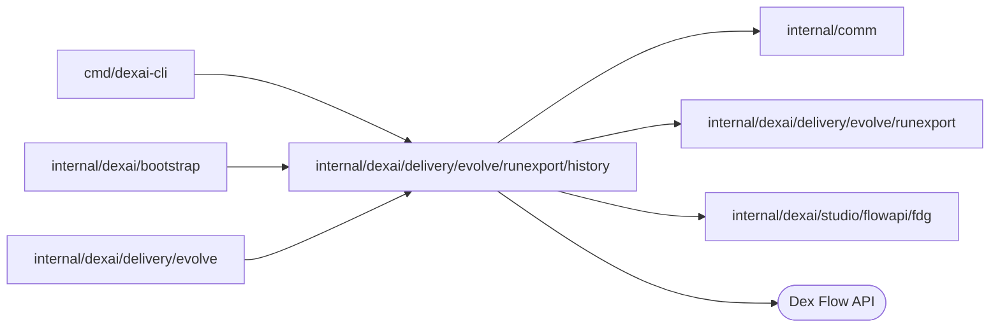

# Run history reader

<!-- BEGIN GENERATED PACKAGE SUMMARY (scripts/check-package-readmes.py; edit only Purpose) -->
Purpose: Reads the runs of one Dex engine through the Flow API and compacts each run's history into an export record.

Callers: `cmd/dexai-cli`, `internal/dexai/bootstrap` and `internal/dexai/delivery/evolve` import this package.

Dependencies: it imports `internal/comm`, `internal/dexai/delivery/evolve/runexport` and `internal/dexai/studio/flowapi/fdg` and calls the Dex Flow API.

<!-- END GENERATED PACKAGE SUMMARY -->

`Engine` searches a Flow type's runs page by page (`SearchPage`, at most `SearchPageSize` a page,
filtered with the FDG contract's visibility query) and reads one run's history in pages up to the
event limit (`Record`). The compactor turns that history into a `runexport.Record`: Step entries,
waits, accepted Actions, the allow-listed scalar Attributes and the trial arm, the Step types an
open run is in, the ordered path (at most 200 entries, the newest kept) and the model connector
usage priced with `Settings.Prices`; `Settings.Timeline` places the run's release at start and the
releases that became Live while it was open. No Step or Action input is read into a record.

EvolveFlow's export of a Project's Live runs and `dexai evolve export` read through this package.
It is separate from `runexport` so that the record, the manifest and the evaluator in `goals`
build without a Dex reader: the coding image's `superverse-evolve` compiles those two packages
from the source tree and never this one.
