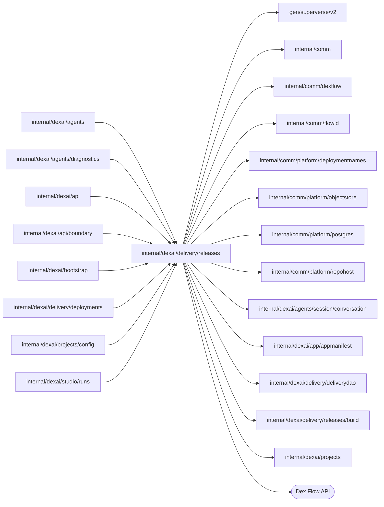

# Release implementation contract

<!-- BEGIN GENERATED PACKAGE SUMMARY (scripts/check-package-readmes.py; edit only Purpose) -->
Purpose: Owns Releases for the API and Live deployment: ProjectReleaseFlow prepares one main-branch commit's source, builds its immutable build revisions through the build port and cleans them up.

Callers: `internal/dexai/agents`, `internal/dexai/agents/diagnostics`, `internal/dexai/api`, `internal/dexai/api/boundary`, `internal/dexai/bootstrap`, `internal/dexai/delivery/deployments`, `internal/dexai/projects/config` and `internal/dexai/studio/runs` import this package.

Dependencies: it imports `gen/superverse/v2`, `internal/comm`, `internal/comm/dexflow`, `internal/comm/flowid`, `internal/comm/platform/deploymentnames`, `internal/comm/platform/objectstore`, `internal/comm/platform/postgres`, `internal/comm/platform/repohost`, `internal/dexai/agents/session/conversation`, `internal/dexai/app/appmanifest`, `internal/dexai/delivery/deliverydao`, `internal/dexai/delivery/releases/build` and `internal/dexai/projects` and calls the Dex Flow API.

<!-- END GENERATED PACKAGE SUMMARY -->

`ProjectReleaseFlow` owns one main-branch commit of a Project: its prepared
source, its immutable build revisions and their cleanup. Build providers live in
[build/](build): the authenticated Local Kind builder in
[build/localbuilder/README.md](build/localbuilder/README.md) and the CodeBuild
builder in [build/hosted/README.md](build/hosted/README.md). The Flow Definition
format the builds render belongs to `internal/dexai/app/appmanifest`.

## Dex Flow Changes

### Identity and execution lifecycle

FlowID is `release-<projectID>-<40-lowercase-hex-main-commit>`, for example
`release-ab12-083ed9fdc1e8f7f039e2f03e092e6e8894f3ce00`. ReleaseID is the
commit. PrepareRelease starts this independent top-level owner with
IDReuseDisallow, a complete actor/request/source/repository/profile Start
RequestID and same-request IgnoreError. Success acknowledges only the known
ReleaseID. A different prepare command joins the same immutable source owner
through typed AlreadyStarted reconciliation; a failed source preparation is
retried through RequestReleaseSourcePreparation with a new complete RequestID
and the expected Release Revision. PrepareRelease is rejected with
FAILED_PRECONDITION when no build provider is configured (Local Kind without a
build token). No dependent Flow is started by an API handler.

The start Step AdmitRelease registers Project cleanup membership before any
source effect. A Project that is already deleting completes the Release through
CompleteReleasePublishing, which records REMOVED and gracefully completes.
PrepareReleasePublishingSource then authorizes the actor against the READY
Project and its admitted repository binding, renders the exact source on the
build provider without an image, validates its strict FDG and AppManifest,
publishes them as immutable objects and registers them through
ProjectReleaseFlowDependency; a version's configuration comes from Live's
next-publish layer when it is published.
CommitReleasePublishingSource records the result as DRAFT, or the failure as
FAILED with its owner and tells the Project's Session of it
([Live failure feedback](#live-failure-feedback)), and the Flow waits.

Each Save and Build admits a separate `build-<UUIDv4>` revision, for example
`build-550e8400-e29b-41d4-a716-446655440000`, into the same Flow. It runs
FreezeReleaseBuildConfiguration → InspectReleaseBuildRevision →
StartReleaseBuildRevision/AwaitReleaseBuildRevision →
PublishReleaseBuildRevision, with CommitReleaseBuildRevision between external
phases. Publish validates the ready build's manifest, Flow Definitions and
requirements against the admitted source before writing any object. Optional
DeployReleaseBuildRevision durably starts the exact Deployment through the
dependency and the accepted expected-Live CAS. A rejected automatic deployment
leaves the build READY; an uncertain acceptance keeps the phase for explicit
recovery, which joins the original deployment under its stable identity. A
draft that lacks what the commit declares is refused before anything is
frozen, with every gap of the configuration host's report.

READY is an open business state, not engine completion. Only Project deletion
admits REMOVING; cleanup settles the active operation, removes exact
source/build artifacts in bounded batches and gracefully completes. Only then
does engine retention apply. Every accepted identity, map entry, pointer,
pending command and receipt is retained for the Release's lifetime; business retries never
intentionally create a new FlowID or RunID. There is no SubFlow.

### Attributes and AttributeMaps

Ordinary Attributes, all set at start:

| Attribute | Value type and purpose |
| --- | --- |
| StartIdentity | `dexflow.StartIdentity`: request fingerprint and actor |
| ProjectID | string; keyword2 index for authorized Project Release lists |
| ReleaseID, SourceCommit | string; the exact lowercase commit |
| BuildProfileVersion, BuildProfileDigest | string; trusted recipe selected at preparation |
| RepositoryBinding | `projects.RepositoryBindingRef`; accepted repository identity and generation |
| ReleaseStatus | string; keyword3 index for status filtering |
| PreparedSource | `PreparedReleaseSource`; status, request/source identity, exact manifest and artifact references, DefinitionRevision (a source prepared before the next-publish layer also holds the seed deployment and build of its per-version draft, which decoding ignores), sanitized failure with its owner (`FailureOwner`, a `conversation.DeliveryOwner`, committed only with the failure and cleared by a retry), up to 128 source request receipts, the provider's measured phases of source preparation (`Timings`) and the commit's `Version` (`repohost.CommitVersion`, its number on main and its subject, computed once by `DescribeCommit` after the reachability check; zero for a source prepared before versions were recorded) |
| ActiveBuildRevisionID, ReadyBuildRevisionID | string; the unsettled and the latest successful build |
| CancellationRequested | bool; admitted Project cleanup fence |
| Failure | optional `dexflow.Failure`; sanitized phase and recoverability |
| Revision | uint64; mutation and phase-commit lock/CAS |
| CreatedAt, UpdatedAt | timestamps |

`ReleaseBuildRevisions` is the one **AttributeMap**, keyed by the exact build
ID above. Each `ReleaseBuildRevision` owns the accepted actor and input
fingerprint, configuration draft revision and frozen reference, recipe pins,
status/revision, provider operation (phase, attempt and up to 128 request
receipts), immutable image/provenance/artifact references,
provider-settled evidence, sanitized failure with its remedy and owner
(`FailureOwner`), automatic-deployment intent and
outcome, its measured phases (`Timings`, at most 16), its
`PreviewValidation` (below) and a person's `Cancellation`
([build cancellation](#build-cancellation)). Its build phase names
are the Step type names. Map cardinality grows
with accepted builds until Project deletion. RPCs load only the requested record
plus, for new-build admission, the one active record; mutations lock the Release
Revision and the exact map instances. An existing key with the same input
returns its original acceptance; changed input under an existing key is
rejected. A new key requires the expected Release Revision and no unresolved
provider job; a settled FAILED or CANCELLED build may be superseded, while
UNKNOWN and an unconfirmed cancellation remain fenced. Normal and terminal reads never hydrate the whole map. No configuration
values or credentials are stored.

**Preview validation.** `PreviewValidation` is how a build met the publishing
rule, decided at admission and never changed: `Kind` (`VALIDATED`, `SKIPPED` or
`LIVE_CODE`, a struct-typed closed set persisted by its names), for `VALIDATED`
the `StartCommandID` and end time (`StartedAt`) of the PreviewFlow
`RecentStarts` entry, for `SKIPPED` the builder's trimmed `SkipReason` (at most
500 code points, which the API enforces), and the `ActorAccountID`. It holds no
secret. A build admitted before it was recorded has none (nil), and its
`preview_validation` column stays NULL.

**Read model.** ReleaseStatus, Revision, SourceCommit, BuildProfileVersion,
PreparedSource, ActiveBuildRevisionID, ReadyBuildRevisionID, Failure, CreatedAt,
UpdatedAt and `ReleaseBuildRevisions` sync to the PostgreSQL read model
(`docs/architecture/teamspace/read-model.md`). The start selects the platform Dex
Attribute Store `releases` (`postgres.ReleaseStore`): it upserts the `releases`
row that the row key `release-{project_id}-{release_id}` splits from the FlowID,
under snake_case columns, and writes each build as its whole
`release_build_revisions` row, deleting the row with the entry. A build's
Fingerprint, BuildProfileDigest, Operation and ExpectedLiveRevision have no
column and are skipped; its ProviderSettled (`provider_settled`), frozen
Configuration (`configuration`, which sets `configuration_revision`),
PreviewValidation (`preview_validation`, migration `0006_studio_setup`),
FailureOwner (`failure_owner`, migration `0008_release_build_failure_owner`)
and Cancellation (`cancellation`, migration `0009_publish_cancellation`) are
synced.
Configuration is a `ReadyConfiguration`: the configuration object's reference
(key, version, digest, media type), the Release ID, two revisions and three
contract digests, so it holds references, revisions and digests and no
configuration value or secret. Sync is asynchronous
latest state: the Flow stays the owner of every fact, and no read uses the
tables yet.

Timings are ordinary `[]dexflow.PhaseTiming` values inside the map entry and
inside PreparedSource, retained with them for the Release's lifetime. A build
revision's Timings start with CONFIGURATION_FREEZE, from the first attempt of
FreezeReleaseBuildConfiguration to the commit of its result
(`releaseBuildPhaseResult.StartedAt` is a measurement, never a deadline). Each
committed provider observation replaces the provider's phases with the ones it
reports, at most 14: QUEUE, HOST_PREPARATION, DEPENDENCY_PREPARATION, ANALYSIS,
COMPILATION and IMAGE_PUBLICATION (`build.Phase*`, documented by each
provider). A provider measures a finished build, so the commit after
AwaitReleaseBuildRevision holds the complete set; a Worker restart during the
wait loses nothing, because the next attempt reads the provider's durable
record. ARTIFACT_PUBLICATION follows, from the first attempt of
PublishReleaseBuildRevision to its commit; automatic deployment is not timed.
Recovery measures again: a new freeze replaces every timing, and the
inspection of a newer provider attempt clears the provider's phases until it is
observed. A build or source preparation that reaches its wait limit records no
provider phases, because its polling Step commits the observation only after
the wait. PreparedSource.Timings holds the provider's phases of source
preparation, which end with ANALYSIS. The API returns both as
`PhaseTiming` entries: `ReleaseBuildRevisionSnapshot.phase_timings` and
`PreparedReleaseSourceSnapshot.phase_timings`, each phase a code constant,
never provider text.

### Channels and ChannelMaps

`ReleaseBuildCommands: ReleaseBuildCommand{Kind,RequestID,BuildRevisionID}` is
the one Channel. Admitted PREPARE, BUILD and REMOVE RPCs produce it;
AwaitReleaseBuildCommands consumes one message at a time. It wakes durable state
already accepted under the Revision lock and is not a deduplication record.
Commands carry no expiry; a stale build wakeup cannot operate on another active
build. ChannelMaps: **None**.

### Streams

`BuildProgress: dexflow.ProgressEvent` is written by CommitReleaseBuildRevision
for each committed phase, by PrepareReleasePublishingSource and
AwaitReleaseBuildRevision when the observed provider state changes and by
CleanupReleasePublishing when its pending stage changes, never once per polling
round, and consumed by snapshot-first WatchRelease. Phase is the Step name only;
the provider state or cleanup stage travels in Detail, a diagnostic that the
API never maps because it can name internal resources; WatchRelease returns the
Phase, the Revision and the event time (`ResourceProgress.created_at`). Its
approximate 10 MiB budget is shared by every instance with the same FlowType and
Stream name in the configured stream backend. Delivery is best effort and may truncate; a
disconnect or lost history recovers from `GetProjectRelease`, never from
messages.

### Steps, RPCs and recovery

RPCs: GetProjectRelease (snapshot), GetReleaseBuildRevision (exact retained map
read), GetDexSummary/GetDexDisplay (ReleaseID and ReadyBuildRevisionID),
RequestReleaseSourcePreparation, RequestReleaseBuildRevision,
RequestReleaseBuildRecovery, RequestReleaseRemoval (Project cleanup only) and
RequestReleaseBuildCancellation ([build cancellation](#build-cancellation)).
The Release snapshot holds only the Attributes above; a build revision's own
status, failure, recipe, image and artifacts stay in its map entry, which the
client pairs with the Release as `BuildSnapshot`. User APIs require Project
ownership or administrator authorization; the API validates request IDs and the
client validates commit and build identities before invoking an RPC.

**Build admission** (`BuildRevision`) runs in the client before
RequestReleaseBuildRevision. Replay comes first: it reads the requested
`ReleaseBuildRevisions` entry, and an existing one goes straight to the RPC,
whose fingerprint comparison returns the original acceptance or refuses changed
input, so a retry after a lost response never meets a check that Preview or
Live changed since. For a new key, admission decides the validation:
`LIVE_CODE` for the Release that the Project's READY Live serves (a
configuration-only build of Live's own code), otherwise `VALIDATED` from the
newest READY start of the commit that `PreviewValidationReader` (
the Session Service) finds in PreviewFlow's `RecentStarts`, otherwise `SKIPPED`
when the request carries a skip reason, and otherwise `ErrPreviewValidationRequired`
(`PREVIEW_VALIDATION_REQUIRED`). Then `ProjectReleaseFlowDependency.CheckReleaseDraft`
refuses a version's frozen copy built before Live, Preview's applied version or
Live's next-publish layer changed (`ErrConfigurationStale`,
`RELEASE_CONFIGURATION_STALE`) and a copy revision other than the requested one
(`REVISION_CHANGED`); `DeriveLiveConfiguration` builds the copy again. Gaps are not
checked here: the freeze refuses them itemized. `PreviewSkipReason` is the last
field of `buildFingerprint`, omitted when empty so earlier fingerprints keep
their hash; the computed validation and the draft checks are not fingerprinted
and are stored on the record. A rollback deploys an existing READY build, so it
never runs admission and keeps its validation.

GetRelease, ListReleases and WatchRelease read the Release's row and the rows
of its active and ready builds (`ReleaseProjection`), seconds behind the Flow,
which leaves the Release's Identity, Repository, BuildProfileDigest and
CancellationRequested and a build's recipe and recovery fields unset; every
write and admission reads the Flow. A read does not wait for source or build
completion. PreparedDefinitions
returns no definitions for a FAILED Release, even when PreparedSource is READY,
so the failure snapshot does not depend on immutable object storage. Other
prepared, non-removing Releases still require their exact source bundle; an
invalid or missing READY artifact remains an error. The bundle is read by the
reference the source preparation recorded after it checked the bundle's owner
(`validatePayloads`): the object store returns exactly that version and digest,
so the read checks the schema and the Flow Definitions but does not compare the
owner again, which a Release read from the read model could not, since its
BuildProfileDigest is not synced. A transient read failure
never changes a Release's durable status or its existing successful build.

State Steps use the shared state preset: ASYNC durability, 30-second deadlines
and two minutes of retries. Provider Steps (AdmitRelease,
FreezeReleaseBuildConfiguration, InspectReleaseBuildRevision,
StartReleaseBuildRevision, PublishReleaseBuildRevision and
DeployReleaseBuildRevision) use SYNC durability, 45-second method deadlines and
three minutes of retries, without locks; their results commit
under the Revision lock in CommitReleaseBuildRevision. The movement options of a
build Step add only its map entry and failure route, so each Step keeps its own
timeouts. Unexpected errors return through `dex.ErrorWithStack` and name the
failed operation and build revision. Without a configured build provider,
AdmitRelease commits "release builds are not configured" as the source failure.

PrepareReleasePublishingSource is one long-running Execute without locks,
under `dexflow.PollingStepOptions(5m30s)`: the 4-minute source preparation
plus the 45-second work before and after it. Each attempt authorizes
the actor, checks the commit on main and inspects the provider's source
preparation, dispatching it only when inspection finds it missing (or failed
under an older attempt), so a retry after a lost response joins the accepted
work. It then polls Inspect every 2 seconds, each
round within 10 seconds, through `dexflow.PollUntil`, writes BuildProgress when
the observed state changes, and validates, publishes and registers the rendered
source; each step before and after the wait has a 45-second deadline, and
`dexflow.KeepAlive` heartbeats every 20 seconds throughout. The engine owns the
wait limit (ExecuteMethodTimeout and ExecuteRetry.TotalDuration across every
attempt); the Step computes no deadline. A refusal that the same request
meets again (`errSourceRejected`: a forbidden actor, a Project that is not READY
with the admitted binding, a commit off main, a provider result other than
READY or an invalid manifest or FDG) moves straight to
CommitReleasePublishingSource as the failure, with its reason; other errors are
retried and, once exhausted or at the wait limit, reach RecordReleaseFailure,
which forwards the recovery error, saying that source preparation did not
finish within 5m30s when `dexflow.RecoveryTimedOut` reports the limit. Work the
provider still runs then is not cancelled: the provider's own limit ends it,
and an explicit source retry starts a newer attempt. CommitReleasePublishingSource commits either outcome under the
Revision lock; a failure waits for an explicit retry.

AwaitReleaseBuildRevision waits for the accepted provider build in one
long-running Execute (`dexflow.PollUntil`): every 10 seconds it reads the owning
Project and inspects the build, each round within 20 seconds, and heartbeats.
It holds no lock and loads only its map entry; the Release
Revision and the entry are locked only by the CommitReleaseBuildRevision that
records the final observation once. Under
`dexflow.PollingStepOptions(180m)` a new attempt covers a lost Worker or
a failed call; the engine's 180-minute wait limit across every attempt outlasts
CodeBuild's 120-minute queue and 45-minute build limits. A build still RUNNING at
the limit fails into RecordReleaseBuildFailure, which records that the build did
not finish within the 180-minute wait. When the
Project starts deletion, Await yields to AwaitReleaseBuildCommands, whose REMOVE
command cancels the build in cleanup. UNKNOWN is committed as a failed build.
Recovery resumes from configuration freezing, from inspection with a new
provider attempt, or from the idempotent automatic deployment; only a strictly
newer source-only attempt may bind a new trusted build executor.

CleanupReleasePublishing runs bounded, idempotent cleanup rounds every 2
seconds, each within 40 seconds, in one long-running Execute without locks, under
`dexflow.PollingStepOptions(30m)`. A round cancels the
active build, whose termination may still be pending, fences and reclaims the
provider's namespaces of the Release (at most eight hosted receipts per call)
and deletes at most 16 object versions; `build.ErrPending` keeps the loop going
and writes BuildProgress when the waiting stage changes. The engine's wait limit
is 30 minutes across every attempt, the cleanup wait limit of the deleting
Project; unfinished cleanup then fails into
RecordReleasePublishingCleanupFailure, which records that cleanup did not finish
within 30 minutes, and the Project's next removal request admits another
wakeup. Cleanup without the owner's admission is a programming error
and panics.

The failure-record Steps write the cause of the last failed attempt,
`ctx.RecoveryError().Detail` truncated to 2 KiB, as the Failure message:
RecordReleaseFailure through CommitReleasePublishingSource,
RecordReleaseBuildFailure and RecordReleasePublishingCleanupFailure directly,
prefixed with the wait limit when the failed polling Step reached it. A failed
build's message carries the
provider's bounded reason (`BuildResult.Failure`), never build output.

External operations are retry safe. A provider build is identified by the
Release's request fingerprint, its build revision and its attempt; every
dispatch is preceded by Inspect, and a lost Start response is reconciled by
inspection, never by another dispatch of the same attempt. Cancel and
CleanupRelease are idempotent and report `build.ErrPending` until confirmed.
Artifacts are immutable objects under
`<project>/releases/<commit>/<buildRevisionId>/`, whose writes read before
writing and accept only identical content. An automatic deployment uses the
build UUID as its DeploymentID and `release-auto-<fingerprint>` as its request,
so a retry joins the accepted deployment.

### Build cancellation

[the current contract](../../../../docs/architecture/studio-setup/flow-changes.md)
lets a person cancel the active build until its artifacts commit. Status
`CANCELLED` joins the one status set; the Release's ReleaseStatus mirrors its
last build, as for FAILED, and the Release stays open. Phase
`CancelReleaseBuildRevision` joins the persisted build phases.

`ReleaseBuildRevision.Cancellation *BuildCancellation{RequestID,
ActorAccountID, RequestedAt, Phase, SettledAt}`, nil until a person cancels,
is set once by the RPC and settled once by the commit, both under the Release
Revision lock and the instance's lock; `Phase` is the build phase at
admission. It syncs to `release_build_revisions.cancellation` and holds no
secret. It is not `CancellationRequested`, the Project cleanup fence.

**RPC `RequestReleaseBuildCancellation(BuildRevisionCancellation{BuildRevisionID,
RequestID, ActorAccountID})`** (Revision lock; the client loads and locks only
the instance) answers `buildRevisionResult`. `ProjectReleaseFlowClient.CancelBuildRevision`,
behind `ReleaseService.CancelReleaseBuild`, validates the build ID and
authorizes the actor with the build capability on the READY Project. In order:
no entry is NOT_FOUND; an entry with `Cancellation` is accepted unchanged, for
any RequestID; Project deletion (`CancellationRequested`) is
FAILED_PRECONDITION; a build READY with `AutoDeploy`, or in
`DeployReleaseBuildRevision`, is refused `DEPLOYING` with its deployment ID
(the build UUID; `BuildDeployingError`, reason `RELEASE_BUILD_DEPLOYING`,
remedy cancel the deployment, with ErrorInfo metadata `deploymentId`); a build
that is not the active one, or not PENDING, BUILDING or RECOVERING, is refused
`NOT_CANCELLABLE` (`ErrBuildNotCancellable`, reason
`RELEASE_BUILD_NOT_CANCELLABLE`); any other is admitted. A Release that no
longer runs answers from its retained build: NOT_FOUND without it, accepted
when it was cancelled, `NOT_CANCELLABLE` otherwise. Admission records the cancellation, sets the phase to
`CancelReleaseBuildRevision` and returns `NextSteps` with that Step for the
build and `CancelSteps` of every Step the build's chain can be in:
ResumeReleaseBuildRevision, the five build Steps but Deploy,
CommitReleaseBuildRevision, RecordReleaseBuildFailure, NotifyReleaseFailure,
AbandonReleaseFailureNotification and AwaitReleaseBuildCommands. A running
Step reads the Attributes its attempt started with, so it never sees a later
cancellation; preemption, not a polling check, ends it. A cancellation
committed first cancels the queued commit that would record the artifacts, so
a cancelled build never becomes READY; a commit first moves the phase or the
status, and the RPC answers by the order above.

**Step `CancelReleaseBuildRevision`** (`dexflow.PollingStepOptions(15m)`, no
lock, failure route RecordReleaseBuildFailure): under Project deletion it moves
to CleanupReleasePublishing; a build without a frozen configuration never
reached the provider and settles at once; otherwise every 5 seconds, each round
within 40, it calls `Builder.Cancel`, which reads the provider's record first
(`build.ErrPending` keeps polling, nil ends the wait, then one `Inspect` under
`dexflow.KeepAlive` reads the final phases), and `build.ErrCancelUnconfirmed`
settles unconfirmed. CommitReleaseBuildRevision then commits CANCELLED,
`ProviderSettled` unless unconfirmed (failure `BUILD_CANCEL_UNCONFIRMED`,
platform, contact the operator), the provider's phases, `SettledAt`, and keeps
the build active; nobody is told. RecordReleaseBuildFailure settles a
cancellation whose Step exhausted its retries or wait limit unconfirmed with
the cause, and moves any other failure of a cancelled build to the Step.
BuildProgress carries `CancelReleaseBuildRevision` frames.

Boundaries: Resume resumes the phase at the Step; Freeze, Inspect, Start,
Await, Publish and Deploy, and CommitReleaseBuildRevision for another phase,
move a build with `Cancellation` there before any effect, beside their
Project cleanup check: only a stale wakeup, a recovery or an open execution
reaches them. A BUILD command still pending is consumed after the settling
commit and ignored, because the build is no longer PENDING or RECOVERING.
`recoverable` admits CANCELLED without `ProviderSettled`, and `admitRecovery`
resumes the cancellation under the same attempt. A preempted short Step runs
to its end on its Worker, its decision discarded: a Start whose request lands
after the cancellation found nothing is refused by the provider, which records
that attempt cancelled (hosted, a CANCELLED head; locally, a FAILED `CANCELLED`
state), and objects a preempted Freeze or Publish wrote are immutable and go
with the Release. Compatibility: the RPC,
the Step and the field are additive; an entry without `Cancellation` decodes
nil.

### Live failure feedback

The Release tells the Project's Session when it fails, through the narrow port
`DeliveryFeedback.ReportDeliveryFailure(ctx, DeliveryFailure)`, which
`agents.SessionFlowService` implements and the composition root injects
into this Flow and ProjectDeployFlow (`delivery_feedback.go`). It adds no
status and no transition: the Step that commits a failure decides its owner
and, outside cancellation, goes on to NotifyReleaseFailure instead of
AwaitReleaseBuildCommands; NotifyReleaseFailure returns there. A failure that
Project cleanup's CancellationRequested fences is told nobody.

| Hook | Step that commits the failure | Failure | Owner | Remedy |
| --- | --- | --- | --- | --- |
| H1 | CommitReleasePublishingSource | `RELEASE_SOURCE_FAILED` decided by PrepareReleasePublishingSource for the commit's own source (`errSourceInvalid`): the build provider's strict analysis of its manifest and Flow Definitions failed, or its dex-app.yaml is invalid (`appmanifest.ErrInvalidAppManifest`) | application | ask the Agent |
| H1 | same | `RELEASE_SOURCE_FAILED` for any other refusal (`errSourceRejected`: actor, Project, commit, provider result or rendered image), from RecordReleaseFailure (exhausted retries or the wait limit) and without a build provider at AdmitRelease | platform | publish again |
| H1 | same | `RELEASE_SOURCE_FAILED` after a hosted builder's fixed platform failure category (including unsupported build tools or a missing category) | platform | publish again |
| H2 | CommitReleaseBuildRevision | `BUILD_FAILED`, a build the provider reported failed | application | ask the Agent |
| H2 | same | `BUILD_FAILED` with a hosted builder's fixed platform failure category | platform | publish again |
| H2 | same | `BUILD_UNKNOWN` | platform | contact the operator |
| H2 | same | a rejected automatic deployment (`AutoDeployFailure`, its rejection code; the build stays READY) | platform | publish again |
| H3 | RecordReleaseBuildFailure | `RELEASE_BUILD_FAILED` of a draft that FreezeReleaseBuildConfiguration refused with its gaps, "Configure ... in Setup · Live, then publish again." | configuration | open Setup |
| H3 | same | Any other `RELEASE_BUILD_FAILED`: exhausted retries, a wait limit, an unknown automatic deployment | platform | publish again |

Each row is one `releaseFailureKind` of `release_failure.go`, declared once with its code, owner and remedy;
`RELEASE_CLEANUP_FAILED` is a platform kind whose remedy is to contact the operator. The failure records its
remedy (`dexflow.Failure.Remedy`), and the build revision keeps the owner beside it in
`ReleaseBuildRevision.FailureOwner` (`conversation.DeliveryOwner`), as `PreparedReleaseSource.FailureOwner` does
for the source; a recovery clears both.

The owner comes from the producing Step with its typed cause, never from the
code or a message: PrepareReleasePublishingSource sets it on the input of
CommitReleasePublishingSource (`rejectedSource`), AdmitRelease and
RecordReleaseFailure set platform, CommitReleaseBuildRevision reads it from the
committed observation or the automatic deployment's rejection
(`committedFailure`), and RecordReleaseBuildFailure from its input. The
configuration refusal is a decision: `ProjectReleaseFlowDependency.FreezeReleaseConfiguration`
answers a draft that the configuration host refuses (`projectconfig.ErrNotReady`
or `ErrConflict`) with the gaps of `Configuration.CheckRequirements` for the
commit's Live draft, and FreezeReleaseBuildConfiguration moves straight to
RecordReleaseBuildFailure with them in `releaseBuildStepInput.Gaps`, which
records "Configure ... in Setup · Live, then publish again". A
refusal without gaps stays an error that the Step asks again.

The hosted provider's fixed `FailureCategory` rides in a build observation and
determines application versus platform ownership for a FAILED build; an old
observation without the field keeps the local provider's application behavior.
The FlowID, Step IDs, requests, retained Attributes, Channels and Streams are
unchanged; no new Run is created for this classification.

NotifyReleaseFailure takes the failure as its input, a `DeliveryFailure`
built by the hook from the state it commits: the ID, the Project, the source
`release`, the owner, the commit, the build revision (`ResourceID`, empty for
the source), the committed `dexflow.Failure`, the gaps and the time of the
commit. The ID names the Revision of that commit, never a later one:
`release/<releaseID>/source/r<revision>` for H1, for example
`release/083ed9fdc1e8f7f039e2f03e092e6e8894f3ce00/source/r4`, and
`release/<releaseID>/<buildRevisionID>/r<revision>` for H2 and H3. A retry, a
Worker restart or a recovery admitted while the Step runs therefore repeats
exactly the same ID, which the Session's `NotificationReceipts` admit once; a
recovery that fails again commits a new Revision and is told again. The Step
makes one call of the port under `dexflow.ProviderStepOptions()` without a
lock and saves nothing; once its retries are exhausted its failure route,
AbandonReleaseFailureNotification (the same input, because a failure route
keeps the input), drops the notification and returns to
AwaitReleaseBuildCommands. A command admitted meanwhile waits in
ReleaseBuildCommands. The Session builds the notification from the input
alone: a `failure` when the application owns it, a `notice` otherwise, and
only an application failure of the Session's HEAD may open an automatic turn.

The owner of a failure is `conversation.DeliveryOwner` (application,
configuration, platform), the one owner set; `DeliverySource` (release,
deployment) is a struct-typed closed set persisted by its names.

Compatibility: since 2026-10 `ReleaseBuildRevision.Timings`,
`PreparedReleaseSource.Timings`, `buildObservation.Timings` and
`releaseBuildPhaseResult.StartedAt` are added and, like the changes below, are
not migrated into open executions. The hosted build result is schema v2, so an
in-flight hosted build whose runner wrote v1 fails verification and is settled
before the upgrade. The polling Steps changed StepOptions and inputs
(`buildObservation.Failure`; since 2026-10 `releaseBuildStepInput.Reason`, which
carried only a deadline failure, is removed and ignored when an open
execution's input still holds it), AwaitReleaseBuildRevision
lost its WaitFor and `buildOperation.StartedAt` was removed. An open execution
inside the old AwaitReleaseBuildRevision timer or source preparation attempt is
not migrated: Local Kind is recreated empty, and hosted environments need an
authorized cleanup of open executions before the upgrade. The Live failure
feedback is a pre-launch replacement too: the Steps NotifyReleaseFailure and
AbandonReleaseFailureNotification, `PreparedReleaseSource.FailureOwner` and
`releaseBuildStepInput.Gaps` are new, and the local lanes and AWS delete their
Projects before the rollout.

## Database Schema Changes

None beyond the read model's `releases` and `release_build_revisions` tables
(migration `0002_read_model`) and their later columns, the last the nullable
`release_build_revisions.cancellation JSONB` of `0009_publish_cancellation`
(no backfill), which only Dex writes from the synced Attributes above. Release Flow Attributes and the AttributeMap own admission and build
lifecycle; versioned objects hold immutable payloads. The configuration owner
holds Live's next-publish layer, per-commit frozen copies, immutable snapshots
and environment-wide credentials.
Credentials are not pinned into build revisions.

## UI/UX

Publishing selects a main commit, prepares its FDG, builds the version's frozen
copy from Live's next-publish layer and builds an immutable revision of it.
Deploy chooses the exact successful revision. A newer failed or pending build
does not invalidate the previous successful revision or change the running Live
Deployment. Automatic
deploy is an explicit unchecked-by-default option with expected-Live CAS.

## Tests

The Live failure feedback runs in the Session Service's Dex integration tests
([internal/dexai/agents](../../agents/README.md#tests)): a Release of a checkpoint
whose Flow source does not compile notifies the application's H1 failure of
the Session's HEAD, which opens an automatic turn, and a retried preparation
notifies again under its new Revision; a build of an unconfigured draft gives
the configuration's H3 notice with its gaps and a rejected automatic
deployment the platform's H2 notice, neither opening a turn.

Build cancellation runs in `internal/dexai/agents`
`TestReleaseBuildCancellationDexIntegration` on the actual Worker of a local
lane: a build cancelled before the provider (with a replay and another
request), one cancelled while AwaitReleaseBuildRevision polls across a Worker
restart (one commit, a new build admitted only once it settled, its provider
build no longer running), a cancellation racing the artifact commit (CANCELLED
without artifacts or READY and refused), the refusals, the read model's
`cancellation` column and the redacted, paged and shared build log of a READY
build. `TestDeploymentCancellationDexIntegration` checks that a build whose
automatic deployment started refuses with that deployment. The retained sync
test compares the `cancellation` column too.

`local_builder_integration_test.go` calls the actual authenticated local builder
with a completed image-build request from
`SUPERVERSE_TEST_BUILD_FIXTURE_REQUEST` and requires its six measured phases.
Its `TestReleaseBuildTimingsWorkerRestartIntegration` admits a new build of
that request's Release through the Flow client against the existing Worker of
the local lane (`SUPERVERSE_TEST_DEX_ADDRESS`,
`SUPERVERSE_TEST_LANE`), replaces the
Worker through `dexflowtest.RestartServerForTest` while AwaitReleaseBuildRevision polls
and requires a failed attempt of that Step and
a READY build whose Timings are CONFIGURATION_FREEZE, the builder's six phases
exactly as it reports them and ARTIFACT_PUBLICATION. It needs a Release
without an active build whose fixture build froze the draft's current
revision; the new build stays until Project deletion removes the Release.
`build/hosted/builder_integration_test.go` (build tag `hosted`) runs a real
CodeBuild/ECR/S3 build revision, its measured phases and its Release cleanup
fence. Missing prerequisites fail. Concurrent Save/Build, stale replay,
more than 128 build revisions, unknown build responses, recovery of an
automatic deployment whose acceptance response was lost (expected ACCEPTED or
joined), exact map loading, Stream loss, cleanup response
loss, and the other polling Steps that resume after a lost Worker within their wait limit
or record their failure when the engine ends them at that limit remain
real-dependency obligations; static compilation and FDG checks do
not establish them.

## Documentation

The canonical architecture is `docs/architecture/superverse-v2.md`; the
generated graph is `docs/flows/sv2-releases-flow.json`.

## File map

| File | Responsibility |
| --- | --- |
| `project_release_flow.go` | Flow primitives, registration, RPCs and Steps |
| `project_release_flow_state.go` | Persisted and RPC types, status/command/phase names and build-revision transitions |
| `project_release_flow_client_projection.go` | `ReleaseProjection`: a Release of the read model with its active and ready builds, decoded from the `deliverydao` rows; `ReadProjection` waits for a new Release's row (`postgres.AwaitRow`), `ListProjections` pages them |
| `delivery_feedback.go` | The `DeliveryFeedback` port, `DeliveryFailure` and `DeliverySource`, and the failure a Release hook reports |
| `project_release_flow_phases.go` | Step effects: Project membership, source preparation, build provider calls and cleanup |
| `release_artifacts.go` | Builder bundle and payload validation, artifact publication and definition reads |
| `project_release_flow_client.go`, `project_release_flow_client_build.go` | Release client: prepare, build, recover, reads and cleanup |
| `build/` | Builder port and wire types, embedded build profiles, local and hosted builders |

Live source preparation resolves `github.com/superdurable/dex/sdk-go` with the isolated Go toolchain after replacements. The selected version must be at least `v1.13.0`; missing, local-path, malformed and older selections produce the typed application rejection `unsupported-dex-sdk` with an upgrade hint. Preliminary module metadata rejects invalid replacements before downloads; the offline selected module check follows dependency preparation. No selected version is retained in state, artifacts or logs.
