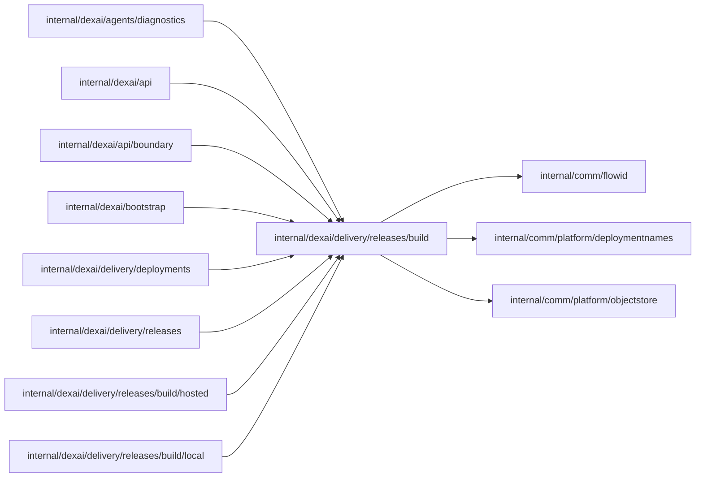

# Release build boundary

<!-- BEGIN GENERATED PACKAGE SUMMARY (scripts/check-package-readmes.py; edit only Purpose) -->
Purpose: Declares the `Builder` port that builds Release images for ProjectReleaseFlow, its wire types and the embedded build profiles, which the `local` and `hosted` packages implement.

Callers: `internal/dexai/agents/diagnostics`, `internal/dexai/api`, `internal/dexai/api/boundary`, `internal/dexai/bootstrap`, `internal/dexai/delivery/deployments`, `internal/dexai/delivery/releases`, `internal/dexai/delivery/releases/build/hosted` and `internal/dexai/delivery/releases/build/local` import this package.

Dependencies: it imports `internal/comm/flowid`, `internal/comm/platform/deploymentnames` and `internal/comm/platform/objectstore`.

<!-- END GENERATED PACKAGE SUMMARY -->

The external Release build boundary: the `Builder` port and its wire types and the
embedded build profiles. The Release Flow imports this package; it never imports the
Flow. Each implementation is a sub-package that only `internal/dexai/bootstrap` imports:
[`hosted`](hosted/README.md) on CodeBuild, ECR and S3, and [`local`](local/README.md),
the client of the [Local Kind build fixture](localbuilder/README.md); both document their
protocols.

Besides inspection, start, cancellation and Release cleanup, the port reads a
build's log in pages (`ReadLog` with a `LogRead`: the page after a cursor that an
earlier `LogPage` returned, or with `Tail` the log's end, at most a number of
bytes of whole lines; a single longer line is cut). A `LogPage` holds the text,
the cursor after it and `Complete` once the provider build no longer runs and
nothing follows; a build the provider never ran has an empty, complete page.
Hosted the cursor is the admission's attempt and CloudWatch's
`nextForwardToken`, locally an absolute byte offset; a cursor no page returned
is `ErrInvalidLogCursor`, and a read a provider rate limit refused is
`ErrLogThrottled`, which the caller defers. The log is build output; the
caller redacts it, and nothing stores it.

`Cancel` reads the provider's record before it stops anything and returns
`ErrPending` until termination is observed. `ErrCancelUnconfirmed` is the
answer waiting cannot change: the fixture lost the job, or could not stop its
exact child processes, or CodeBuild no longer finds the execution its
admission names. ProjectReleaseFlow settles such a build CANCELLED without
`ProviderSettled`.

The product-owned `go-react-v1` Dockerfile serves both local and hosted Release
builders: `bp1` and the hosted `bp2`, which adds its Docker configuration. The local
lanes select `bp3` for new Releases (`Profiles.SelectLocalDefault`), the same recipe
with the module redirect of the [local build service](localbuilder/README.md#release-candidates)
in its `go-modules` stage, so a connector's release candidate that only the local Git
host's copy holds builds. `bp1` stays registered for the builds it accepted. Its `go-modules` stage downloads the OpenAPI tool and application
modules into `/go/pkg/mod` in immutable image layers, keyed by their manifests.
The application's source is copied only into `go-build`, which generates code,
runs tests and vet, and compiles with `--network=none`, `GOPROXY=off` and
`GOSUMDB=off`. The compiler and npm download cache mounts accelerate builds but
are disposable; module availability never depends on a cache mount. Digest-pinned
base images and the profile digest still identify the complete trusted recipe.

Run `python3 scripts/check-release-build-cache.py` to build the tracked
`app-template/` twice on a dedicated BuildKit builder, pruning only that builder's
execution cache mounts between builds. The second build reuses the module layers
and forces `go-build` to execute with an empty compiler cache. The script retains
build logs, image metadata and OCI archives in its reported temporary directory,
then removes its dedicated builder; it does not prune the shared local builder.
Use `--builder <existing-builder>` when its pinned base images are already local.
Both modes use unique cache IDs and prune only the mounts those IDs created;
the verification copy changes only cache IDs, leaving the recipe's commands,
network policy and image pins intact. It requires both online download layers
to be reused on the second build so rerunning downloads cannot hide a failure.

| File | Responsibility |
| --- | --- |
| `builder.go` | The `Builder` port |
| `build_request.go` | Build requests, results with their measured phases, identities and image tags |
| `failure_category.go` | The typed hosted failure categories and their ownership, passed to the runner and retained by the provider |
| `build_profile.go` | The embedded build profiles in `build-profiles/` |
| `localbuilder/` | The Local Kind build fixture, a Python service that `local.Builder` calls; it keeps its directory because the Kind behavior fingerprint hashes its file names |

## Live SDK floor

Live source preparation resolves `github.com/superdurable/dex/sdk-go` after replacements. The selected version must be at least `v1.13.0`. Missing, local-path, older or otherwise unsupported SDK selections produce the typed application rejection `unsupported-dex-sdk` with an upgrade hint. A failed Go invocation, including an unparseable module file, is a platform metadata-command failure rather than an SDK selection rejection.

Both fixed module downloads and both SDK metadata commands share one owned dependency container. Metadata commands execute no application code and disable network fetching with readonly/local-toolchain settings. Bounded metadata stdout is parsed only in memory. The [local builder](localbuilder/README.md) owns its `METADATA_COMMAND_FAILED` / `METADATA_COMMAND_TIMEOUT` diagnostics and UNKNOWN reconciliation; the [hosted runner](hosted/README.md) owns its safe category mapping. Only an explicit cancellation request reports `CANCELLED`.
